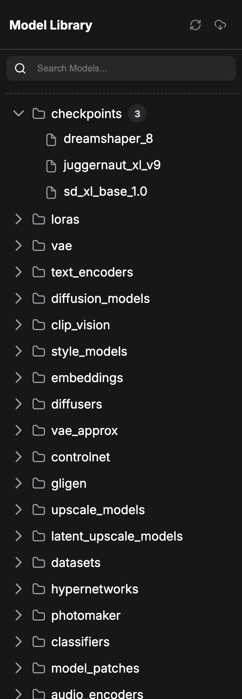

Der Eintrag **Models** in der linken Seitenleiste öffnet die Modellbibliothek. Nach dem Start von ComfyUI listet sie die Modellordner und -dateien auf, die unter Ihrem `ComfyUI/models`-Verzeichnis erkannt werden (sowie alle zusätzlichen Modellpfade, die Sie konfiguriert haben). Nutzen Sie sie, um nach Namen zu suchen, nach Ordnertyp zu durchsuchen, Metadaten in der Vorschau anzuzeigen und ein Modell auf den Canvas zu ziehen, um den passenden Loader-Node einzufügen.

Die Verfügbarkeit hängt von der Version ab:

- **Self-hosted / Desktop**: Die Seitenleiste zeigt eine Ordnerstruktur der lokalen Modelldateien. Unter Desktop erscheinen laufende Downloads oben im Bereich, und das Symbol in der Seitenleiste kann ein Badge mit der Download-Anzahl anzeigen.
- **Comfy Cloud**: Wenn das Assets-System verfügbar ist und **Use the asset browser for the model library** aktiviert ist (Cloud-Standard), öffnet ein Klick auf **Models** den Asset-Browser für Modelle statt der Struktur in der Seitenleiste. Wie Sie eigene Gewichte hochladen oder importieren, lesen Sie unter [Modelle importieren](/de/cloud/import-models).

Mediendateien (Bilder, Video, Audio, 3D) werden hier nicht aufgelistet. Diese finden Sie unter [Assets](/de/interface/assets).

## Modellbibliothek öffnen

Klicken Sie in der linken Seitenleiste auf das Symbol **Models**. Der Titel des Panels lautet **Model Library**.

## Nach Ordner durchsuchen

Ohne Suchbegriff listet das Panel die Stammordner der Modelle auf (zum Beispiel `checkpoints`, `loras`, `vae`, `controlnet`, `diffusion_models`, `upscale_models`, `text_encoders` und weitere, die der Server zurückgibt). Erweitern Sie einen Ordner, um seine Dateien zu laden.

Standardmäßig laden Stammordner ihren Inhalt, sobald Sie sie öffnen. Das können Sie in den Einstellungen ändern:

- **Alle Modellordner automatisch laden** (`Comfy.ModelLibrary.AutoLoadAll`): Ist die Option an, wird jeder Ordner geladen, sobald Sie die Bibliothek öffnen (kann bei großen Bibliotheken langsam sein). Ist sie aus (bei Self-Hosting standardmäßig an), lädt ein Ordner erst beim Erweitern. Diese Einstellung ist in Comfy Cloud ausgeblendet.
- **Welcher Name in der Baumansicht der Modellbibliothek angezeigt wird** (`Comfy.ModelLibrary.NameFormat`): `title` (Standard) verwendet die Titel aus den Modell-Metadaten, sofern verfügbar; `filename` zeigt einen vereinfachten Dateinamen ohne Verzeichnis und ohne die Erweiterung `.safetensors`.

Ist das Assets-Feature-Flag ausgeschaltet, erscheint im Kopfbereich des Panels neben Aktualisieren die Schaltfläche **Alle Ordner laden**.

## Suche

Das Suchfeld oben filtert Modelle während der Eingabe nach Namen und zugehörigen durchsuchbaren Feldern. Beim Suchen werden alle Ordner geladen, damit die Ergebnisse vollständig sind. Die Ergebnisse werden in der Baumansicht automatisch erweitert. Wenn mehr als 500 Modelle übereinstimmen, zeigt das Panel einen Hinweis auf begrenzte Ergebnisse an. Verfeinern Sie die Suchanfrage, um die restlichen Ergebnisse zu erreichen.

## Vorschau und Aktualisieren

Bewegen Sie den Mauszeiger über ein Modellblatt, um eine Vorschaukarte zu öffnen, wenn Metadaten verfügbar sind. Die Karte kann Titel, Dateiname, Architektur, Autor, Bildvorschau, Nutzungshinweis, Auslösephrase und Beschreibung anzeigen.

Verwenden Sie die Schaltfläche „Aktualisieren“ in der Kopfzeile des Panels oder drücken Sie `r` (`Comfy.RefreshNodeDefinitions`), nachdem Sie bei laufendem ComfyUI Modelldateien hinzugefügt oder entfernt haben. Diese Aktualisierung lädt auch die Node-Auswahllisten neu, sodass Loader-Widgets neue Dateien übernehmen.

## Ein Modell auf den Canvas ziehen

Modelleinträge lassen sich ziehen. Ziehen Sie einen davon auf den Canvas, um den diesem Ordner zugeordneten Loader-Node zu erstellen (zum Beispiel `CheckpointLoaderSimple` für `checkpoints`, `LoraLoader` für `loras`, `VAELoader` für `vae`, `UNETLoader` für `diffusion_models`, `CLIPLoader` für `text_encoders` sowie weitere im Frontend registrierte Zuordnungen). Das passende Widget wird mit dem Dateinamen des Modells gefüllt.

Wenn für einen Ordnertyp keine Loader-Zuordnung registriert ist, wird beim Ablegen möglicherweise kein Node erstellt. Fehlende Modelle, die ein Workflow erwartet, erscheinen weiterhin unter der Registerkarte **Errors** im [Right Side Panel](/de/interface/right-side-panel), mit Aktionen zum Herunterladen oder Importieren, sofern verfügbar.

## Zugehörige Einstellungen

| Einstellung | Wo | Funktion |
| --- | --- | --- |
| Alle Modellordner automatisch laden | `Comfy` → Modellbibliothek | Jeden Ordner beim Öffnen laden statt beim Erweitern |
| Namensformat | `Comfy` → Modellbibliothek | `title` oder `filename` in der Baumansicht anzeigen |
| Asset-Browser für die Modellbibliothek verwenden | Experimentell / Cloud-orientiert | Öffnet den Asset-Browser anstelle des Seitenleisten-Baums, wenn Assets aktiviert sind |

## Verwandte Seiten

- [Benutzeroberfläche im Überblick](/de/interface/overview)
- [Assets](/de/interface/assets) (Mediendateien, keine Modellgewichte)
- [Modelle importieren](/de/cloud/import-models) (Cloud)
- [Rechte Seite](/de/interface/right-side-panel) (Fehler bei fehlenden Modellen)
- [Comfy-Einstellungen](/de/interface/settings/comfy) (Bereich Modellbibliothek)
