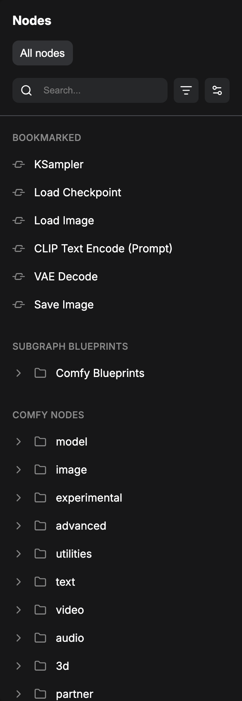
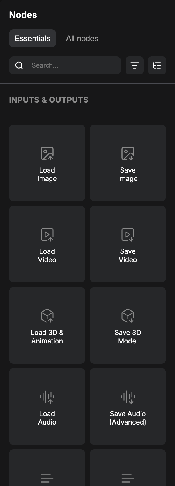
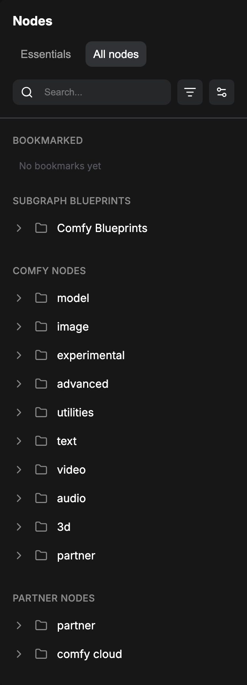

---
title: "Node-Bibliothek - Nodes durchsuchen und hinzufügen"
description: "Durchsuchen Sie die Node-Bibliothek in der Seitenleiste, setzen Sie Lesezeichen für Favoriten und ziehen Sie Nodes direkt auf das Canvas."
sidebarTitle: "Node-Bibliothek"
icon: "cubes"

Der Eintrag **Nodes** in der linken Seitenleiste öffnet die Node-Bibliothek. Hier finden Sie jeden Node, der in Ihrer ComfyUI-Instanz verfügbar ist: Comfy Core, Partner-Nodes und die Custom Nodes, die Sie installiert haben. Das Panel ist durchsuchbar.

Das Panel hat zwei Tabs, wenn der Tab **Grundlagen** verfügbar ist:

- **Grundlagen**: ein kuratierter Überblick über die Nodes, die die meisten Workflows benötigen, gruppiert nach Aufgabe. Die Abschnitte sind Eingaben & Ausgaben, Generieren (Bild, Video, Text, Audio, 3D), Steuerung & Anleitung (Bild) sowie Bearbeitung & Dienstprogramme (Bildtransformation, Bilddienstprogramme, Bildfilter & Effekte, Bildfarbe, Bildauswahl & Maskierung, Videotransformation, Videokomposition, Videoauswahl & Maskierung, 3D-Transformation). Fahren Sie mit der Maus über eine Kachel, um den Node vor der Verwendung in der Vorschau zu sehen. Ziehen Sie eine Kachel auf das Canvas, um den Node zu Ihrem Workflow hinzuzufügen. Verwenden Sie die Filterschaltfläche, um nur die Medientypen anzuzeigen, mit denen Sie arbeiten, und die Listenschaltfläche, um direkt zu einem Abschnitt zu springen.
- **Alle Nodes**: die vollständige Node-Liste. Filtern Sie sie nach Comfy Nodes, Partner-Nodes, Erweiterungen oder Vorlagen und wechseln Sie die Sortierung zwischen der standardmäßig kategorisierten Reihenfolge und A-Z.

Klicken Sie auf das Lesezeichen-Symbol bei einem Node unter **Alle Nodes**, um ihn dem Abschnitt **Mit Lesezeichen versehen** oben in der Liste hinzuzufügen.

Der Tab **Grundlagen** erscheint, wenn das ComfyUI-Backend ihn aktiviert, was bei Comfy Cloud und in Nightly-Builds der Fall ist. Eine selbst gehostete stabile Installation zeigt nur **Alle Nodes**. Sie können zum vorherigen Panel unter `Settings` --> `Comfy` --> `Node Library` zurückkehren, indem Sie `New Node Library Design` deaktivieren.

## Verwandte Themen

- [Benutzeroberfläche im Überblick](/de/interface/overview)
- [Node-Dokumentation](/de/interface/features/node-docs)
- [Rechtes Seitenpanel](/de/interface/right-side-panel) (Der Tab Info zeigt dieselbe Hilfe für einen ausgewählten Node)