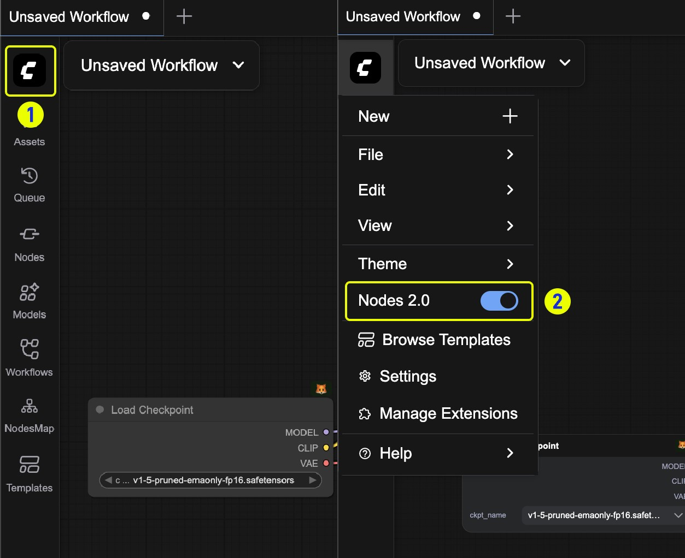

Nodes 2.0 ist jetzt in Comfy Desktop, der portablen Version und den Stable-Releases verfügbar. Dieses Update stellt das Node-System vom Rendering über LiteGraph.js Canvas auf eine Vue-basierte Architektur um und ermöglicht so schnellere Iterationen und reichere Interaktionen.

## Warum diese Änderung?

Das bisherige Canvas-Rendering-System war zu einem Entwicklungsengpass geworden. Selbst kleine UI-Änderungen erforderten oft tiefgreifende Anpassungen und konnten Tage dauern. Das bremste die Reaktionsfähigkeit auf Feedback aus der Community und machte die Anpassung von Nodes für Entwickler schwierig.

Das neue Vue-basierte System ermöglicht:

- **Schnellere Feature-Entwicklung**: UI-Änderungen lassen sich zügiger umsetzen
- **Reichere Interaktionen**: Dynamische Widgets, erweiterbare Nodes und bessere Komponenten
- **Eine flexiblere Grundlage**: Bessere Unterstützung für zukünftige Tools und Anpassungen

## Aktueller Status und bekannte Probleme

Wir arbeiten aktiv an Verbesserungen und möchten offen über die aktuellen Einschränkungen informieren:

| Bereich | Status |
|------|--------|
| **Performance** | Die Optimierung in Richtung Canvas-Performance läuft noch. In bestimmten Szenarien kann sich das Verhalten unterscheiden. |
| **Kompatibilität** | Einige Custom Nodes benötigen möglicherweise Updates, um vollständig unterstützt zu werden. |
| **Sonderfälle** | Bei extremen Zoomstufen oder in sehr großen Workflows können kleinere visuelle Probleme auftreten. |

Wir sammeln Feedback, um Verbesserungen priorisieren zu können. Das Rendering-System von LiteGraph.js bleibt verfügbar, und Sie können jederzeit zwischen den Systemen wechseln.

## So probieren Sie es aus

### Nodes 2.0 aktivieren

1. Rufen Sie [cloud.comfy.org](https://cloud.comfy.org) auf oder aktualisieren Sie auf die neueste Version von Comfy Desktop, der portablen Version oder des Stable-Release
2. Klicken Sie beim Start von ComfyUI im oberen Banner auf **Try it out**

### Was Sie testen können

Verwenden Sie Nodes 2.0 in Ihren täglichen Workflows und teilen Sie Ihr Feedback mit uns:

- **Grundlegende Interaktionen**: Ziehen, Größe ändern, Auswählen
- **Tägliche Workflows**: Ausführung, Parameter, Custom Nodes
- **Performance**: Besonders bei komplexen Workflows

## So geben Sie Feedback

Sind Probleme aufgetreten oder haben Sie Vorschläge zur Verbesserung der Interaktion?

- **Hilfe-Center**: [ComfyUI Help Center](https://support.comfy.org)
- **GitHub-Probleme**: [Create an issue in ComfyUI_frontend](https://github.com/Comfy-Org/ComfyUI_frontend/issues)

<Tip>
Wenn Sie Probleme melden, sind Schritte zur Reproduktion, Screenshots und Systeminformationen äußerst hilfreich.
</Tip>

## Zurückwechseln

Wenn Probleme auftreten:

1. Klicken Sie auf das **ComfyUI-Logo**, um das Menü zu öffnen
2. Schalten Sie **Nodes 2.0** um, um zur vorherigen Oberfläche zurückzuwechseln

Ihr Feedback hilft uns, Verbesserungen zu priorisieren. Aktivieren Sie Nodes 2.0 in den Einstellungen und entdecken Sie das neue Node-Design!