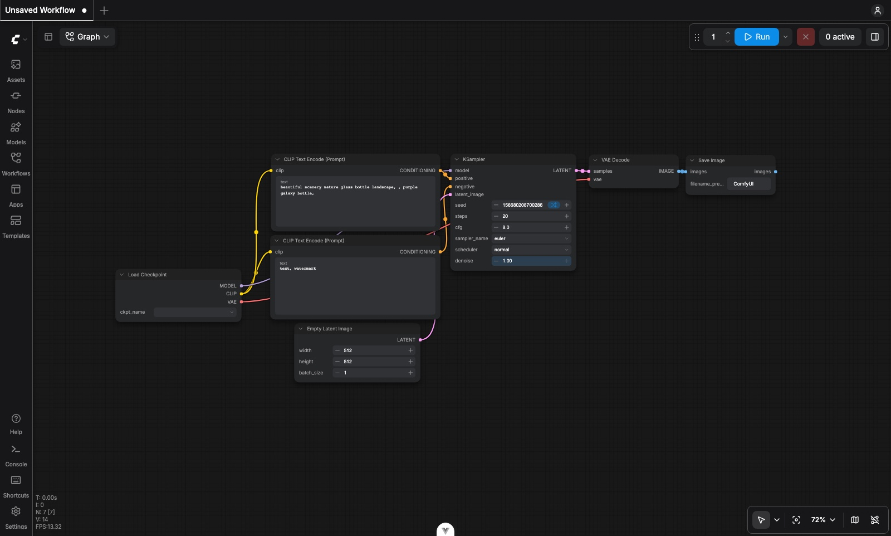
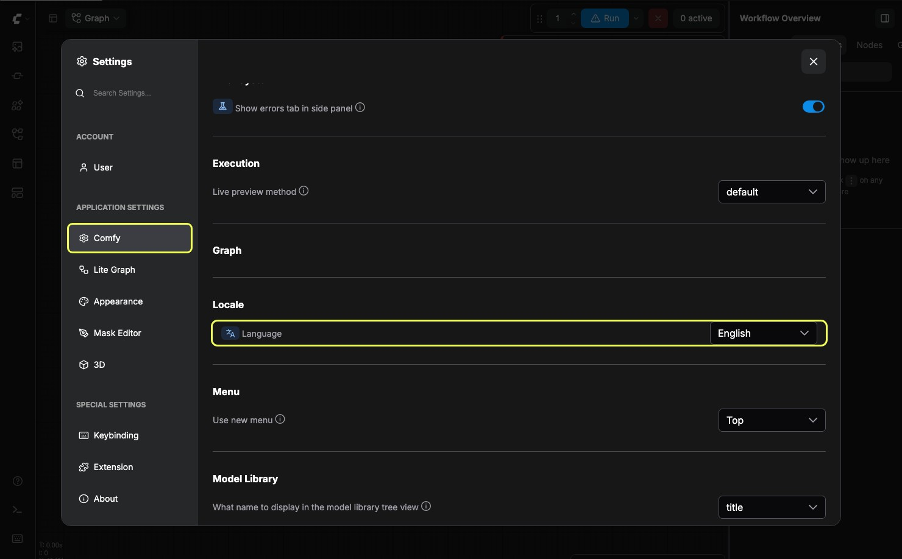
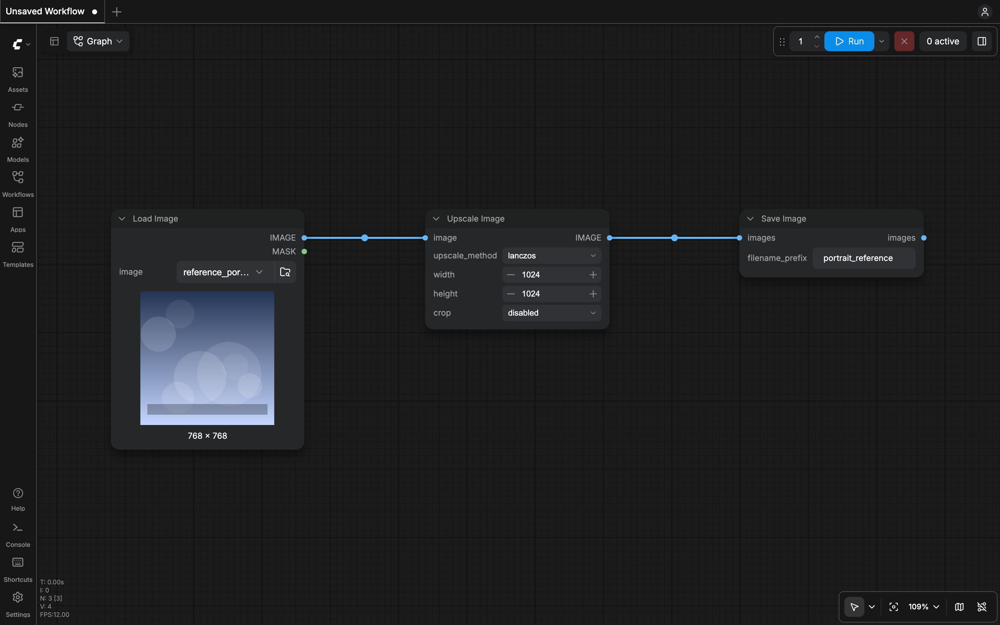
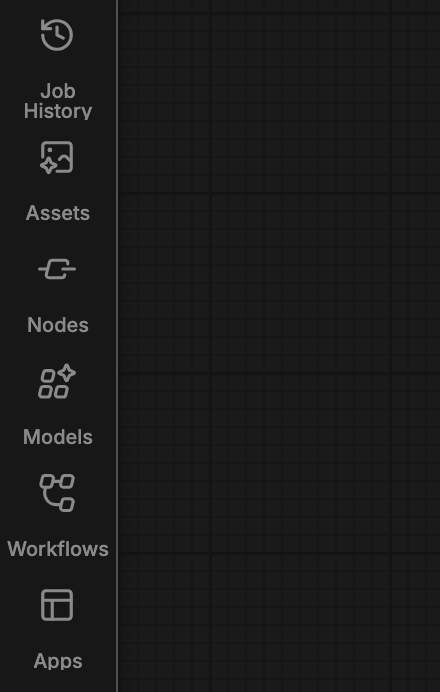
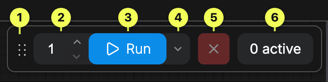

Die visuelle Oberfläche ist die Art und Weise, wie die meisten Anwender den [ComfyUI Server](/development/comfyui-server/comms_overview) bedienen. Nutzen Sie diese Seite als Übersicht der UI und öffnen Sie anschließend die verlinkten Anleitungen für die einzelnen Bereiche und Komponenten.

Das [ComfyUI Frontend](https://github.com/Comfy-Org/ComfyUI_frontend) wird als eigenständiges Projekt gepflegt. Beiträge gehen an dieses Repository.

## Lokalisierung

ComfyUI unterstützt Englisch, Chinesisch, Russisch, Französisch, Japanisch und Koreanisch. Öffnen Sie **Einstellungen** und wählen Sie unter `Comfy` → `Locale` Ihre Sprache aus.

## Workspace-Übersicht

Die Nummern im Screenshot entsprechen den folgenden Bereichen:

| # | Bereich | Beschreibung |
| --- | --- | --- |
| **1** | **Linke Seitenleiste** | Assets, Node-Bibliothek, Modellbibliothek, Workflows, Apps und (falls aktiviert) Auftragshistorie |
| **2** | **Canvas** | Der Graph, in dem Sie Nodes platzieren und verbinden, sowie die Canvas-Steuerelemente |
| **3** | **Rechtes Seitenpanel** | Parameter, Node-Info, Einstellungen und Fehler für die aktuelle Auswahl (wird über den Eigenschaften-Umschalter in der oberen Leiste geöffnet) |
| **4** | **Obere Leiste** | Geöffnete Workflows, Steuerelemente für Run und Warteschlange, Anmeldung und der Umschalter für das Eigenschaften-Panel |
| **5** | **Unten links** | Hilfe-Center, unteres Panel (Protokolle / Tastenkürzel) und Einstellungen |
| **6** | **Unten rechts** | Canvas-Steuerelemente: Verschieben, Minikarte, Verbindungssichtbarkeit, Zoom, Einpassen |

### Linke Seitenleiste

Die Symbole der linken Leiste von oben nach unten. **Auftragshistorie** wird nur dann oben angezeigt, wenn `Comfy.Queue.QPOV2` aktiviert ist:

<Columns cols={2}>
  <Card title="Assets" icon="images" href="/interface/assets">
    Generierte und importierte Medien: Vorschau, Wiederverwenden, Herunterladen, Löschen
  </Card>
  <Card title="Node-Bibliothek" icon="cubes" href="/interface/node-library">
    Grundlagen-Raster und vollständige Node-Liste, Lesezeichen, Suche
  </Card>
  <Card title="Modellbibliothek" icon="box" href="/interface/model-library">
    Erkannte Modelle in Ihrem Modelle-Ordner
  </Card>
  <Card title="Workflows" icon="folder-tree" href="/interface/workflows">
    Lokal gespeicherte Workflows und zuletzt verwendete Dateien
  </Card>
  <Card title="Apps" icon="grid-2" href="/interface/apps">
    Eintrag Apps in der Seitenleiste; siehe auch App-Modus unter Funktionskomponenten
  </Card>
  <Card title="Auftragshistorie" icon="clock-rotate-left" href="/interface/job-history">
    Warteschlange / Auftragshistorie, wenn QPOV2 aktiviert ist
  </Card>
</Columns>

### Rechtes Seitenpanel

<Columns cols={2}>
  <Card title="Rechtes Seitenpanel" icon="panel-right" href="/interface/right-side-panel">
    Parameter, Info (Node-Dokumentation), Einstellungen, Fehler
  </Card>
</Columns>

### Canvas

<Columns cols={2}>
  <Card title="Canvas-Steuerelemente" icon="arrows-up-down-left-right" href="/de/interface/canvas-controls">
    Minikarte, Verbindungen, Canvas-Info, Zoom, Einpassen, Fokusmodus
  </Card>
  <Card title="Nodes 2.0" icon="sitemap" href="/de/interface/nodes-2">
    Node-Rahmen, Kopfzeilen und Auswahlverhalten
  </Card>
</Columns>

### Run-Leiste

Die schwebende Run-Leiste befindet sich am oberen Rand des Canvas und enthält alles, was zum Starten und Überwachen eines Laufs nötig ist: Batch-Anzahl, Run, Warteschlangenmodus, Abbrechen und die Anzahl der aktiven Aufträge.

| # | Steuerelement | Funktion |
| --- | --- | --- |
| **1** | **Ziehpunkt** | Verschiebt die Leiste an eine beliebige Stelle auf dem Canvas. Während Sie ziehen, erscheint ein Bereich **Oben andocken**, mit dem Sie sie wieder an der Oberkante fixieren können. |
| **2** | **Batch-Anzahl** | Wie oft der Workflow pro Lauf in die Warteschlange gestellt wird (Standard: `1`). Geben Sie einen Wert ein oder verwenden Sie die Pfeile nach oben und unten. |
| **3** | **Run** | Stellt den Workflow in die Warteschlange. Halten Sie `Shift` gedrückt, um ihn am Anfang statt am Ende der Warteschlange einzureihen. |
| **4** | **Warteschlangenmodus-Menü** | Legt fest, wann der Workflow sich selbst in die Warteschlange einreiht: **Run** (nur wenn Sie klicken), **Run (On Change)** (reiht ihn erneut ein, sobald sich der Workflow ändert) oder **Run (Instant)** (reiht ihn erneut ein, sobald der aktuelle Lauf abgeschlossen ist). |
| **5** | **Abbrechen** | Beendet den Lauf, der gerade ausgeführt wird. Deaktiviert, solange die Warteschlange im Leerlauf ist. |
| **6** | **Aktive Aufträge** | Anzahl der eingereihten und laufenden Aufträge. Klicken Sie, um die Warteschlange zu öffnen; klicken Sie mit der rechten Maustaste, um sie zu leeren. |

### Unterer Bereich und Hilfe

<Columns cols={2}>
  <Card title="Unteres Panel" icon="terminal" href="/interface/bottom-panel">
    Tastenkürzel, Protokolle und (Desktop-)Befehlsterminal
  </Card>
  <Card title="Hilfe-Center" icon="circle-question" href="/interface/help-center">
    Versionshinweise, Dokumentation, Support, Feedback
  </Card>
</Columns>

## Funktionskomponenten

Wiederverwendbare UI-Funktionen, die nicht an einen einzelnen Bereich der Workspace-Oberfläche gebunden sind.

<Columns cols={2}>
  <Card title="Vorlagen" icon="copy" href="/interface/features/template">
    Integrierte Workflow-Vorlagen
  </Card>
  <Card title="App-Modus" icon="mobile" href="/interface/app-mode">
    Lineare / app-ähnliche UI zum Ausführen von Workflows
  </Card>
  <Card title="Subgraph" icon="diagram-nested" href="/interface/features/subgraph">
    Graphen zu wiederverwendbaren Subgraph-Nodes reduzieren
  </Card>
  <Card title="Teilweise Ausführung" icon="play" href="/interface/features/partial-execution">
    Nur einen Teil eines Workflows ausführen
  </Card>
  <Card title="Node-Dokumentation" icon="book" href="/interface/features/node-docs">
    Node-Hilfe in der App (auch auf dem RSP Info-Tab)
  </Card>
  <Card title="Dynamische Eingänge" icon="plus" href="/interface/features/autogrow-inputs">
    Dynamische Eingänge, die beim Verbinden mitwachsen
  </Card>
  <Card title="Maskeneditor" icon="brush" href="/interface/maskeditor">
    Maskierungen auf dem Canvas malen und bearbeiten
  </Card>
</Columns>

## Einstellungen

<Columns cols={2}>
  <Card title="Einstellungen" icon="gear" href="/de/interface/settings/overview">
    Vollständiger Einstellungsdialog nach Kategorie
  </Card>
</Columns>

## Benutzerkonto und Credits

<Columns cols={2}>
  <Card title="Benutzer" icon="user" href="/de/interface/user">
    Benutzerkonto- und Profileinstellungen
  </Card>
  <Card title="Tarif & Credits" icon="coins" href="/interface/credits">
    Guthaben, Aufladen, Nutzungsaktivität und Cloud-Rechnungen
  </Card>
</Columns>

## Cloud-exklusiv

<Columns cols={3}>
  <Card title="Workspaces" icon="users" href="/cloud/workspace">
    Team-Arbeitsbereiche auf Comfy Cloud
  </Card>
  <Card title="Workflow teilen" icon="share-nodes" href="/cloud/share-workflow">
    Workflows aus Cloud teilen
  </Card>
  <Card title="Modelle importieren" icon="cloud-arrow-up" href="/cloud/import-models">
    Eigene Modelle in Cloud hochladen
  </Card>
</Columns>
