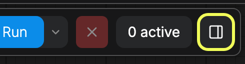
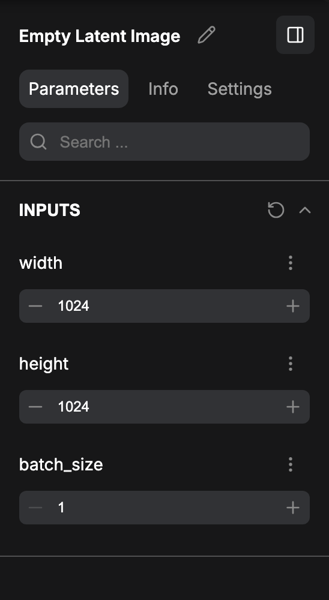
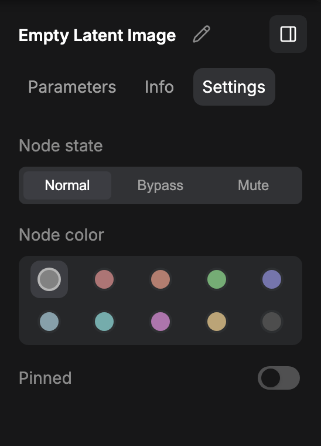
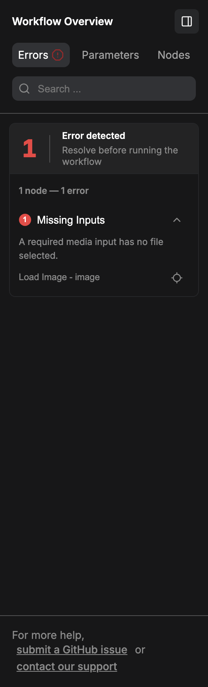
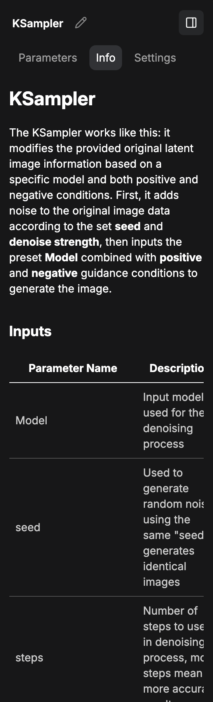
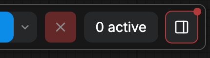

Das Panel auf der rechten Seite ist das Eigenschaften-Panel am rechten Rand des ComfyUI-Workspace. Es zeigt die Parameter, Informationen und Einstellungen für das, was Sie auf dem Canvas ausgewählt haben, hält die Eingänge, die Sie am häufigsten nutzen, mit einem Klick bereit und listet Workflow-Fehler samt ihren Korrekturen auf.

## Panel öffnen und schließen

Klicken Sie auf das Panel-Symbol im Steuerungsbereich oben rechts, um das Panel zu öffnen. Der Tooltip der Schaltfläche lautet **Toggle properties panel**. Treten im Workflow Fehler auf, während das Panel geschlossen ist, zeigt die Schaltfläche einen roten Punkt an, sodass Sie das Panel direkt in der Fehlerliste öffnen können. Schließen Sie das Panel über das Symbol in der Kopfzeile des Panels.

ComfyUI merkt sich den Zustand des Panels über Sitzungen hinweg.

## Das Panel folgt Ihrer Auswahl

Der Titel und die verfügbaren Tabs ändern sich je nachdem, was auf dem Canvas ausgewählt ist:

| Auswahl | Panel-Titel | Tabs |
| --- | --- | --- |
| Nichts | Workflow-Übersicht | Parameter, Nodes, Einstellungen |
| Ein Node | Der Node-Name | Parameter, Info, Einstellungen, plus Fehler, falls relevant |
| Ein Subgraph-Node | Der Node-Name | Parameter, Einstellungen, plus Fehler, falls relevant, und die Schaltfläche Subgraph bearbeiten |
| Mehrere Elemente | Die Anzahl der ausgewählten Elemente | Nodes, Einstellungen, plus Fehler, falls relevant |

Klicken Sie auf die Stift-Schaltfläche neben dem Titel, um den ausgewählten Node oder die ausgewählte Gruppe umzubenennen. Bei einem Subgraph-Node zeigt die Kopfzeile zusätzlich eine Schaltfläche **Subgraph bearbeiten** an, die den Subgraph-Editor im Panel öffnet.

Der Tab Fehler erscheint, wenn die Auswahl relevante Fehler enthält, wenn nichts ausgewählt ist und der Workflow Fehler enthält, oder wenn der Workflow veraltete Nodes verwendet, für die es einen Ersatz gibt. Sie können den Tab vollständig mit der Einstellung **Fehler-Tab in der Seitenleiste anzeigen** unter `Comfy` → `Fehlersystem` ausblenden.

### Parameter

Wenn ein Node ausgewählt ist, listet der Tab **Parameter** seine Eingaben unter **EINGABEN** auf. Wenn mehrere Elemente ausgewählt sind, trägt dieselbe Ansicht die Bezeichnung **Nodes** und listet die Eingaben jedes ausgewählten Elements auf. Beide Ansichten haben oben ein Suchfeld und einen einklappbaren Bereich pro Node. Eingaben, die als erweitert markiert sind, werden in einem separaten Bereich **ERWEITERTE EINGÄNGE** gesammelt. Jede Eingabe hat ein Aktionsmenü mit **Umbenennen**, **Favorisieren** und **Auf Standard zurücksetzen** sowie **Eingabe ausblenden** für Eingaben, die aus einem Subgraph hochgestuft wurden. Wenn mehrere Nodes ausgewählt sind, hat jeder Bereich außerdem eine Schaltfläche, um seine Nodes auf dem Canvas anzuzeigen.

Wenn nichts ausgewählt ist, zeigt derselbe Tab stattdessen Ihre favorisierten Eingaben an, sodass Sie die Werte, die Sie am häufigsten ändern, anpassen können, ohne zuerst einen Node auszuwählen.

### Nodes

Der Tab Nodes wird angezeigt, wenn nichts ausgewählt ist. Er listet jeden Node im Workflow mit seinen Eingaben auf, durchsuchbar und einklappbar, sodass Sie jeden Node an einer Stelle prüfen oder bearbeiten können. Er ist außerdem die Bezeichnung, die die Parameteransicht verwendet, wenn mehrere Elemente ausgewählt sind.

### Info

Der Tab Info erscheint für einen einzelnen ausgewählten Node, der kein Subgraph ist. Er zeigt denselben Hilfeinhalt der [Node-Dokumentation](/de/interface/features/node-docs), den Sie über das Dokumentationssymbol in der Auswahl-Toolbox und über die Hilfe-Schaltfläche in Nodes 2.0 erhalten.

### Einstellungen

Bei einer Auswahl deckt der Tab Einstellungen die ausgewählten Nodes und Gruppen ab:

- **Node-Status**: **Normal**, **Bypass** oder **Mute**.
- **Node-Farbe**: Wählen Sie eine Farbe für den Node.
- **Angepinnt**: pinnt den Node an, sodass er an seiner Position auf dem Canvas fixiert bleibt.

Änderungen gelten für jedes Element der Auswahl, sodass Sie denselben Status oder dieselbe Farbe für eine ganze Gruppe auf einmal festlegen können. Gruppen bieten nur die Steuerelemente für Farbe und Anpinnen.

Wenn nichts ausgewählt ist, trägt der Tab die Bezeichnung **Globale Einstellungen** und bündelt Schnellumschalter, die dem vollständigen Einstellungsdialog entsprechen:

- **Nodes**: Erweiterte Parameter anzeigen, Toolbox bei Auswahl anzeigen, Nodes 2.0.
- **Canvas**: Rasterabstand, Nodes am Raster ausrichten.
- **VERBINDUNGSLINIEN**: Verbindungsform, Verbundene Verbindungen anzeigen.
- **Alle Einstellungen anzeigen**: öffnet den vollständigen Einstellungsdialog.

### Fehler

Der Tab Fehler gruppiert die Probleme, die den Workflow blockieren, sowie Hinweise auf Nodes, für die es einen neueren Ersatz gibt, damit Sie sie vor dem Ausführen beheben können:

- **Node-Fehler**: der fehlerhafte Node, die Fehlermeldung, ein Steuerelement zum **Ausklappen** und **Einklappen** sowie **Node auf dem Canvas anzeigen**.
- **Fehlende Node-Packs**: **Alle installieren**, **Änderungen anwenden** und **Im Manager anzeigen**, wenn ComfyUI Manager verfügbar ist. In Comfy Cloud heißt die Gruppe stattdessen **Nicht unterstützte Node-Packs**, da Sie dort keine Node-Packs installieren können.
- **Fehlende Modelle**: **Herunterladen** für eine einzelne Datei oder **Alle herunterladen**, **Import** in Comfy Cloud für Modelle, die Sie selbst bereitstellen, und ein Hinweis, wenn ein Modell auf Hugging Face zugriffsbeschränkt ist und ein angemeldetes Konto mit akzeptierter Lizenz erfordert.
- **Fehlende Eingaben**: Eingabemedien, die der Workflow erwartet, aber nicht findet.
- **Veraltete Nodes**: installierte Nodes, die noch laufen, für die es aber einen neueren Ersatz gibt. Die Gruppe ist ein Hinweis, kein Fehler: Sie öffnet nicht das Fehler-Overlay, fügt dem Canvas keine Badges hinzu und zählt nicht zum Fehlerindikator. Verwenden Sie **Ersetzen** in einer Zeile oder **Alle ersetzen** für die gesamte Gruppe.
- **Fehlerprotokoll** und Links zum Einreichen eines GitHub-Issues oder zum Kontaktieren des Supports.

Comfy Cloud meldet Ausgaben, die bei einem Lauf übersprungen werden. Wenn ComfyUI einen Lauf annimmt, aber einige Ausgaben überspringt, weil ihre Nodes die Validierung nicht bestehen, zum Beispiel eine nicht vorhandene Checkpoint-Datei, erscheinen die tatsächlich ausgeführten Ausgaben trotzdem und die übersprungenen Nodes werden rot. Die Fehler werden unter **Node-Fehler** aufgeführt, und das Fehler-Overlay öffnet sich für den Lauf auf dem Bildschirm, wenn **Fehler-Tab in der Seitenleiste anzeigen** aktiviert ist.

## Eingaben favorisieren

Favorisierte Eingaben sind die Schnellzugriffe des Panels. Öffnen Sie den Parameters-Tab, klicken Sie bei einer beliebigen Eingabe auf das Aktionsmenü und wählen Sie **Favorite**. Favorisierte Eingaben erscheinen dann im Panel, wenn nichts ausgewählt ist. Dort können Sie sie suchen und neu anordnen. Verwenden Sie **Unfavorite** im selben Menü, um eine Eingabe zu entfernen.

## Verwandte Themen

- [Benutzeroberfläche im Überblick](/de/interface/overview) für die Bereiche des Workspace.
- [ComfyUI-Einstellungen](/de/interface/settings/overview) für den vollständigen Einstellungsdialog.
- [Node-Dokumentation](/de/interface/features/node-docs) (derselbe Hilfeinhalt wie im Tab Info).
- [Node-Bibliothek](/de/interface/node-library).
