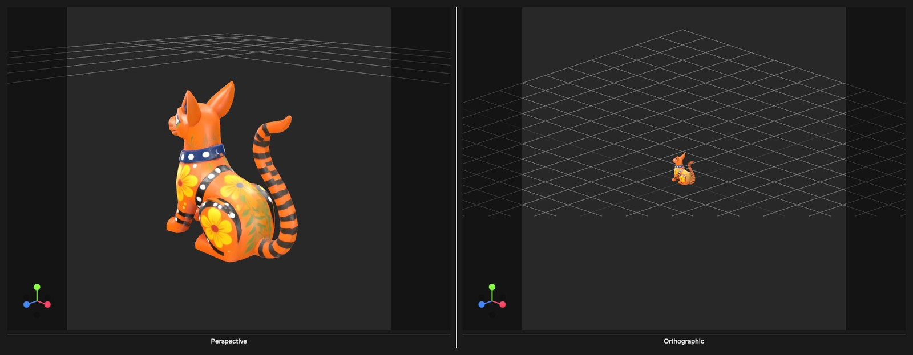
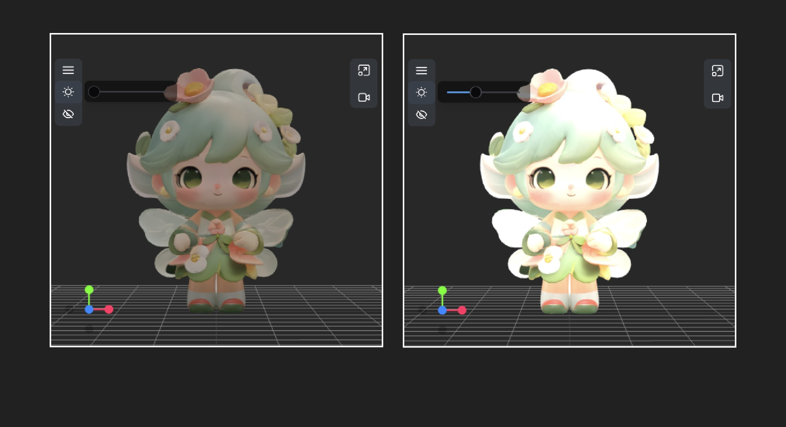
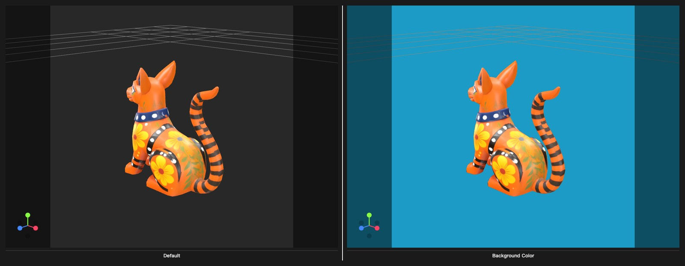
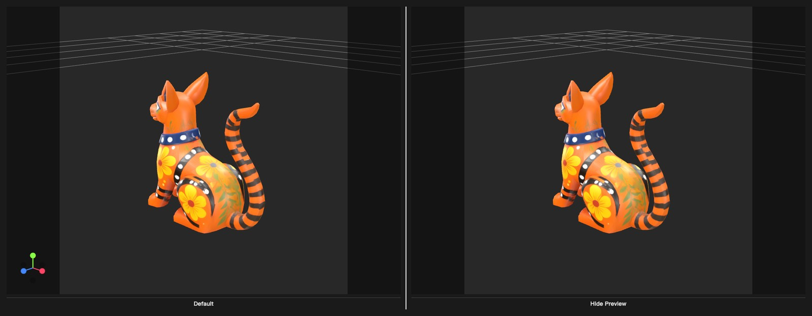
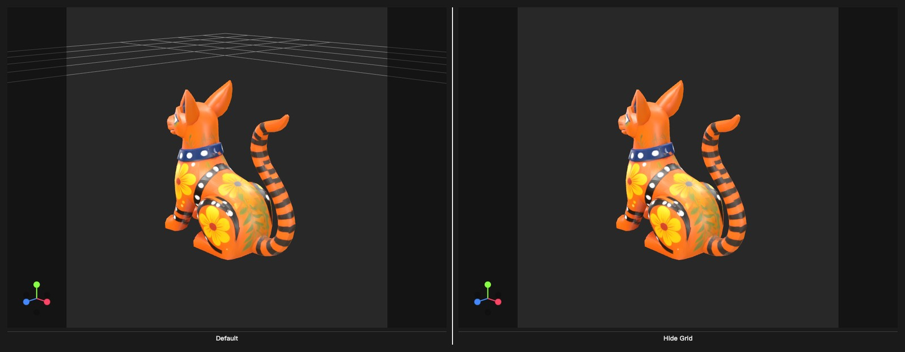

import SettingsMenuContext from "/snippets/de/interface/settings-menu-context.mdx"

<SettingsMenuContext />

Dieser Abschnitt der Einstellungen dient hauptsächlich dazu, die Initialisierungseinstellungen der 3D-bezogenen Komponenten in ComfyUI zu steuern, einschließlich Kamera, Beleuchtung, Szene usw. Wenn Sie neue 3D-Komponenten erstellen, werden sie gemäß diesen Einstellungen initialisiert. Nach der Erstellung können diese Einstellungen weiterhin individuell angepasst werden.

## Kamera

### Standard-Kameratyp
- **Optionen**:
  - `perspective`
  - `orthographic`
- **Funktion**: Legt fest, ob die Standardkamera beim Erstellen neuer 3D-Komponenten perspektivisch oder orthografisch ist. Diese Standardeinstellung kann nach dem Erstellen weiterhin für jede Komponente einzeln geändert werden.

## Licht

Die Lichteinstellungen in diesem Abschnitt legen die Standardbeleuchtung für 3D-Komponenten fest. Die entsprechenden Einstellungen in den 3D-Einstellungen von ComfyUI können ebenfalls geändert werden.

### Schrittweite für Lichtanpassung
- **Standardwert**: 0.5  
- **Funktion**: Legt die Schrittgröße beim Anpassen der Lichtintensität in 3D-Szenen fest. Kleinere Schrittwerte ermöglichen feinere Lichtanpassungen, während größere Werte jede Anpassung deutlicher ausfallen lassen  

### Minimale Lichtintensität
- **Standardwert**: 1  
- **Funktion**: Legt den minimal zulässigen Wert der Lichtintensität in 3D-Szenen fest. Damit ist die geringste Helligkeit definiert, die beim Anpassen der Beleuchtung eines 3D-Controls eingestellt werden kann  

### Maximale Lichtintensität
- **Standardwert**: 10  
- **Funktion**: Legt den maximal zulässigen Wert der Lichtintensität in 3D-Szenen fest. Damit ist die Obergrenze der Helligkeit definiert, die beim Anpassen der Beleuchtung eines 3D-Controls eingestellt werden kann  
  

### Anfängliche Lichtintensität
- **Standardwert**: 3  
- **Funktion**: Legt die Standardhelligkeit von Lichtern in 3D-Szenen fest. Dieser Wert bestimmt die Intensität, mit der Lichter Objekte beleuchten, wenn neue 3D-Controls erstellt werden; jedes Control kann jedoch nach dem Erstellen einzeln angepasst werden

## Szene

### Anfängliche Hintergrundfarbe
- **Funktion**: Steuert die Standard-Hintergrundfarbe von 3D-Szenen. Diese Einstellung bestimmt das Erscheinungsbild des Hintergrunds beim Erstellen neuer 3D-Komponenten; jede Komponente kann jedoch nach dem Erstellen individuell angepasst werden
- **Standardwert**: wahr (dunkelgrau `282828`)

Ändern Sie die Hintergrundfarbe, die auch im Canvas angepasst werden kann.

### Standardmäßige Vorschau-Sichtbarkeit
- **Funktion**: Steuert, ob der Vorschau-Bildschirm beim Erstellen neuer 3D-Komponenten standardmäßig angezeigt wird. Diese Standardeinstellung kann nach dem Erstellen weiterhin für jede Komponente einzeln umgeschaltet werden
- **Standardwert**: wahr (aktiviert)

  
### Standardmäßige Gittersichtbarkeit
- **Funktion**: Steuert, ob das Raster beim Erstellen neuer 3D-Komponenten standardmäßig angezeigt wird. Diese Standardeinstellung kann nach dem Erstellen weiterhin für jede Komponente einzeln umgeschaltet werden
- **Standardwert**: wahr (aktiviert)

Raster beim Initialisieren ein- oder ausblenden

## 3D Viewer (Beta)

Der 3D-Viewer (Beta) öffnet ein 3D-Modell in einem Fenster in voller Größe, getrennt von der Vorschau im Node. Verwenden Sie ihn, um ein Modell zu prüfen, die Platzierung des Modells anzupassen und es zu exportieren.

Wählen Sie einen einzelnen Load 3D-Node auf dem Canvas aus und klicken Sie dann auf die Viewer-Schaltfläche in der Auswahl-Toolbox. Die Schaltfläche öffnet das Fenster **3D Viewer (Beta)**, das maximiert werden kann.

### 3D-Viewer (Beta) aktivieren

- **Optionen**:
  - enabled
  - disabled
- **Standardwert**: enabled
- **Funktion**: Steuert, ob die Viewer-Schaltfläche in der Auswahl-Toolbox erscheint, wenn ein einzelner Load 3D-Node ausgewählt ist. Wenn die Option deaktiviert ist, erscheint die Schaltfläche nicht. Die Einstellung trägt in der Einstellungsliste eine Beta-Markierung.

### Bereiche des Viewers

Der Viewer verfügt über eigene Bereiche für Szene, Kamera, Beleuchtung, Modell, Gizmo, Animation und Export:

- **Scene**: Hintergrundfarbe, Sichtbarkeit des Rasters und ein Hintergrundbild, das als gekachelt oder als Panorama gerendert wird
- **Camera**: Kameratyp und Sichtfeld
- **Light**: Lichtintensität
- **Model**: Aufwärtsrichtung und Materialmodus
- **Gizmo**: das Modell im Viewport verschieben, drehen oder skalieren
- **Animation**: die in der Datei gespeicherten Animationsclips wiedergeben, mit Geschwindigkeits- und Suchsteuerung
- **Export**: das geladene Modell speichern. Mesh-Dateien werden als GLB, OBJ, STL oder FBX exportiert, während Punktwolken- und Gaussian-Splat-Dateien ihr ursprüngliches Format behalten

Änderungen, die Sie im Viewer vornehmen, werden in den Node zurückgeschrieben, wenn Sie den Viewer schließen. Wählen Sie **Abbrechen**, um den Viewer zu schließen, ohne den Node zu ändern.

## Punktwolke

### Punktwolken-Engine

- **Optionen**:
  - `threejs`
  - `fastply`
- **Standardwert**: `threejs`
- **Funktion**: Wählt die Engine aus, die Punktwolken-PLY-Dateien lädt. `threejs` verwendet den nativen Three.js PLYLoader, der Binär- und ASCII-Dateien liest und Meshes laden kann. `fastply` verwendet einen optimierten Parser für ASCII-PLY-Dateien. 3D-Gaussian-Splat-Dateien werden automatisch erkannt und verwenden immer den Gaussian-Splat-Renderer, unabhängig davon, welche Engine Sie hier auswählen.
