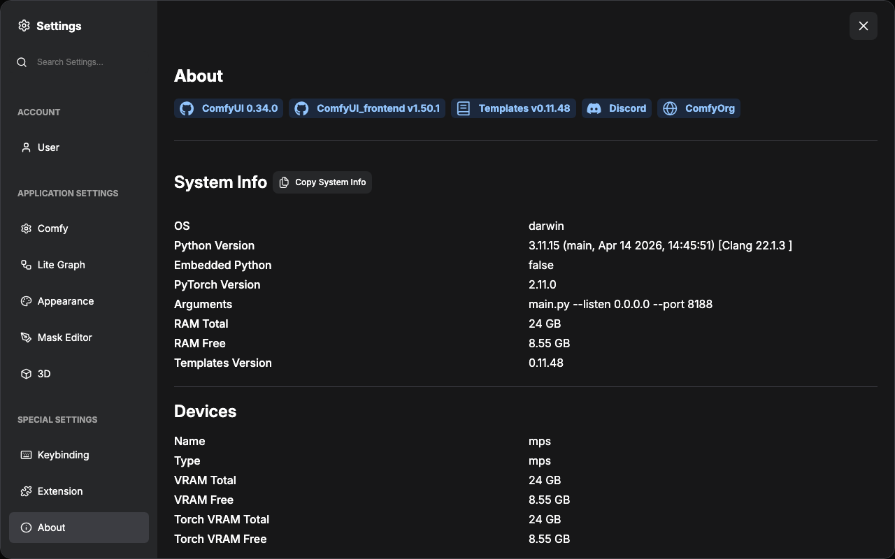

import SettingsMenuContext from "/snippets/de/interface/settings-menu-context.mdx"

<SettingsMenuContext />

Die Seite „Über“ ist eine Informationsanzeige im Einstellungssystem von ComfyUI. Sie zeigt Versionsinformationen der Anwendung, zugehörige Links und Systemstatistiken an. Diese Einstellungen liefern Ihnen wichtige Informationen, wenn Sie Feedback absenden oder Probleme melden.



### Versions-Badges

Die Seite „Über“ zeigt die folgenden zentralen Versionsinformationen an:

- **ComfyUI-Version**: Zeigt die Versionsnummer des ComfyUI-Backends und ist mit dem offiziellen GitHub-Repository verknüpft
- **ComfyUI_frontend-Version**: Zeigt die Versionsnummer der Frontend-Oberfläche und ist mit dem Frontend-GitHub-Repository verknüpft
- **Discord-Community**: Bietet einen Link zum Discord-Server von ComfyOrg
- **Offizielle Website**: Verknüpft mit der offiziellen Website von ComfyOrg

<Tip>
Da die Versionsinformationen hier hauptsächlich den stabilen Versionen entsprechen, wird bei Verwendung der Nightly-Version der zugehörige Commit-Hash hier nicht angezeigt. Wenn Sie die Nightly-Version verwenden, können Sie im entsprechenden ComfyUI-Hauptverzeichnis mit dem Befehl `git log` den zugehörigen Commit-Hash und weitere Informationen anzeigen.
Ein weiteres häufiges Problem ist, dass verschiedene Abhängigkeitspakete bei Aktualisierungen fehlschlagen und zurückgerollt werden können.
</Tip>

### Badges von Custom Nodes

Wenn Custom Nodes installiert sind, zeigt die Seite „Über“ zusätzliche Badge-Informationen an, die von Custom Nodes bereitgestellt werden. Diese Badges werden von jedem Custom Node über die Eigenschaft `aboutPageBadges` registriert.

### Systeminformationen

Am unteren Rand der Seite werden detaillierte Systemstatistiken angezeigt, darunter:
- Informationen zur Hardware-Konfiguration
- Informationen zur Software-Umgebung
- Daten zur Systemleistung

## Leitfaden für Erweiterungsentwickler

Entwickler von Erweiterungen können der Seite „Über“ eigene Badges hinzufügen, indem Sie der Konfiguration Ihrer Erweiterung die Eigenschaft `aboutPageBadges` hinzufügen:

```javascript
app.registerExtension({
  name: 'MyExtension',
  aboutPageBadges: [
    {
      label: 'My Extension v1.0.0',
      url: 'https://github.com/myuser/myextension',
      icon: 'pi pi-github'
    }
  ]
})
```
