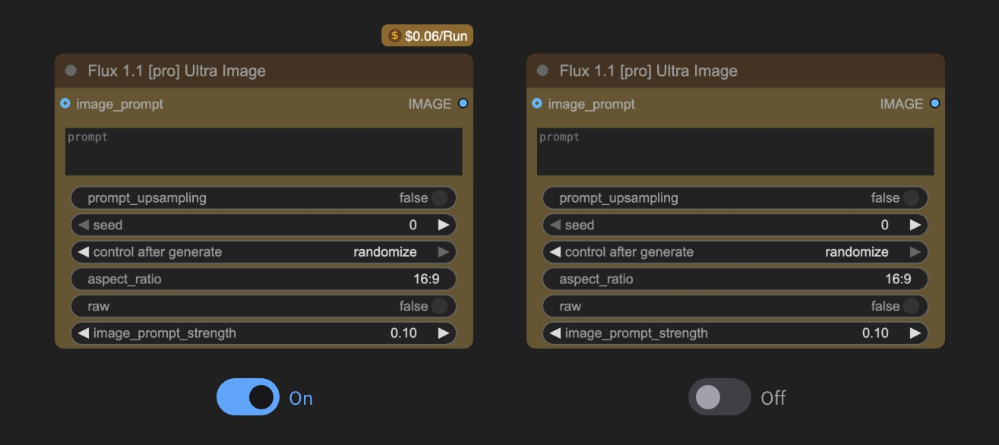
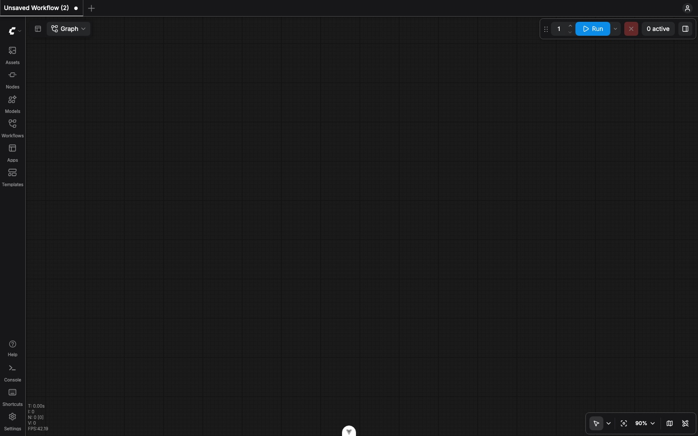
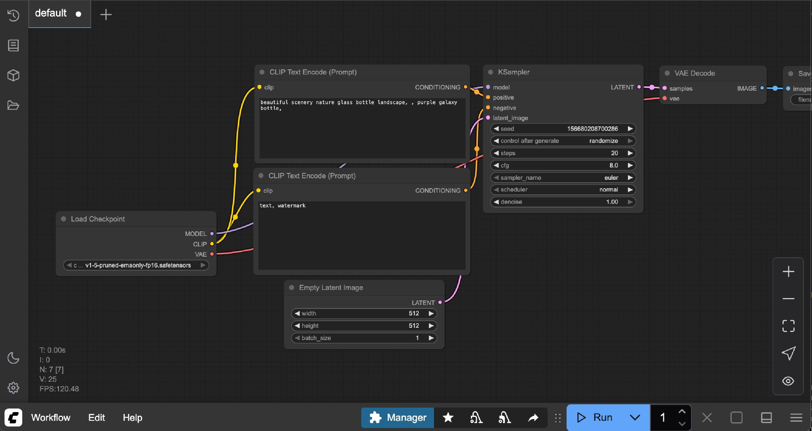
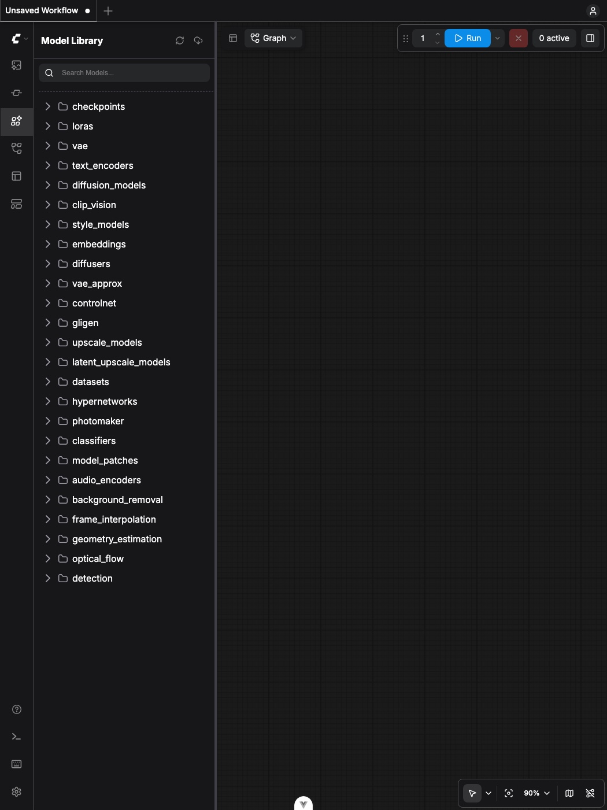
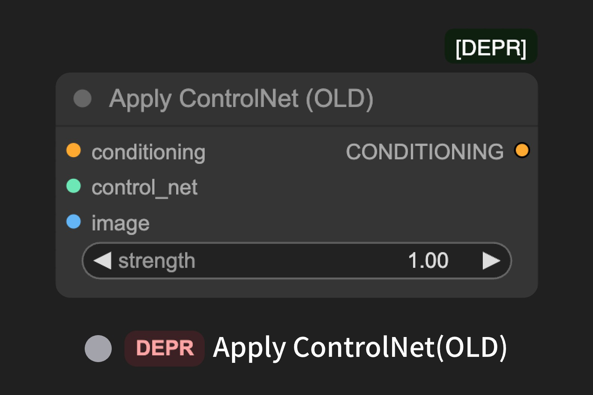
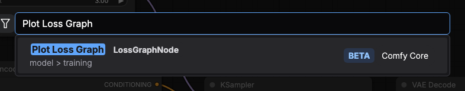
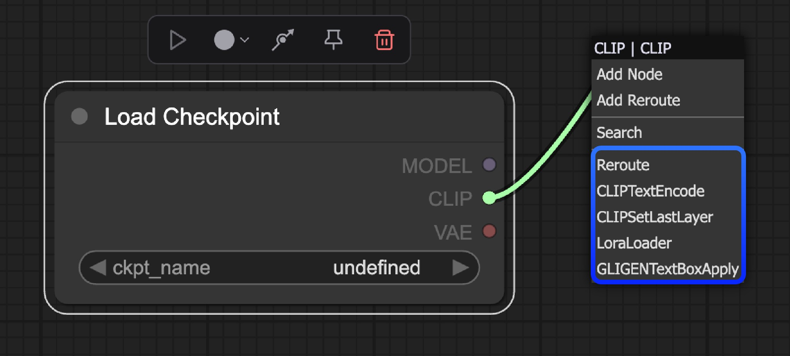
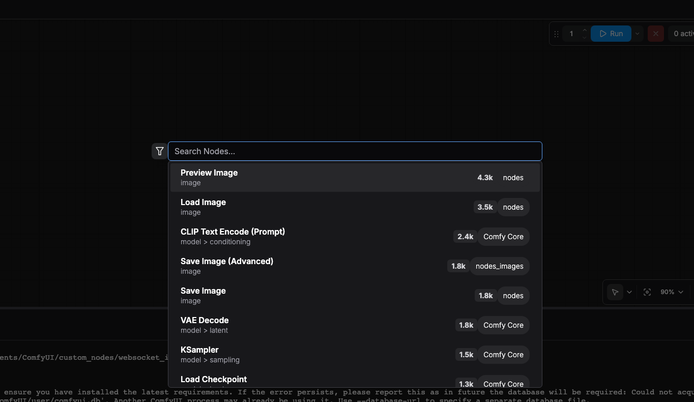
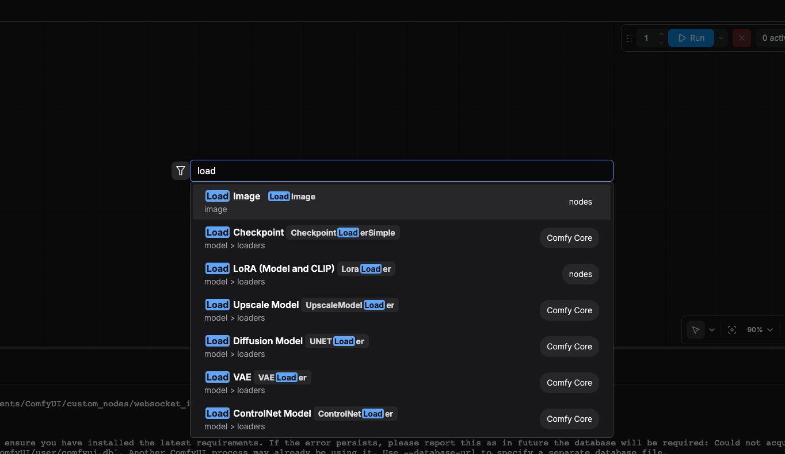

import SettingsMenuContext from "/snippets/de/interface/settings-menu-context.mdx"

<SettingsMenuContext />

## Partner-Nodes

### Show Partner Node pricing badge
- **Standardwert**: Enabled
- **Funktion**: Steuert, ob auf Partner-Nodes Preis-Badges angezeigt werden, damit Sie die Nutzungskosten von Partner-Nodes erkennen können

> Weitere Informationen zu Partner-Nodes finden Sie unter [Partner-Nodes](/de/tutorials/partner-nodes/overview)

## Entwicklermodus

### Optionen für den Entwicklermodus aktivieren (API-Speichern usw.)
- **Standardwert**: Deaktiviert
- **Funktion**: Aktiviert Optionen für den Entwicklermodus (z. B. API-Speichern usw.)

## Token-Gewichtung bearbeiten

### Präzision mit Strg+Auf/Ab
- **Standardwert**: 0.01
- **Funktion**: Wenn Sie Nodes vom Typ CLIPTextEncode oder Widgets zur Texteingabe in Nodes verwenden, können Sie mit Strg+Auf/Ab die Gewichtungen schnell anpassen. Diese Option legt fest, um wie viel sich der Gewichtungswert bei jeder Anpassung ändert.

<video controls>
  <source src="/images/interface/setting/comfy/token_weight.mp4" type="video/mp4" />
</video>

## Fehlersystem

### Fehler-Tab in der Seitenleiste anzeigen
- **Standardwert**: Aktiviert
- **Funktion**: Zeigt in der rechten Seitenleiste einen Tab „Probleme“ an, der blockierende Fehler und fehlende Ressourcen auflistet, die eingerichtet werden müssen, etwa fehlende Node-Packs, Modelldateien und Eingabemedien. Wenn Sie diese Option deaktivieren, werden der Tab und das Fehler-Overlay ausgeblendet; Fehler zur Laufzeit und bei der Prompt-Ausführung erscheinen weiterhin in Dialogen.

### Fehlende Nodes im Tab „Probleme“ anzeigen
- **Standardwert**: Aktiviert
- **Funktion**: Legt fest, ob fehlende Node-Packs im Tab „Probleme“ aufgeführt und auf dem Canvas hervorgehoben werden. Das Ausblenden macht den Workflow nicht lauffähig: Die Nodes müssen weiterhin installiert werden, bevor er ausgeführt werden kann.

### Fehlende Modelle im Tab „Probleme“ anzeigen
- **Standardwert**: Aktiviert
- **Funktion**: Legt fest, ob Modelldateien, die nicht gefunden werden, im Tab „Probleme“ aufgeführt und auf dem Canvas hervorgehoben werden.

### Fehlende Medien im Tab „Probleme“ anzeigen
- **Standardwert**: Aktiviert
- **Funktion**: Legt fest, ob Eingabebilder, Videos und Audio, die nicht gefunden werden, im Tab „Probleme“ aufgeführt und auf dem Canvas hervorgehoben werden.

## Ausführung

### Methode für Live-Vorschau
- **Standardwert**: default
- **Optionen**: default, none, auto, latent2rgb, taesd
- **Funktion**: Legt fest, wie ein in Bearbeitung befindliches Bild während der Ausführung eines Prompts in der Vorschau angezeigt wird. `default` verwendet die auf dem ComfyUI-Server konfigurierte Vorschaumethode, und `none` deaktiviert Live-Vorschauen.

## Gebietsschema

### Sprache
- **Optionen**: English, 中文 (Chinesisch), 日本語 (Japanisch), 한국어 (Koreanisch), Русский (Russisch), Español (Spanisch), Français (Französisch)
- **Standardwert**: Browsersprache automatisch erkennen
- **Funktion**: Ändert die Anzeigesprache der ComfyUI-Oberfläche

## Menü

### Neues Menü verwenden
- **Standardwert**: Oben
- **Funktion**: Menüoberfläche und Position auswählen; derzeit werden Oben und Unten unterstützt

<Tabs>
    <Tab title="Oben">
        Die Menüoberfläche wird oben im Workspace angezeigt
        
    </Tab>
    <Tab title="Unten">
        Die Menüleiste wird unten im Workspace angezeigt
        
    </Tab>
</Tabs>

## Modellbibliothek

Die Modellbibliothek bezeichnet die Modellverwaltungsfunktion im Menü der ComfyUI-Seitenleiste. Mit dieser Funktion können Sie Modelle in Ihrem Verzeichnis `ComfyUI/models` sowie in zusätzlich konfigurierten Modellordnern anzeigen.

### Anzeigenamen in der Baumansicht der Modellbibliothek festlegen
- **Standardwert**: title
- **Funktion**: Legt das Namensformat fest, das in der Baumansicht der Modellbibliothek angezeigt wird; derzeit werden nur Dateiname und Titel unterstützt.

### Alle Modellordner automatisch laden
- **Standardwert**: Deaktiviert
- **Funktion**: Ob beim Klicken auf die Modellbibliothek automatisch Modelldateien in allen Ordnern erkannt werden. Das Aktivieren kann zu Verzögerungen beim Laden führen (alle Ordner müssen durchlaufen werden). Wenn die Option deaktiviert ist, werden Dateien im entsprechenden Ordner erst geladen, wenn Sie auf den Ordnernamen klicken.

## Node

Im Zuge der Weiterentwicklung von ComfyUI werden einige Nodes angepasst und einige Nodes aktiviert. Diese Nodes können in zukünftigen Versionen größeren Änderungen unterliegen oder entfernt werden. Um die Kompatibilität zu gewährleisten, wurden veraltete Nodes jedoch nicht entfernt. Mit den folgenden Einstellungen können Sie festlegen, ob **experimentelle Nodes** und **veraltete Nodes** angezeigt werden.

### Veraltete Nodes in der Suche anzeigen
- **Standardwert**: Deaktiviert
- **Funktion**: Steuert, ob veraltete Nodes in der Suche angezeigt werden. Veraltete Nodes sind in der UI standardmäßig ausgeblendet, bleiben aber in bestehenden Workflows wirksam.

### Experimentelle Nodes in der Suche anzeigen
- **Standardwert**: Aktiviert
- **Funktion**: Steuert, ob experimentelle Nodes in der Suche angezeigt werden. Experimentelle Nodes bieten Unterstützung für neue Funktionen, sind aber noch nicht vollständig stabil und können in zukünftigen Versionen geändert oder entfernt werden.

## Node-Bibliothek

### Neues Design der Node-Bibliothek
- **Standardwert**: Aktiviert
- **Funktion**: Verwendet die neu gestaltete Seitenleiste der Node-Bibliothek mit den Tabs Grundlagen, Alle und Benutzerdefiniert, einer verbesserten Suche und Vorschauen beim Darüberfahren mit dem Mauszeiger

## Node-Suchfeld

### Anzahl der Node-Vorschläge
- **Standardwert**: 5
- **Funktion**: Dient zum Ändern der Anzahl der empfohlenen Nodes im Kontextmenü der zugehörigen Nodes. Je größer der Wert, desto mehr zugehörige empfohlene Nodes werden angezeigt.

### Node-Häufigkeit in Suchergebnissen anzeigen
- **Standardwert**: Disabled
- **Funktion**: Steuert, ob die Nutzungshäufigkeit von Nodes in Suchergebnissen angezeigt wird

### Node-ID-Namen in Suchergebnissen anzeigen
- **Standardwert**: Disabled
- **Funktion**: Steuert, ob Node-ID-Namen in Suchergebnissen angezeigt werden

### Node-Kategorie in Suchergebnissen anzeigen
- **Standardwert**: Enabled
- **Funktion**: Steuert, ob Node-Kategorien in Suchergebnissen angezeigt werden, damit Sie die Klassifizierungsinformationen der Nodes besser verstehen

### Node-Vorschau
- **Standardwert**: Enabled
- **Funktion**: Steuert, ob Node-Vorschauen in Suchergebnissen angezeigt werden, sodass Sie Nodes schnell in der Vorschau ansehen können

### Implementierung des Node-Suchfelds
- **Standardwert**: default
- **Funktion**: Wählen Sie die Implementierungsmethode des Node-Suchfelds (experimentelle Funktion). Wenn Sie `litegraph (legacy)` auswählen, wird auf das frühere ComfyUI-Suchfeld umgeschaltet

### Hinzugefügte Nodes folgen dem Cursor
- **Standardwert**: Enabled
- **Funktion**: Wenn aktiviert, folgt ein aus dem Suchfeld hinzugefügter Node dem Zeiger, bis Sie klicken, um ihn zu platzieren. Gilt nur für die Standardimplementierung des Node-Suchfelds

## Node-Widget

### Widget-Steuerungsmodus
- **Optionen**: before, after
- **Standardwert**: after
- **Funktion**: Steuert, ob die Aktualisierung von Node-Widget-Werten vor oder nach der Workflow-Ausführung erfolgt, etwa bei der Aktualisierung von Seed-Werten.

### Rechtschreibprüfung im Textbereich-Widget
- **Standardwert**: Disabled
- **Funktion**: Steuert, ob Textbereich-Widgets die Rechtschreibprüfung aktivieren und damit während der Texteingabe eine Rechtschreibprüfung bieten. Diese Funktion wird über das `spellcheck`-Attribut des Browsers umgesetzt.

## Benachrichtigungseinstellungen

### Versionsupdates anzeigen
- **Standardwert**: Aktiviert
- **Funktion**: Zeigt Benachrichtigungen über neue Modelle und wichtige neue Funktionen in der Oberfläche an

## Warteschlange

### Größe des Queue-Verlaufs
- **Standardwert**: 64
- **Bereich**: 2 - 256
- **Funktion**: Steuert die Größe des Queue-Verlaufs, der im Queue-Verlaufs-Panel der Seitenleiste aufgezeichnet wird. Je größer der Wert, desto mehr Verlauf wird aufgezeichnet. Bei einem großen Wert benötigt auch das Laden der Seite mehr Speicher

### Angedocktes Auftragsverlaufs-/Queue-Panel
- **Standardwert**: In Stable-Releases deaktiviert, in Nightly-Builds aktiviert
- **Funktion**: Ersetzt das schwebende Auftrags-Queue-Panel durch dieselbe Auftragswarteschlange, die im Seitenpanel für den Auftragsverlauf angedockt ist. Deaktivieren Sie die Option, um zum Layout mit dem schwebenden Panel zurückzukehren

## Queue-Schaltfläche

### Limit für Batch-Anzahl
- **Standardwert**: 100
- **Funktion**: Legt die maximale Anzahl an Aufgaben fest, die mit einem einzigen Klick zur Warteschlange hinzugefügt werden, und verhindert, dass versehentlich zu viele Aufgaben zur Warteschlange hinzugefügt werden

## Validierung

### Workflows validieren

- **Standardwert**: Disabled
- **Funktion**: Stellt die strukturelle Korrektheit und die korrekte Verbindung von Workflows sicher. Wenn aktiviert, ruft das System `useWorkflowValidation().validateWorkflow()` auf, um die Workflow-Daten zu validieren
- **Validierungsprozess**: Der Validierungsprozess umfasst zwei Schritte:
    - Schema-Validierung: Zod-Schemas werden verwendet, um die Struktur des Workflows zu validieren
    - Verbindungsreparatur: Probleme bei den Verbindungen zwischen Nodes werden geprüft und repariert
- **Fehlerbehandlung**: Wenn die Validierung fehlschlägt, werden Fehlermeldungen angezeigt, das Laden des Workflows wird jedoch nicht blockiert

## Fenster

### Bestätigung beim Schließen des Fensters anzeigen
- **Standardwert**: Aktiviert
- **Funktion**: Steuert, ob beim Schließen des Browserfensters oder Tabs eine Bestätigung angezeigt wird, wenn geänderte, aber nicht gespeicherte Workflows vorhanden sind. So verhindern Sie, dass das Fenster versehentlich geschlossen und nicht gespeicherte Workflows verloren gehen.

## Workflow

### Workflow-Zustand beibehalten und beim (erneuten) Laden der Seite wiederherstellen
- **Standardwert**: Aktiviert
- **Funktion**: Steuert, ob der Workflow-Zustand beim (erneuten) Laden der Seite wiederhergestellt wird, sodass der Workflow-Inhalt nach dem Neuladen der Seite erhalten bleibt

### Automatisches Speichern
- **Standardwert**: off
- **Funktion**: Steuert das Verhalten des automatischen Speicherns von Workflows; Änderungen am Workflow werden automatisch gespeichert, um Datenverlust zu vermeiden

### Verzögerung für automatisches Speichern (ms)
- **Standardwert**: 1000
- **Funktion**: Legt die Verzögerungszeit für das automatische Speichern fest; wirksam nur, wenn das automatische Speichern auf „nach Verzögerung“ gesetzt ist

### Bestätigung beim Löschen von Workflows anzeigen
- **Standardwert**: Aktiviert
- **Funktion**: Steuert, ob beim Löschen von Workflows in der Seitenleiste ein Bestätigungsdialog angezeigt wird, um versehentliches Löschen wichtiger Workflows zu verhindern

### Canvas-Position und Zoomstufe in Workflows speichern und wiederherstellen
- **Standardwert**: Aktiviert
- **Funktion**: Steuert, ob Canvas-Position und Zoomstufe in Workflows gespeichert und wiederhergestellt werden, sodass beim erneuten Öffnen von Workflows der vorherige Ansichtsstatus wiederhergestellt wird

### Position geöffneter Workflows
- **Optionen**: Seitenleiste, Obere Leiste, Obere Leiste (zweite Reihe)
- **Standardwert**: Obere Leiste
- **Funktion**: Steuert die Anzeigeposition geöffneter Workflow-Tabs; derzeit werden nur Seitenleiste, Obere Leiste und Obere Leiste (zweite Reihe) unterstützt

### Dateinamen beim Speichern von Workflows abfragen
- **Standardwert**: Aktiviert
- **Funktion**: Steuert, ob beim Speichern von Workflows eine Eingabe des Dateinamens abgefragt wird, sodass Sie die Dateinamen von Workflows anpassen können

### Node-IDs beim Speichern von Workflows sortieren
- **Standardwert**: Deaktiviert
- **Funktion**: Legt fest, ob Node-IDs beim Speichern von Workflows sortiert werden, wodurch das Dateiformat von Workflows einheitlicher und die Versionsverwaltung erleichtert wird

### Bestätigung beim Leeren des Workflows anfordern
- **Standardwert**: Aktiviert
- **Funktion**: Steuert, ob beim Leeren von Workflows ein Bestätigungsdialog angezeigt wird, um versehentliches Leeren des Workflow-Inhalts zu verhindern

### Vorschläge zum Ersetzen von Nodes aktivieren
- **Standardwert**: Aktiviert
- **Funktion**: Fehlende Nodes mit einer bekannten Ersetzung werden im Dialog für fehlende Nodes als ersetzbar aufgeführt, sodass Sie die Ersetzung prüfen und anwenden können, statt das ursprüngliche Node-Paket zu installieren

### Bestätigung beim Überschreiben eines vorhandenen Subgraph-Blueprints anfordern
- **Standardwert**: Aktiviert
- **Funktion**: Fragt eine Bestätigung ab, bevor ein vorhandener Subgraph-Blueprint überschrieben wird, wenn Sie einen Subgraph mit demselben Namen speichern

### Widget-Werte anhand des Namens wiederherstellen
- **Standardwert**: Deaktiviert
- **Funktion**: Lädt Widget-Werte anhand des Widget-Namens statt anhand ihrer Position in der Widget-Liste. Dies ist eine Übergangseinstellung, die in einer zukünftigen Version zum Standard werden soll
