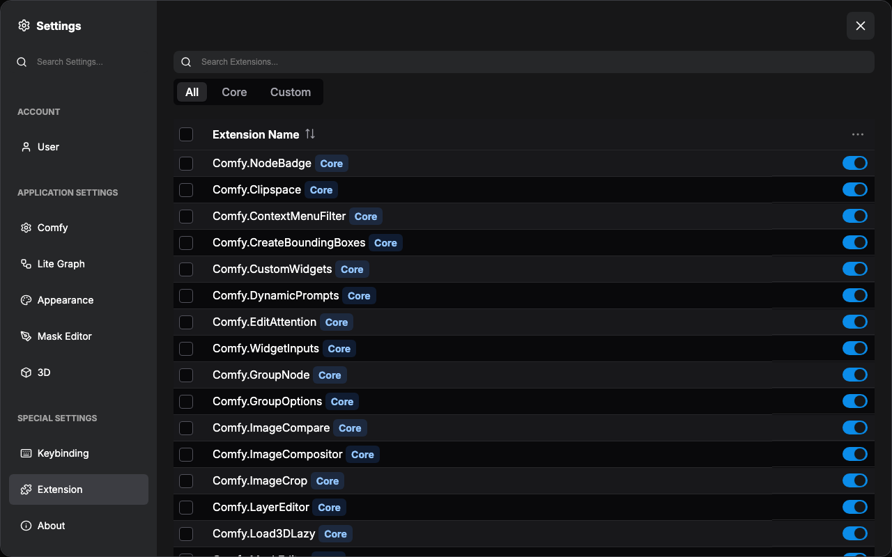

import SettingsMenuContext from "/snippets/de/interface/settings-menu-context.mdx"

<SettingsMenuContext />

Das Panel für Erweiterungs-Einstellungen ist ein besonderes Verwaltungspanel im Einstellungssystem des ComfyUI-Frontends. Es dient ausschließlich dazu, den Aktivierungsstatus von Frontend-Erweiterungs-Plugins zu verwalten. Anders als bei Custom Nodes wird dieses Panel nur verwendet, um Frontend-Erweiterungen zu verwalten, die von Custom Nodes registriert wurden, und nicht, um die Custom Nodes selbst zu deaktivieren.

Diese Frontend-Erweiterungs-Plugins erweitern die ComfyUI-Oberfläche, indem sie zum Beispiel Tastenkürzel, Einstellungen, UI-Komponenten, Menüeinträge und weitere Funktionen bereitstellen.

Änderungen am Status einer Erweiterung werden erst nach dem Neuladen der Seite wirksam:

## Funktionen des Erweiterungsbereichs

### 1. Erweiterungsliste verwalten
Zeigt alle registrierten Erweiterungen in einer Tabelle an, einschließlich:
- Erweiterungsname, mit einem Badge `Core` oder `Custom`
- Aktivierungsstatus als Schalter in jeder Zeile
- Ein Kontrollkästchen zum Auswählen von Erweiterungen für Batch-Operationen

Die Schaltflächen **All**, **Core** und **Custom** über der Tabelle filtern die Liste, und der Spaltenkopf Erweiterungsname sortiert sie.

### 2. Suchfunktion
Stellt ein Suchfeld bereit, um bestimmte Erweiterungen schnell zu finden:

### 3. Ein- und Ausschalten
Jede Erweiterung hat einen eigenen Umschalter:

### 4. Batch-Operationen
Die Schaltfläche ⋮ (Weitere Optionen) im Spaltenkopf Erweiterungsname öffnet ein Menü für Batch-Operationen:
- Ausgewählte aktivieren, Ausgewählte deaktivieren: gilt für die Erweiterungen, die Sie per Kontrollkästchen ausgewählt haben
- Alle Erweiterungen aktivieren, Alle Erweiterungen deaktivieren, Drittanbieter deaktivieren (Core-Erweiterungen behalten): gilt für jede Erweiterung, egal ob ausgewählt oder nicht

Erweiterungen, deren Status Sie geändert haben, werden über der Tabelle mit der Schaltfläche **Neu laden, um Änderungen zu übernehmen** aufgeführt.

## Hinweise

- Änderungen am Status einer Erweiterung werden erst nach dem Neuladen der Seite wirksam
- Einige Core-Erweiterungen können nicht deaktiviert werden
- Bekannte problematische Erweiterungen deaktiviert das System automatisch
- Erweiterungs-Einstellungen werden automatisch in der Benutzerkonfigurationsdatei gespeichert

Dieses Panel für Erweiterungs-Einstellungen ist im Wesentlichen ein „Frontend-Plugin-Manager“, mit dem Sie die Funktionsmodule von ComfyUI flexibel steuern können.