import SettingsMenuContext from "/snippets/de/interface/settings-menu-context.mdx"

<SettingsMenuContext />

LiteGraph ist die zugrunde liegende Grafik-Rendering-Engine von ComfyUI. Die Einstellungen in dieser Kategorie steuern hauptsächlich das Verhalten und das Erscheinungsbild der grafischen Oberflächen wie Canvas, Nodes und Verbindungen.

## Canvas

### Auswahlwerkzeugleiste anzeigen
- **Standardwert**: Aktiviert
- **Funktion**: Die Auswahlwerkzeugleiste ist eine schwebende Symbolleiste für Schnellaktionen, die nach dem Auswählen von Nodes auf diesen erscheint und gängige Schnelloperationen wie Teilausführung, Anheften, Löschen, Ändern der Farbe usw. bietet.

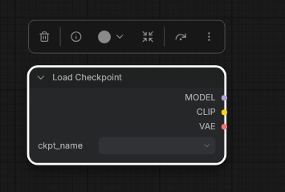

### Live-Auswahl
- **Standardwert**: Aktiviert
- **Funktion**: Wenn diese Option aktiviert ist, werden Nodes beim Ziehen eines Auswahlrechtecks in Echtzeit ausgewählt und abgewählt, ähnlich wie in anderen Design-Tools.

### Detailgrad von Nodes beim Zoomen (Schwellenwert für Schriftgröße)
- **Standardwert**: 8
- **Bereich**: 0 - 24
- **Funktion**: Legt fest, ab wann Nodes beim Verkleinern auf eine vereinfachte Detaildarstellung umschalten, gemessen als minimale Schriftgröße in Pixeln. Höhere Werte lassen Nodes früher auf die vereinfachte Darstellung wechseln, niedrigere Werte behalten die volle Node-Qualität länger, und 0 deaktiviert den Wechsel des Detailgrads vollständig. Die verschiedenen Darstellungsmodi sind unten abgebildet.

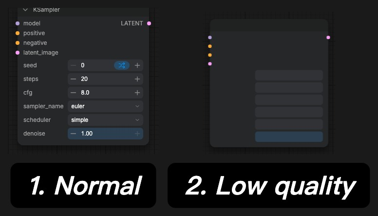

### Maximale FPS
- **Standardwert**: 0 (Bildwiederholrate des Bildschirms verwenden)
- **Bereich**: 0 - 120
- **Funktion**: Begrenzt die Bildrate beim Rendern des Canvas. 0 bedeutet, die Bildwiederholrate des Bildschirms zu verwenden. Höhere FPS machen das Rendern des Canvas flüssiger, verbrauchen aber auch mehr Leistung. Zu niedrige Werte führen zu deutlich stärkerem Ruckeln.

### Immer am Raster ausrichten
- **Standardwert**: Deaktiviert
- **Funktion**: Wenn diese Option nicht aktiviert ist, können Sie die Taste `Shift` gedrückt halten, um die Kanten von Nodes am Raster auszurichten. Wenn sie aktiviert ist, richten sich die Kanten von Nodes automatisch am Raster aus, ohne dass Sie die Taste `Shift` gedrückt halten müssen.

<video controls>
  <source src="/images/interface/setting/lite-graph/snap-to-grid.mp4" type="video/mp4" />
</video>

### Rastergröße für Einrasten
- **Standardwert**: 10
- **Bereich**: 1 - 500
- **Funktion**: Wenn das automatische Einrasten aktiviert ist oder Sie Nodes mit gedrückter Taste `Shift` verschieben, bestimmt dieser Parameter die Rastergröße für das Einrasten. Der Standardwert ist 10, und Sie können ihn nach Bedarf anpassen.

### Schnellzoom-Tastenkürzel aktivieren (Ctrl + Shift + Drag)
- **Standardwert**: Aktiviert
- **Funktion**: Aktiviert die Schnellzoom-Funktion über `Ctrl + Shift + Left Mouse Button Drag`, die eine schnellere Zoom-Operation bietet.

<video controls>
  <source src="/images/interface/setting/lite-graph/fast-zoom.mp4" type="video/mp4" />
</video>

### Graph-Canvas-Menü anzeigen
- **Standardwert**: Aktiviert
- **Funktion**: Steuert, ob das Canvas-Menü in der unteren rechten Ecke angezeigt wird.

Das Canvas-Menü befindet sich in der unteren rechten Ecke der gesamten ComfyUI-Oberfläche und enthält Operationen wie das Zoomen des Canvas, das vorübergehende Ausblenden aller Verbindungen, das schnelle Skalieren des Workflows, damit er in den Canvas passt, usw., wie in der folgenden Abbildung gezeigt.

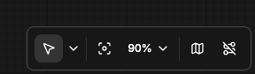

### Canvas-Zoomgeschwindigkeit
- **Standardwert**: 1.1
- **Bereich**: 1.01 - 2.5
- **Funktion**: Steuert die Geschwindigkeit des Canvas-Zooms und passt die Empfindlichkeit beim Zoomen mit dem Mausrad an.

### Canvas-Informationen unten links anzeigen (FPS usw.)
- **Standardwert**: Aktiviert
- **Funktion**: Steuert, ob Canvas-Informationen in der unteren linken Ecke angezeigt werden, darunter Leistungskennzahlen wie FPS.

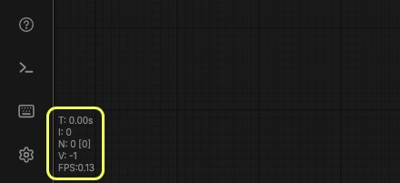

### Geschwindigkeit für automatisches Verschieben
- **Standardwert**: 15
- **Bereich**: 0 - 30
- **Funktion**: Legt die maximale Geschwindigkeit fest, die verwendet wird, wenn der Canvas automatisch verschoben wird, während Sie einen Node oder eine Verbindung gegen den Canvas-Rand ziehen. Setzen Sie den Wert auf 0, um das automatische Verschieben zu deaktivieren.

## Canvas-Navigation

### Navigationsmodus
- **Standardwert**: Drag Navigation
- **Optionen**: Standard (New), Drag Navigation, Custom
- **Funktion**: Wählt eine Voreinstellung für die beiden unten beschriebenen Verhaltensweisen der Canvas-Navigation. Standard (New) wählt mit der linken Maustaste aus und verschiebt mit dem Mausrad, Drag Navigation (der Standard) verschiebt mit der linken Maustaste und vergrößert/verkleinert mit dem Mausrad, und Custom behält die Einstellungen bei, die Sie für jede Verhaltensweise einzeln festgelegt haben. Wenn Sie eine der beiden Verhaltensweisen so ändern, dass sie nicht mehr der Voreinstellung entspricht, wird diese Einstellung auf Custom umgestellt.

### Verhalten bei linkem Mausklick
- **Standardwert**: Panning
- **Optionen**: Panning, Select
- **Funktion**: Legt fest, was das Ziehen mit der linken Maustaste auf einem leeren Bereich des Canvas bewirkt: den Canvas verschieben oder ein Auswahlrechteck aufziehen.

### Mausradverhalten
- **Standardwert**: Zoom in/out
- **Optionen**: Panning, Zoom in/out
- **Funktion**: Legt fest, was das Mausrad auf dem Canvas bewirkt: Vergrößern und Verkleinern oder vertikales Verschieben.

## Kontextmenü

### Menüs (Listen) von Node-Combo-Widgets beim Hineinzoomen skalieren
- **Standardwert**: Deaktiviert
- **Funktion**: Legt fest, ob die Menüs (Listen) von Node-Combo-Widgets beim Hineinzoomen skaliert werden, damit Sie Node-Combo-Widgets auswählen können

## Graph

### Verbindungsdarstellungsmodus
- **Standardwert**: 2 (Spline)
- **Optionen**: Gerade, Linear, Spline, Ausgeblendet
- **Funktion**: Legt den Darstellungsstil von Verbindungen fest und steuert das visuelle Erscheinungsbild der Verbindungen zwischen Nodes.

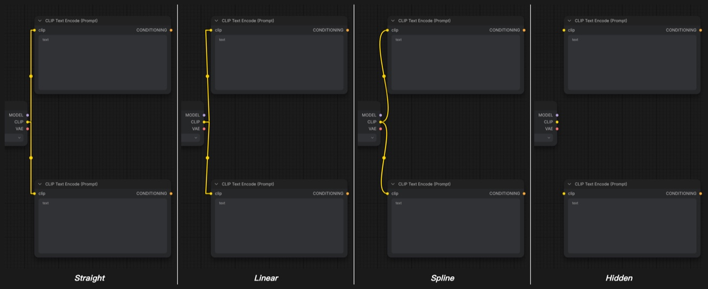

## Gruppe

Dieser Abschnitt der Einstellungen bezieht sich hauptsächlich auf die Funktionalität von Nodegruppen.

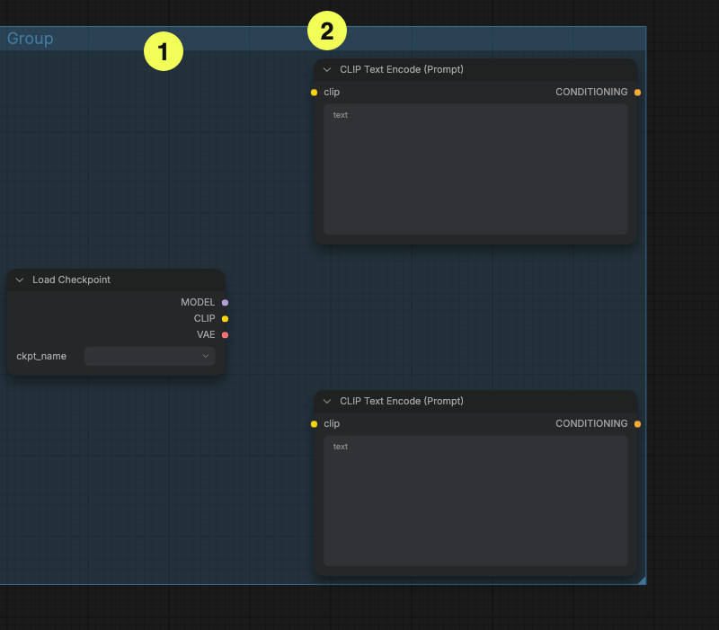

### Gruppentitel per Doppelklick bearbeiten
- **Standardwert**: Aktiviert
- **Funktion**: Steuert, ob Sie den Node-Titel per Doppelklick bearbeiten können, sodass Benutzer Nodes umbenennen können; in der Abbildung als Teil `1` markiert.

### Randabstand beim Gruppieren ausgewählter Nodes
- **Standardwert**: 10
- **Bereich**: 0 - 100
- **Funktion**: Legt den Innenabstand beim Gruppieren ausgewählter Nodes fest und steuert den Abstand zwischen Gruppenrahmen und Nodes; in der Abbildung als Pfeilannotation `2` markiert.

### Gruppeninhalte beim Klicken auswählen
- **Standardwert**: Deaktiviert
- **Funktion**: Wenn aktiviert, werden beim Klick auf eine Gruppe alle darin enthaltenen Nodes und Elemente ausgewählt.

## Verbindung

### Markierungen in der Verbindungsmitte
- **Standardwert**: Kreis
- **Optionen**: Keine, Kreis, Pfeil
- **Funktion**: Legt den Markierungsstil in der Verbindungsmitte fest und zeigt Richtungsindikatoren in der Verbindungsmitte an.

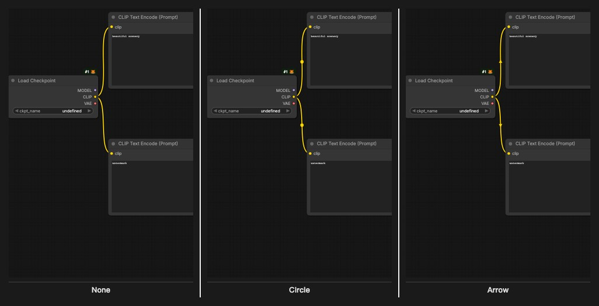

## Verbindungsfreigabe

Dieser Menüabschnitt steuert derzeit hauptsächlich die zugehörigen Operationen, wenn Verbindungen freigegeben werden. Die beiden derzeit relevanten Operationen sind:

**Nach der Freigabe erscheint eine Node-Empfehlungsliste, die sich auf die aktuelle Eingabe/Ausgabe bezieht**
<video controls>
  <source src="/images/interface/setting/lite-graph/link-release-contenxt-menu.mp4" type="video/mp4" />
</video>

**Nach der Freigabe wird ein Suchfeld geöffnet**
<video controls>
  <source src="/images/interface/setting/lite-graph/link-release-search-box.mp4" type="video/mp4" />
</video>

### Aktion bei Verbindungsfreigabe (Shift)
- **Standardwert**: Suchfeld
- **Optionen**: Kontextmenü, Suchfeld, Keine Aktion
- **Funktion**: Legt die Aktion fest, wenn Verbindungen bei gehaltener Shift-Taste freigegeben werden, also das besondere Verhalten beim Freigeben von Verbindungen bei gehaltener Shift-Taste

### Aktion bei Verbindungsfreigabe (ohne Modifikatortaste)
- **Standardwert**: Kontextmenü
- **Optionen**: Kontextmenü, Suchfeld, Keine Aktion
- **Funktion**: Legt die Standardaktion beim Freigeben von Verbindungen fest und steuert das Verhalten nach dem Ziehen und Freigeben von Verbindungen

## Node

### Neue Nodes immer auf Minimalgröße verkleinern
- **Standardwert**: Deaktiviert
- **Funktion**: Steuert, ob neue Nodes beim Erstellen automatisch verkleinert werden. Nodes werden dann stets in minimaler Größe angezeigt, wodurch beim Hinzufügen jedoch Text abgeschnitten werden kann und die Node-Größe manuell angepasst werden muss.

### DOM-Element-Clipping aktivieren (kann die Leistung beeinträchtigen)
- **Standardwert**: Aktiviert
- **Funktion**: Aktiviert das Clipping von DOM-Elementen (kann die Leistung beeinträchtigen). Optimiert das Rendering, kann aber die Leistung verringern.

### Mittelklick erstellt einen neuen Reroute-Node
- **Standardwert**: Aktiviert
- **Funktion**: Erstellt beim Mittelklick einen neuen Reroute-Node. So lassen sich schnell Reroute-Nodes zum Organisieren von Verbindungen anlegen.

### Alle Verbindungen beim Löschen von Nodes behalten
- **Standardwert**: Aktiviert
- **Funktion**: Umgeht Verbindungen beim Löschen von Zwischen-Nodes automatisch und versucht, Eingabe- und Ausgabe-Verbindungen beim Löschen von Nodes wiederherzustellen.

### Node beim Einrasten hervorheben
- **Standardwert**: Aktiviert
- **Funktion**: Hebt Nodes hervor, wenn Verbindungen auf sie gezogen werden. Bietet visuelles Feedback und zeigt verbindungsfähige Nodes an. Wenn aktiviert, wird die entsprechende Seite der Verbindung wie im folgenden Bild hervorgehoben dargestellt.

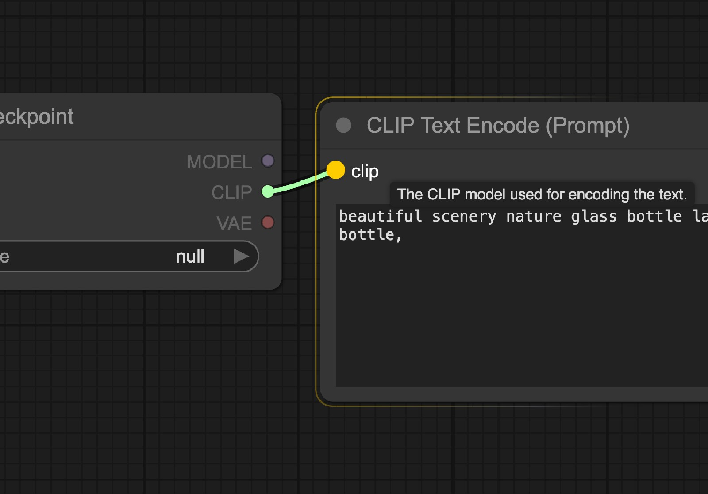

### Verbindung automatisch am Node-Slot einrasten
- **Standardwert**: Aktiviert
- **Funktion**: Rastet Verbindungen beim Ziehen auf Nodes automatisch an verfügbaren Slots ein, vereinfacht Verbindungsvorgänge und findet automatisch geeignete Eingabe-Slots.

<video controls>
  <source src="/images/interface/setting/lite-graph/snap-link-to-node-slot.mp4" type="video/mp4" />
</video>

### Tooltips aktivieren
- **Standardwert**: Aktiviert
- **Funktion**: Einige Node-Informationen enthalten Tooltips, darunter Parameterbeschreibungen usw. Wenn aktiviert, werden diese Tooltips beim Darüberfahren mit der Maus angezeigt, wie im folgenden Bild dargestellt.

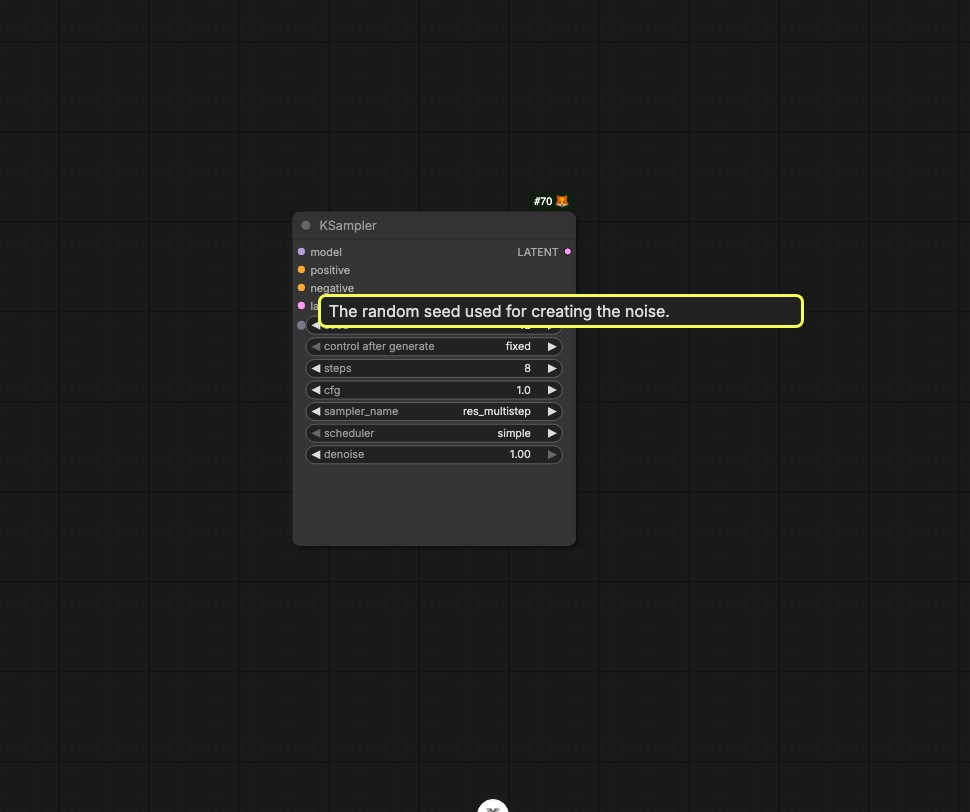

### Tooltip-Verzögerung
- **Standardwert**: 500
- **Bereich**: 100 - 3000
- **Funktion**: Steuert die Verzögerung in Millisekunden, bevor ein Tooltip angezeigt wird.

### Node-Lebenszyklus-Abzeichenmodus
- **Standardwert**: Alle anzeigen
- **Funktion**: Steuert die Anzeige der Node-Lebenszyklus-Markierungen und zeigt Statusinformationen der Nodes an.

### Node-ID-Abzeichenmodus
- **Standardwert**: Keine
- **Funktion**: Steuert die Anzeige der Node-ID-Markierungen und zeigt eindeutige Node-Identifikatoren an.

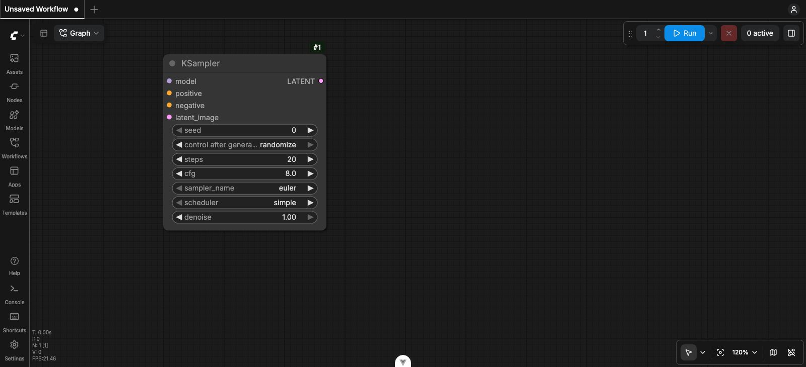

### Node-Quell-Abzeichenmodus
- **Standardwert**: Integrierte ausblenden
- **Optionen**:
  - Keine
  - Integrierte ausblenden
  - Alle anzeigen
- **Funktion**: Steuert den Anzeigemodus der Node-Quell-Markierungen und zeigt Quellinformationen der Nodes an. Der entsprechende Anzeigeeffekt ist im folgenden Bild dargestellt. Wenn Alle anzeigen ausgewählt ist, werden Beschriftungen sowohl für Custom Nodes als auch für integrierte Nodes angezeigt, sodass Sie die entsprechende Node-Quelle bequem bestimmen können. Das entsprechende Fuchs-Logo steht für integrierte ComfyUI-Nodes.

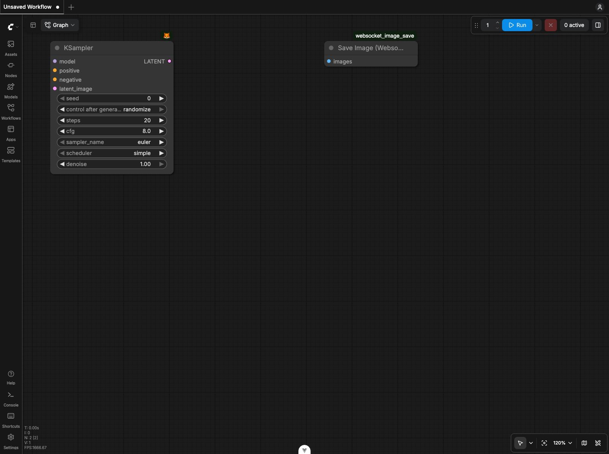

### Node-Titel per Doppelklick bearbeiten
- **Standardwert**: Aktiviert
- **Funktion**: Steuert, ob Sie den Node-Titel per Doppelklick bearbeiten können, um Nodes umzubenennen.

## Node-Widget

### Nachkommastellen für Float-Widget-Rundung [0 = Automatisch]
- **Standardwert**: 0 (Automatisch)
- **Bereich**: 0 - 6
- **Funktion**: Legt die Anzahl der Nachkommastellen für die Rundung von Float-Widgets fest. 0 bedeutet Automatisch. Erfordert ein Neuladen der Seite.

### Standardmäßige Float-Widget-Rundung deaktivieren
- **Standardwert**: Deaktiviert
- **Funktion**: Steuert, ob die standardmäßige Rundung von Float-Widgets deaktiviert wird. Erfordert ein Neuladen der Seite. Kann nicht deaktiviert werden, wenn das Node-Backend eine Rundung festgelegt hat.

### Slider für Node-Widgets deaktivieren
- **Standardwert**: Deaktiviert
- **Funktion**: Steuert, ob Slider-Steuerelemente in Node-Widgets deaktiviert werden. Erzwingt eine Texteingabe anstelle von Slidern.

### Erweiterte Widgets immer auf allen Nodes anzeigen
- **Standardwert**: Deaktiviert
- **Funktion**: Wenn aktiviert, sind erweiterte Widgets immer auf allen Nodes sichtbar, ohne jeden Node einzeln aufklappen zu müssen.

### Vorschaubildformat
- **Standardwert**: Leerer String (Originalformat verwenden)
- **Funktion**: Legt das Format für Vorschaubilder in Bild-Widgets fest. Konvertiert in leichtgewichtige Formate wie webp, jpeg usw.

### Breite × Höhe unter der Bildvorschau anzeigen
- **Standardwert**: Aktiviert
- **Funktion**: Zeigt die Informationen Breite × Höhe unter Bildvorschauen an und gibt die Abmessungen des Bildes wieder.

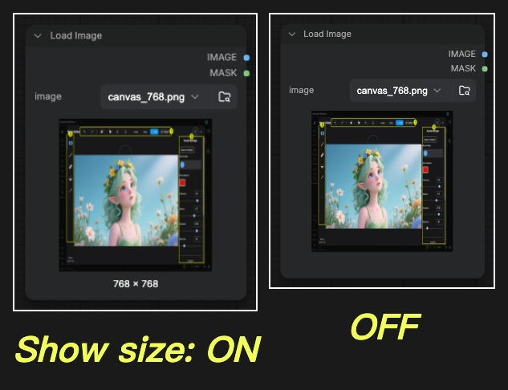

## Zeiger

### Trackpad-Gesten aktivieren
- **Standardwert**: Aktiviert
- **Funktion**: Diese Einstellung aktiviert den Trackpad-Modus für den Canvas und ermöglicht Zwei-Finger-Pinch-Zoom und Ziehen.

### Doppelklick-Intervall (maximal)
- **Standardwert**: 300
- **Funktion**: Maximale Zeit (in Millisekunden) zwischen zwei Klicks eines Doppelklicks. Ein höherer Wert hilft, Probleme zu lösen, bei denen Doppelklicks manchmal nicht erkannt werden.

### Zeiger-Drift beim Klicken (maximale Distanz)
- **Standardwert**: 6
- **Funktion**: Bewegt sich der Zeiger beim Gedrückthalten der Maustaste weiter als diese Distanz, gilt die Aktion als Ziehen (statt als Klick). Hilft, versehentliche Mausbewegungen beim Klicken zu vermeiden.

## Reroute

### Spline-Versatz für Reroute
- **Standardwert**: 20
- **Funktion**: Legt die Glätte der Kurven auf beiden Seiten von Reroute-Nodes fest. Größere Werte machen die Kurven glatter, kleinere Werte machen sie schärfer.

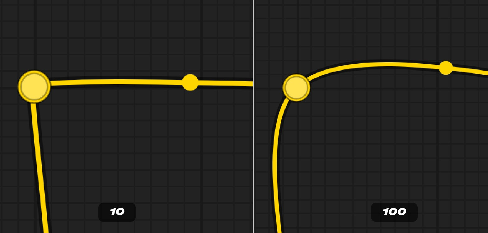
