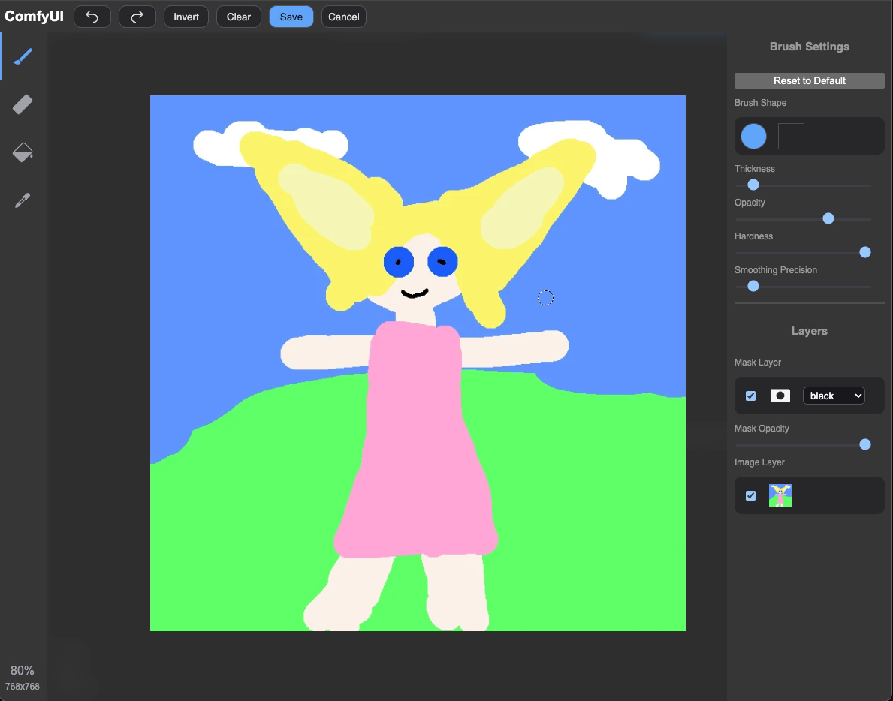
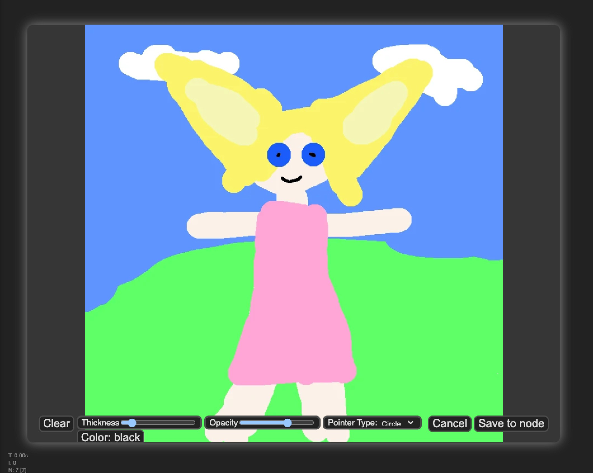

import SettingsMenuContext from "/snippets/de/interface/settings-menu-context.mdx"

<SettingsMenuContext />

## Pinseleinstellung

### Multiplikator für Anpassungsgeschwindigkeit des Pinsels
- **Funktion**: Steuert die Geschwindigkeit, mit der sich Pinselgröße und Härte bei der Anpassung ändern
- **Beschreibung**: Höhere Werte bedeuten schnellere Änderungen

### Pinseleinstellung an dominante Achse sperren
- **Funktion**: Wenn aktiviert, wirkt sich die Pinseleinstellung je nach Bewegungsrichtung nur auf die Größe oder die Härte aus
- **Beschreibung**: Mit dieser Funktion können Sie die Anpassung der Pinsel-Eigenschaften präziser steuern

## Neuer Editor

### Neuen Maskeneditor verwenden

- **Funktion**: Wechselt zur Oberfläche des neuen Pinseleditors
- **Beschreibung**: Ermöglicht den Wechsel zwischen der neuen und der alten Editor-Oberfläche

<Tabs>
    <Tab title="Neuer Editor">
    Die neue Version bietet eine bessere Oberfläche und Interaktion sowie einen vollständigeren Funktionsumfang.
        
    </Tab>
    <Tab title="Alter Editor">
    Die alte Version ist eine frühe Version mit relativ einfachem Funktionsumfang, erfüllt aber grundlegende Anforderungen. Sie wird künftig nicht mehr aktualisiert.
        
    </Tab>
</Tabs>