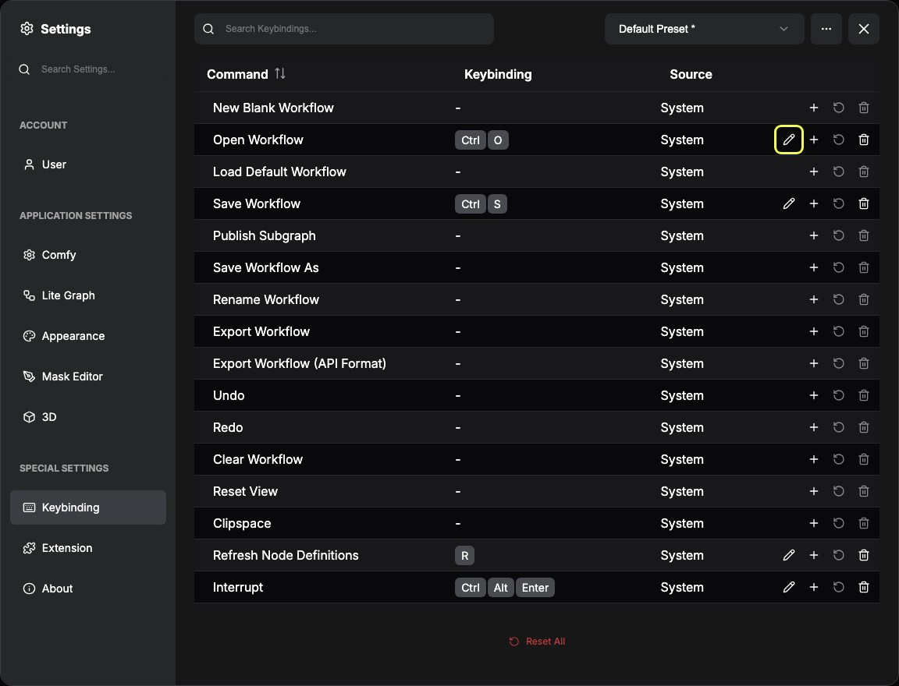

import SettingsMenuContext from "/snippets/de/interface/settings-menu-context.mdx"

{/*
description: "Eine Liste der Tastatur- und Maus-Tastenkürzel für ComfyUI"
*/}

{/* TODO(yoland): Add this back to comfyUI readme page */}

<SettingsMenuContext />

ComfyUI wird mit einer Standardauswahl an Tastenkürzeln ausgeliefert, und jeder Befehl kann neu belegt werden. Öffnen Sie **Einstellungen (Zahnrad-Symbol)** > **Tastenkürzel**, um sie anzuzeigen und zu ändern.

## Tastenkürzel suchen und bearbeiten

Das Panel listet jeden Befehl mit seinem aktuellen Tastenkürzel auf. Das Suchfeld oben grenzt die Liste ein, und ein Klick auf die Kopfzeile **Befehl** sortiert sie alphabetisch. Die Spalte **Quelle** nennt die Erweiterung oder das Custom-Node-Paket, das einen Befehl bereitstellt; bei Befehlen, die von ComfyUI selbst stammen, bleibt sie leer.

Wählen Sie das Bearbeiten-Symbol in einer Zeile, um eine neue Tastenkombination aufzuzeichnen. Über das Zeilenmenü können Sie den Befehl auf seinen Standard zurücksetzen oder seine Tastenkürzel entfernen. Hat ein Befehl mehr als ein Tastenkürzel, wird die Zeile ausgeklappt und jedes Kürzel erhält eigene Schaltflächen zum Bearbeiten und Löschen. **Alle zurücksetzen** unten im Panel löscht nach einer Bestätigung alle Anpassungen.

## Tastenkürzel-Voreinstellungen

Ihre Änderungen gehören zu einer benannten Voreinstellung, und die Auswahl der Voreinstellung oben im Panel wechselt zwischen ihnen. Die **Standardvoreinstellung** enthält die integrierten Tastenkürzel. Wenn Sie sie auswählen, werden diese Tastenkürzel wiederhergestellt und die ungespeicherten Änderungen Ihrer aktuellen Sitzung verworfen. Voreinstellungen, die Sie früher gespeichert haben, bleiben auf der Festplatte erhalten.

- Der Name einer Voreinstellung zeigt ein `*`, solange ungespeicherte Änderungen vorhanden sind. Bei einer gespeicherten Voreinstellung wählen Sie **Änderungen speichern**, um sie zu sichern. Die Standardvoreinstellung hat keine Schaltfläche „Änderungen speichern“, daher werden ihre Änderungen über **Als neue Voreinstellung speichern** gesichert.
- Die Schaltfläche ... (mehr) neben der Auswahl der Voreinstellung enthält **Als neue Voreinstellung speichern** (ausgeblendet, solange die Standardvoreinstellung keine Änderungen hat), **Auf Standard zurücksetzen**, **Voreinstellung löschen** (für die Standardvoreinstellung deaktiviert), **Voreinstellung importieren** und **Voreinstellung exportieren**.
- **Voreinstellung importieren** liest eine aus ComfyUI exportierte Voreinstellungsdatei ein, sodass ein Satz von Tastenkürzeln zwischen Installationen verschoben oder an einen anderen Benutzer weitergegeben werden kann. **Voreinstellung exportieren** schreibt die aktuelle Voreinstellung in eine JSON-Datei.
- Beim Wechseln der Voreinstellung mit ungespeicherten Änderungen werden Sie aufgefordert, diese zuerst zu speichern oder sie zu verwerfen und fortzufahren.

Voreinstellungen werden als JSON-Dateien im Benutzerverzeichnis von ComfyUI unter `keybindings/` gespeichert.

Im Folgenden finden Sie die aktuelle Standardliste der Tastenkürzel.

<Tabs><Tab title="Windows/Linux">
| Tastenkürzel                        | Befehl                                                                                                             |
|------------------------------------|--------------------------------------------------------------------------------------------------------------------|
| Ctrl + Enter                       | Prompt in Warteschlange einreihen                                                                                  |
| Ctrl + Shift + Enter               | Prompt in Warteschlange einreihen (vorne)                                                                          |
| Ctrl + Alt + Enter                 | Unterbrechen                                                                                                       |
| Ctrl + Z / Ctrl + Y                | Rückgängig/Wiederholen                                                                                             |
| Ctrl + S                           | Workflow speichern                                                                                                 |
| Ctrl + O                           | Workflow laden                                                                                                     |
| Ctrl + A                           | Alle Nodes auswählen                                                                                               |
| Alt + C                            | Ausgewählte Nodes reduzieren/erweitern                                                                             |
| Ctrl + M                           | Ausgewählte Nodes stummschalten/Stummschaltung aufheben                                                            |
| Ctrl + B                           | Ausgewählte Nodes umgehen/Umgehung aufheben                                                                        |
| Delete Backspace               | Ausgewählte Nodes löschen                                                                                          |
| Backspace                          | Workflow leeren                                                                                                    |
| Space                              | Canvas verschieben, indem Sie den Cursor halten und bewegen                                                        |
| Ctrl + Click Shift + Click     | Angeklickten Node zur Auswahl hinzufügen                                                                           |
| Ctrl + C/Ctrl + V                  | Ausgewählte Nodes kopieren und einfügen (ohne Verbindungen zu Ausgängen nicht ausgewählter Nodes beizubehalten)    |
| Ctrl + C/Ctrl + Shift + V          | Ausgewählte Nodes kopieren und einfügen (Verbindungen von Ausgängen nicht ausgewählter Nodes zu Eingängen eingefügter Nodes beibehalten) |
| Shift + Drag                       | Mehrere ausgewählte Nodes gleichzeitig verschieben                                                                 |
| Ctrl + G                           | Rahmen zu ausgewählten Nodes hinzufügen                                                                            |
| Ctrl + ,                           | Einstellungsdialog anzeigen                                                                                        |
| Alt + =                            | Vergrößern (Canvas)                                                                                                |
| Alt + -                            | Verkleinern (Canvas)                                                                                               |
| .                                  | Ansicht an ausgewählte Nodes anpassen                                                                              |
| P                                  | Ausgewählte Elemente anheften/lösen                                                                                |
| L                                  | Verbindungen der ausgewählten Nodes ein- oder ausblenden                                                           |
| Q                                  | Warteschlangen-Seitenleiste ein-/ausblenden                                                                        |
| W                                  | Workflow-Seitenleiste ein-/ausblenden                                                                              |
| N                                  | Node-Bibliothek-Seitenleiste ein-/ausblenden                                                                       |
| M                                  | Modellbibliothek-Seitenleiste ein-/ausblenden                                                                      |
| Ctrl + `                           | Unteres Log-Panel ein-/ausblenden                                                                                  |
| F                                  | Fokusmodus (Vollbild) umschalten                                                                                   |
| R                                  | Node-Definitionen aktualisieren                                                                                    |
| Double-Click LMB                   | Schnellsuche nach hinzuzufügenden Nodes                                                                            |
</Tab><Tab title="MacOS">
| Tastenkürzel                          | Befehl                                                                                                            |
|--------------------------------------|--------------------------------------------------------------------------------------------------------------------|
| Cmd ⌘ + Enter                        | Prompt in Warteschlange einreihen                                                                                  |
| Cmd ⌘ + Shift + Enter                | Prompt in Warteschlange einreihen (vorne)                                                                          |
| Cmd ⌘ + Alt + Enter                  | Unterbrechen                                                                                                       |
| Cmd ⌘ + Z/Cmd ⌘ + Y                  | Rückgängig/Wiederholen                                                                                             |
| Cmd ⌘ + S                            | Workflow speichern                                                                                                 |
| Cmd ⌘ + O                            | Workflow laden                                                                                                     |
| Cmd ⌘ + A                            | Alle Nodes auswählen                                                                                               |
| Opt ⌥ + C                            | Ausgewählte Nodes reduzieren/wieder erweitern                                                                      |
| Cmd ⌘ + M                            | Ausgewählte Nodes stummschalten/Stummschaltung aufheben                                                            |
| Cmd ⌘ + B                            | Ausgewählte Nodes umgehen/Umgehung aufheben                                                                        |
| Delete Backspace                 | Ausgewählte Nodes löschen                                                                                          |
| Backspace                            | Workflow leeren                                                                                                    |
| Leertaste                            | Canvas beim Halten und Bewegen des Cursors verschieben                                                             |
| Cmd ⌘ + Klick Shift + Klick      | Angeklickten Node zur Auswahl hinzufügen                                                                           |
| Cmd ⌘ + C / Cmd ⌘ + V                | Ausgewählte Nodes kopieren und einfügen (ohne Verbindungen zu Ausgängen nicht ausgewählter Nodes beizubehalten)     |
| Cmd ⌘ + C / Cmd ⌘ + Shift + V        | Ausgewählte Nodes kopieren und einfügen (Verbindungen von Ausgängen nicht ausgewählter Nodes zu Eingängen eingefügter Nodes bleiben erhalten) |
| Shift + Ziehen                       | Mehrere ausgewählte Nodes gleichzeitig verschieben                                                                 |
| Cmd ⌘ + G                            | Rahmen zu ausgewählten Nodes hinzufügen                                                                            |
| Cmd ⌘ + ,                            | Einstellungsdialog anzeigen                                                                                        |
| Opt ⌥ + =                            | Vergrößern (Canvas)                                                                                                |
| Opt ⌥ + -                            | Verkleinern (Canvas)                                                                                               |
| .                                    | Ansicht an ausgewählte Nodes anpassen                                                                              |
| P                                    | Ausgewählte Elemente anheften/lösen                                                                                |
| L                                    | Verbindungen der ausgewählten Nodes ein- oder ausblenden                                                           |
| Q                                    | Warteschlangen-Seitenleiste ein-/ausblenden                                                                        |
| W                                    | Workflow-Seitenleiste ein-/ausblenden                                                                              |
| N                                    | Node-Bibliothek-Seitenleiste ein-/ausblenden                                                                       |
| M                                    | Modellbibliothek-Seitenleiste ein-/ausblenden                                                                      |
| Cmd ⌘ + `                            | Unteres Log-Panel ein-/ausblenden                                                                                  |
| F                                    | Fokusmodus umschalten (Vollbild)                                                                                   |
| R                                    | Node-Definitionen aktualisieren                                                                                    |
| Doppelklick LMB                      | Schnellsuche nach Nodes zum Hinzufügen                                                                             |

</Tab>
</Tabs>

## Rückgängig und Wiederholen in einem Node

Einige Widgets führen ihre eigene Bearbeitungshistorie: der Maler, Begrenzungsrahmen, Bildzuschnitt, Videobearbeitung sowie Kurven-, Bereichs-, Farb- und Licht-Widgets. Wenn der Tastaturfokus in einem dieser Nodes liegt, schreiten `Ctrl + Z` und `Ctrl + Y` (`Cmd ⌘` unter macOS) durch die Widget-Historie dieses Nodes, und zwar in demselben Schritt, den seine Schaltflächen „Rückgängig“ und „Wiederholen“ ausführen. Bei einem Node mit mehreren Widgets mit eigener Historie wird das zuletzt bearbeitete rückgängig gemacht.

In allen anderen Fällen macht die Tastenkombination weiterhin den Workflow-Graphen rückgängig: bei Fokus auf dem leeren Canvas oder auf einem Node, dessen Widget-Schritte aufgebraucht sind. Ein fokussiertes Textfeld bildet einen Sonderfall: Dort behält die Tastenkombination ihre normale Textbearbeitung bei und erreicht weder den Graphen noch das Widget. Für den App-Modus gilt dies nicht.
