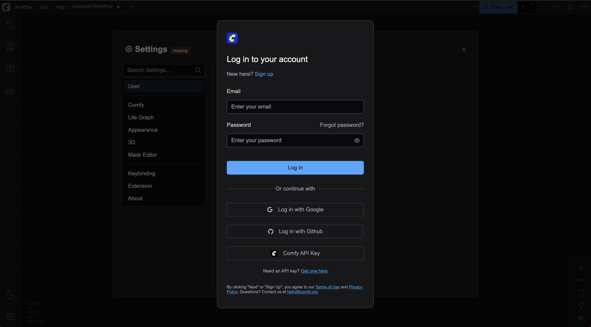
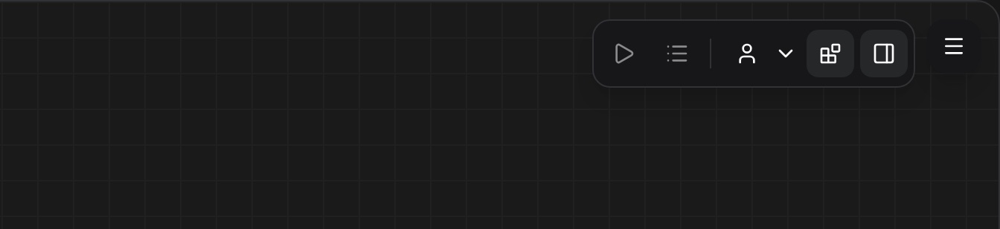
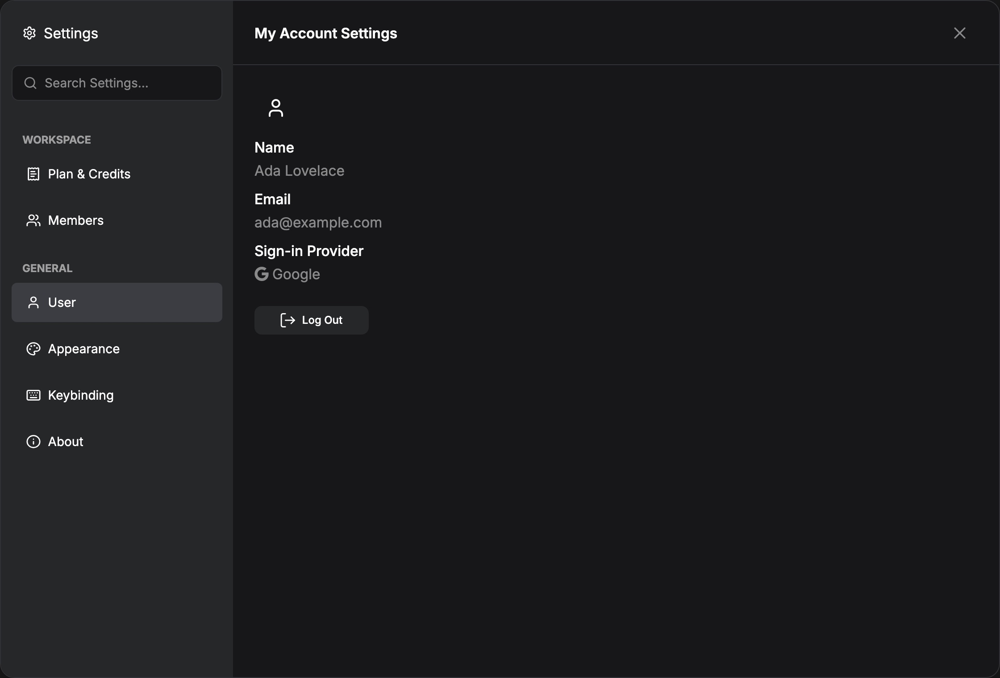

import SettingsMenuContext from "/snippets/de/interface/settings-menu-context.mdx"

<SettingsMenuContext />

Partner-Nodes und die Cloud-Abrechnung erfordern ein angemeldetes ComfyUI-Konto. Melden Sie sich unter **Einstellungen → Benutzer** an (in der Gruppe **Allgemein**). Nach der Anmeldung erscheint **Einstellungen → Workspace → Tarif & Credits** für Guthaben und Aufladen. Siehe [Tarif & Credits](/de/interface/credits).

Derzeit unterstützen wir die folgenden Anmeldemethoden:

- E-Mail-Anmeldung
- Google-Anmeldung
- GitHub-Anmeldung
- API-Schlüssel-Anmeldung (für die Autorisierung von Websites, die nicht auf der Whitelist stehen)

Die relevanten Anforderungen an die Anmeldung und die zugehörigen Erläuterungen finden Sie in diesem Dokument.

## Anforderungen an die ComfyUI-Version

Möglicherweise benötigen Sie mindestens [ComfyUI v0.3.0](https://github.com/Comfy-Org/ComfyUI/releases/tag/v0.3.30), um das Kontosystem zu verwenden. Stellen Sie sicher, dass die entsprechende Frontend-Version mindestens `1.17.11` beträgt. Manchmal schlägt die Installation des Frontends fehl und es fällt auf eine ältere Version zurück. Prüfen Sie deshalb bitte unter `Settings` -> `About`, ob die Frontend-Version größer als `1.17.11` ist.

In einigen Regionen können Netzwerkbeschränkungen den normalen Zugriff auf die Login-API verhindern, was zu Timeouts oder Fehlern führt. **Stellen Sie vor der Anmeldung sicher, dass Ihr Netzwerkumfeld den Zugriff auf die entsprechende API nicht einschränkt**, und vergewissern Sie sich, dass Sie auf Seiten wie Google oder GitHub zugreifen können.

<Tip>
Da wir uns weiterhin in einer Phase schneller iterativer Updates befinden, können sich die zugehörigen Funktionen ändern. Sofern keine besonderen Umstände vorliegen, aktualisieren Sie bitte auf die neueste Version, um Support für die entsprechenden Funktionen zu erhalten.
</Tip>

## Netzwerkanforderungen

Um sich bei Ihrem ComfyUI-Konto anzumelden, müssen Sie sich in einer sicheren Netzwerkumgebung befinden:

- Erlauben Sie den Zugriff ausschließlich von `127.0.0.1` oder `localhost` aus.
- Die Verwendung des Parameters `--listen` für den Zugriff auf den Partner Node über ein lokales Netzwerk wird nicht unterstützt.
- Wenn Sie ein Nicht-SSL-Zertifikat oder eine Website verwenden, die nicht mit `https` beginnt, können Sie sich möglicherweise nicht erfolgreich anmelden.
- Auf einer Website, die nicht in unserer Whitelist aufgeführt ist, können Sie sich möglicherweise nicht anmelden (mit einem API-Schlüssel ist die Anmeldung jetzt jedoch möglich).
- Stellen Sie sicher, dass Sie eine normale Verbindung zu unserem Dienst herstellen können (in einigen Regionen ist möglicherweise ein Proxy erforderlich).

## Anmelden

Melden Sie sich über **Einstellungen → Benutzer** an:

## Anmeldemethoden

Wenn Sie sich zum ersten Mal anmelden, erstellen Sie bitte zuerst ein Konto.

<Card title="Anmelden mit einem API-Schlüssel" icon="key" href="/de/account/login#logging-in-with-an-api-key">
  Für nicht auf der Whitelist stehende Websites oder LAN-Umgebungen können Sie die Anmeldung per API-Schlüssel verwenden. Eine ausführliche Anleitung finden Sie in der Dokumentation zur Kontoanmeldung.
</Card>

## Status nach der Anmeldung

Nach dem Anmelden zeigt das obere Menü die Steuerung Ihres Kontos. Von dort aus können Sie das Benutzerpanel erneut öffnen, sich abmelden und in Cloud **Manage plan** öffnen (dasselbe Panel **Tarif & Credits** wie unter **Einstellungen → Workspace → Tarif & Credits**).

## Häufig gestellte Fragen

<AccordionGroup>
  <Accordion title="Wie ändere ich meinen Anzeigenamen oder meine E-Mail-Adresse?">
  Die Zeilen **Name**, **Email** und **Provider** unter **Einstellungen → Benutzer** sind schreibgeschützt. Sie zeigen die Daten an, die Ihr angemeldetes Konto zurückliefert, und das Panel bietet kein Feld, um sie zu bearbeiten.

  - **Anmeldung über Google oder GitHub**: Name und E-Mail-Adresse stammen aus dem Profil des jeweiligen Anbieters. Aktualisieren Sie sie dort und melden Sie sich anschließend ab und erneut an, damit das Panel die neuen Werte anzeigt.
  - **Registrierung per E-Mail**: Für das Konto ist kein Name hinterlegt, daher zeigt **Name** den Wert **Not set** an. Das Panel bietet derzeit keine Möglichkeit, einen Namen hinzuzufügen oder zu ändern.
  - **E-Mail-Adresse**: Sie bleibt die Adresse, mit der Sie sich registriert haben, oder die Adresse, die der Anbieter zurückliefert. Sie kann innerhalb der App nicht geändert werden.
  </Accordion>

  <Accordion title="Gibt es Einschränkungen bei den Geräten für die Anmeldung?">
   Wir schränken die Geräte für die Anmeldung nicht ein. Sie können sich bei Ihrem Konto auf jedem Gerät anmelden. Beachten Sie jedoch, dass andere Geräte auf Ihre Kontoinformationen zugreifen können; melden Sie sich deshalb nicht auf öffentlichen Geräten bei Ihrem Konto an.
  </Accordion>

  <Accordion title="Wie melde ich mich in einer LAN-Umgebung an?">
  Derzeit wird in einer LAN-Umgebung nur die Anmeldung mit API-Schlüssel unterstützt. Wenn Sie über ein LAN auf ComfyUI-Dienste zugreifen, melden Sie sich bitte mit einem API-Schlüssel an.
  </Accordion>
   <Accordion title="Warum kann ich mich auf manchen Websites nicht anmelden?">
  Unser Anmeldedienst verwendet eine Whitelist, daher ist eine Anmeldung bei ComfyUI, das auf manchen Servern bereitgestellt ist, möglicherweise nicht möglich. In diesem Fall hilft Ihnen die Anmeldung mit API-Schlüssel weiter.
  </Accordion>
</AccordionGroup>
