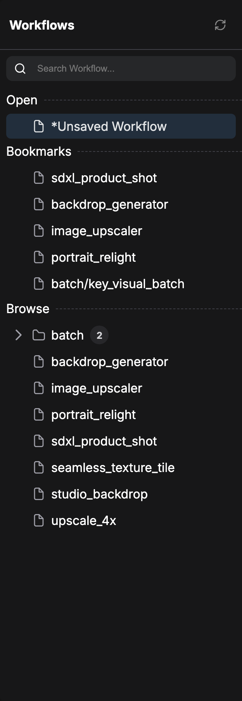

Der Eintrag **Workflows** in der linken Seitenleiste listet Workflows auf, die auf dieser Installation gespeichert sind, mit Lesezeichen versehene Favoriten und (optional) die Graphen, die Sie gerade geöffnet haben. Von hier aus öffnen Sie einen Graphen, benennen gespeicherte Dateien um oder löschen sie, versehen Favoriten mit Lesezeichen, fügen einen Workflow in einen anderen ein und duplizieren einen Graphen, ohne den Editor zu verlassen.

Vorlagen sind über eine separate Aktion zum Durchsuchen verfügbar (`Browse Templates` im Menü View oder das Steuerelement Templates in der Seitenleiste). Siehe [Vorlagen](/de/interface/features/template). Workflows paketierter Apps (Dateien mit der Endung `.app.json`) erscheinen ebenfalls unter [Apps](/de/interface/apps).

## Workflows-Panel öffnen

Klicken Sie in der linken Seitenleiste auf das Symbol **Workflows** (Standardtastenkürzel: `w`). Der Titel des Panels lautet **Workflows**. Verwenden Sie die Schaltfläche zum Aktualisieren in der Kopfzeile, um die Liste der gespeicherten Workflows erneut von der Festplatte zu synchronisieren.

## Bereiche im Panel

Wenn Sie nicht gerade suchen, ist das Panel in Bereiche unterteilt:

### Geöffnet

Wird nur angezeigt, wenn die **Position geöffneter Workflows** (`Comfy.Workflow.WorkflowTabsPosition`) auf **Seitenleiste** gesetzt ist. Es listet alle aktuell im Editor geöffneten Workflows als flache Liste auf. Geänderte oder ungespeicherte Graphen zeigen ein `*` vor dem Namen. Klicken Sie in einer Zeile auf die Schaltfläche zum Schließen, um diesen Tab zu schließen. Halten Sie beim Schließen `Shift` gedrückt, um die Warnung vor ungespeicherten Änderungen zu überspringen (die Schaltfläche zum Schließen wechselt in einen destruktiven Stil, solange `Shift` gedrückt gehalten wird).

Wenn die Einstellung **Obere Leiste** (der Standard) lautet, bleiben geöffnete Workflows stattdessen in der oberen Tab-Leiste, und dieser Bereich wird ausgeblendet. Wenn die Position **Seitenleiste** ist, zeigt das Seitenleisten-Symbol außerdem ein Badge mit der Anzahl geöffneter Workflows an, wenn die Anzahl größer als null ist.

### Lesezeichen

Eine flache Liste der Workflows, die Sie mit einem Lesezeichen versehen haben. Verwenden Sie das Lesezeichen-Symbol an einem Blatt in **Durchsuchen** (oder hier), um das Lesezeichen umzuschalten. Der Bereich wird ausgeblendet, wenn Sie keine Lesezeichen haben.

### Durchsuchen

Ihre gespeicherten Workflows als Ordnerbaum unter dem Workflow-Speicherpfad dieser Installation. Klicken Sie auf ein Blatt, um es zu öffnen. Leere Bibliotheken zeigen eine Meldung für den leeren Zustand an.

## Suchen

Das Suchfeld filtert alle Workflows (nicht nur Durchsuchen) nach ihrem Pfad. Solange eine Suchanfrage aktiv ist, wechselt das Panel zu einem einzigen Baum mit Suchergebnissen.

## Aktionen für einen Workflow

Bei einem Workflow-Blatt können Sie:

- **Öffnen**: Klicken Sie auf das Blatt, um es als aktiven Graphen zu laden.
- **Umbenennen**: Benennen Sie den Eintrag direkt an Ort und Stelle um; die Datei wird auf dem Datenträger mit der korrekten Workflow-Endung (`.json` oder `.app.json`) umbenannt.
- **Löschen**: Entfernen Sie einen gespeicherten Workflow (temporäre Graphen können auf diese Weise nicht gelöscht werden).
- **Lesezeichen**: Schalten Sie das Lesezeichen über die Aktionsschaltfläche des Blatts um.
- **Ziehen**: Workflow-Blätter lassen sich auf Drop-Ziele ziehen, die sie akzeptieren.
- **Kontextmenü**:
  - **Einfügen**: Fügt den Workflow in den aktuellen Graphen ein (wird im App-Modus nicht angeboten).
  - **Duplizieren**: Erstellt eine Kopie des Workflows.

## Zusammenhang mit der oberen Tableiste

Die Workflow-Tabs oben und diese Seitenleiste zeigen dieselben geöffneten Graphen, wenn die Tabs in der oberen Leiste liegen. Wenn Sie **Opened workflows position** zwischen **Topbar** und **Sidebar** umstellen, ändert sich nur, wo die Liste der geöffneten Workflows angezeigt wird, nicht, wo die Dateien gespeichert sind.

Die Pfade unterscheiden sich je nach Installationsart (Benutzerdaten der Desktop-App, Benutzerverzeichnis bei Portable/Self-hosted, Workspace-Speicher in Comfy Cloud), die Abschnitte und Aktionen des Panels bleiben jedoch gleich.

## Verwandte Seiten

- [Benutzeroberfläche im Überblick](/de/interface/overview)
- [Vorlagen](/de/interface/features/template)
- [Apps](/de/interface/apps)
- [Workflow teilen](/de/cloud/share-workflow) (Cloud)
- [App-Modus](/de/interface/app-mode)
