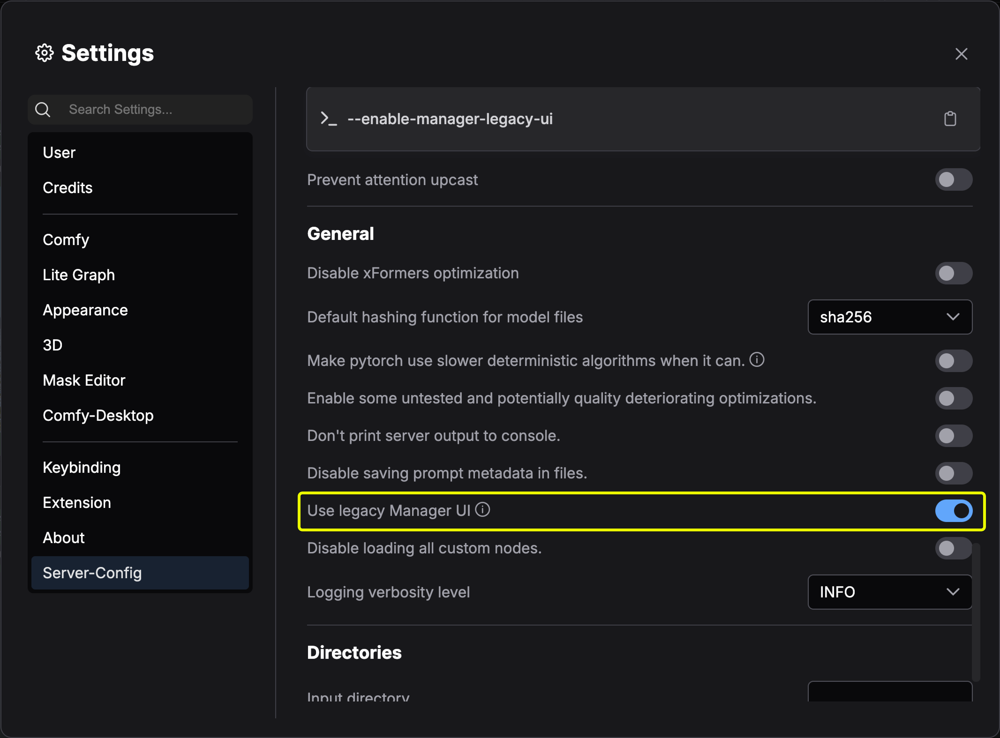

## Desktop-Nutzer

Comfy Desktop installiert ComfyUI-Manager mit jeder ComfyUI-Installation und startet ihn mit `--enable-manager`. Sie müssen also nichts selbst installieren. Manager wird pro Installation innerhalb der App konfiguriert:

<Steps>
  <Step title="Das Manage-Panel für die Installation öffnen">
  Öffnen Sie in Comfy Desktop die Installation, wechseln Sie zum **Manage panel** und dann zur Registerkarte **Startup Args**.
  </Step>
  <Step title="Die Manager-Optionen festlegen">
  - **Manager Security Level** legt fest, welche Node-Packs Manager installieren darf: **Strict**, **Standard** (EMPFOHLEN), **Relaxed** oder **Permissive**. Strengere Stufen sind vor allem dann wichtig, wenn ComfyUI mit `--listen` in Ihrem Netzwerk erreichbar ist
  - **Manager Network Mode** legt fest, wie Manager die Node-Registry erreicht: **Public** (Standard), **Private**, **Offline** oder **Personal cloud** (nur für einen Rechner, den Sie kontrollieren)

  Beide Optionen gelten beim nächsten Start der Installation.
  </Step>
  <Step title="Die Flags ändern, mit denen Manager startet (optional)">
  **Startup Arguments** auf derselben Registerkarte steuert die Flags, mit denen die Installation startet. Entfernen Sie `--enable-manager`, um ComfyUI ohne Manager auszuführen, oder behalten Sie es und fügen Sie `--disable-manager-ui` hinzu, um die Manager-UI auszublenden, während seine Hintergrundaufgaben weiterlaufen.
  </Step>
</Steps>

Die übrigen Einstellungen pro Installation finden Sie unter [Registerkarte Startup Args](/de/installation/desktop/usage/instance-management#set-startup-arguments), die Flags von Manager in der [Startup-Flags-Referenz](/de/development/comfyui-server/startup-flags).

## Nutzer der Portable-Version

Wenn Sie die Version [Windows Portable](/de/installation/comfyui_portable_windows) verwenden, ist der neue ComfyUI-Manager bereits in den ComfyUI-Core integriert, muss aber aktiviert werden.

1. Installieren Sie die Abhängigkeiten des Managers:
   ```bash
   .\python_embeded\python.exe -m pip install -r ComfyUI\manager_requirements.txt
   ```

2. Starten Sie ComfyUI mit aktiviertem Manager:
   ```bash
   .\python_embeded\python.exe -s ComfyUI\main.py --windows-standalone-build --enable-manager
   pause
   ```

## Nutzer mit manueller Installation

Bei einer [manuellen Installation](/de/installation/manual_install) ist der neue ComfyUI-Manager im ComfyUI-Kern enthalten, muss aber aktiviert werden.

1. Aktivieren Sie Ihre virtuelle Umgebung:
   ```bash
   # Windows
   venv\Scripts\activate
   
   # Linux/macOS
   source venv/bin/activate
   ```

2. Installieren Sie die Abhängigkeiten des Managers:
   ```bash
   pip install -r manager_requirements.txt
   ```

3. Aktivieren Sie den Manager beim Start von ComfyUI mit dem Flag `--enable-manager`:
   ```bash
   python main.py --enable-manager
   ```

### Befehlszeilenoptionen

| Flag | Beschreibung |
|------|-------------|
| `--enable-manager` | ComfyUI-Manager aktivieren |
| `--enable-manager-legacy-ui` | Die Legacy-Manager-UI anstelle der neuen UI verwenden (erfordert `--enable-manager`) |
| `--disable-manager-ui` | Die Manager-UI und die Endpunkte deaktivieren, Hintergrundfunktionen bleiben dabei aktiv (erfordert `--enable-manager`) |

### Zwischen neuer und Legacy-UI wechseln

Die folgenden Versionsupdates unterstützen nur pip-Installationen. Versionen, die über Custom Nodes installiert wurden, unterstützen den Wechsel zur neuen UI nicht.

<Tabs>
<Tab title="Nicht-Desktop-Nutzer">
So verwenden Sie die neue UI:
```bash
python main.py --enable-manager
```

So verwenden Sie die Legacy-UI:
```bash
python main.py --enable-manager --enable-manager-legacy-ui
```

</Tab>
<Tab title="Desktop-Nutzer">
Desktop-Nutzer können in **Server Settings → UI Settings → Use legacy manager interface** zur Legacy-UI wechseln.

</Tab>
</Tabs>

## ComfyUI-Manager aktualisieren

ComfyUI-Manager wird als eigenes Python-Paket ausgeliefert, und der ComfyUI-Kern legt in `manager_requirements.txt` fest, welche Version er verwendet. Wie Sie den Manager aktualisieren, hängt davon ab, wie ComfyUI installiert ist:

<Tabs>
<Tab title="Desktop">
Desktop enthält den Manager und hält ihn mit den Updates von Comfy Desktop aktuell. Aktualisieren Sie die ComfyUI-Engine über das [Manage panel](/de/installation/desktop/usage/instance-management#update-comfyui).
</Tab>
<Tab title="Portable und manuelle Installationen">
Ein Update von ComfyUI kann das installierte Manager-Paket unverändert lassen. Installieren Sie die Anforderungen des Managers in der Umgebung, aus der Sie ComfyUI starten, und starten Sie ComfyUI anschließend mit `--enable-manager` neu:

```bash
# Portable (Windows)
.\python_embeded\python.exe -m pip install -r ComfyUI\manager_requirements.txt
.\python_embeded\python.exe -s ComfyUI\main.py --windows-standalone-build --enable-manager

# Manuelle Installation
pip install -r manager_requirements.txt
python main.py --enable-manager
```
</Tab>
<Tab title="Git clone">
Wenn Sie den Manager selbst in `custom_nodes` geklont haben:

```bash
cd ComfyUI/custom_nodes/comfyui-manager
git pull
```

Starten Sie ComfyUI anschließend neu.
</Tab>
</Tabs>

## Ältere Installationsmethoden

<Accordion title="Methode 1: Git klonen (allgemeine Installation)">
Um ComfyUI-Manager zusätzlich zu einer bestehenden ComfyUI-Installation zu installieren:

1. Navigieren Sie im Terminal zum Verzeichnis `ComfyUI/custom_nodes`
2. Klonen Sie das Repository:
   ```bash
   git clone https://github.com/Comfy-Org/ComfyUI-Manager comfyui-manager
   ```
3. Installieren Sie die Abhängigkeiten des Managers:
   ```bash
   cd comfyui-manager
   pip install -r requirements.txt
   ```
4. ComfyUI neustarten
</Accordion>

<Accordion title="Methode 2: Portable Version (Windows)">
1. Installieren Sie [Git for Windows](https://git-scm.com/download/win) (Standalone-Version, wählen Sie „use windows default console window“)
2. Laden Sie [install-manager-for-portable-version.bat](https://github.com/Comfy-Org/ComfyUI-Manager/raw/main/scripts/install-manager-for-portable-version.bat) in Ihr Verzeichnis `ComfyUI_windows_portable` herunter
3. Doppelklicken Sie auf die Batch-Datei, um die Installation zu starten
</Accordion>

<Accordion title="Methode 3: comfy-cli (empfohlen für Neuinstallationen)">
comfy-cli bietet verschiedene Funktionen, um ComfyUI über die CLI zu verwalten.

**Voraussetzungen**: Python 3, Git

**Windows:**
```bash
python -m venv venv
venv\Scripts\activate
pip install comfy-cli
comfy install
```

**Linux/macOS:**
```bash
python -m venv venv
. venv/bin/activate
pip install comfy-cli
comfy install
```

Siehe auch: [comfy-cli-Dokumentation](/de/comfy-cli/getting-started)
</Accordion>

<Accordion title="Methode 4: Linux + venv">
**Voraussetzungen**: python-is-python3, python3-venv, git

1. Laden Sie [install-comfyui-venv-linux.sh](https://github.com/comfy-org/ComfyUI-Manager/raw/main/scripts/install-comfyui-venv-linux.sh) in ein leeres Installationsverzeichnis herunter
2. Ausführen:
   ```bash
   chmod +x install-comfyui-venv-linux.sh
   ./install-comfyui-venv-linux.sh
   ```
3. Führen Sie ComfyUI mit `./run_gpu.sh` oder `./run_cpu.sh` aus
</Accordion>

<Warning>
**Vorsichtsmaßnahmen bei der Installation:**
- Die Dateien von ComfyUI-Manager müssen sich exakt im Pfad `ComfyUI/custom_nodes/comfyui-manager` befinden
- Entpacken Sie nicht direkt nach `ComfyUI/custom_nodes` (Dateien wie `__init__.py` dürfen nicht in diesem Verzeichnis liegen)
- Installieren Sie nicht in Pfaden wie `ComfyUI/custom_nodes/ComfyUI-Manager/ComfyUI-Manager` oder `ComfyUI/custom_nodes/ComfyUI-Manager-main`
</Warning>
