## ComfyUI Custom Nodes verwalten
Erfahren Sie, wie Sie Custom Nodes über den Manager installieren

### Nodes installieren

<Steps>
    <Step title="Klicken Sie in der ComfyUI-Oberfläche auf die Schaltfläche Manager">
    Klicken Sie in der oberen Menüleiste auf die Schaltfläche **Manager**.
    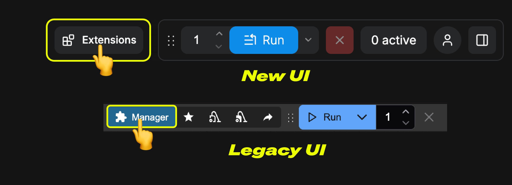
    </Step>
    <Step title="Wählen Sie Install Nodes aus">
    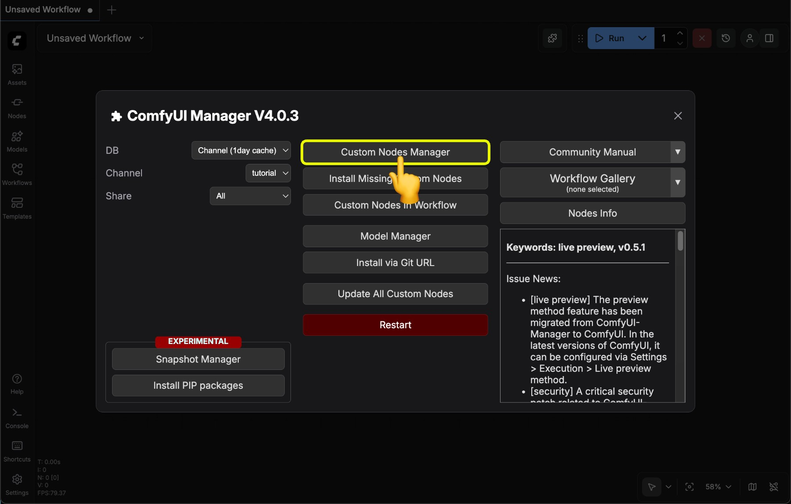
    </Step>
    <Step title="Durchsuchen oder suchen Sie den Node, den Sie installieren möchten">
    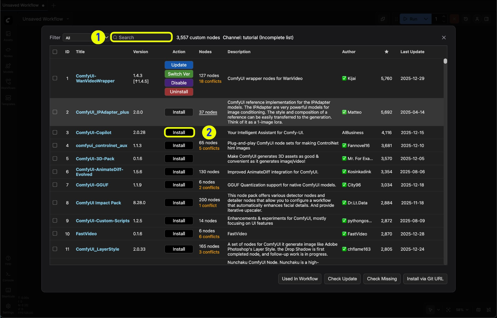
    </Step>
    <Step title="Klicken Sie auf Installieren, um den Node zu installieren">
    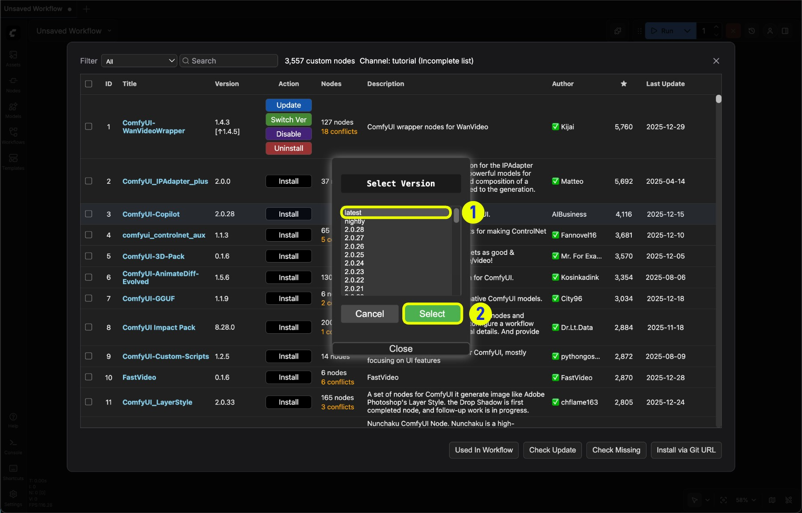
    1. Bevorzugen Sie die Version **latest**, wenn verfügbar
    2. Klicken Sie auf **Select**, um den Node zu installieren
    <Note>
    - Versionsnummern mit Ziffern sind Versionen, die Autoren in der [Registry](https://registry.comfy.org/) veröffentlicht haben, gleichbedeutend mit stabilen Releases
    - nightly ist die neueste Version, die Autoren auf GitHub veröffentlichen, gleichbedeutend mit einer Entwicklungsversion, in der Regel nicht sicherheitsgescannt und mit instabilen Faktoren

    Die Standard-Sicherheitseinstellungen von ComfyUI erlauben keine direkte Installation von **nightly**-Versionen. Details finden Sie in der [Security Policy](/de/manager/troubleshooting#sicherheitsrichtlinie)
    </Note>
    </Step>
    <Step title="Warten Sie, bis die Installation der Abhängigkeiten abgeschlossen ist, und starten Sie ComfyUI neu">
      Nach dem Klick auf Installieren übernimmt der Manager die Installation der Abhängigkeiten automatisch und fordert Sie nach Abschluss der Installation auf, ComfyUI neu zu starten
      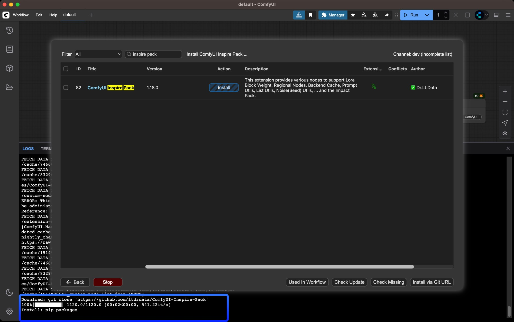
      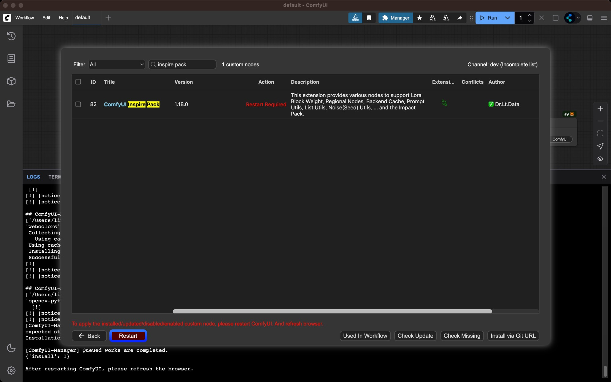
    </Step>
    <Step title="Prüfen Sie, ob das Plugin erfolgreich installiert wurde">
    Prüfen Sie nach dem Neustart im ComfyUI Manager, ob das entsprechende Plugin erfolgreich installiert wurde und ob `import failed`-Fehlermeldungen vorliegen
      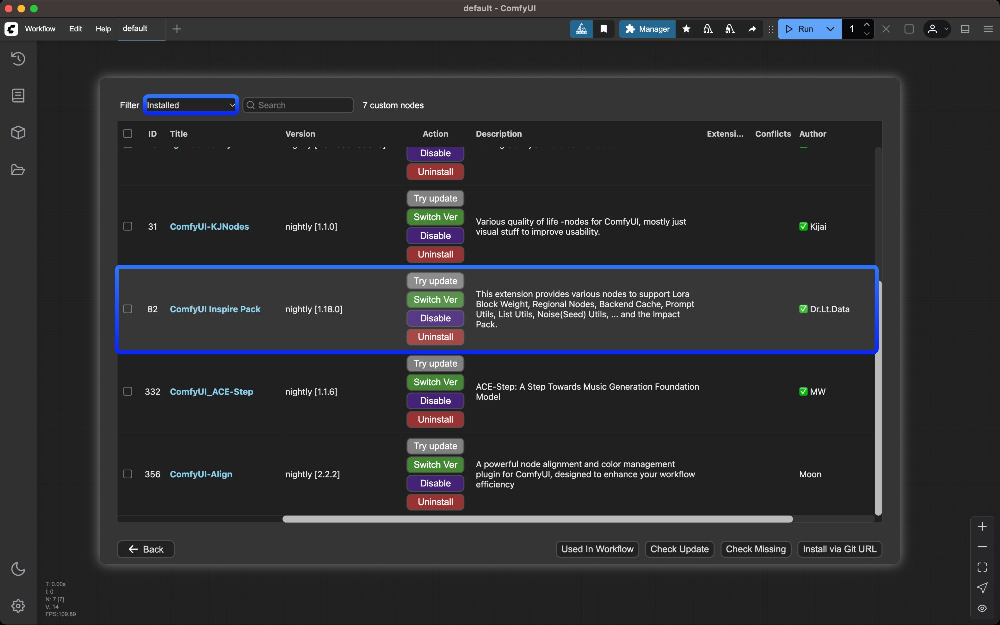
    </Step>
</Steps>

### Fehlende Nodes installieren

Fehlende Nodes sind eine häufige Situation beim Laden von Workflows. In der Regel gibt es zwei Arten von fehlenden Nodes:
1. Fehlender Core-Node: Die ComfyUI-Version ist nicht die neueste Version. Informationen zum Aktualisieren finden Sie unter [ComfyUI aktualisieren](/de/installation/update_comfyui)
2. Fehlender Custom Node: Es fehlen Custom Nodes von Drittanbietern. Zur Installation können Sie diese Anleitung verwenden

Wenn ComfyUI-Manager installiert ist und beim Importieren von Workflows Custom Nodes fehlen, werden Sie über die Informationen zu den fehlenden Nodes benachrichtigt

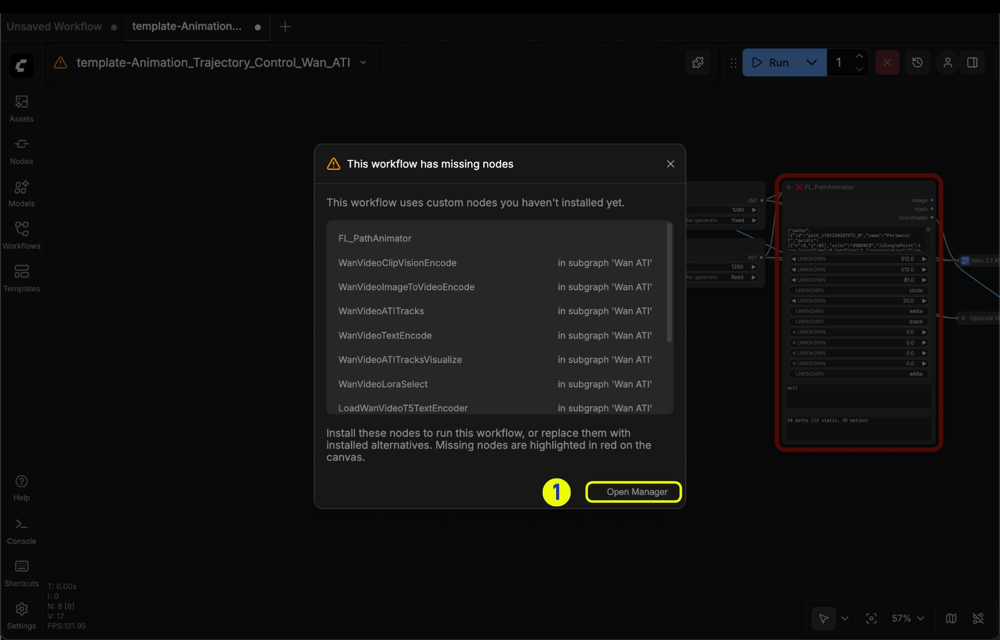
1. Klicken Sie auf **Manager öffnen**, um die entsprechende Option zu aktivieren

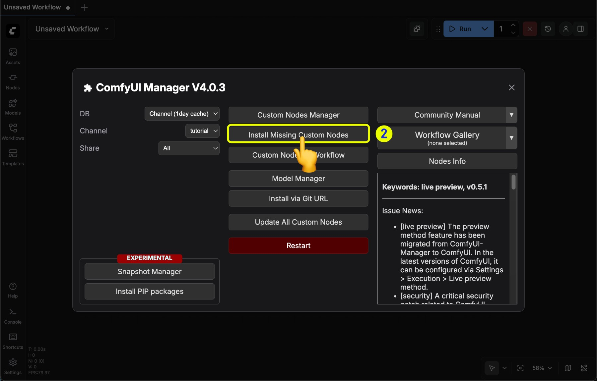
2. Klicken Sie im Manager-Menü auf **Fehlende Custom Nodes installieren**, um die Liste der fehlenden Nodes zu öffnen

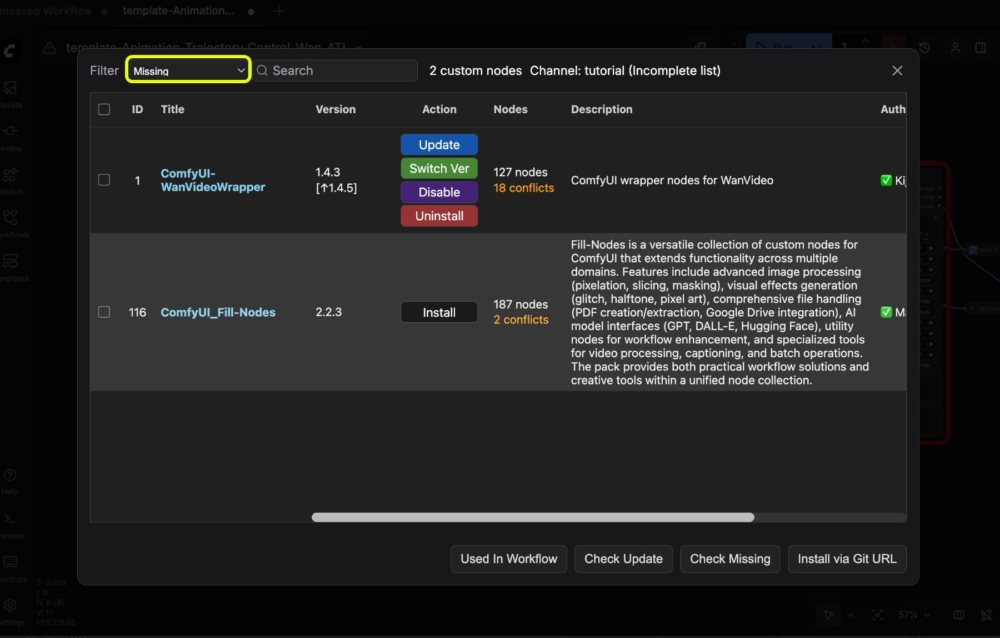
3. Sehen Sie sich die entsprechenden Nodes in der Node-Liste an und installieren Sie sie

<Note>
Wenn Sie feststellen, dass die Liste der fehlenden Nodes den entsprechenden Node nicht findet, gibt es in der Regel mehrere Situationen:
1. Der Autor des Nodes hat den Custom Node nicht in der [Registry](/de/registry/overview) eingereicht und registriert
2. Der entsprechende Node ist nicht Open Source, es kann sich um einen eingeschränkten Node bestimmter Autoren oder Plattformen handeln
3. Der ursprüngliche Autor hat die Version geändert und den entsprechenden Node gelöscht
</Note>

### Nodes aktualisieren
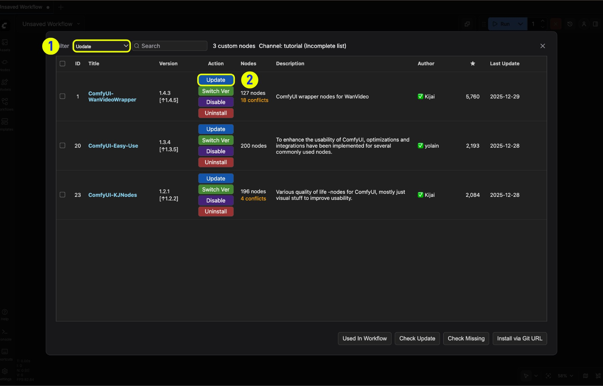
1. Wechseln Sie den Filter auf **Update**, um Nodes zu filtern, die in der aktuellen Node-Liste aktualisiert werden können
2. Klicken Sie auf die Schaltfläche **Update**, um den Node zu aktualisieren

### Nodes deinstallieren

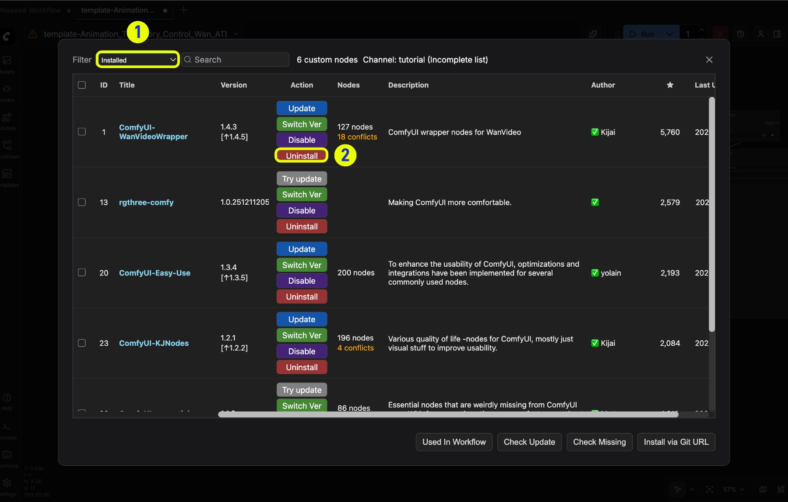
1. Wählen Sie in der Node-Liste den Filter „Installiert“, um installierte Nodes in der aktuellen Node-Liste zu filtern
2. Klicken Sie mit der rechten Maustaste auf den entsprechenden Node und wählen Sie **Deinstallieren**, um ihn zu deinstallieren

> Durch die Deinstallation des entsprechenden Nodes wird die zugehörige Installation der Abhängigkeiten nicht entfernt

Weitere Methoden zum Installieren von Plugins finden Sie im folgenden Artikel

<Card
    title="Custom Nodes installieren"
    icon="download"
    href="/de/installation/install_custom_node"
>
    Erfahren Sie, wie Sie Custom Nodes manuell installieren
</Card>

## Snapshot-Manager

Snapshots speichern Ihren aktuellen Installationsstatus und ermöglichen die Wiederherstellung eines früheren Zustands.

Snapshots werden automatisch gespeichert, wenn Sie **Save snapshot** drücken oder **Update All** verwenden. Snapshot-Dateien werden hier gespeichert: `<USER_DIRECTORY>/default/ComfyUI-Manager/snapshots`

Zum Wiederherstellen: Öffnen Sie den Snapshot-Manager, wählen Sie einen Snapshot aus und drücken Sie **Restore**.

<Note>
Die Wiederherstellung wird beim nächsten Start von ComfyUI wirksam. Für Custom Nodes, die nicht über Git verwaltet werden, ist die Snapshot-Unterstützung unvollständig.
</Note>
