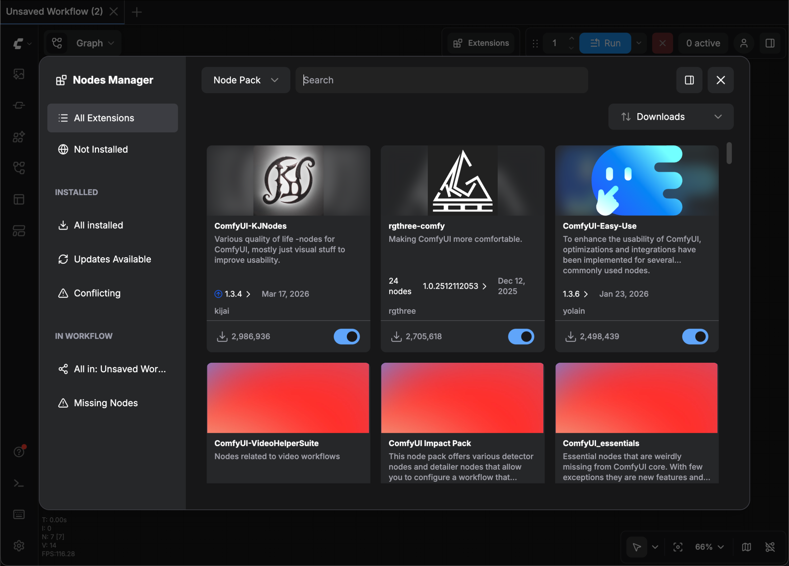

**ComfyUI-Manager** ist eine Erweiterung, die die Benutzerfreundlichkeit von [ComfyUI](https://github.com/Comfy-Org/ComfyUI) verbessern soll. Sie bietet Verwaltungsfunktionen, um verschiedene Custom Nodes von ComfyUI **zu installieren, zu entfernen, zu deaktivieren und zu aktivieren**. Darüber hinaus stellt diese Erweiterung eine Hub-Funktion sowie praktische Funktionen bereit, mit denen Sie auf vielfältige Informationen innerhalb von ComfyUI zugreifen können.

## Wichtige Funktionen

- **Verwaltung von Custom Nodes**: Custom Nodes installieren, aktualisieren, entfernen und deaktivieren
- **Modellverwaltung**: Modelle aus verschiedenen Quellen herunterladen und verwalten
- **Snapshot-Verwaltung**: Installationsstände sichern und wiederherstellen
- **Erkennung fehlender Nodes**: Fehlende Nodes aus Workflows automatisch erkennen und installieren

## Nächste Schritte

<CardGroup cols={2}>
  <Card title="Installation" icon="download" href="/de/manager/install">
    Installieren Sie ComfyUI-Manager für Ihr Setup
  </Card>
  <Card title="New UI" icon="puzzle-piece" href="/de/manager/pack-management">
    Custom Nodes und Modelle mit der neuen UI verwalten
  </Card>
  <Card title="Legacy UI" icon="puzzle-piece" href="/de/manager/legacy-ui">
    Custom Nodes und Modelle mit der Legacy-UI verwalten
  </Card>
  <Card title="Konfiguration" icon="gear" href="/de/manager/configuration">
    Einstellungen und Optionen konfigurieren
  </Card>
  <Card title="Fehlerbehebung" icon="bug" href="/de/manager/troubleshooting">
    Häufige Probleme lösen
  </Card>
</CardGroup>