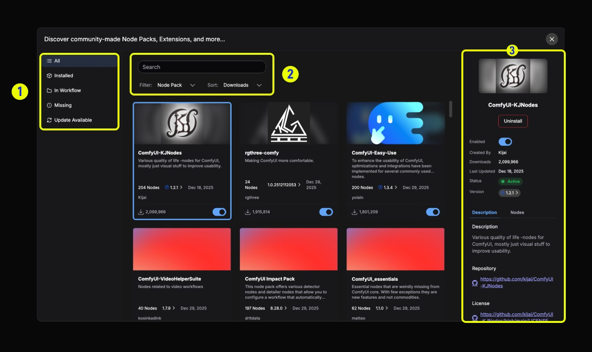
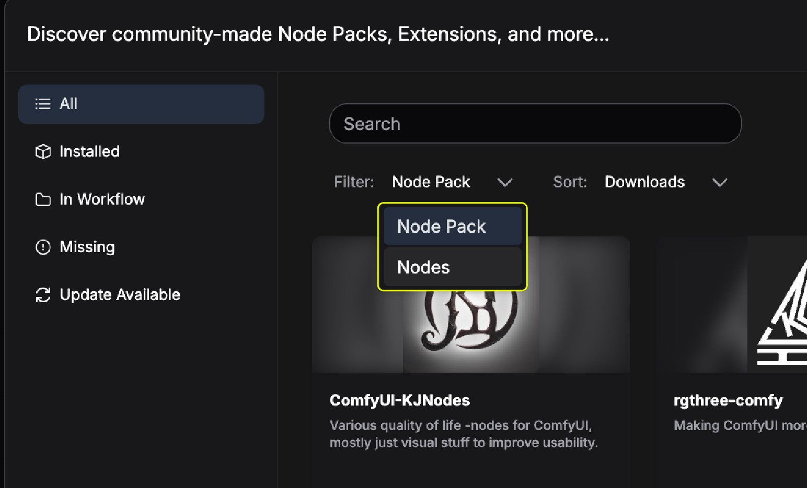
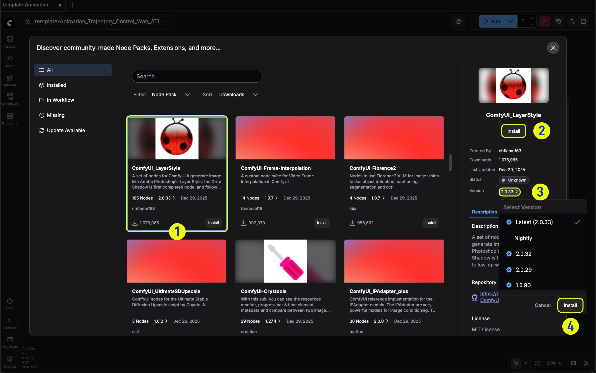
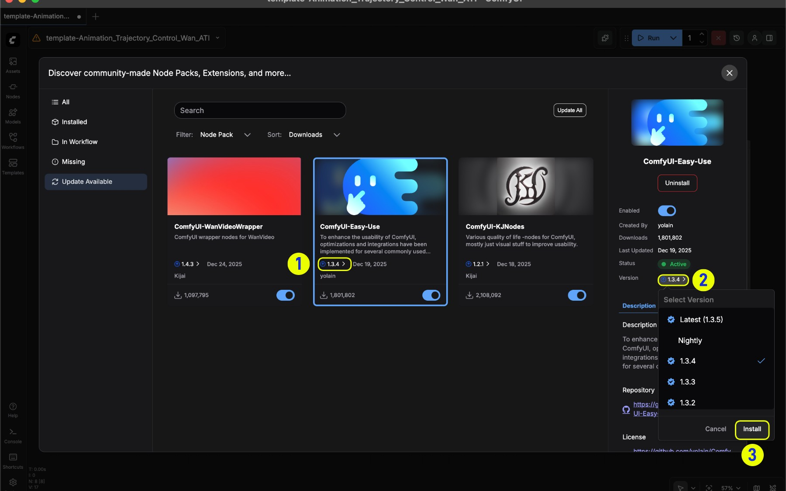
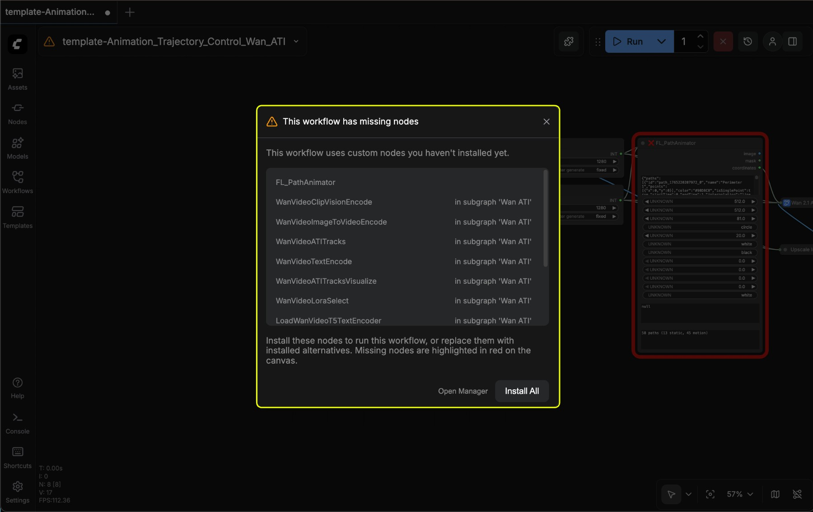
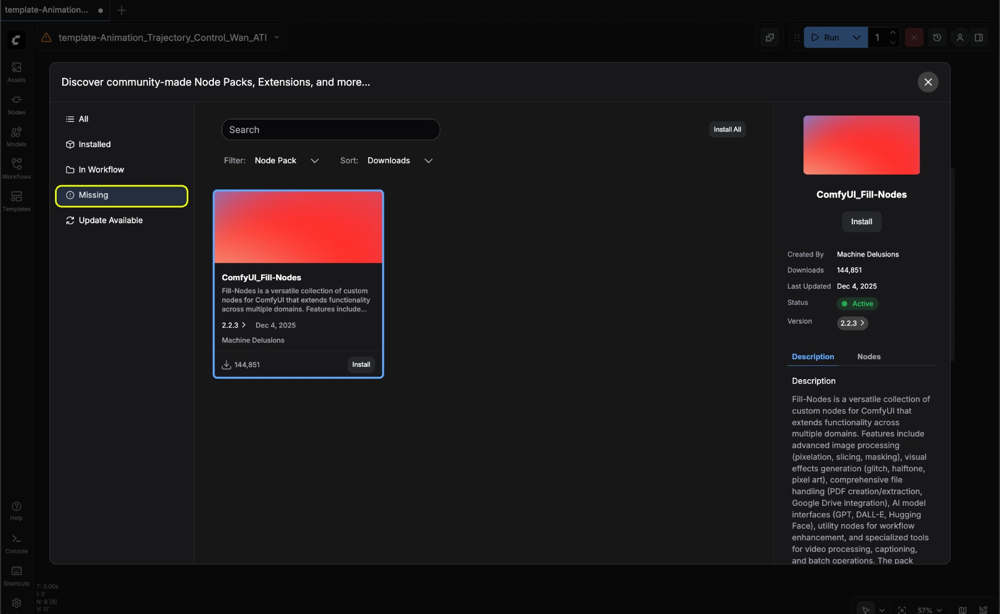
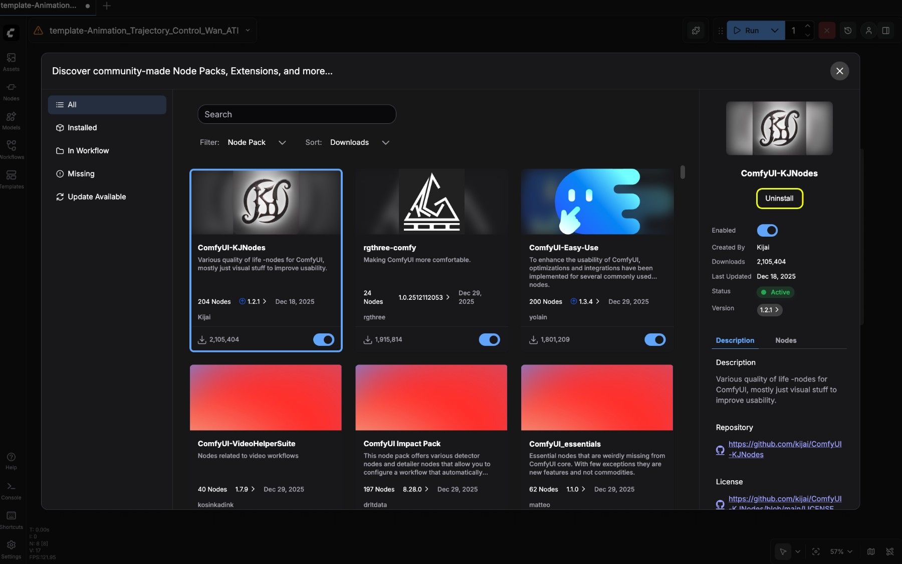

<Note>
Wenn Sie die neue UI nicht verwenden, lesen Sie den Abschnitt [Zwischen neuer und alter UI wechseln](/de/manager/install), um zu erfahren, wie Sie wechseln.
</Note>

## Überblick über die neue UI

1. **Linke Seitenleiste (Filter)**: Installierte Nodes, Nodes im Workflow, fehlende Nodes, aktualisierbare Nodes usw. filtern.
2. **Obere Suchleiste**: Node-Pakete (Node Pack) oder einzelne Nodes (Node) durchsuchen; den Suchtyp über das Dropdown „Filter“ wechseln
3. **Rechtes Detailfenster**: Klicken Sie auf einen Node, um detaillierte Informationen wie Beschreibung, Aktivierungsstatus, Versionsinformationen usw. anzuzeigen. Der Tab „Description“ enthält Informationen zum Repository, und der Tab „Nodes“ zeigt eine Vorschau aller Nodes

## Node-Verwaltung

Erfahren Sie, wie Sie mit dem neuen ComfyUI Manager Custom Nodes verwalten

### Nodes durchsuchen

Der Manager unterstützt die getrennte Suche nach Node-Paketen und einzelnen Nodes. Wie oben gezeigt, können Sie den Suchtyp wechseln, indem Sie den Filter umschalten.
- Node Pack: Ein vollständiges Custom-Node-Paket
- Individual Node: Einzelne Nodes innerhalb von Node-Paketen durchsuchen

### Nodes installieren

1. Wählen Sie die entsprechende Node-Karte aus
2. Klicken Sie in den aufgeklappten Node-Informationen auf **Install**
3. Oder wählen Sie in **Version** eine bestimmte Version aus, um sie zu installieren

### Nodes aktualisieren
Unter dem Filter **Update available** können Sie in der aktuellen Node-Liste Nodes herausfiltern, für die Updates verfügbar sind

1. Aktualisierbare Nodes zeigen einen Pfeil als Update-Indikator an
2. Wählen Sie in **Version** eine bestimmte Version aus
3. Klicken Sie nach der Versionsauswahl auf die Schaltfläche **Update**, um zu aktualisieren

### Fehlende Nodes finden

Wenn Ihr ComfyUI Manager korrekt installiert ist, erscheint beim Laden eines Workflows mit fehlenden Nodes ein Prompt
1. Sie können **Install All** wählen, um alle Nodes auf einmal zu installieren
2. Oder Sie wählen **Manager öffnen**, um den Manager zu öffnen und die Details vor der Installation zu prüfen

Um fehlende Nodes in einem Workflow zu finden, wählen Sie den entsprechenden Node aus und klicken Sie dann im Vorschaufenster auf die Schaltfläche **Missing**, um fehlende Nodes zu finden

### Nodes deinstallieren

Um einen installierten Node zu deinstallieren, wählen Sie den entsprechenden Node aus und klicken Sie dann im Vorschaufenster auf die Schaltfläche **Uninstall**

## Häufige Fragen
1. Warum finde ich den benötigten Node nicht?
Der neue Manager unterstützt nur die Installation von Nodes aus der [Registry](/de/registry/overview). Wenn Ihr Node nicht in der Registry registriert ist, registrieren Sie ihn bitte zuerst im Manager.

2. Warum finde ich keine Option zur Installation über git?
Aus Gründen der Sicherheit und Stabilität des ComfyUI-Nutzersystems unterstützt die neue UI die Installation von Nodes über git nicht. Wie Sie Custom Nodes manuell installieren, erfahren Sie unter [Custom Nodes manuell installieren](/de/installation/install_custom_node).