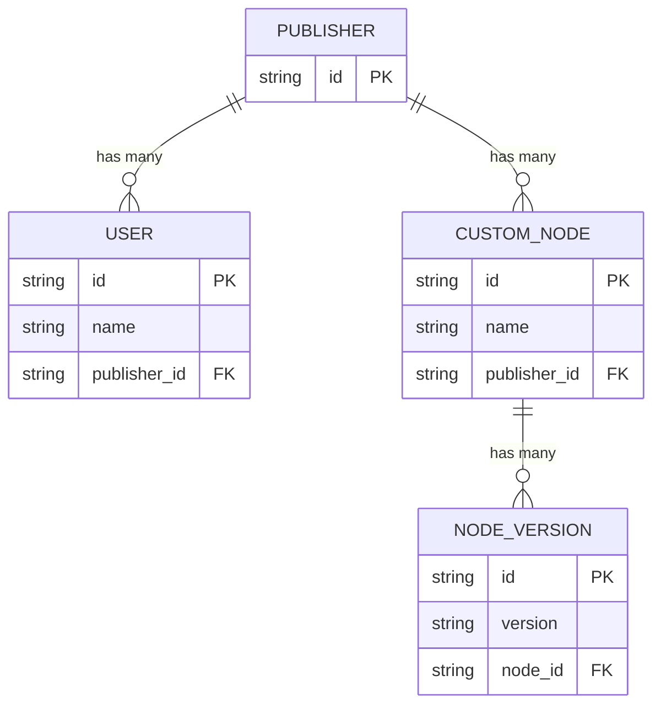

## Übersicht

Die Custom Node Registry folgt dieser Struktur:

## Häufig verwendete APIs

- **Alle Nodes auflisten** [API](/de/registry/api-reference/nodes/retrieves-a-list-of-nodes)
- **Einen Node installieren** [API](/de/registry/api-reference/nodes/returns-a-node-version-to-be-installed)