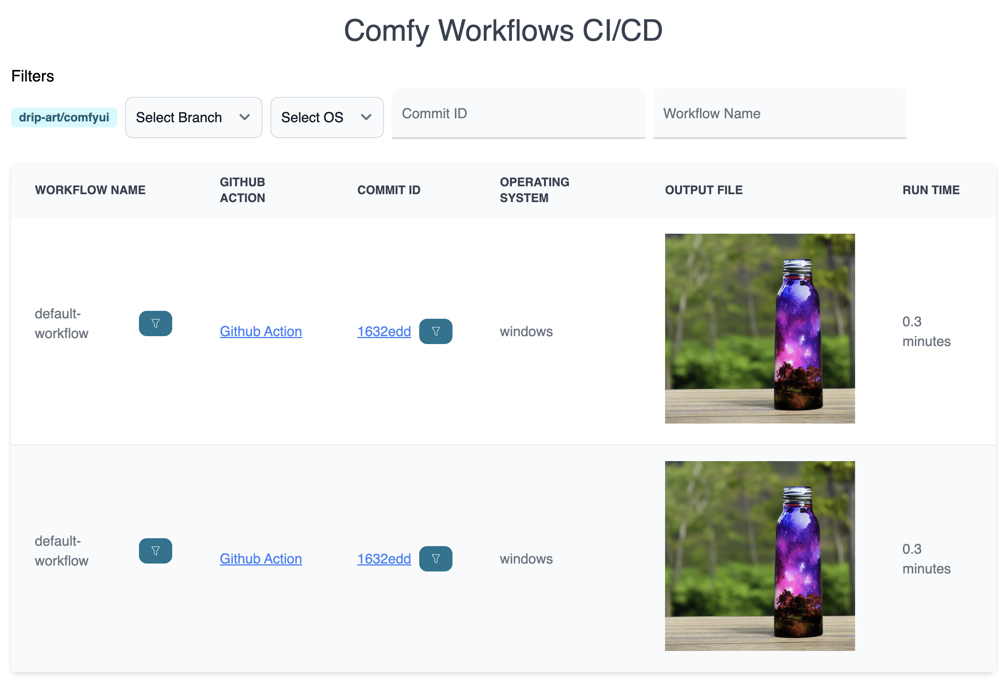

## Einleitung

Wenn Sie Änderungen an Custom Nodes vornehmen, kommt es nicht selten vor, dass in Comfy oder in anderen Custom Nodes etwas kaputtgeht. Oft ist es unrealistisch, auf jedem Betriebssystem und mit unterschiedlichen PyTorch-Konfigurationen zu testen.

### Comfy-Workflows mit GitHub Actions ausführen

[Comfy-Action](https://github.com/Comfy-Org/comfy-action) ermöglicht es Ihnen, eine Comfy workflow.json-Datei auf GitHub Actions auszuführen. Es unterstützt das Herunterladen von Modellen und Custom Nodes und läuft unter Linux/Mac/Windows.

### Ergebnisse

Die Ausgabedateien werden in das [CI/CD-Dashboard](https://ci.comfy.org/) hochgeladen und können dort als letzter Schritt vor dem Commit neuer Änderungen oder der Veröffentlichung neuer Versionen des Custom Node eingesehen werden.



### Versionen über GitHub Actions veröffentlichen

[Publish Node Action](https://github.com/Comfy-Org/node-publish-action) veröffentlicht die Version aus Ihrer `pyproject.toml` in der Registry. Es genügt also, die Version zu erhöhen, um eine neue Veröffentlichung auszulösen. Fügen Sie Ihren Registry-Zugriffstoken als Repository-Secret mit dem Namen `REGISTRY_ACCESS_TOKEN` unter **Settings** > **Secrets and variables** > **Actions** hinzu und fügen Sie dann diesen Workflow hinzu:

```yaml
name: Publish to Comfy registry
on:
  workflow_dispatch:
  push:
    branches:
      - main
    paths:
      - "pyproject.toml"

jobs:
  publish-node:
    name: Publish Custom Node to registry
    runs-on: ubuntu-latest
    steps:
      - name: Check out code
        uses: actions/checkout@v4
      - name: Publish Custom Node
        uses: Comfy-Org/publish-node-action@main
        with:
          personal_access_token: ${{ secrets.REGISTRY_ACCESS_TOKEN }}
```

<Note>
Die veröffentlichte Version ist das Feld `version` in `pyproject.toml`. Aktualisieren Sie es, bevor der Workflow läuft.
</Note>