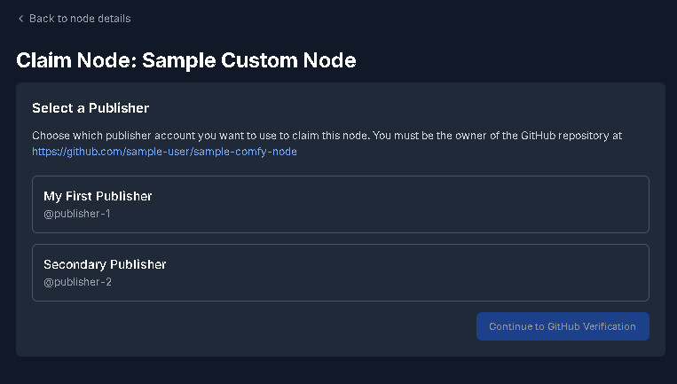
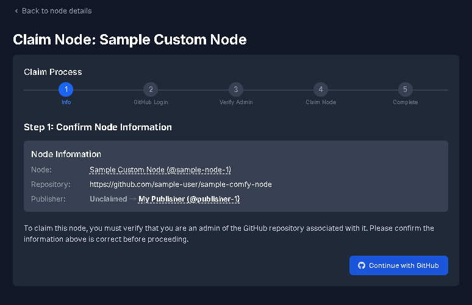

## Überblick

Die Funktion **Claim My Node** ermöglicht es Entwicklern, die Eigentümerschaft an Custom Nodes in der ComfyUI Registry zu beanspruchen. Dieses System stellt sicher, dass nur die rechtmäßigen Autoren ihre veröffentlichten Nodes verwalten und aktualisieren können, und sorgt so für Sicherheit und Nachvollziehbarkeit innerhalb der Community.

## Was sind nicht beanspruchte Nodes?

Während wir mit neuen Standards vom ComfyUI Manager zur Comfy Registry migrieren, erscheinen viele Custom Nodes, die zuvor im Legacy-System des ComfyUI Manager gelistet waren, nun in der Registry als „nicht beansprucht“. Dabei handelt es sich um Nodes, die:

- ursprünglich im Legacy-System des ComfyUI Manager veröffentlicht wurden
- zur Comfy Registry migriert wurden, um die neuesten Standards zu erfüllen
- darauf warten, dass ihre ursprünglichen Autorinnen und Autoren die Eigentümerschaft beanspruchen

Wir bieten Entwicklerinnen und Entwicklern eine einfache Möglichkeit, diese migrierten Nodes zu beanspruchen. So gewährleisten wir einen reibungslosen Übergang vom Legacy-System zum neuen Registry-Standard und erhalten gleichzeitig eine ordnungsgemäße Eigentümerschaft und Kontrolle.

## Erste Schritte

Um Ihre Nodes zu beanspruchen:

1. **Navigieren Sie zu Ihrer Seite für den nicht beanspruchten Node**: Rufen Sie Ihre Seite für den nicht beanspruchten Node auf und klicken Sie auf die Schaltfläche „Claim my node!“.

2. **Herausgeber erstellen (falls Sie noch keinen haben)**:
   - Wenn Sie noch keinen Herausgeber erstellt haben, werden Sie aufgefordert, einen zu erstellen. Ein Herausgeber ist erforderlich, um Nodes zu beanspruchen und effektiv zu verwalten.

3. **Herausgeber auswählen**: Wählen Sie den Herausgeber aus, unter dem Sie den Node beanspruchen möchten. Dieser Schritt leitet Sie zur Seite zum Beanspruchen weiter.

Um den Node unter dem ausgewählten Herausgeber zu beanspruchen, gehen Sie wie folgt vor:

1. **Node-Informationen prüfen:**
   - Prüfen Sie die Node-Details, einschließlich Name, Repository-Link und Herausgeberstatus, wie auf dem Bildschirm dargestellt.

2. **GitHub-Authentifizierung:**
   - Klicken Sie auf die Schaltfläche „Continue with GitHub“, um den Authentifizierungsprozess zu starten. Stellen Sie sicher, dass Sie mit dem richtigen GitHub-Konto angemeldet sind, das über Administratorrechte für das Repository verfügt.

3. **Administratorzugriff überprüfen:**
   - Nach der Anmeldung prüft das System, ob Sie über Administratorrechte für das angegebene GitHub-Repository verfügen. Dieser Schritt ist entscheidend, um sicherzustellen, dass Sie die erforderlichen Berechtigungen haben.

4. **Node beanspruchen:**
   - Wenn die Verifizierung erfolgreich ist, klicken Sie auf „Claim“, um den Node zu beanspruchen. Der Herausgeberstatus ändert sich und zeigt die Eigentümerschaft an.

5. **Fertig!:**
   - Nachdem Sie den Node erfolgreich beansprucht haben, können Sie mit dem [Veröffentlichen](./publishing) und der Verwaltung Ihres Nodes als rechtmäßiger Inhaber fortfahren.

## Häufig gestellte Fragen

<AccordionGroup>

  <Accordion title="Wer kann Nodes beanspruchen?">
    Jeder GitHub-Benutzer kann eine Anfrage zur Beanspruchung einreichen, aber die Ansprüche werden anhand des ursprünglichen Node-Repositorys und der Autoreninformationen überprüft.
  </Accordion>

  <Accordion title="Wie lange dauert der Beanspruchungsprozess?">
    Ansprüche werden automatisch genehmigt, sobald die GitHub-Admin-Berechtigungen für das Repository verifiziert sind. Dies geschieht unmittelbar nach dem Absenden Ihres Anspruchs.
  </Accordion>

  <Accordion title="Was passiert, nachdem mein Anspruch genehmigt wurde?">
    Nach der Genehmigung haben Sie die vollständige Kontrolle über die Verwaltung Ihres Nodes, einschließlich Veröffentlichen von Versionen, Aktualisieren von Metadaten, Deprecation und Richtlinieneinstellungen.
  </Accordion>

  <Accordion title="Kann ich Nodes beanspruchen, die ich nicht erstellt habe?">
    Nein, Ansprüche werden automatisch anhand der GitHub-Repository-Admin-Berechtigungen validiert. Nur Benutzer mit Admin-Zugriff auf das ursprüngliche Repository können Nodes erfolgreich beanspruchen.
  </Accordion>

  <Accordion title="Was ist, wenn mein Anspruch abgelehnt wird?">
    Ansprüche werden automatisch auf der Grundlage der GitHub-Admin-Berechtigungen verarbeitet. Wenn Sie keinen Admin-Zugriff auf das Repository haben, wird der Anspruch automatisch abgelehnt. Wenden Sie sich an den Inhaber des Repositorys, um Admin-Zugriff zu beantragen, wenn Sie der Meinung sind, dass Ihnen Eigentumsrechte zustehen.
  </Accordion>
</AccordionGroup>
