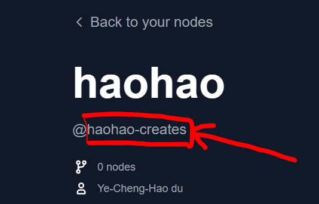
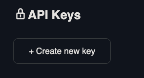

## Registry-Konto einrichten

Folgen Sie den untenstehenden Schritten, um ein Registry-Konto einzurichten und Ihren ersten Node zu veröffentlichen.

### Tutorial ansehen

<iframe height="415" src="https://www.youtube.com/embed/WhOZZOgBggU?si=6TyvhJJadmQ65uXC" title="YouTube video player" frameborder="0" allow="accelerometer; autoplay; clipboard-write; encrypted-media; gyroscope; picture-in-picture; web-share" referrerpolicy="strict-origin-when-cross-origin" allowfullscreen style={{ width: "100%", borderRadius: "0.5rem" }}></iframe>

### Herausgeber erstellen

Ein Herausgeber ist eine Identität, die Custom Nodes in der Registry veröffentlichen kann. Jeder Custom Node muss eine Herausgeber-ID in der pyproject.toml-[Datei]() angeben.

Gehen Sie zur [Comfy Registry](https://registry.comfy.org) und erstellen Sie ein Herausgeberkonto. Ihre Herausgeber-ID ist global eindeutig und kann später nicht geändert werden, da sie in der URL Ihres Custom Node verwendet wird.

Ihre Herausgeber-ID finden Sie nach dem `@`-Symbol auf Ihrer Profilseite.



### API-Schlüssel für die Registry-Veröffentlichung erstellen

<Note>
  **Wichtig:** Dieser API-Schlüssel ist speziell für das **Veröffentlichen von Custom Nodes in der Registry und in ComfyUI-Manager** gedacht. Wenn Sie stattdessen kostenpflichtige Partner-Nodes in Ihren Workflows verwenden möchten, lesen Sie die [Partner Nodes Overview](/de/tutorials/partner-nodes/overview).
</Note>

Gehen Sie [hierhin](https://registry.comfy.org/nodes) und klicken Sie auf den Herausgeber, für den Sie einen API-Schlüssel erstellen möchten. Dieser Schlüssel wird verwendet, um Custom Nodes über die CLI oder GitHub Actions in der Registry zu veröffentlichen (die ComfyUI-Manager mit Daten versorgt).



Benennen Sie den API-Schlüssel und speichern Sie ihn an einem sicheren Ort. Wenn Sie ihn verlieren, müssen Sie einen neuen Schlüssel erstellen.


### Metadaten hinzufügen

<Tip>Haben Sie comfy-cli installiert? [Installieren Sie es zuerst](/de/comfy-cli/getting-started).</Tip>

```bash
comfy node init
```

Dieser Befehl generiert die folgenden Metadaten:

```toml
# pyproject.toml
[project]
name = "" # Eindeutige Kennung für Ihren Node. Nach der Erstellung unveränderlich.
description = ""
version = "1.0.0" # Version des Custom Node. Muss semantisch versioniert sein.
license = { file = "LICENSE.txt" }
dependencies  = [] # Aus requirements.txt übernommen

[project.urls]
Repository = "https://github.com/..."

[tool.comfy]
PublisherId = "" # TODO (Herausgeber-ID von der Comfy Registry Website eintragen).
DisplayName = "" # Anzeigename für den Custom Node. Kann später geändert werden.
Icon = "https://example.com/icon.png" # SVG, PNG, JPG oder GIF (MAX. 800x400px)
```

Fügen Sie diese Datei Ihrem Repository hinzu. In den [Spezifikationen](/de/registry/specifications) finden Sie weitere Informationen zur pyproject.toml-Datei.

### Dateien mit `.comfyignore` ausschließen

Standardmäßig packt `comfy node publish` jede von `git` verfolgte Datei ein. Um reine Entwicklungsdateien (Tests, Design-Assets, große Beispieldateien) aus dem veröffentlichten Archiv herauszuhalten, legen Sie eine `.comfyignore`-Datei im Stammverzeichnis Ihres Repositorys an. Die Syntax entspricht der von [`.gitignore`](https://git-scm.com/docs/gitignore):

```gitignore
# Nur für die Entwicklung bestimmte Assets
docs/
tests/
*.psd
.vscode/
```

<Note>

- `.comfyignore` ergänzt `.gitignore`: Dateien, die git nicht verfolgt, sind bereits ausgeschlossen. Verwenden Sie `.comfyignore`, um Dateien auszuschließen, die Sie in git *behalten*, aber nicht im Registry-Archiv haben möchten.
- Verzeichnisse, die in [`[tool.comfy].includes`](/de/registry/specifications) aufgeführt sind, werden zwangsweise eingeschlossen, auch wenn sie einem `.comfyignore`-Muster entsprechen (nützlich, wenn ein gebauter `dist/`-Ordner von git ignoriert wird, aber mit ausgeliefert werden muss).
- Committen Sie `.comfyignore` in Ihr Repository, damit lokale Läufe und die CI dasselbe Archiv erzeugen.

</Note>

## In der Registry veröffentlichen

### Option 1: Comfy CLI

Führen Sie den folgenden Befehl aus, um Ihren Node manuell in der Registry zu veröffentlichen.

```bash
comfy node publish
```

Sie werden zur Eingabe des API-Schlüssels aufgefordert.

```bash
API Key for publisher '<publisher id>': ****************************************************

...Version 1.0.0 Published. 
See it here: https://registry.comfy.org/publisherId/your-node
```

<Warning>
  Beachten Sie, dass der API-Schlüssel standardmäßig ausgeblendet ist.
</Warning>
<Warning>
  Beim Kopieren und Einfügen kann Ihr API-Schlüssel bei Verwendung von STRG+V (unter Windows) ein zusätzliches \x16 am Ende haben, z. B.: ************************************************\x16.

  Es ist EMPFOHLEN, Ihren API-Schlüssel stattdessen per Rechtsklick einzufügen.
</Warning>


### Option 2: Github Actions

Veröffentlichen Sie Ihren Node automatisch über Github Actions.

<Steps>
<Step title="Ein Github-Secret einrichten">

Gehen Sie zu Settings -> Secrets and Variables -> Actions -> unter dem Tab Secrets und Repository secrets -> New Repository Secret.

Erstellen Sie ein Secret namens `REGISTRY_ACCESS_TOKEN` und speichern Sie Ihren API-Schlüssel als Wert.

</Step>
<Step title="Eine Github-Action erstellen">
Kopieren Sie den Code unten und fügen Sie ihn hier ein: `/.github/workflows/publish_action.yml`

```bash
name: Publish to Comfy registry
on:
  workflow_dispatch:
  push:
    branches:
      - main
    paths:
      - "pyproject.toml"

jobs:
  publish-node:
    name: Publish Custom Node to registry
    runs-on: ubuntu-latest
    steps:
      - name: Check out code
        uses: actions/checkout@v7
      - name: Publish Custom Node
        uses: Comfy-Org/publish-node-action@main
        with:
          personal_access_token: ${{ secrets.REGISTRY_ACCESS_TOKEN }} ## Fügen Sie hier Ihr eigenes persönliches Zugriffstoken zu den Secrets Ihres Github-Repositorys hinzu und referenzieren Sie es an dieser Stelle.
```

<Warning>Wenn Ihre Arbeitsverzweigung anders als `main` heißt, zum Beispiel `master`, fügen Sie den Namen im Abschnitt branches hinzu.</Warning>
</Step>
<Step title="Die Github-Action testen">

Pushen Sie ein Update der Versionsnummer in Ihrer `pyproject.toml`. Ihr aktualisierter Node sollte anschließend in der Registry erscheinen.

<Tip>Die Github-Action wird automatisch bei jedem Push eines Updates Ihrer `pyproject.toml`-Datei ausgeführt.</Tip>

</Step>


</Steps>
