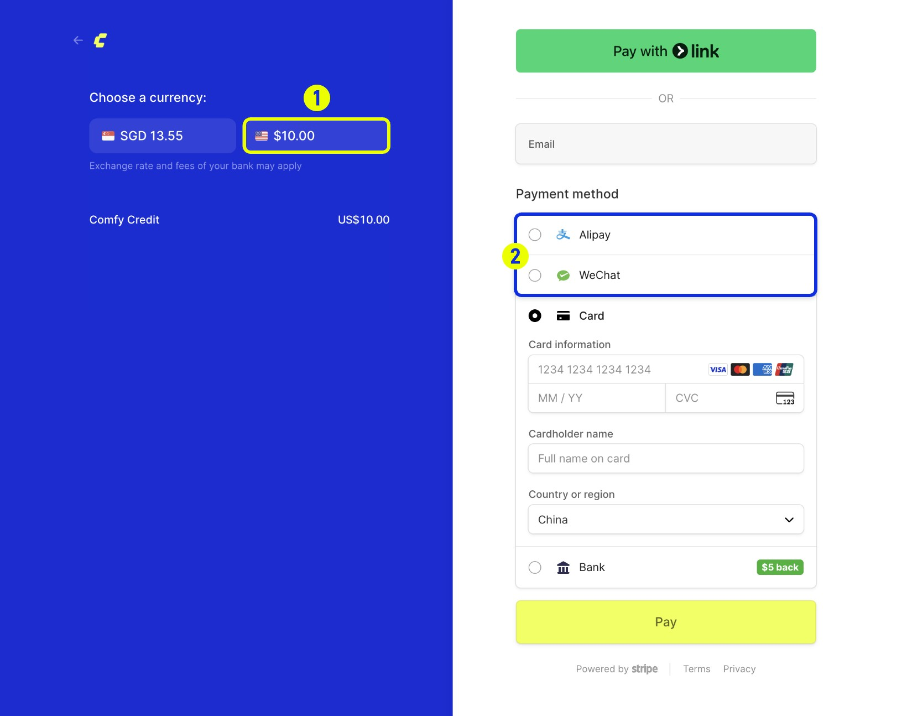

Die Zahlungsmethoden, die Ihnen an der Kasse angezeigt werden, sind die für Ihren Standort und Ihre Währung verfügbaren. Comfy Organization Inc verarbeitet Zahlungen über Stripe.

## Kredit- und Debitkarten

Wir akzeptieren die folgenden gängigen Kredit- und Debitkarten:

- Visa
- Mastercard
- American Express

## Digitale Wallets

Sie können auch mit digitalen Wallet-Diensten bezahlen:

- Google Pay
- Link

## Alternative Zahlungsmethoden

Diese Methoden sind nur verfügbar, wenn Sie in **USD** bezahlen:

- **Alipay**: lokale API-Credits und Comfy Cloud-Abonnements
- **WeChat Pay**: nur lokale API-Credits

<Note>
WeChat Pay und Alipay sind nur in bestimmten Regionen verfügbar. Prüfen Sie den Abschnitt `Business locations` in der Stripe-Dokumentation, um die Verfügbarkeit in Ihrem Land zu überprüfen:
- [Stripe-Dokumentation zu WeChat Pay](https://docs.stripe.com/payments/wechat-pay#get-started)
- [Stripe-Dokumentation zu Alipay](https://docs.stripe.com/payments/alipay)
</Note>

Um Alipay oder WeChat Pay zu nutzen, wählen Sie beim Bezahlen **USD** als Zahlungswährung. Die Optionen erscheinen dann in der Liste der Zahlungsmethoden, sofern sie in Ihrer Region verfügbar sind.

## Anforderungen

Damit Ihre Zahlung erfolgreich verarbeitet werden kann:

- Ihre Karte muss über ausreichend Guthaben oder verfügbaren Kreditrahmen verfügen
- Ihre Rechnungsadresse muss mit der Adresse übereinstimmen, die bei Ihrem Kartenherausgeber hinterlegt ist
- Internationale Karten werden akzeptiert, können jedoch Währungsumrechnungsgebühren Ihrer Bank verursachen

## Sicherheit

Stripe ist ein PCI Service Provider Level 1, die strengste Zertifizierungsstufe, die in der Zahlungsbranche verfügbar ist. Alle Zahlungsinformationen werden sicher mit branchenüblicher Verschlüsselung verarbeitet. Comfy Organization Inc speichert Ihre vollständigen Kartendaten nicht auf unseren Servern.

## Zahlungsabwicklung

Zahlungen werden unmittelbar beim Abschluss oder bei der Verlängerung eines Abonnements verarbeitet. Sie erhalten eine Bestätigungs-E-Mail, sobald Ihre Zahlung erfolgreich verarbeitet wurde.

Wenn bei der Zahlungsabwicklung Probleme auftreten, wenden Sie sich bitte an unser [Support-Team](https://support.comfy.org/).