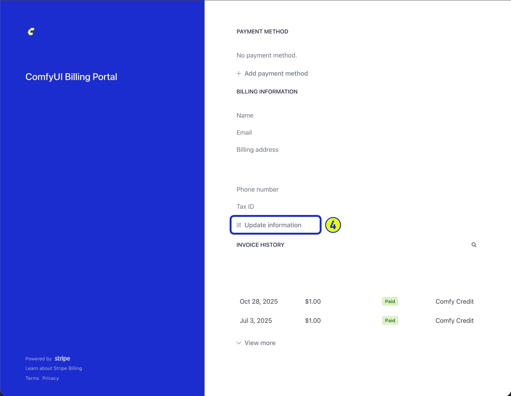

Sie können die Zahlungsdetails für ein Comfy Cloud-Abonnement unter **Tarif & Credits** aktualisieren. Rechnungen und Zahlungsmethoden werden weiterhin im Stripe-Abrechnungsportal verwaltet.

## Zahlungsinformationen für Comfy Cloud bearbeiten

1. Rufen Sie [cloud.comfy.org](https://cloud.comfy.org/?utm_source=docs) auf und melden Sie sich an.
2. Öffnen Sie das Profil-Menü und klicken Sie auf **Tarif verwalten**.
3. Klicken Sie in **Tarif & Credits** auf **Abrechnung & Rechnungen**. Damit öffnen Sie das Stripe-Abrechnungsportal.
4. Klicken Sie auf **Update information** und bearbeiten Sie Ihre Abrechnungs- oder Zahlungsdetails.
5. Speichern Sie Ihre Änderungen in Stripe.

Wenn eine Zahlung fehlgeschlagen ist, können Sie auch im Banner **Zahlung fehlgeschlagen** auf **Zahlung aktualisieren** klicken. Damit öffnen Sie dasselbe Stripe-Portal.

## Was Sie aktualisieren können

Sie können die folgenden Zahlungsdetails ändern:

- Kredit- oder Debitkartennummer
- Ablaufdatum der Karte
- CVV-/Sicherheitscode
- Rechnungsadresse
- Art der Zahlungsmethode (Wechsel zwischen Karte und digitaler Wallet)

## Wann Änderungen wirksam werden

- Änderungen an Ihrer Zahlungsmethode werden sofort wirksam
- Ihr nächster Abrechnungszeitraum verwendet die aktualisierten Zahlungsinformationen
- Aktualisierungen der Abrechnungsdetails (Name, Adresse, Steuer-ID) gelten nur für zukünftige Rechnungen. Bestehende Rechnungen können nicht geändert werden.
- Aktive Abonnements werden nicht unterbrochen, wenn Sie Zahlungsdetails aktualisieren

## Wichtige Hinweise

- Sie müssen eine aktive Zahlungsmethode hinterlegt haben, um Ihr Abonnement zu behalten
- Wenn Sie eine Zahlungsmethode entfernen, fügen Sie vor dem nächsten Abrechnungsdatum eine neue hinzu
- Behalten Sie eine Kopie vergangener Rechnungen, bevor Sie Änderungen vornehmen, falls Sie diese für Ihre Unterlagen benötigen
- Das Aktualisieren Ihrer Zahlungsinformationen ändert weder Ihr Abrechnungsdatum noch Ihren Abonnement-Tarif

## Fehlerbehebung

Wenn beim Aktualisieren Ihrer Zahlungsinformationen Probleme auftreten:

- Prüfen Sie, ob alle Angaben korrekt eingegeben sind
- Stellen Sie sicher, dass Ihre Karte nicht abgelaufen ist
- Prüfen Sie, ob Ihre Rechnungsadresse mit den Daten Ihres Kartenherausgebers übereinstimmt
- Versuchen Sie einen anderen Browser oder leeren Sie Ihren Cache
- Wenden Sie sich an unser [Support-Team](https://support.comfy.org/), wenn die Probleme weiterhin bestehen