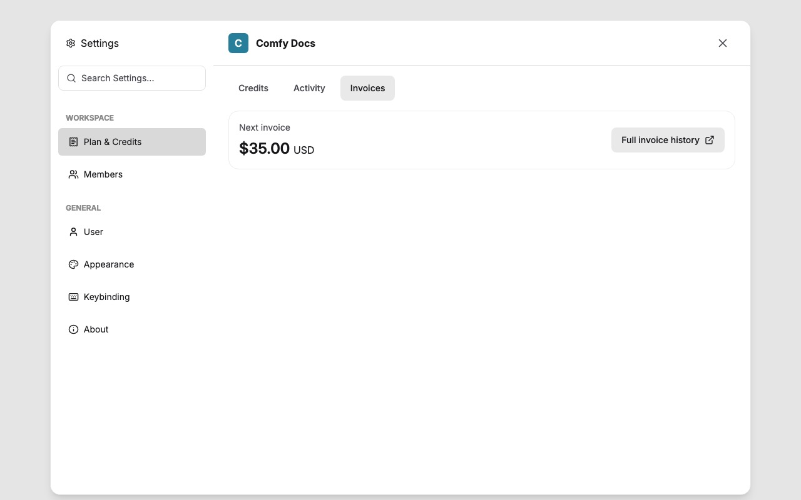

Ihre Rechnung basiert auf den Abrechnungsdaten, die Sie beim Bezahlvorgang eingeben. Diese Daten erscheinen in späteren Rechnungen im Stripe-Abrechnungsportal.

<Card title="Zahlungsinformationen aktualisieren" icon="credit-card" href="/de/support/payment/editing-payment-information">
  Erfahren Sie, wie Sie Ihre Abrechnungsdaten und Zahlungsinformationen aktualisieren
</Card>

## Warum Rechnungen von Stripe stammen

Abonnements und Credit-Käufe für Comfy Cloud werden von Stripe abgewickelt, daher werden Rechnungen und Belege über das Stripe-Abrechnungsportal ausgestellt und nicht direkt von Comfy. Wie Sie eine vergangene Rechnung finden oder herunterladen, erfahren Sie unter [Zahlungsverlauf von Comfy Cloud ansehen](/de/support/payment/payment-history).

## Nächste Rechnung einsehen

Der Tab **Rechnungen** in **Tarif & Credits** zeigt den Betrag der **Nächsten Rechnung** in USD für Ihren aktuellen Tarif. Sie öffnen ihn über das Profil-Menü: **Tarif verwalten** → **Tarif & Credits** → **Rechnungen**.

Solange das Abonnement pausiert ist, steht keine Abbuchung an, daher wird der Betrag ausgeblendet und es bleibt nur der Link zum Verlauf. Können die Abrechnungsdaten nicht geladen werden, bietet der Tab „Erneut versuchen“ an.

Rechnungsverlauf und der Download einzelner Rechnungen befinden sich im Stripe-Abrechnungsportal. Klicken Sie auf **Vollständiger Rechnungsverlauf**, um es zu öffnen. Nur Workspace-Mitglieder, die die Abrechnung verwalten können, sehen den Tab **Rechnungen**.

## Wichtige Hinweise

- Änderungen an Ihren Zahlungsinformationen gelten nur für **künftige Rechnungen**
- Bereits ausgestellte Rechnungen können wir nicht ändern
- Geben Sie die Abrechnungsdaten, die auf Ihrer Rechnung erscheinen sollen, beim Bezahlvorgang ein