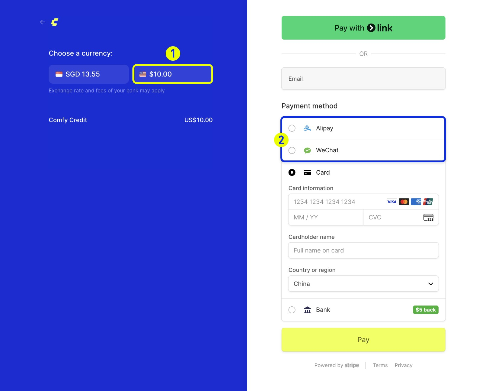

Comfy Organization Inc verarbeitet Zahlungen in mehreren Währungen. Die Preise für Abonnements sind standardmäßig in **US-Dollar (USD)** angegeben.

## Verfügbarkeit der Zahlungsmethoden

### Alipay und WeChat Pay

- **Alipay** wird sowohl für lokale API-Credits als auch für Comfy Cloud-Abonnements unterstützt
- **WeChat Pay** ist derzeit nur für lokale API-Credits verfügbar

Beide erfordern die Zahlung in **USD**. Siehe [Akzeptierte Zahlungsmethoden bei Comfy Cloud](/de/support/payment/accepted-payment-methods).

## Währungsauswahl

Ihre Zahlungswährung wird in der Regel bestimmt durch:

- Den Standort Ihres Kontos
- Ihre Rechnungsadresse
- Die Standardwährung Ihrer Zahlungsmethode

Wählen Sie an der Kasse **USD**, wenn Alipay oder WeChat Pay angezeigt werden sollen.

## Währungsumrechnung

### Automatische Umrechnung

Wenn die Währung Ihrer Karte von der Abrechnungswährung abweicht:

- Rechnet Ihre Bank oder der Kartenaussteller den Betrag automatisch um
- Legt Ihr Finanzinstitut die Wechselkurse fest
- Können zusätzliche Gebühren für die Währungsumrechnung anfallen

### Umrechnungsgebühren

- Gebühren für die Währungsumrechnung erhebt Ihre Bank, nicht Comfy Organization Inc
- Diese Gebühren liegen in der Regel zwischen 1-3% des Transaktionsbetrags
- Fragen Sie bei Ihrer Bank nach den konkreten Umrechnungsgebühren

## Abbuchungen in Ihrer Währung einsehen

So sehen Sie die ungefähre Abbuchung in Ihrer lokalen Währung:

1. Prüfen Sie Ihren Bank- oder Kreditkartenauszug
2. Nutzen Sie den Währungsrechner Ihrer Bank
3. Beachten Sie, dass Wechselkurse täglich schwanken

## Abrechnungswährung ändern

Um die Abrechnungswährung eines bestehenden Abonnements zu ändern, wenden Sie sich mit Ihrer Wunschwährung an unser [Support-Team](https://support.comfy.org/). Währungsänderungen können den abgebuchten Betrag aufgrund von Wechselkursen beeinflussen.

## Preisunterschiede nach Region

Die Abonnementpreise können je nach Region leicht abweichen, bedingt durch:

- Lokale Steuervorschriften
- Wechselkurse
- Regionale Preisanpassungen

## Steuern und Umsatzsteuer

Je nach Ihrem Standort können zusätzliche Gebühren anfallen:

- Sales Tax (Kunden in den USA)
- Umsatzsteuer (Kunden in Europa)
- GST (Australien, Kanada und andere zutreffende Regionen)

Diese Steuern werden anhand Ihrer Rechnungsadresse berechnet und Ihrem Gesamtbetrag hinzugefügt.