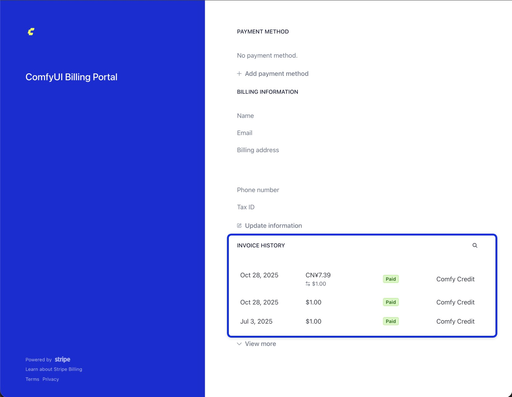
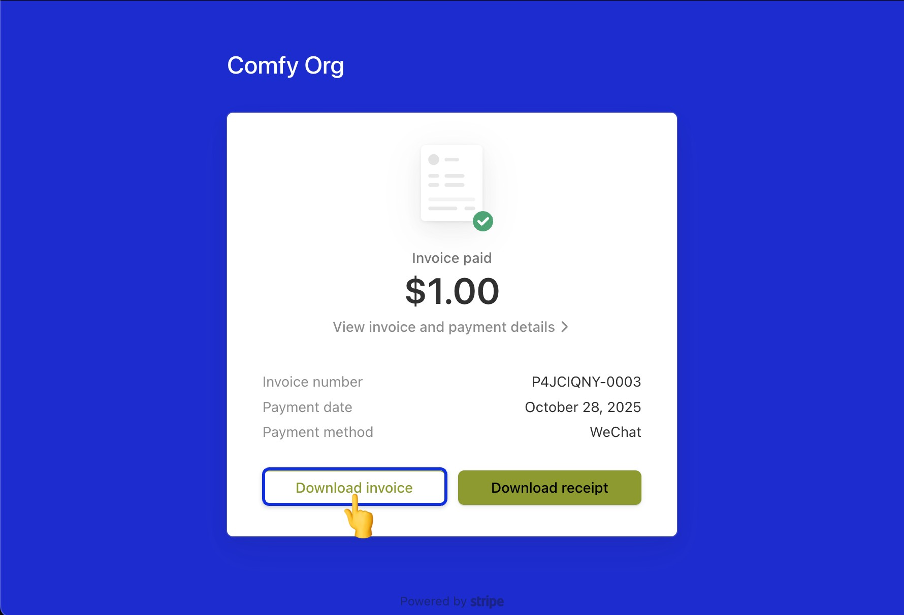

Sie können Ihre Rechnungen von Comfy Cloud unter **Tarif & Credits** einsehen. **Abrechnung & Rechnungen** öffnet das Stripe-Abrechnungsportal, in dem sich die Rechnungsliste und die PDF-Downloads befinden.

## Zahlungsverlauf von Comfy Cloud aufrufen

1. Rufen Sie [cloud.comfy.org](https://cloud.comfy.org/?utm_source=docs) auf und melden Sie sich an.
2. Öffnen Sie das Profilmenü und klicken Sie auf **Tarif verwalten**.
3. Klicken Sie in **Tarif & Credits** auf **Abrechnung & Rechnungen**. Dadurch wird das Stripe-Abrechnungsportal geöffnet.
4. Öffnen Sie eine Rechnung in Stripe, um Details anzuzeigen oder das PDF herunterzuladen.

Stellen Sie sicher, dass Ihre Rechnungsdaten korrekt sind, bevor neue Rechnungen erstellt werden. Aktualisieren Sie sie unter [Zahlungsinformationen für Comfy Cloud bearbeiten](/de/support/payment/editing-payment-information).

## Wann Rechnungen erscheinen

Comfy Cloud stellt jedes Mal eine Rechnung aus, wenn eine Zahlung erfolgreich ist, etwa bei einer Verlängerung des Abonnements oder beim Kauf von Credits. Die Rechnungen erscheinen zusammen mit Ihren übrigen Belastungen im Stripe-Abrechnungsportal.

## Verwandte Seiten zur Abrechnung

<CardGroup cols={3}>
  <Card title="Informationen zu Rechnungen" icon="book-open" href="/de/support/payment/invoice-information">
    Sehen Sie, welche Rechnungsdaten auf einer Rechnung erscheinen.
  </Card>
  <Card title="Zahlungsinformationen bearbeiten" icon="credit-card" href="/de/support/payment/editing-payment-information">
    Aktualisieren Sie die Karte und die Rechnungsdaten, die für künftige Belastungen verwendet werden.
  </Card>
  <Card title="Fehlgeschlagene Zahlung beheben" icon="life-ring" href="/de/support/payment/unsuccessful-payments">
    Aktualisieren Sie Ihre Zahlungsmethode, bevor das Abonnement pausiert wird.
  </Card>
</CardGroup>