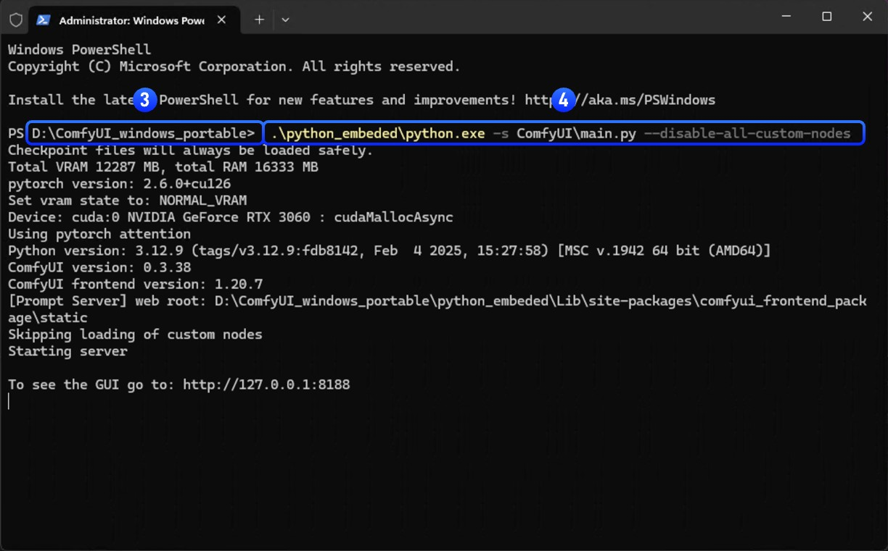
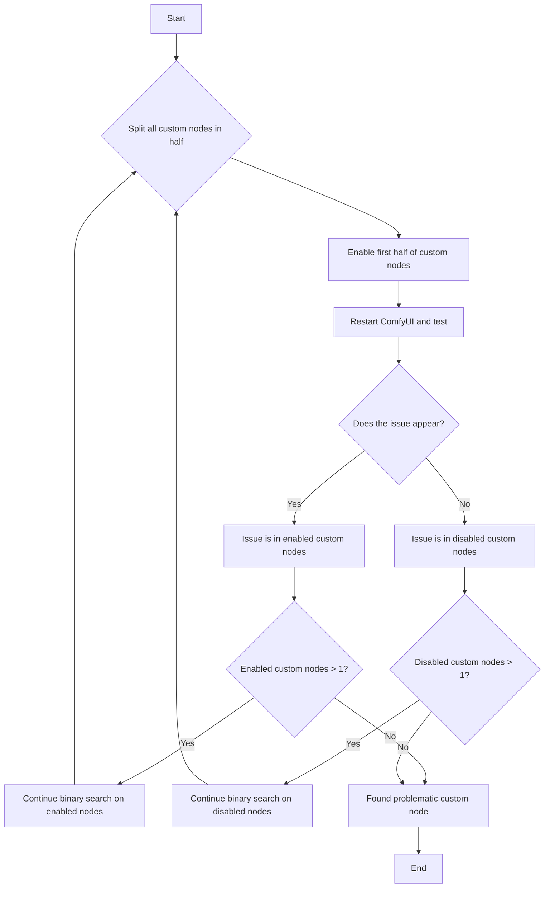

Here is the overall approach for troubleshooting custom node issues:

 ```mermaid
 flowchart TD
    A[Issue Encountered] --> B{Does the issue disappear after <a href="#how-to-disable-all-custom-nodes%3F">disabling all custom nodes</a>?}
    B -- Yes --> C[Issue caused by custom nodes]
    B -- No --> D[Issue not caused by custom nodes, refer to other troubleshooting docs]
    C --> E{<a href="#1-troubleshooting-the-custom-nodes’-frontend-extensions">Check frontend extensions first</a>?}
    E -- Yes --> F[<a href="#1-troubleshooting-the-custom-nodes’-frontend-extensions">Troubleshoot in ComfyUI frontend</a><br/><li>Only need reload the frontend</li>]
    E -- No --> G[<a href="#2-general-custom-node-troubleshooting">Use general binary search method</a><li>Need to restart ComfyUI multiple times</li>]
    F --> H[Use binary search to locate problematic node]
    G --> H
    H --> I[<a href="#how-to-fix-the-issue">Fix, replace, report or remove problematic node</a>]
    I --> J[Issue solved]
```

## Alle Custom Nodes deaktivieren

<Tabs>
<Tab title="Desktop-Benutzer">
Starten Sie Comfy Desktop mit deaktivierten Custom Nodes über das Einstellungsmenü.

oder starten Sie den Server manuell:
```bash
cd path/to/your/comfyui
python main.py --disable-all-custom-nodes
```
</Tab>
<Tab title="Manuelle Installation">
```bash
cd ComfyUI
python main.py --disable-all-custom-nodes
```
</Tab>
<Tab title="Portable">
<Tabs>
   <Tab title="`.bat`-Datei bearbeiten">
   Öffnen Sie den Ordner, in dem sich die portable Version befindet, und suchen Sie die Datei `run_nvidia_gpu.bat` oder `run_cpu.bat`.
   
   1. Kopieren Sie die Datei `run_nvidia_gpu.bat` oder `run_cpu.bat` und benennen Sie sie in `run_nvidia_gpu_disable_custom_nodes.bat` um.
   2. Öffnen Sie die kopierte Datei mit Notepad.
   3. Fügen Sie den Parameter `--disable-all-custom-nodes` zur Datei hinzu, oder kopieren Sie die folgenden Parameter in eine `.txt`-Datei und benennen Sie die Datei in `run_nvidia_gpu_disable_custom_nodes.bat` um.
   ```bash
   .\python_embeded\python.exe -s ComfyUI\main.py --disable-all-custom-nodes  --windows-standalone-build
   pause
   ```
   4. Speichern Sie die Datei und schließen Sie sie.
   5. Doppelklicken Sie auf die Datei, um sie auszuführen. Wenn alles normal verläuft, sollten Sie sehen, dass ComfyUI startet und die Custom Nodes deaktiviert sind.
   </Tab>
   <Tab title="Über die Befehlszeile">
   
   1. Wechseln Sie in den Ordner, in dem sich die portable Version befindet.
   2. Öffnen Sie das Terminal über einen Rechtsklick auf das Menü → Terminal öffnen.
   
   3. Stellen Sie sicher, dass der Ordner das aktuelle Verzeichnis der portablen Version ist.
   4. Geben Sie den folgenden Befehl ein, um ComfyUI über die portable Python-Version zu starten und Custom Nodes zu deaktivieren.
   ```
   .\python_embeded\python.exe -s ComfyUI\main.py --disable-all-custom-nodes
   ```
   </Tab>
</Tabs>
</Tab>
</Tabs>

**Ergebnisse:**
- ✅ **Problem verschwindet**: Ein Custom Node verursacht das Problem → Fahren Sie mit Schritt 2 fort
- ❌ **Problem bleibt bestehen**: Kein Problem mit einem Custom Node → [Melden Sie das Problem](#reporting-issues)

## Was ist die binäre Suche?

In diesem Dokument stellen wir die binäre Suche als Ansatz zur Fehlerbehebung bei Problemen mit Custom Nodes vor. Dabei prüfen Sie jeweils die Hälfte der Custom Nodes, bis Sie den problematischen Node gefunden haben.

Beachten Sie das folgende Flussdiagramm für das genaue Vorgehen: Aktivieren Sie jedes Mal die Hälfte der derzeit deaktivierten Nodes und prüfen Sie, ob das Problem auftritt, bis Sie ermitteln, welcher Custom Node das Problem verursacht.




## Zwei Methoden zur Fehlersuche {#two-troubleshooting-methods}

In diesem Dokument unterteilen wir Custom Nodes zur Fehlersuche in zwei Typen:


- A: Custom Nodes mit Frontend-Erweiterungen
- B: Reguläre Custom Nodes

Betrachten wir zunächst die möglichen Probleme und Ursachen bei den verschiedenen Typen von Custom Nodes:

<Tabs>
   <Tab title="Custom Nodes mit Frontend-Erweiterungen">
   Bei Custom Nodes können wir die Fehlersuche bei denen mit Frontend-Erweiterungen priorisieren, da sie die meisten Probleme verursachen. Ihre wesentlichen Konflikte entstehen durch Inkompatibilitäten mit Aktualisierungen der ComfyUI-Frontend-Version.
   
   Häufige Probleme sind:
   - Workflows werden nicht ausgeführt
   - Einige Nodes können keine Vorschaubilder anzeigen (z. B. der Node Save Image)
   - Fehlausgerichtete UI-Elemente
   - Auf das ComfyUI-Frontend kann nicht zugegriffen werden
   - Völlig defekte Benutzeroberfläche oder leerer Bildschirm
   - Es kann nicht normal mit dem ComfyUI-Backend kommuniziert werden
   - Node-Verbindungen funktionieren nicht richtig
   - Und weitere
   
   Häufige Ursachen für diese Probleme:
   - Änderungen am Frontend bei Updates, an die sich die Custom Nodes noch nicht angepasst haben
   - Anwender aktualisieren ComfyUI, ohne die Custom Nodes gleichzeitig zu aktualisieren, obwohl die Autorinnen und Autoren kompatible Versionen veröffentlicht haben
   - Autorinnen und Autoren stellen die Wartung ein, wodurch die Erweiterungen der Custom Nodes mit dem ComfyUI-Frontend inkompatibel werden
      
   </Tab>
   <Tab title="Reguläre Custom Nodes">
   Wenn das Problem nicht durch die Frontend-Erweiterungen der Custom Nodes verursacht wird, hängen die Probleme häufig mit Abhängigkeiten zusammen. Häufige Probleme sind:
   - „Failed to import“-Fehler in der Konsole bzw. den Protokollen
   - Fehlende Nodes werden auch nach Installation und Neustart weiterhin als fehlend angezeigt
   - ComfyUI stürzt ab oder startet nicht
   - Und weitere

   Häufige Ursachen für diese Fehler:
   - Custom Nodes, die zusätzliche Wheels wie ComfyUI-Nunchaku benötigen
   - Custom Nodes, die strikte Abhängigkeitsversionen verwenden (z. B. `torch==2.4.1`), während andere Plugins andere Versionen nutzen (z. B. `torch>=2.4.2`), was nach der Installation zu Konflikten führt
   - Netzwerkprobleme, die eine erfolgreiche Installation der Abhängigkeiten verhindern

   Wenn Probleme die gegenseitigen Abhängigkeiten und Versionen der Python-Umgebung betreffen, wird die Fehlersuche komplexer und erfordert Kenntnisse im Umgang mit der Python-Umgebung, einschließlich der Frage, wie Abhängigkeiten installiert und deinstalliert werden
   </Tab>
</Tabs>

## Using Binary Search for Troubleshooting

Among these two different types of custom node issues, conflicts between custom node frontend extensions and ComfyUI are more common. We'll prioritize troubleshooting these nodes first. Here's the overall troubleshooting approach:

### 1. Troubleshooting the Custom Nodes' Frontend Extensions

<Steps>
   <Step title="Disable All Third-Party Frontend Extensions">
   
   After starting ComfyUI, find the `Extensions` menu in settings and follow the steps shown in the image to disable all third-party extensions
   <Tip>
      If you can't enter ComfyUI frontend, just skip the frontend extensions troubleshooting section and continue to [General Custom Node Troubleshooting Approach](#2-general-custom-node-troubleshooting)
   </Tip>
   </Step>
   <Step title="Restart ComfyUI">
   After disabling frontend extensions for the first time, it's recommended to restart ComfyUI to ensure all frontend extensions are properly disabled
   - If the problem disappears, then it was caused by custom node frontend extensions, and we can proceed with binary search troubleshooting
   - If the problem persists, then it's not caused by frontend extensions - please refer to the other troubleshooting approaches in this document
   </Step>
   <Step title="Use Binary Search to Locate Problem Nodes">
   Use the method mentioned at the beginning of this document to troubleshoot, enabling half of the custom nodes at a time until you find the problematic node
   
   Refer to the image to enable half of the frontend extensions. Note that if extension names are similar, they likely come from the same custom node's frontend extensions
   </Step>
   <Step title="Follow-up Actions">
   If you find the problematic custom node, please refer to the problem fixing section of this document to resolve the custom node issues
   </Step>
</Steps>

Using this method, you don't need to restart ComfyUI multiple times - just reload ComfyUI after enabling/disabling custom node frontend extensions. Plus, your troubleshooting scope is limited to nodes with frontend extensions, which greatly narrows down the search range.

### 2. General Custom Node Troubleshooting


<Steps>
  <Step title="Use Binary Search to Locate Custom Nodes">
      For the binary search localization method, in addition to manual search, we also have automated binary search using comfy-cli, as detailed below:

      <Tabs>
         <Tab title="Using Comfy CLI (Recommended)">
         Using Comfy CLI requires some command line experience. If you're not comfortable with it, use manual binary search instead.
         
         If you have [Comfy CLI](/comfy-cli/getting-started) installed, you can use the automated bisect tool to find the problematic node:

         ```bash
         # Start a bisect session
         comfy-cli node bisect start

         # Follow the prompts:
         # - Test ComfyUI with the current set of enabled nodes
         # - Mark as 'good' if the issue is gone: comfy-cli node bisect good
         # - Mark as 'bad' if the issue persists: comfy-cli node bisect bad
         # - Repeat until the problematic node is identified

         # Reset when done
         comfy-cli node bisect reset
         ```

         The bisect tool will automatically enable/disable nodes and guide you through the process.

         </Tab>
         <Tab title="Manual Binary Search">
            <Warning>
            Before starting, please **create a backup** of your custom_nodes folder in case something goes wrong.
            </Warning>

         If you prefer to do the process manually or don't have Comfy CLI installed, follow the steps below:

         <Steps>
            <Step title="Create Temporary Folders">
            Before starting, enter the `<YOUR_COMFYUI_FOLDER>\ComfyUI\` folder
                  <Tabs>
                     <Tab title="Windows">
                     - **Backup all custom nodes**: Copy and rename `custom_nodes` to `custom_nodes_backup`
                     - **Create a temporary folder**: Create a folder named `custom_nodes_temp`
                     
                     Or use the following command line to backup:
      
                     ```bash
                     # Create backup and temporary folder
                     mkdir "%USERPROFILE%\custom_nodes_backup"
                     mkdir "%USERPROFILE%\custom_nodes_temp"

                     # Backup all content
                     xcopy "custom_nodes\*" "%USERPROFILE%\custom_nodes_backup\" /E /H /Y
                     ```
                     </Tab>
                     <Tab title="macOS/Linux">
                     Manually backup custom_nodes folder
                     Or use the following command line to backup:
                     ```bash
                     # Create backup and temporary folder
                     mkdir ~/custom_nodes_backup
                     mkdir ~/custom_nodes_temp

                     # Backup all content
                     cp -r custom_nodes/* ~/custom_nodes_backup/
                     ```
                     </Tab>
                     <Tab title="Cloud/Colab">
                     ```bash
                     # Create backup and temporary folder
                     mkdir /content/custom_nodes_backup
                     mkdir /content/custom_nodes_temp

                     # Backup all content
                     cp -r /content/ComfyUI/custom_nodes/* /content/custom_nodes_backup/
                     ```
                     </Tab>
                  </Tabs>
               </Step>
               <Step title="List all custom nodes">
                   <Tabs>
                     <Tab title="Windows">
                     Since Windows has a visual interface, you can skip this step unless you're only using the command line
                     ```bash
                     dir custom_nodes
                     ```
                     </Tab>
                     <Tab title="macOS/Linux">
                     ```bash
                     ls custom_nodes/
                     ```
                     </Tab>
                     <Tab title="Cloud/Colab">
                     ```bash
                     ls /content/ComfyUI/custom_nodes/
                     ```
                     </Tab>
                  </Tabs>
               </Step>
               <Step title="Split nodes in half">
               Let's assume that you have 8 custom nodes. Move the first half to temporary storage:
                  <Tabs>
                  <Tab title="Windows">
                  ```bash
                  # Move first half (nodes 1-4) to temp
                  move "custom_nodes\node1" "%USERPROFILE%\custom_nodes_temp\"
                  move "custom_nodes\node2" "%USERPROFILE%\custom_nodes_temp\"
                  move "custom_nodes\node3" "%USERPROFILE%\custom_nodes_temp\"
                  move "custom_nodes\node4" "%USERPROFILE%\custom_nodes_temp\"
                  ```
                  </Tab>
                  <Tab title="macOS/Linux">
                  ```bash
                  # Move first half (nodes 1-4) to temp
                  mv custom_nodes/node1 ~/custom_nodes_temp/
                  mv custom_nodes/node2 ~/custom_nodes_temp/
                  mv custom_nodes/node3 ~/custom_nodes_temp/
                  mv custom_nodes/node4 ~/custom_nodes_temp/
                  ```
                  </Tab>
                  <Tab title="Cloud/Colab">
                  ```bash
                  # Move first half (nodes 1-4) to temp
                  mv /content/ComfyUI/custom_nodes/node1 /content/custom_nodes_temp/
                  mv /content/ComfyUI/custom_nodes/node2 /content/custom_nodes_temp/
                  mv /content/ComfyUI/custom_nodes/node3 /content/custom_nodes_temp/
                  mv /content/ComfyUI/custom_nodes/node4 /content/custom_nodes_temp/
                  ```
                  </Tab>
                  </Tabs>
               </Step>
               <Step title="Test ComfyUI">
               Start ComfyUI normally
                  ```bash
                  python main.py
                  ```
               </Step>
               <Step title="Interpret results">
                  - **Issue persists**: Problem is in the remaining nodes (5-8)
                  - **Issue disappears**: Problem was in the moved nodes (1-4)
               </Step>
               <Step title="Narrow it down">
                  - If issue persists: Move half of remaining nodes (e.g., nodes 7-8) to temp
                  - If issue gone: Move half of temp nodes (e.g., nodes 3-4) back to custom_nodes
               </Step>
               <Step title="Repeat until you find the single problematic node">
                  - Repeat until you find the single problematic node
               </Step>
            </Steps>
         </Tab>
      </Tabs>
   </Step>
</Steps>

## So beheben Sie das Problem

Sobald Sie den problematischen Custom Node identifiziert haben:

### Option 1: Den Node aktualisieren
1. Prüfen Sie in ComfyUI Manager, ob ein Update verfügbar ist
2. Aktualisieren Sie den Node und testen Sie erneut

### Option 2: Den Node ersetzen
1. Suchen Sie nach alternativen Custom Nodes mit ähnlicher Funktionalität
2. Prüfen Sie die [ComfyUI Registry](https://registry.comfy.org) auf Alternativen

### Option 3: Das Problem melden
Wenden Sie sich an den Entwickler des Custom Node:
1. Finden Sie das GitHub-Repository des Node
2. Erstellen Sie ein Issue mit:
   - Ihrer ComfyUI-Version
   - Fehlermeldungen/Protokollen
   - Schritten zum Reproduzieren
   - Ihrem Betriebssystem

### Option 4: Den Node entfernen oder deaktivieren
Wenn keine Lösung verfügbar ist und Sie die Funktionalität nicht benötigen:
1. Entfernen Sie den problematischen Node aus `custom_nodes/` oder deaktivieren Sie ihn in der Oberfläche von ComfyUI Manager
2. Starten Sie ComfyUI neu

## Probleme melden

Wenn das Problem nicht durch Custom Nodes verursacht wird, finden Sie in der allgemeinen [Fehlerbehebungsübersicht](/de/troubleshooting/overview) weitere häufige Probleme.

### Bei Problemen mit bestimmten Custom Nodes
Wenden Sie sich an den Entwickler des Custom Node:
- Suchen Sie das GitHub-Repository des Nodes  
- Erstellen Sie ein Issue mit Ihrer ComfyUI-Version, den Fehlermeldungen, Schritten zur Reproduktion und Ihrem Betriebssystem
- Prüfen Sie die Dokumentation und die Issues-Seite des Nodes auf bekannte Probleme

### Bei Problemen mit dem ComfyUI-Kern
- **GitHub**: [ComfyUI-Probleme](https://github.com/Comfy-Org/ComfyUI/issues)
- **Forum**: [Offizielles ComfyUI-Forum](https://forum.comfy.org/)

### Bei Problemen mit der Desktop-App  
- **GitHub**: [Comfy Desktop-Probleme](https://github.com/Comfy-Org/Comfy-Desktop/issues)

### Bei Problemen mit dem Frontend
- **GitHub**: [ComfyUI Frontend-Probleme](https://github.com/Comfy-Org/ComfyUI_frontend/issues)

<Note>
Bei allgemeinen Installations-, Modell- oder Leistungsproblemen lesen Sie unsere Seiten [Fehlerbehebungsübersicht](/de/troubleshooting/overview) und [Modellprobleme](/de/troubleshooting/model-issues).
</Note>
