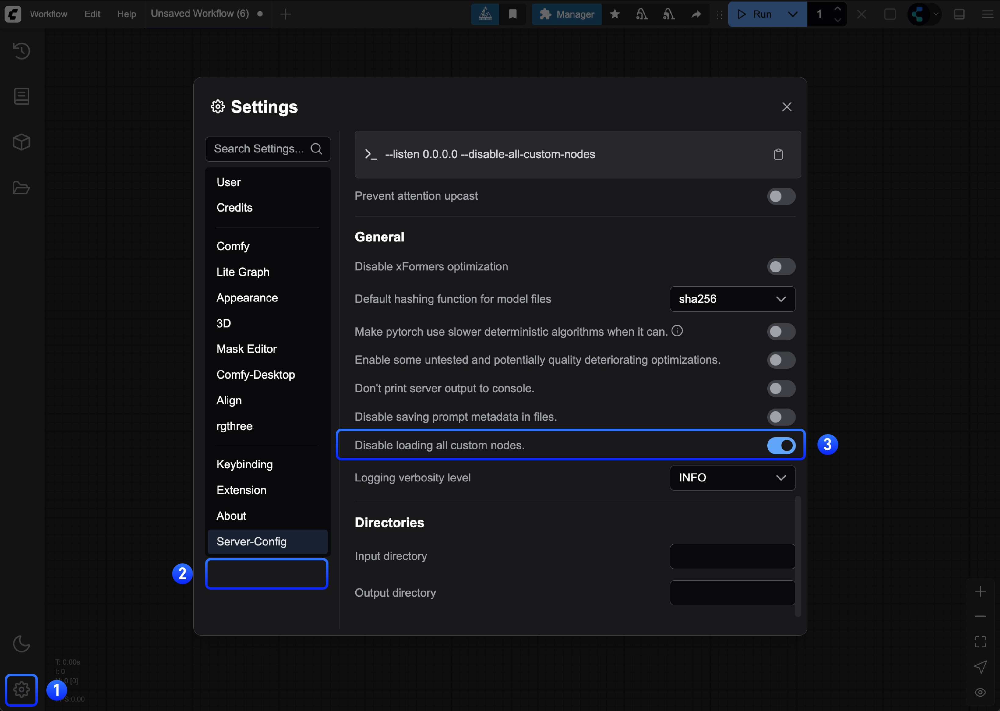
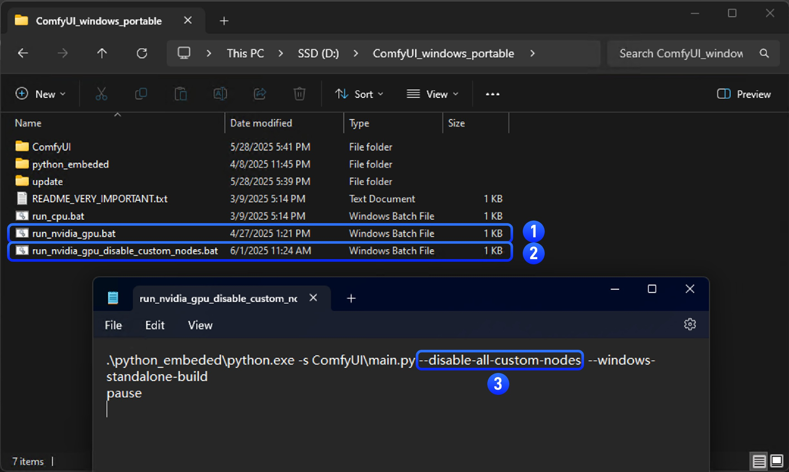
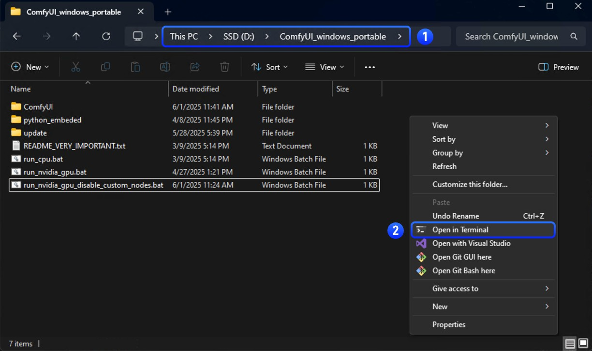
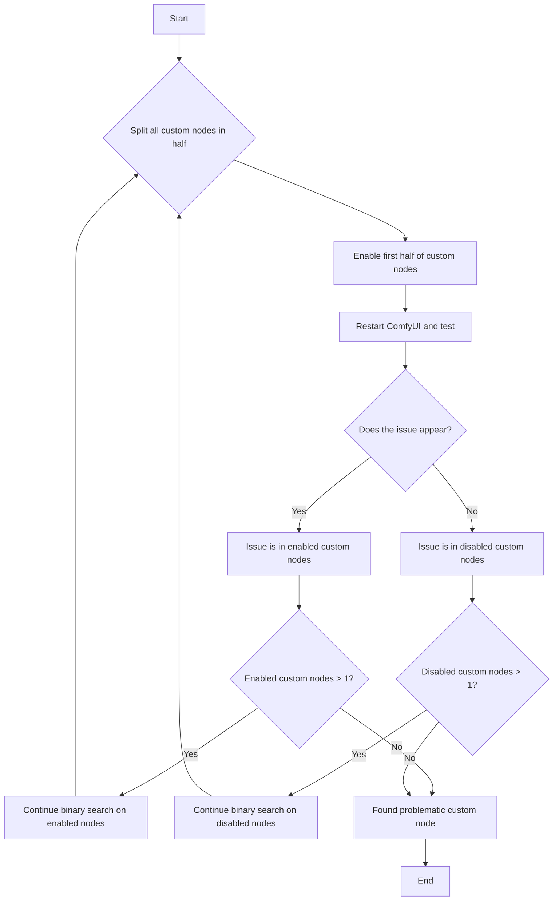
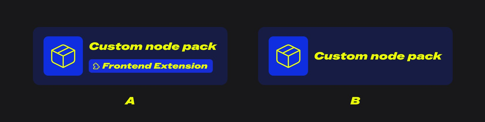
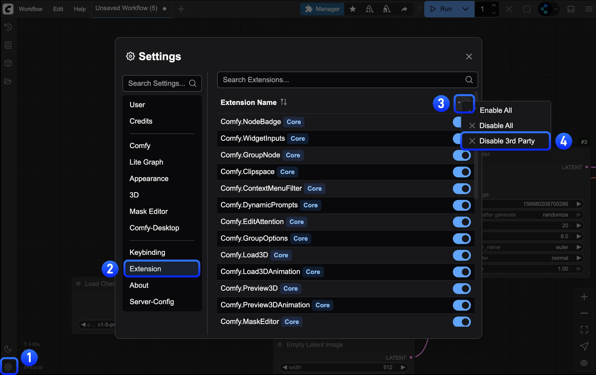
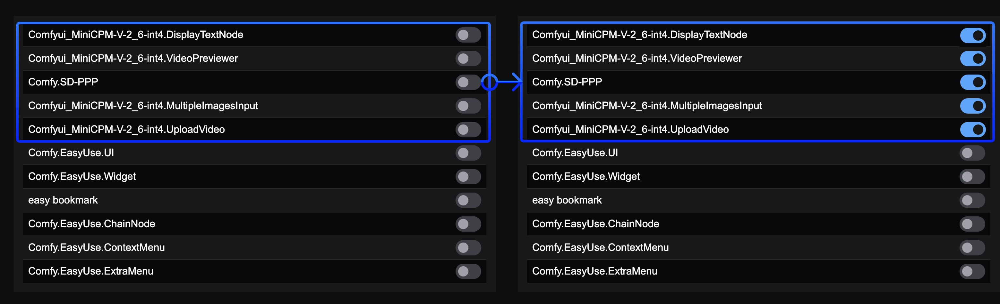

Im Folgenden finden Sie das allgemeine Vorgehen bei der Fehlerbehebung von Problemen mit Custom Nodes:

 ```mermaid
 flowchart TD
    A[Problem aufgetreten] --> B{Verschwindet das Problem <a href="#alle-custom-nodes-deaktivieren">NACH dem Deaktivieren aller Custom Nodes</a>?}
    B -- Ja --> C[Problem durch Custom Nodes verursacht]
    B -- Nein --> D[Problem nicht durch Custom Nodes verursacht, siehe andere Fehlerbehebungs-Dokumentation]
    C --> E{<a href="#1-fehlerbehebung-bei-den-frontend-erweiterungen-der-custom-nodes">Zuerst Frontend-Erweiterungen prüfen</a>?}
    E -- Ja --> F[<a href="#1-fehlerbehebung-bei-den-frontend-erweiterungen-der-custom-nodes">Fehlerbehebung im ComfyUI-Frontend</a><br/><li>Nur das Frontend muss neu geladen werden</li>]
    E -- Nein --> G[<a href="#2-allgemeine-fehlerbehebung-bei-custom-nodes">Allgemeine Methode der binären Suche verwenden</a><li>ComfyUI muss mehrmals neu gestartet werden</li>]
    F --> H[Problematischen Node mit binärer Suche finden]
    G --> H
    H --> I[<a href="#so-beheben-sie-das-problem">Problematischen Node beheben, ersetzen, melden oder entfernen</a>]
    I --> J[Problem gelöst]
```


## Alle Custom Nodes deaktivieren

<Tabs>
<Tab title="Desktop-Benutzer">
Starten Sie Comfy Desktop mit deaktivierten Custom Nodes über das Einstellungen-Menü

oder starten Sie den Server manuell:
```bash
cd path/to/your/comfyui
python main.py --disable-all-custom-nodes
```
</Tab>
<Tab title="Manuelle Installation">
```bash
cd ComfyUI
python main.py --disable-all-custom-nodes
```
</Tab>
<Tab title="Portable">
<Tabs>
   <Tab title="`.bat`-Datei bearbeiten">
   Öffnen Sie den Ordner, in dem sich die portable Version befindet, und suchen Sie die Datei `run_nvidia_gpu.bat` oder `run_cpu.bat`
   
   1. Kopieren Sie die Datei `run_nvidia_gpu.bat` oder `run_cpu.bat` und benennen Sie sie in `run_nvidia_gpu_disable_custom_nodes.bat` um
   2. Öffnen Sie die kopierte Datei mit Notepad
   3. Fügen Sie den Parameter `--disable-all-custom-nodes` zur Datei hinzu, oder kopieren Sie die unten stehenden Parameter in eine `.txt`-Datei und benennen Sie die Datei in `run_nvidia_gpu_disable_custom_nodes.bat` um
   ```bash
   .\python_embeded\python.exe -s ComfyUI\main.py --disable-all-custom-nodes  --windows-standalone-build
   pause
   ```
   4. Speichern Sie die Datei und schließen Sie sie
   5. Doppelklicken Sie auf die Datei, um sie auszuführen. Wenn alles normal verläuft, sollten Sie sehen, dass ComfyUI startet und die Custom Nodes deaktiviert sind
   </Tab>
   <Tab title="Über die Befehlszeile">
   
   1. Wechseln Sie in den Ordner, in dem sich die portable Version befindet
   2. Öffnen Sie das Terminal, indem Sie mit der rechten Maustaste auf das Menü klicken → Open terminal
   
   3. Stellen Sie sicher, dass der Ordnername dem aktuellen Verzeichnis der portablen Version entspricht
   4. Geben Sie den folgenden Befehl ein, um ComfyUI über die portable Python-Version zu starten und die Custom Nodes zu deaktivieren
   ```
   .\python_embeded\python.exe -s ComfyUI\main.py --disable-all-custom-nodes
   ```
   </Tab>
</Tabs>
</Tab>
</Tabs>

**Ergebnisse:**
- ✅ **Problem verschwindet**: Ein Custom Node verursacht das Problem → Fahren Sie mit Schritt 2 fort
- ❌ **Problem bleibt bestehen**: Kein Custom-Node-Problem → [Problem melden](#probleme-melden)

## Was ist die binäre Suche?

In diesem Dokument stellen wir die binäre Suche zur Fehlerbehebung bei Problemen mit Custom Nodes vor: Sie prüfen jeweils die Hälfte der Custom Nodes, bis Sie den problematischen Node finden.

Das genaue Vorgehen entnehmen Sie dem folgenden Flussdiagramm: Aktivieren Sie jeweils die Hälfte der aktuell deaktivierten Nodes und prüfen Sie, ob das Problem auftritt, bis Sie erkennen, welcher Custom Node das Problem verursacht.




## Zwei Methoden zur Fehlerbehebung

In diesem Dokument unterteilen wir Custom Nodes für die Fehlerbehebung in zwei Typen:


- A: Custom Nodes mit Frontend-Erweiterungen
- B: Reguläre Custom Nodes

Betrachten wir zunächst die möglichen Probleme und Ursachen bei den verschiedenen Typen von Custom Nodes:

<Tabs>
   <Tab title="Custom Nodes mit Frontend-Erweiterungen">
   Bei Custom Nodes können wir uns vorrangig um diejenigen mit Frontend-Erweiterungen kümmern, da sie die meisten Probleme verursachen. Ihre wichtigsten Konflikte entstehen durch Inkompatibilitäten mit Aktualisierungen der ComfyUI-Frontend-Version.
   
   Häufige Probleme sind:
   - Workflows werden nicht ausgeführt
   - Einige Nodes können keine Vorschaubilder anzeigen (z. B. der Node Save Image)
   - Falsch ausgerichtete UI-Elemente
   - Kein Zugriff auf das ComfyUI-Frontend
   - Vollständig defekte UI oder leerer Bildschirm
   - Keine normale Kommunikation mit dem ComfyUI-Backend
   - Node-Verbindungen funktionieren nicht richtig
   - Und mehr
   
   Häufige Ursachen für diese Probleme:
   - Änderungen am Frontend während der Updates, an die sich die Custom Nodes noch nicht angepasst haben
   - Sie aktualisieren ComfyUI, ohne die Custom Nodes synchron mit zu aktualisieren, obwohl die Autoren bereits kompatible Versionen veröffentlicht haben
   - Die Autoren haben die Wartung eingestellt, sodass die Erweiterungen der Custom Nodes nicht mehr mit dem ComfyUI-Frontend kompatibel sind
      
   </Tab>
   <Tab title="Reguläre Custom Nodes">
   Wenn das Problem nicht durch die Frontend-Erweiterungen der Custom Nodes verursacht wird, hängen die Probleme oft mit Abhängigkeiten zusammen. Häufige Probleme sind:
   - Fehler „Failed to import“ in der Konsole bzw. den Protokollen
   - Fehlende Nodes werden auch nach der Installation und einem Neustart noch als fehlend angezeigt
   - ComfyUI stürzt ab oder startet nicht
   - Und mehr

   Häufige Ursachen für diese Fehler:
   - Custom Nodes, die zusätzliche Wheels wie ComfyUI-Nunchaku benötigen
   - Custom Nodes, die strikte Abhängigkeitsversionen verwenden (z. B. `torch==2.4.1`), während andere Plugins andere Versionen verwenden (z. B. `torch>=2.4.2`), was nach der Installation zu Konflikten führt
   - Netzwerkprobleme, die eine erfolgreiche Installation der Abhängigkeiten verhindern

   Wenn Probleme mit den gegenseitigen Abhängigkeiten und Versionen der Python-Umgebung zusammenhängen, wird die Fehlerbehebung komplexer und erfordert Kenntnisse im Management der Python-Umgebung, einschließlich der Frage, wie Abhängigkeiten installiert und deinstalliert werden
   </Tab>
</Tabs>

## Binäre Suche zur Fehlerbehebung verwenden

Von diesen beiden Arten von Problemen mit Custom Nodes treten Konflikte zwischen Frontend-Erweiterungen von Custom Nodes und ComfyUI häufiger auf. Diese Nodes behandeln wir daher zuerst. So gehen Sie bei der Fehlerbehebung insgesamt vor:

### 1. Fehlerbehebung bei den Frontend-Erweiterungen der Custom Nodes

<Steps>
   <Step title="Alle Frontend-Erweiterungen von Drittanbietern deaktivieren">
   
   Suchen Sie nach dem Start von ComfyUI in den Einstellungen das Menü `Extensions` und folgen Sie den im Bild gezeigten Schritten, um alle Erweiterungen von Drittanbietern zu deaktivieren
   <Tip>
      Wenn Sie die ComfyUI-Oberfläche nicht öffnen können, überspringen Sie einfach den Abschnitt zur Fehlerbehebung der Frontend-Erweiterungen und fahren Sie mit [Allgemeine Vorgehensweise zur Fehlerbehebung bei Custom Nodes](#2-allgemeine-fehlerbehebung-bei-custom-nodes) fort
   </Tip>
   </Step>
   <Step title="ComfyUI neustarten">
   Nachdem Sie Frontend-Erweiterungen zum ersten Mal deaktiviert haben, empfiehlt es sich, ComfyUI neu zu starten, damit alle Frontend-Erweiterungen zuverlässig deaktiviert sind
   - Wenn das Problem verschwindet, wurde es durch Frontend-Erweiterungen von Custom Nodes verursacht, und wir können mit der Fehlerbehebung per binärer Suche fortfahren
   - Wenn das Problem weiterhin besteht, wurde es nicht durch Frontend-Erweiterungen verursacht. Bitte sehen Sie sich die anderen Vorgehensweisen zur Fehlerbehebung in diesem Dokument an
   </Step>
   <Step title="Problematische Nodes per binärer Suche finden">
   Verwenden Sie die zu Beginn dieses Dokuments beschriebene Methode und aktivieren Sie jeweils die Hälfte der Custom Nodes, bis Sie den problematischen Node gefunden haben
   
   Aktivieren Sie nach dem Bild die Hälfte der Frontend-Erweiterungen. Beachten Sie: Wenn die Namen von Erweiterungen ähnlich sind, stammen sie wahrscheinlich von den Frontend-Erweiterungen desselben Custom Node
   </Step>
   <Step title="Weitere Aktionen">
   Wenn Sie den problematischen Custom Node gefunden haben, sehen Sie bitte im Abschnitt zur Problembehebung dieses Dokuments nach, um die Probleme mit dem Custom Node zu beheben
   </Step>
</Steps>

Mit dieser Methode müssen Sie ComfyUI nicht mehrfach neu starten: Laden Sie ComfyUI einfach nach dem Aktivieren bzw. Deaktivieren von Frontend-Erweiterungen von Custom Nodes neu. Außerdem beschränkt sich Ihre Fehlerbehebung auf Nodes mit Frontend-Erweiterungen, was die Reichweite der Suche erheblich eingrenzt.

### 2. Allgemeine Fehlerbehebung bei Custom Nodes


<Steps>
  <Step title="Custom Nodes per binärer Suche finden">
      Für die Lokalisierung per binärer Suche gibt es neben der manuellen Suche auch eine automatisierte binäre Suche mit comfy-cli, wie unten beschrieben:

      <Tabs><Tab title="Comfy CLI verwenden (EMPFOHLEN)">
         Die Verwendung von Comfy CLI erfordert einige Erfahrung mit der Befehlszeile. Wenn Sie sich damit nicht wohlfühlen, nutzen Sie stattdessen die manuelle binäre Suche.
         
         Wenn Sie [Comfy CLI](/de/comfy-cli/getting-started) installiert haben, können Sie das automatisierte Bisect-Werkzeug verwenden, um den problematischen Node zu finden:

         ```bash
         # Eine Bisect-Sitzung starten
         comfy-cli node bisect start

         # Folgen Sie den Aufforderungen:
         # - Testen Sie ComfyUI mit den aktuell aktivierten Nodes
         # - Als „gut“ markieren, wenn das Problem nicht mehr auftritt: comfy-cli node bisect good
         # - Als „schlecht“ markieren, wenn das Problem weiterhin besteht: comfy-cli node bisect bad
         # - Wiederholen, bis der problematische Node identifiziert ist

         # Nach Abschluss zurücksetzen
         comfy-cli node bisect reset
         ```

         Das Bisect-Werkzeug aktiviert/deaktiviert Nodes automatisch und führt Sie durch den Prozess.

         </Tab><Tab title="Manuelle binäre Suche">
            <Warning>
            Bevor Sie beginnen, **erstellen Sie bitte eine Sicherung** Ihres Ordners `custom_nodes`, falls etwas schiefgeht.
            </Warning>

         Wenn Sie den Vorgang lieber manuell durchführen möchten oder Comfy CLI nicht installiert haben, folgen Sie den untenstehenden Schritten:

         <Steps>
            <Step title="Temporäre Ordner erstellen">
            Bevor Sie beginnen, wechseln Sie in den Ordner `<YOUR_COMFYUI_FOLDER>\ComfyUI\`
                  <Tabs>
                     <Tab title="Windows">
                     - **Alle Custom Nodes sichern**: Kopieren Sie `custom_nodes` und benennen Sie den Ordner in `custom_nodes_backup` um
                     - **Einen temporären Ordner erstellen**: Erstellen Sie einen Ordner mit dem Namen `custom_nodes_temp`
                     
                     Oder verwenden Sie die folgende Befehlszeile zum Sichern:
      
                     ```bash
                     # Sicherung und temporären Ordner erstellen
                     mkdir "%USERPROFILE%\custom_nodes_backup"
                     mkdir "%USERPROFILE%\custom_nodes_temp"

                     # Gesamten Inhalt sichern
                     xcopy "custom_nodes\*" "%USERPROFILE%\custom_nodes_backup\" /E /H /Y
                     ```
                     </Tab><Tab title="macOS/Linux">
Sichern Sie den Ordner custom_nodes manuell.
Oder verwenden Sie zum Sichern den folgenden Befehl:
                     ```bash
                     # Backup und temporären Ordner erstellen
                     mkdir ~/custom_nodes_backup
                     mkdir ~/custom_nodes_temp

                     # Alle Inhalte sichern
                     cp -r custom_nodes/* ~/custom_nodes_backup/
                     ```
</Tab><Tab title="Cloud/Colab">
                     ```bash
                     # Backup- und temporären Ordner erstellen
                     mkdir /content/custom_nodes_backup
                     mkdir /content/custom_nodes_temp

                     # Alle Inhalte sichern
                     cp -r /content/ComfyUI/custom_nodes/* /content/custom_nodes_backup/
                     ```
                     </Tab>
                  </Tabs>
               </Step>
               <Step title="Alle Custom Nodes auflisten">
                   <Tabs>
                     <Tab title="Windows">
                     Da Windows über eine grafische Oberfläche verfügt, können Sie diesen Schritt überspringen, es sei denn, Sie verwenden ausschließlich die Befehlszeile
                     ```bash
                     dir custom_nodes
                     ```
                     </Tab>
                     <Tab title="macOS/Linux">
                     ```bash
                     ls custom_nodes/
                     ```
                     </Tab>
                     <Tab title="Cloud/Colab">
                     ```bash
                     ls /content/ComfyUI/custom_nodes/
                     ```
                     </Tab>
                  </Tabs>
               </Step>
               <Step title="Nodes in zwei Hälften aufteilen">
               Angenommen, Sie haben 8 Custom Nodes. Verschieben Sie die erste Hälfte in den temporären Ordner:
                  <Tabs>
                  <Tab title="Windows">
                  ```bash
                  # Erste Hälfte (Nodes 1-4) in den temporären Ordner verschieben
                  move "custom_nodes\node1" "%USERPROFILE%\custom_nodes_temp\"
                  move "custom_nodes\node2" "%USERPROFILE%\custom_nodes_temp\"
                  move "custom_nodes\node3" "%USERPROFILE%\custom_nodes_temp\"
                  move "custom_nodes\node4" "%USERPROFILE%\custom_nodes_temp\"
                  ```
                  </Tab>
                  <Tab title="macOS/Linux">
                  ```bash
                  # Erste Hälfte (Nodes 1-4) in den temporären Ordner verschieben
                  mv custom_nodes/node1 ~/custom_nodes_temp/
                  mv custom_nodes/node2 ~/custom_nodes_temp/
                  mv custom_nodes/node3 ~/custom_nodes_temp/
                  mv custom_nodes/node4 ~/custom_nodes_temp/
                  ```
                  </Tab>
                  <Tab title="Cloud/Colab">
                  ```bash
                  # Erste Hälfte (Nodes 1-4) in den temporären Ordner verschieben
                  mv /content/ComfyUI/custom_nodes/node1 /content/custom_nodes_temp/
                  mv /content/ComfyUI/custom_nodes/node2 /content/custom_nodes_temp/
                  mv /content/ComfyUI/custom_nodes/node3 /content/custom_nodes_temp/
                  mv /content/ComfyUI/custom_nodes/node4 /content/custom_nodes_temp/
                  ```
                  </Tab>
                  </Tabs>
               </Step>
               <Step title="ComfyUI testen">
               Starten Sie ComfyUI wie gewohnt.
                  ```bash
                  python main.py
                  ```
               </Step>
               <Step title="Ergebnisse interpretieren">
                  - **Problem besteht weiterhin**: Das Problem liegt in den verbleibenden Nodes (5-8).
                  - **Problem verschwindet**: Das Problem lag in den verschobenen Nodes (1-4).
               </Step>
               <Step title="Eingrenzen">
                  - Wenn das Problem weiterhin besteht: Verschieben Sie die Hälfte der verbleibenden Nodes (z. B. Nodes 7-8) in den temporären Ordner.
                  - Wenn das Problem nicht mehr auftritt: Verschieben Sie die Hälfte der Nodes aus dem temporären Ordner (z. B. Nodes 3-4) zurück nach custom_nodes.
               </Step>
               <Step title="Wiederholen, bis Sie den einzelnen problematischen Node gefunden haben">
                  - Wiederholen Sie den Vorgang, bis Sie den einzelnen problematischen Node gefunden haben.
               </Step>
            </Steps>
         </Tab>
      </Tabs>
   </Step>
</Steps>

## So beheben Sie das Problem

Sobald Sie den problematischen Custom Node identifiziert haben:

### Option 1: Node aktualisieren
1. Prüfen Sie im ComfyUI Manager, ob ein Update verfügbar ist
2. Aktualisieren Sie den Node und testen Sie erneut

### Option 2: Node ersetzen
1. Suchen Sie nach alternativen Custom Nodes mit ähnlicher Funktionalität
2. Prüfen Sie die [ComfyUI Registry](https://registry.comfy.org) auf Alternativen

### Option 3: Problem melden
Wenden Sie sich an den Entwickler des Custom Node:
1. Finden Sie das GitHub-Repository des Node
2. Erstellen Sie ein Issue mit:
   - Ihrer ComfyUI-Version
   - Fehlermeldungen/Protokollen
   - Schritten zur Reproduktion
   - Ihrem Betriebssystem

### Option 4: Node entfernen oder deaktivieren
Wenn keine Lösung verfügbar ist und Sie die Funktionalität nicht benötigen:
1. Entfernen Sie den problematischen Node aus `custom_nodes/` oder deaktivieren Sie ihn in der Oberfläche des ComfyUI Manager
2. Starten Sie ComfyUI neu

## Probleme melden

Wenn das Problem nicht durch Custom Nodes verursacht wird, lesen Sie die allgemeine [Übersicht zur Fehlerbehebung](/de/troubleshooting/overview) für weitere häufige Probleme.

### Bei Problemen mit einem bestimmten Custom Node
Wenden Sie sich an die Entwicklerin oder den Entwickler des Custom Node:
- Suchen Sie das GitHub-Repository des Node
- Erstellen Sie ein Issue mit Ihrer ComfyUI-Version, Fehlermeldungen, Schritten zum Reproduzieren und Ihrem Betriebssystem
- Prüfen Sie die Dokumentation und die Issues-Seite des Node auf bekannte Probleme

### Bei Problemen mit dem ComfyUI-Core
- **GitHub**: [ComfyUI Issues](https://github.com/Comfy-Org/ComfyUI/issues)
- **Forum**: [Offizielles ComfyUI-Forum](https://forum.comfy.org/)

### Bei Problemen mit der Desktop-App
- **GitHub**: [Comfy Desktop Issues](https://github.com/Comfy-Org/Comfy-Desktop/issues)

### Bei Problemen mit dem Frontend
- **GitHub**: [ComfyUI Frontend Issues](https://github.com/Comfy-Org/ComfyUI_frontend/issues)

<Note>
Bei allgemeinen Installations-, Modell- oder Leistungsproblemen lesen Sie unsere Seiten [Übersicht zur Fehlerbehebung](/de/troubleshooting/overview) und [Modellprobleme](/de/troubleshooting/model-issues).
</Note>
