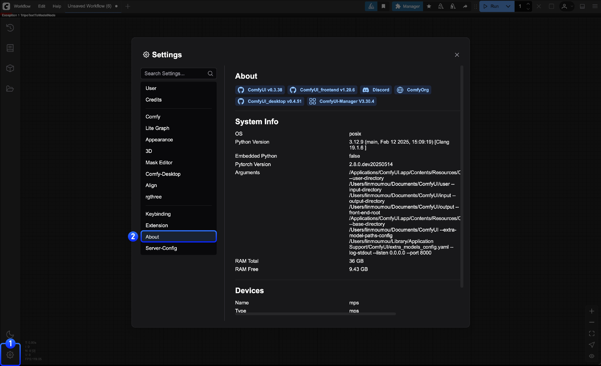

import DockerNotice from "/snippets/de/install/docker-notice.mdx"

<Tip>
   Wir erhalten sehr viele Rückmeldungen zu Problemen, und uns fällt auf, dass die meisten eingereichten Probleme mit Custom Nodes zusammenhängen. Bitte stellen Sie daher sicher, dass Sie den [Leitfaden zur Fehlerbehebung bei Custom Nodes](/de/troubleshooting/custom-node-issues) gelesen haben, bevor Sie einen Fehlerbericht einreichen. So schließen Sie aus, dass das Problem durch den ComfyUI-Kern verursacht wird.
</Tip>

<Card title="Leitfaden zur Fehlerbehebung bei Custom Nodes" icon="puzzle-piece" href="/de/troubleshooting/custom-node-issues">
  Erfahren Sie, wie Sie Probleme beheben, die durch Custom Nodes verursacht werden.
</Card>

## Häufige Probleme und schnelle Lösungen

Bevor Sie in die detaillierte Fehlerbehebung einsteigen, versuchen Sie diese häufigen Lösungen:

### ComfyUI startet nicht

**Symptome:** Die Anwendung stürzt beim Start ab, zeigt einen schwarzen Bildschirm oder lässt sich nicht laden.

**Schnelle Lösungen:**
1. **Systemanforderungen prüfen**: Stellen Sie sicher, dass Ihr System die [Mindestanforderungen](/de/installation/system_requirements) erfüllt.
2. **GPU-Treiber aktualisieren**: Laden Sie die neuesten Treiber von NVIDIA/AMD/Intel herunter.

### Generierung schlägt fehl oder führt zu Fehlern

**Symptome:** Dialog „Prompt-Ausführung fehlgeschlagen“ mit der Schaltfläche „Bericht anzeigen“, die Ausführung des Workflows stoppt.

**Schnelle Lösungen:**
1. **Auf „Bericht anzeigen“ klicken**: Lesen Sie die detaillierte Fehlermeldung, um das konkrete Problem zu identifizieren.
2. **Prüfen, ob das Problem von einem Custom Node verursacht wird**: [Folgen Sie unserem Leitfaden zur Fehlerbehebung für Custom Nodes](/de/troubleshooting/custom-node-issues).
3. **Modelldateien prüfen**: Informationen zur Einrichtung von Modellen finden Sie in der [Dokumentation zu Modellen](/de/basic-concepts/models).
4. **VRAM-Nutzung prüfen**: Schließen Sie andere Anwendungen, die GPU-Speicher verwenden.

### Langsame Leistung

**Symptome:** Sehr langsame Generierungszeiten, das System friert ein, Out-of-Memory-Fehler.

**Schnelle Lösungen:**
1. **Auflösung/Batch-Größe verringern**: Reduzieren Sie die Bildgröße oder die Anzahl der Bilder.
2. **Speicheroptimierungs-Flags verwenden**: Weitere Informationen finden Sie im Abschnitt zur Leistungsoptimierung unten.
3. **Nicht benötigte Anwendungen schließen**: Geben Sie RAM und VRAM frei.
4. **CPU-/GPU-Nutzung prüfen**: Ermitteln Sie mit dem Task-Manager Engpässe.

**Befehle zur Leistungsoptimierung:**

Für Systeme mit wenig VRAM:
```bash
# Low-VRAM-Modus (nutzt die CPU für den Text-Encoder)
python main.py --lowvram

# CPU-Modus (sehr langsam, funktioniert aber mit jeder Hardware, nur als allerletztes Mittel verwenden)
python main.py --cpu
```

Für bessere Leistung:
```bash
# Vorschauen deaktivieren (spart VRAM und Rechenzeit)
python main.py --preview-method none

# Optimierte Attention-Mechanismen verwenden
python main.py --use-pytorch-cross-attention
python main.py --use-flash-attention

# Asynchrones Weight-Offloading
python main.py --async-offload
```

Für die Speicherverwaltung:
```bash
# Bestimmte VRAM-Menge für das Betriebssystem reservieren (in GB)
python main.py --reserve-vram 2

# Intelligente Speicherverwaltung deaktivieren
python main.py --disable-smart-memory

# Verschiedene Caching-Strategien verwenden
python main.py --cache-none      # Weniger RAM-Nutzung, aber langsamer
python main.py --cache-lru 10    # 10 Ergebnisse cachen, schneller
python main.py --cache-classic   # Alten (aggressiven) Caching-Stil verwenden.
```


## Installationsspezifische Probleme

### Probleme mit der Desktop-App

Eine umfassende Fehlerbehebung für die Desktop-Installation finden Sie im [Desktop-Installationshandbuch](/de/installation/desktop/overview#comfy-desktop-für-ihr-betriebssystem-installieren).

<Tabs>
<Tab title="Windows">
- **Nicht unterstütztes Gerät**: Comfy Desktop für Windows unterstützt nur NVIDIA-GPUs mit CUDA. Verwenden Sie [ComfyUI Portable](/de/installation/comfyui_portable_windows) oder die [manuelle Installation](/de/installation/manual_install) für andere GPUs
- **Installation schlägt fehl**: Führen Sie das Installationsprogramm als Administrator aus und stellen Sie mindestens 15 GB Speicherplatz bereit
- **Wartungsseite**: Prüfen Sie die [Mirror-Einstellungen](/de/installation/desktop/usage/settings#advanced), wenn Downloads fehlschlagen
- **Fehlende Modelle**: Modelle werden bei der Migration nicht kopiert, sondern nur verknüpft. Überprüfen Sie die Modellpfade
</Tab>
<Tab title="macOS">
- **„App ist beschädigt“**: Erlauben Sie die App in den Einstellungen für Sicherheit & Datenschutz
- **Leistungsprobleme**: Erteilen Sie in den Datenschutzeinstellungen den Vollzugriff auf die Festplatte
- **Abstürze**: Prüfen Sie die Konsole-App auf Absturzberichte
</Tab>
<Tab title="Linux">
- **Fehlende Bibliotheken**: Installieren Sie die Abhängigkeiten mit dem Paketmanager
- **LD_LIBRARY_PATH-Fehler**: Probleme mit dem PyTorch-Bibliothekspfad (siehe unten)
</Tab>
</Tabs>

### Probleme bei der manuellen Installation

<Note>
Die Dokumentation kann etwas veraltet sein. Wenn ein Problem auftritt, prüfen Sie bitte manuell, ob eine neuere stabile Version von PyTorch oder einer der aufgeführten Bibliotheken verfügbar ist. Nutzen Sie Ressourcen wie die [PyTorch-Installationsmatrix](https://pytorch.org/get-started/locally/) oder die [ROCm-Website](https://rocm.docs.amd.com/projects/install-on-linux/en/develop/install/3rd-party/pytorch-install.html#using-a-wheels-package).
</Note>

**Konflikte bei der Python-Version:**
```bash
# Python-Version prüfen (3.9+ erforderlich, 3.12 empfohlen)
python --version

# Virtuelle Umgebung verwenden (empfohlen)
python -m venv comfyui_env
source comfyui_env/bin/activate  # Linux/Mac
comfyui_env\Scripts\activate     # Windows
```

**Fehlgeschlagene Paketinstallationen:**
```bash
# Zuerst pip aktualisieren
python -m pip install --upgrade pip

# Abhängigkeiten installieren
pip install -r requirements.txt

# Für NVIDIA-GPUs (CUDA 13.0)
pip install torch torchvision torchaudio --extra-index-url https://download.pytorch.org/whl/cu130

# Für AMD-GPUs (nur Linux - ROCm 7.2)
pip install torch torchvision torchaudio --index-url https://download.pytorch.org/whl/rocm7.2
```

### Linux-spezifische Probleme

**LD_LIBRARY_PATH-Fehler:**

Häufige Symptome:
- "libcuda.so.1: cannot open shared object file"
- "libnccl.so: cannot open shared object file" 
- "ImportError: libnvinfer.so.X: cannot open shared object file"

**Lösungen:**

1. **Moderne PyTorch-Installationen (am häufigsten):**
```bash
# Für virtuelle Umgebungen mit NVIDIA-Paketen
export LD_LIBRARY_PATH=$VIRTUAL_ENV/lib/python3.12/site-packages/nvidia/nvjitlink/lib:$LD_LIBRARY_PATH

# Für Conda-Umgebungen
export LD_LIBRARY_PATH=$CONDA_PREFIX/lib/python3.12/site-packages/nvidia/nvjitlink/lib:$LD_LIBRARY_PATH

# Oder die Python-site-packages automatisch ermitteln
PYTHON_PATH=$(python -c "import site; print(site.getsitepackages()[0])")
export LD_LIBRARY_PATH=$PYTHON_PATH/nvidia/nvjitlink/lib:$LD_LIBRARY_PATH

# Möglicherweise werden weitere NVIDIA-Bibliotheken benötigt
export LD_LIBRARY_PATH=$PYTHON_PATH/nvidia/cuda_runtime/lib:$LD_LIBRARY_PATH
export LD_LIBRARY_PATH=$PYTHON_PATH/nvidia/cublas/lib:$LD_LIBRARY_PATH
```

2. **Herausfinden, welche Bibliotheken vorhanden sind:**
```bash
# Installierte NVIDIA-Pakete prüfen
python -c "import site; import os; nvidia_path=os.path.join(site.getsitepackages()[0], 'nvidia'); print('NVIDIA libs:', [d for d in os.listdir(nvidia_path) if os.path.isdir(os.path.join(nvidia_path, d))] if os.path.exists(nvidia_path) else 'Not found')"

# Fehlende Bibliotheken ermitteln, die PyTorch benötigt
python -c "import torch; print(torch.__file__)"
ldd $(python -c "import torch; print(torch.__file__.replace('__init__.py', 'lib/libtorch_cuda.so'))")
```

3. **Dauerhaft für Ihre Umgebung festlegen:**
```bash
# Für virtuelle Umgebungen: zum Aktivierungsskript hinzufügen
echo 'export LD_LIBRARY_PATH=$VIRTUAL_ENV/lib/python*/site-packages/nvidia/nvjitlink/lib:$LD_LIBRARY_PATH' >> $VIRTUAL_ENV/bin/activate

# Für Conda-Umgebungen
conda env config vars set LD_LIBRARY_PATH=$CONDA_PREFIX/lib/python*/site-packages/nvidia/nvjitlink/lib:$LD_LIBRARY_PATH

# Für die globale bashrc (Python-Version bei Bedarf anpassen)
echo 'export LD_LIBRARY_PATH=$(python -c "import site; print(site.getsitepackages()[0])")/nvidia/nvjitlink/lib:$LD_LIBRARY_PATH' >> ~/.bashrc
```

4. **Alternative: ldconfig verwenden:**
```bash
# Aktuellen Bibliotheks-Cache prüfen
ldconfig -p | grep cuda
ldconfig -p | grep nccl

# Falls fehlend, Bibliothekspfade hinzufügen (erfordert root)
sudo echo "/usr/local/cuda/lib64" > /etc/ld.so.conf.d/cuda.conf
sudo ldconfig
```

5. **Laden der Bibliotheken debuggen:**
```bash
# Ausführliches Laden der Bibliotheken, um Fehlendes zu erkennen
LD_DEBUG=libs python main.py 2>&1 | grep "looking for"

# Verfügbarkeit von PyTorch CUDA prüfen
python -c "import torch; print('CUDA available:', torch.cuda.is_available()); print('CUDA version:', torch.version.cuda)"
```


## Probleme mit Modellen

Eine umfassende Fehlerbehebung für Modelle, einschließlich Architektur-Inkompatibilitäten, fehlender Modelle und Ladefehlern, finden Sie auf der speziellen Seite [Modellprobleme](/de/troubleshooting/model-issues).

## Netzwerk- und API-Probleme

### Partner-Nodes funktionieren nicht

**Symptome:** API-Aufrufe schlagen fehl, Timeout-Fehler, Kontingent überschritten

**Lösungen:**
1. **Gültigkeit des API-Schlüssels prüfen** – Überprüfen Sie die Schlüssel in den [Benutzereinstellungen](/de/interface/user)
2. **Guthaben des Kontos prüfen** – Stellen Sie sicher, dass ausreichend [API-Credits](/de/interface/credits) vorhanden sind
3. **Internetverbindung prüfen** – Testen Sie mit anderen Onlinediensten
4. **Dienststatus prüfen** – Der Anbieter hat möglicherweise eine Ausfallzeit

### Verbindungsprobleme

**Symptome:** „Failed to connect to server“, Timeout-Fehler

**Lösungen:**
1. **Firewall-Einstellungen prüfen** – Erlauben Sie ComfyUI den Zugriff durch die Firewall
2. **Anderen Port versuchen** – Standard ist 8188, versuchen Sie 8189 oder 8190
3. **VPN vorübergehend deaktivieren** – Das VPN blockiert möglicherweise Verbindungen
4. **Proxy-Einstellungen prüfen** – Deaktivieren Sie den Proxy, wenn er nicht erforderlich ist

### Frontend-Probleme

**„Frontend or Templates Package Not Updated“:**
```bash
# Nach dem Aktualisieren von ComfyUI über Git die Frontend-Abhängigkeiten aktualisieren
pip install -r requirements.txt
```

**„Can't Find Custom Node“:**
- Deaktivieren Sie die Node-Validierung in den ComfyUI-Einstellungen

**„Error Toast About Workflow Failing Validation“:**
- Deaktivieren Sie die Workflow-Validierung vorübergehend in den Einstellungen
- Melden Sie das Problem dem ComfyUI-Team

**Anmeldeprobleme außerhalb von localhost:**
- Die normale Anmeldung funktioniert nur beim Zugriff über localhost
- Für LAN-/Remote-Zugriff: Generieren Sie einen API-Schlüssel unter [platform.comfy.org/login](https://platform.comfy.org/login)
- Verwenden Sie den API-Schlüssel im Anmeldedialog oder mit dem Kommandozeilenargument `--api-key`

## Hardwarespezifische Probleme

### Probleme mit NVIDIA-GPUs

**Fehler „Torch not compiled with CUDA enabled“:**
```bash
# Zuerst torch deinstallieren
pip uninstall torch

# Stabiles PyTorch mit CUDA 13.0 installieren
pip install torch torchvision torchaudio --extra-index-url https://download.pytorch.org/whl/cu130

# Für Nightly-Builds (können Leistungsverbesserungen enthalten)
pip install --pre torch torchvision torchaudio --index-url https://download.pytorch.org/whl/nightly/cu132

# CUDA-Support prüfen
python -c "import torch; print(torch.cuda.is_available())"
```

**GPU wird nicht erkannt:**
```bash
# Prüfen, ob die GPU sichtbar ist
nvidia-smi

# Treiberversion und CUDA-Kompatibilität prüfen
nvidia-smi --query-gpu=driver_version --format=csv
```

**Blackwell-GPUs (`sm_103`): Die Generierung schlägt in der ersten Attention-Schicht fehl:**

Auf NVIDIA-GPUs der Blackwell-Generation kann die standardmäßige scaled dot-product attention (SDPA) von PyTorch
das cuDNN-Backend auswählen, für das es für diese Architektur keinen gültigen Plan gibt:

```
cuDNN Frontend error: No valid execution plans built
```

Bei FLUX betrifft das den allerersten Attention-Block im UNet, sodass nie ein Bild erzeugt wird.

```bash
# Eine handgeschriebene Attention-Implementierung verwenden, die SDPA und cuDNN umgeht
python main.py --use-split-cross-attention

# Blackwell erfordert außerdem einen PyTorch-Build mit CUDA 12.8 oder neuer;
# gegen cu121 kompilierte Builds laufen auf diesen Karten überhaupt nicht
```

<Note>
Das Deaktivieren des cuDNN-SDPA-Backends vor dem Start, etwa durch den Aufruf von
`torch.backends.cuda.enable_cudnn_sdp(False)` aus einer `sitecustomize.py`, funktioniert nicht, weil
das Flag die CUDA-Initialisierung nicht übersteht. Der Startparameter ist die zuverlässige Lösung.
</Note>

*Dieser Eintrag wurde in [PR #1491](https://github.com/Comfy-Org/docs/pull/1491) hinzugefügt.*

### Probleme mit AMD-GPUs

**ROCm-Support (nur Linux):**
```bash
# Stabiles ROCm-PyTorch installieren (7.2 zum Zeitpunkt der Erstellung)
pip install torch torchvision torchaudio --index-url https://download.pytorch.org/whl/rocm7.2

# Für Nightly-Builds (ROCm 7.2 zum Zeitpunkt der Erstellung, die Leistungsverbesserungen enthalten können)
pip install --pre torch torchvision torchaudio --index-url https://download.pytorch.org/whl/nightly/rocm7.2
```

**Nicht unterstützte AMD-GPUs:**
```bash
# Für RDNA2 oder älter (6700, 6600)
HSA_OVERRIDE_GFX_VERSION=10.3.0 python main.py

# Für RDNA3-Karten (7600)
HSA_OVERRIDE_GFX_VERSION=11.0.0 python main.py
```

**Performance-Optimierung:**
```bash
# Experimentelle speichereffiziente Attention aktivieren (mit PyTorch 2.4 nicht mehr erforderlich)
TORCH_ROCM_AOTRITON_ENABLE_EXPERIMENTAL=1 python main.py --use-pytorch-cross-attention

# Tunable Operations aktivieren (erster Lauf langsam, spätere Läufe schneller)
PYTORCH_TUNABLEOP_ENABLED=1 python main.py
```


### Probleme mit Apple Silicon (M1/M2/M3)

<Note>
Die Schritte in diesem Abschnitt gelten für eine manuelle Installation bzw. eine Installation aus dem Quellcode, bei der ComfyUI in einer Python-Umgebung läuft, die Sie selbst eingerichtet haben. Die unterstützten Python-Versionen finden Sie unter [Systemanforderungen](/de/installation/system_requirements), die Einrichtungsschritte unter [Manuelle Installation](/de/installation/manual_install).

**Comfy Desktop** benötigt auf Apple Silicon keine separate Python-Installation: Die App verwaltet für jede Instanz ihre eigene Python-Umgebung. Siehe [Comfy Desktop für macOS](/de/installation/desktop/overview#comfy-desktop-für-ihr-betriebssystem-installieren).
</Note>

**MPS-Backend einrichten:**
```bash
# PyTorch Nightly für Apple Silicon installieren
# Apples Anleitung folgen: https://developer.apple.com/metal/pytorch/

# MPS-Verfügbarkeit prüfen
python -c "import torch; print(torch.backends.mps.is_available())"

# ComfyUI starten
python main.py
```

**Wenn MPS Probleme verursacht:**
```bash
# CPU-Modus erzwingen
python main.py --cpu

# Mit Speicheroptimierung
python main.py --force-fp16 --cpu
```

### Probleme mit Intel-GPUs

**Fehler „Torch not compiled with CUDA enabled“:**

Auf Intel-GPUs bedeutet dieser Fehler, dass ComfyUI CUDA verwenden wollte, weil das XPU-Backend nicht verfügbar war. Befolgen Sie nicht die oben genannten Schritte zur CUDA-Neuinstallation für NVIDIA. Intel-GPUs verwenden XPU, nicht CUDA.

Prüfen Sie, ob PyTorch die Intel-GPU erkennt:

```bash
python -c "import torch; print('XPU available:', hasattr(torch, 'xpu') and torch.xpu.is_available())"
```

Wenn dies `True` ausgibt, verwendet ComfyUI automatisch das XPU-Backend.

Wenn `False` ausgegeben wird:

1. Bestätigen Sie, dass Sie eine unterstützte Intel Arc GPU besitzen (Arc A-Serie, Arc B-Serie oder einen Core Ultra Prozessor mit Arc Graphics).
2. Installieren oder aktualisieren Sie den [Intel GPU-Treiber](https://www.intel.com/content/www/us/en/developer/articles/tool/pytorch-prerequisites-for-intel-gpu.html).
3. Installieren Sie einen XPU-fähigen PyTorch-Build mit einer der folgenden Optionen. Installieren Sie kein CUDA-Wheel.

**Option 1: Native PyTorch XPU-Unterstützung (Windows/Linux):**
```bash
# Stabile XPU-Wheels (empfohlen)
pip install torch torchvision torchaudio --index-url https://download.pytorch.org/whl/xpu

# Nightly-XPU-Wheels (können Leistungsverbesserungen enthalten)
pip install --pre torch torchvision torchaudio --index-url https://download.pytorch.org/whl/nightly/xpu

# ComfyUI starten
python main.py
```

**Option 2: Intel Extension for PyTorch (IPEX):**
```bash
# Für Intel Arc A-Series Graphics
conda install libuv
pip install torch==2.3.1.post0+cxx11.abi torchvision==0.18.1.post0+cxx11.abi torchaudio==2.3.1.post0+cxx11.abi intel-extension-for-pytorch==2.3.110.post0+xpu --extra-index-url https://pytorch-extension.intel.com/release-whl/stable/xpu/us/
```


## Häufig gestellte Fragen

### ComfyUI mit Docker ausführen

<DockerNotice />

Für die lokale Installation unter Linux folgen Sie der [Anleitung zur manuellen Installation](/de/installation/manual_install). Informationen zur Nutzung in der Cloud finden Sie unter [Comfy Cloud](/de/get_started/cloud).

## Hilfe erhalten und Fehler melden

### Bevor Sie einen Fehler melden

1. **Prüfen Sie, ob es sich um ein bekanntes Problem handelt:**
   - Durchsuchen Sie die [GitHub Issues](https://github.com/Comfy-Org/ComfyUI/issues)
   - Prüfen Sie das [ComfyUI-Forum](https://forum.comfy.org/)
   - Sehen Sie sich die [Discord-Diskussionen](https://discord.com/invite/comfyorg) an

2. **Führen Sie eine grundlegende Fehlerbehebung durch:**
   - Testen Sie mit dem [Standard-Workflow](/de/get_started/first_generation)
   - Deaktivieren Sie alle Custom Nodes (siehe [Fehlerbehebung bei Custom Nodes](/de/troubleshooting/custom-node-issues))
   - Prüfen Sie die Konsole bzw. das Terminal auf Fehlermeldungen
   - Wenn Sie comfy-cli verwenden, versuchen Sie eine Aktualisierung: `comfy node update all`

### Fehler effektiv melden

#### Probleme mit ComfyUI Core
**Wo melden:** [GitHub Issues](https://github.com/Comfy-Org/ComfyUI/issues)

#### Probleme mit der Desktop-App
**Wo melden:** [Desktop GitHub Issues](https://github.com/Comfy-Org/Comfy-Desktop/issues)

#### Probleme mit dem Frontend
**Wo melden:** [Frontend GitHub Issues](https://github.com/Comfy-Org/ComfyUI_frontend/issues)

#### Probleme mit Custom Nodes
**Wo melden:** Wenden Sie sich an den Entwickler des jeweiligen Custom Node

### Erforderliche Informationen

Wenn Sie ein Problem melden, geben Sie Folgendes an:

<Steps>
<Step title="Systeminformationen">

<Tabs>
<Tab title="Aus der ComfyUI-Oberfläche">
**Systeminformationen (zu finden auf der Seite „Über“ in den Einstellungen):**
- Betriebssystem (Windows 11, macOS 14.1, Ubuntu 22.04 usw.)
- ComfyUI-Version (siehe Seite „Über“ in den Einstellungen)
- Python-Version: `python --version`
- PyTorch-Version: `python -c "import torch; print(torch.__version__)"`
- GPU-Modell und Treiberversion
- Installationsmethode (Desktop, Portable, Manuell, comfy-cli)


</Tab>
<Tab title="Aus der Kommandozeile">
   <Tabs>
      <Tab title="Windows">
      ```bash
      # Systeminformationen
      systeminfo | findstr /C:"OS Name" /C:"OS Version"

      # GPU-Informationen
      wmic path win32_VideoController get name

      # Python- und PyTorch-Informationen
      python --version
      python -c "import torch; print(f'PyTorch: {torch.__version__}')"
      python -c "import torch; print(f'CUDA Available: {torch.cuda.is_available()}')"
      ```
      </Tab>
      <Tab title="macOS/Linux">
      ```bash
      # Systeminformationen
      uname -a

      # GPU-Informationen (Linux)
      lspci | grep VGA

      # Python- und PyTorch-Informationen
      python --version
      python -c "import torch; print(f'PyTorch: {torch.__version__}')"
      python -c "import torch; print(f'CUDA Available: {torch.cuda.is_available()}')"
      ```
      </Tab>
   </Tabs>
</Tab>
</Tabs>
</Step>

<Step title="Probleme mit der Desktop-App">
**Bei Problemen mit der Desktop-App geben Sie zusätzlich an:**
- Protokolldateien aus: `C:\Users\<username>\AppData\Roaming\ComfyUI\logs` (Windows)
- Konfigurationsdateien aus: `C:\Users\<username>\AppData\Roaming\ComfyUI` (Windows)
</Step>

<Step title="Problemdetails">
**Problemdetails:**
- Klare Beschreibung des Problems
- Schritte zum Reproduzieren des Problems
- Erwartetes gegenüber tatsächlichem Verhalten
- Screenshots oder Videos, falls zutreffend

**Fehlermeldungen:**
- Vollständiger Fehlertext aus der Konsole bzw. dem Terminal
- Fehler in der Browser-Konsole (F12 → Tab „Konsole“)
- Eventuelle Absturzprotokolle oder Fehlerdialoge
</Step>

<Step title="Zusätzlicher Kontext">
**Zusätzlicher Kontext:**
- Liste der installierten Custom Nodes
- Workflow-Datei (.json), die das Problem reproduziert
- Letzte Änderungen (Neuinstallationen, Updates usw.)
</Step>
</Steps>

## Community-Ressourcen

- **Offizielles Forum:** [forum.comfy.org](https://forum.comfy.org/)
- **Discord:** [ComfyUI Discord Server](https://discord.com/invite/comfyorg)
- **Reddit:** [r/comfyui](https://reddit.com/r/comfyui)
- **YouTube:** [ComfyUI Tutorials](https://www.youtube.com/@comfyorg)
