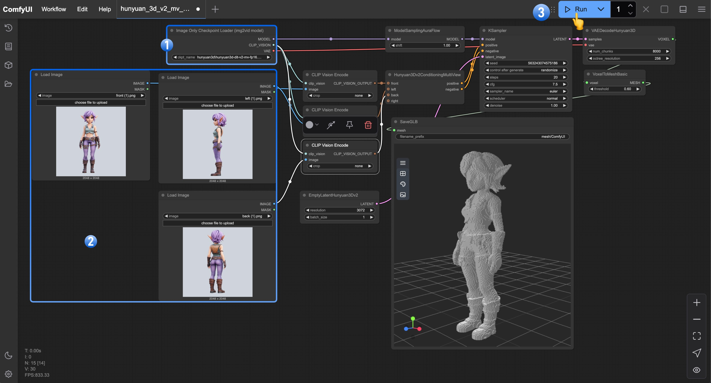
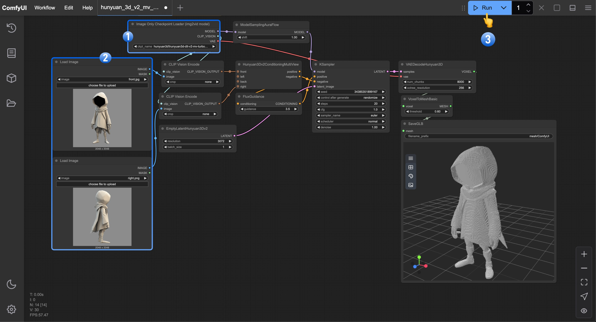
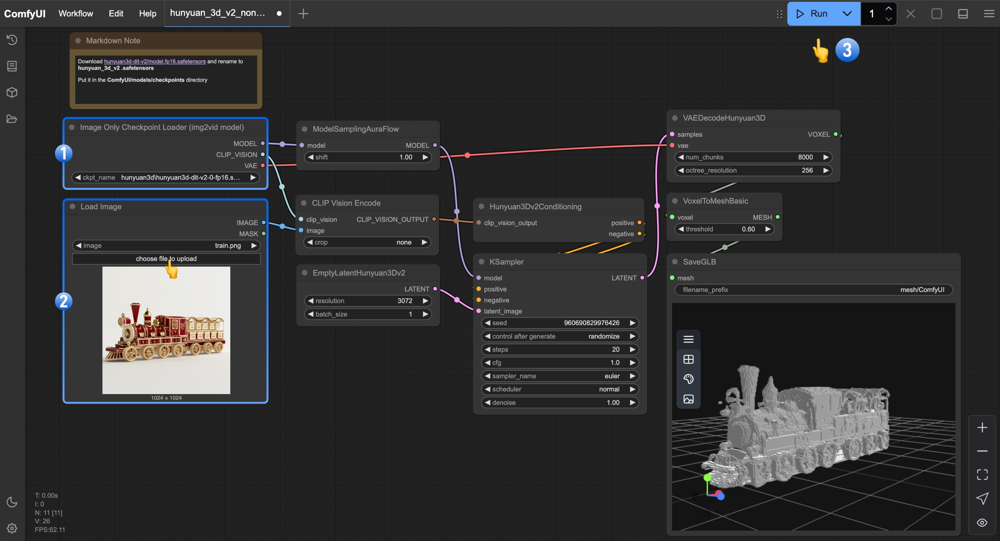

import UpdateReminder from "/snippets/de/tutorials/update-reminder.mdx"

# Einführung in Hunyuan3D 2.0


[Hunyuan3D 2.0](https://github.com/Tencent/Hunyuan3D-2) ist ein von Tencent veröffentlichtes Open-Source-Modell zur Generierung von 3D-Assets, das aus Text oder Bildern hochauflösende 3D-Modelle mit hochauflösenden Texturkarten erzeugen kann.

Hunyuan3D 2.0 verwendet einen zweistufigen Generierungsansatz: Zuerst wird ein Geometriemodell ohne Texturen erzeugt, anschließend werden hochauflösende Texturkarten synthetisiert. Dadurch wird die Komplexität der Form- und Texturgenerierung wirksam getrennt. Im Folgenden die beiden Kernkomponenten von Hunyuan3D 2.0:

1. **Geometrie-Generierungsmodell (Hunyuan3D-DiT)**: Basierend auf einer Flow-Diffusion-Transformer-Architektur erzeugt es untexturierte geometrische Modelle, die exakt zu den Eingabebedingungen passen.
2. **Textur-Generierungsmodell (Hunyuan3D-Paint)**: Kombiniert geometrische Bedingungen und Multi-View-Diffusion-Techniken, um Modelle mit hochauflösenden Texturen zu versehen, und unterstützt PBR-Materialien.

**Wichtigste Vorteile**

- **Hochpräzise Generierung**: Scharfe geometrische Strukturen, satte Texturfarben, Unterstützung der Generierung von PBR-Materialien und nahezu realistische Lichteffekte.
- **Vielfältige Nutzungsmöglichkeiten**: Bietet Code-Aufrufe, Blender-Plugins, Gradio-Anwendungen und eine Online-Erfahrung über die offizielle Website und eignet sich damit für unterschiedliche Benutzeranforderungen.
- **Leichtgewichtig und kompatibel**: Das Modell Hunyuan3D-2mini benötigt nur 5 GB VRAM, die Standardversion benötigt 6 GB VRAM für die Formgenerierung, und der vollständige Prozess (Form + Textur) benötigt nur 12 GB VRAM.

Seit Kurzem (18. März 2025) führt Hunyuan3D 2.0 außerdem ein Multi-View-Formgenerierungsmodell (Hunyuan3D-2mv) ein, das detailliertere geometrische Strukturen aus Eingaben unterschiedlicher Blickwinkel erzeugen kann.

Dieses Beispiel enthält vier Workflows:
- Hunyuan3D-2mv mit mehreren Ansichten als Eingabe verwenden, um 3D-Modelle zu generieren
- Hunyuan3D-2mv-turbo mit mehreren Ansichten als Eingabe verwenden, um 3D-Modelle zu generieren
- Hunyuan3D-2 mit einer einzelnen Ansicht als Eingabe verwenden, um 3D-Modelle zu generieren
- Hunyuan3D 2.1 mit einer einzelnen Ansicht als Eingabe verwenden, um 3D-Modelle zu generieren

<Tip>
ComfyUI unterstützt Hunyuan3D-2mv inzwischen nativ, aber noch keine Textur- und Materialgenerierung. Bitte stellen Sie sicher, dass Sie auf die neueste Version von [ComfyUI](https://github.com/Comfy-Org/ComfyUI) aktualisiert haben, bevor Sie beginnen.

Die Workflow-Beispielbilder im PNG-Format in dieser Anleitung enthalten die Workflow-JSON in ihren Metadaten:
- Sie können sie direkt in ComfyUI ziehen
- Oder Sie verwenden das Menü `Workflows` -> `Open (ctrl+o)`

Dadurch wird der entsprechende Workflow geladen und Sie werden aufgefordert, die erforderlichen Modelle herunterzuladen. Die generierten Modelle im `.glb`-Format werden im Ordner `ComfyUI/output/mesh` ausgegeben.
</Tip>

## ComfyUI Hunyuan3D-2mv Workflow-Beispiel

Im Hunyuan3D-2mv-Workflow verwenden wir Multi-View-Bilder, um ein 3D-Modell zu generieren. Beachten Sie, dass mehrere Ansichtsbilder in diesem Workflow nicht zwingend erforderlich sind: Sie können auch nur das Bild der Ansicht `front` verwenden, um ein 3D-Modell zu generieren.

<UpdateReminder/>

### HY 3D 2.0 MV {#3d_hunyuan3d_multiview_to_model}

Generieren Sie 3D-Modelle aus mehreren Ansichten mit Hunyuan3D 2.0 MV.


<CardGroup cols={2}>
  <Card title="Auf Comfy Cloud ausführen" icon="cloud" href="https://cloud.comfy.org/?template=3d_hunyuan3d_multiview_to_model&utm_source=docs&utm_medium=referral&utm_campaign=hunyuan3D-2">
    Führen Sie diesen Workflow sofort auf Comfy Cloud aus
  </Card>
  <Card title="Workflow herunterladen" icon="download" href="https://github.com/Comfy-Org/workflow_templates/blob/main/templates/3d_hunyuan3d_multiview_to_model.json">
    Laden Sie die JSON-Datei herunter oder suchen Sie in der Vorlagenbibliothek nach &quot;HY 3D 2.0 MV&quot;
  </Card>
</CardGroup>

**Eingabematerialien**

Laden Sie diese Dateien in die passenden `LoadImage`-Nodes hoch:

<CardGroup cols={2}>
  <Card title="3d_hunyuan3d_multiview_to_model_front_image.png" icon="image" href="https://raw.githubusercontent.com/Comfy-Org/workflow_templates/main/input/3d_hunyuan3d_multiview_to_model_front_image.png">
    `LoadImage`-Node 56 · Vorderansicht
  </Card>
  <Card title="3d_hunyuan3d_multiview_to_model_left_image.png" icon="image" href="https://raw.githubusercontent.com/Comfy-Org/workflow_templates/main/input/3d_hunyuan3d_multiview_to_model_left_image.png">
    `LoadImage`-Node 78 · linke Ansicht
  </Card>
  <Card title="3d_hunyuan3d_multiview_to_model_back_image.png" icon="image" href="https://raw.githubusercontent.com/Comfy-Org/workflow_templates/main/input/3d_hunyuan3d_multiview_to_model_back_image.png">
    `LoadImage`-Node 80 · Rückansicht
  </Card>
  <Card title="3d_hunyuan3d_multiview_to_model_right_image.png" icon="image" href="https://raw.githubusercontent.com/Comfy-Org/workflow_templates/main/input/3d_hunyuan3d_multiview_to_model_right_image.png">
    `LoadImage`-Node 87 · rechte Ansicht
  </Card>
</CardGroup>

### 1. Workflow

Bitte laden Sie die unten stehenden Bilder herunter und ziehen Sie sie in ComfyUI, um den Workflow zu laden.


Laden Sie die unten stehenden Bilder herunter, wir verwenden sie als Eingabebilder.


<Tip>
In diesem Beispiel wurden die Eingabebilder bereits vorverarbeitet, um überschüssigen Hintergrund zu entfernen. In der Praxis können Sie Custom Nodes wie [ComfyUI_essentials](https://github.com/cubiq/ComfyUI_essentials) verwenden, um überschüssigen Hintergrund automatisch zu entfernen.
</Tip>

### 2. Manuelle Modellinstallation

Laden Sie das unten stehende Modell herunter und speichern Sie es im entsprechenden ComfyUI-Ordner

- hunyuan3d-dit-v2-mv: [model.fp16.safetensors](https://huggingface.co/tencent/Hunyuan3D-2mv/blob/main/hunyuan3d-dit-v2-mv/model.fp16.safetensors?download=true): Nach dem Herunterladen können Sie die Datei in `hunyuan3d-dit-v2-mv.safetensors` umbenennen

```
ComfyUI/
├── models/
│   ├── checkpoints/
│   │   └── hunyuan3d-dit-v2-mv.safetensors  // umbenannte Datei
```

### 3. Schritte zum Ausführen des Workflows



1. Stellen Sie sicher, dass der Image Only Checkpoint Loader (img2vid model) unser heruntergeladenes und umbenanntes Modell `hunyuan3d-dit-v2-mv.safetensors` geladen hat
2. Laden Sie die entsprechenden Ansichtsbilder in den jeweiligen `Load Image`-Nodes
3. Klicken Sie auf die Schaltfläche `Queue` oder verwenden Sie die Tastenkombination `Ctrl(cmd) + Enter`, um den Workflow auszuführen

Wenn Sie weitere Ansichten hinzufügen möchten, laden Sie die weiteren Ansichtsbilder im Node `Hunyuan3Dv2ConditioningMultiView` und stellen Sie sicher, dass Sie die entsprechenden Ansichtsbilder in den `Load Image`-Nodes laden.

## Hunyuan3D-2mv-turbo Workflow

Im Hunyuan3D-2mv-turbo-Workflow wird das Modell Hunyuan3D-2mv-turbo verwendet, um 3D-Modelle zu generieren. Dieses Modell ist eine Step-Distillation-Version von Hunyuan3D-2mv und ermöglicht eine schnellere Generierung von 3D-Modellen. In dieser Version des Workflows wird `cfg` auf 1.0 gesetzt und ein `flux guidance`-Node hinzugefügt, um die Generierung mit `distilled cfg` zu steuern.

### HY 3D 2.0 MV Turbo {#3d_hunyuan3d_multiview_to_model_turbo}

Generieren Sie mit Hunyuan3D 2.0 MV Turbo 3D-Modelle aus mehreren Ansichten.


<CardGroup cols={2}>
  <Card title="Auf Comfy Cloud ausführen" icon="cloud" href="https://cloud.comfy.org/?template=3d_hunyuan3d_multiview_to_model_turbo&utm_source=docs&utm_medium=referral&utm_campaign=hunyuan3D-2">
    Diesen Workflow sofort auf Comfy Cloud ausführen
  </Card>
  <Card title="Workflow herunterladen" icon="download" href="https://github.com/Comfy-Org/workflow_templates/blob/main/templates/3d_hunyuan3d_multiview_to_model_turbo.json">
    JSON herunterladen oder in der Vorlagenbibliothek nach &quot;HY 3D 2.0 MV Turbo&quot; suchen
  </Card>
</CardGroup>

**Eingabematerialien**

Laden Sie diese Dateien in die passenden `LoadImage`-Nodes hoch:

<CardGroup cols={2}>
  <Card title="3d_hunyuan3d_multiview_to_model_turbo_front_view.png" icon="image" href="https://raw.githubusercontent.com/Comfy-Org/workflow_templates/main/input/3d_hunyuan3d_multiview_to_model_turbo_front_view.png">
    `LoadImage`-Node 56 · Vorne
  </Card>
  <Card title="3d_hunyuan3d_multiview_to_model_turbo_back_view.png" icon="image" href="https://raw.githubusercontent.com/Comfy-Org/workflow_templates/main/input/3d_hunyuan3d_multiview_to_model_turbo_back_view.png">
    `LoadImage`-Node 82 · Hinten
  </Card>
  <Card title="3d_hunyuan3d_multiview_to_model_turbo_left_view.png" icon="image" href="https://raw.githubusercontent.com/Comfy-Org/workflow_templates/main/input/3d_hunyuan3d_multiview_to_model_turbo_left_view.png">
    `LoadImage`-Node 85 · Links
  </Card>
  <Card title="3d_hunyuan3d_multiview_to_model_turbo_right_view.png" icon="image" href="https://raw.githubusercontent.com/Comfy-Org/workflow_templates/main/input/3d_hunyuan3d_multiview_to_model_turbo_right_view.png">
    `LoadImage`-Node 87 · Rechts
  </Card>
</CardGroup>

### 1. Workflow

Bitte laden Sie die untenstehenden Bilder herunter und ziehen Sie sie in ComfyUI, um den Workflow zu laden.


Laden Sie die untenstehenden Bilder herunter, sie werden als Eingabebilder verwendet.


### 2. Manuelle Modellinstallation

Laden Sie das untenstehende Modell herunter und speichern Sie es im entsprechenden ComfyUI-Ordner

- hunyuan3d-dit-v2-mv-turbo: [model.fp16.safetensors](https://huggingface.co/tencent/Hunyuan3D-2mv/blob/main/hunyuan3d-dit-v2-mv-turbo/model.fp16.safetensors?download=true) - nach dem Herunterladen können Sie die Datei in `hunyuan3d-dit-v2-mv-turbo.safetensors` umbenennen

```
ComfyUI/
├── models/
│   ├── checkpoints/
│   │   └── hunyuan3d-dit-v2-mv-turbo.safetensors  // umbenannte Datei
```

### 3. Schritte zum Ausführen des Workflows



1. Stellen Sie sicher, dass im Node `Image Only Checkpoint Loader(img2vid model)` das umbenannte Modell `hunyuan3d-dit-v2-mv-turbo.safetensors` geladen ist
2. Laden Sie in jedem der `Load Image`-Nodes die passenden Ansichtsbilder
3. Klicken Sie auf die Schaltfläche `Queue` oder verwenden Sie die Tastenkombination `Ctrl(cmd) + Enter`, um den Workflow auszuführen

## Hunyuan3D-2 Single-View-Workflow

Im Hunyuan3D-2-Workflow verwenden wir das Modell Hunyuan3D-2, um 3D-Modelle zu generieren. Dieses Modell ist kein Multi-View-Modell. In diesem Workflow verwenden wir den Node `Hunyuan3Dv2Conditioning` anstelle des Nodes `Hunyuan3Dv2ConditioningMultiView`.

### HY 3D 2.0 {#3d_hunyuan3d_image_to_model}

Generieren Sie 3D-Modelle aus einzelnen Bildern mit Hunyuan3D 2.0.


<CardGroup cols={2}>
  <Card title="Auf Comfy Cloud ausführen" icon="cloud" href="https://cloud.comfy.org/?template=3d_hunyuan3d_image_to_model&utm_source=docs&utm_medium=referral&utm_campaign=hunyuan3D-2">
    Diesen Workflow sofort auf Comfy Cloud ausführen
  </Card>
  <Card title="Workflow herunterladen" icon="download" href="https://github.com/Comfy-Org/workflow_templates/blob/main/templates/3d_hunyuan3d_image_to_model.json">
    JSON herunterladen oder in der Vorlagenbibliothek nach „HY 3D 2.0“ suchen
  </Card>
</CardGroup>

**Eingabematerialien**

Laden Sie diese Datei in den passenden `LoadImage`-Node hoch:

<CardGroup cols={2}>
  <Card title="3d_hunyuan3d_image_to_model_input_image.png" icon="image" href="https://raw.githubusercontent.com/Comfy-Org/workflow_templates/main/input/3d_hunyuan3d_image_to_model_input_image.png">
    `LoadImage`-Node 56 · `3d_hunyuan3d_image_to_model_input_image.png`
  </Card>
</CardGroup>

### 1. Workflow

Bitte laden Sie das Bild unten herunter und ziehen Sie es in ComfyUI, um den Workflow zu laden.


Laden Sie das folgende Bild herunter. Wir verwenden es als Eingabebild.


### 2. Modelle manuell installieren

Laden Sie das folgende Modell herunter und speichern Sie es im entsprechenden ComfyUI-Ordner:

- hunyuan3d-dit-v2-0: [model.fp16.safetensors](https://huggingface.co/tencent/Hunyuan3D-2/blob/main/hunyuan3d-dit-v2-0/model.fp16.safetensors?download=true). Nach dem Herunterladen können Sie es in `hunyuan3d-dit-v2.safetensors` umbenennen.

```
ComfyUI/
├── models/
│   ├── checkpoints/
│   │   └── hunyuan3d-dit-v2.safetensors  // umbenannte Datei
```

### 3. Workflow ausführen



1. Stellen Sie sicher, dass der Node `Image Only Checkpoint Loader(img2vid model)` unser umbenanntes Modell `hunyuan3d-dit-v2.safetensors` geladen hat.
2. Laden Sie das Bild im Node `Load Image`.
3. Klicken Sie auf die Schaltfläche `Queue` oder verwenden Sie die Tastenkombination `Ctrl(cmd) + Enter`, um den Workflow auszuführen.

## Hunyuan3D 2.1 Single View Workflow

Hunyuan3D 2.1 ist das Nachfolgemodell von Tencent für die Formgenerierung und wurde im Juni 2025 veröffentlicht. Es verbessert die Geometriequalität von Hunyuan3D 2.0, und der ComfyUI-Checkpoint packt die gesamte Shape-Pipeline in eine einzige Datei, sodass dieser Workflow nur einen Modelldownload benötigt statt separater DiT- und VAE-Dateien. Wie die anderen Workflows auf dieser Seite gibt er ein untexturiertes Mesh aus.

### HY 3D 2.1 {#3d_hunyuan3d-v2.1}

Generieren Sie ein 3D-Mesh aus einem einzelnen Bild mit Hunyuan3D 2.1.


<CardGroup cols={2}>
  <Card title="Auf Comfy Cloud ausführen" icon="cloud" href="https://cloud.comfy.org/?template=3d_hunyuan3d-v2.1&utm_source=docs&utm_medium=referral&utm_campaign=hunyuan3D-2">
    Führen Sie diesen Workflow direkt auf Comfy Cloud aus
  </Card>
  <Card title="Workflow herunterladen" icon="download" href="https://github.com/Comfy-Org/workflow_templates/blob/main/templates/3d_hunyuan3d-v2.1.json">
    Laden Sie die JSON-Datei herunter oder suchen Sie in der Vorlagenbibliothek nach &quot;HY 3D 2.1&quot;
  </Card>
</CardGroup>

**Eingabematerialien**

Laden Sie diese Datei in den passenden `LoadImage`-Node hoch:

<CardGroup cols={2}>
  <Card title="3d_hunyuan3d-v2.1_input_image.png" icon="image" href="https://raw.githubusercontent.com/Comfy-Org/workflow_templates/main/input/3d_hunyuan3d-v2.1_input_image.png">
    `LoadImage`-Node 2 · `3d_hunyuan3d-v2.1_input_image.png`
  </Card>
</CardGroup>

### 1. Manuelle Modellinstallation

Laden Sie den folgenden Checkpoint herunter und speichern Sie ihn im Ordner `checkpoints`:

<CardGroup cols={2}>
  <Card title="hunyuan_3d_v2.1.safetensors" icon="download" href="https://huggingface.co/Comfy-Org/hunyuan3D_2.1_repackaged/blob/main/hunyuan_3d_v2.1.safetensors">
    Nach <code>ComfyUI/models/checkpoints/</code> legen
  </Card>
</CardGroup>

```
📂 ComfyUI/
├── 📂 models/
│   └── 📂 checkpoints/
│       └── hunyuan_3d_v2.1.safetensors
```

Die Datei ist etwa 7,4 GB groß.

### 2. Schritte zum Ausführen des Workflows

1. Stellen Sie sicher, dass der Node `Image Only Checkpoint Loader(img2vid model)` die Datei `hunyuan_3d_v2.1.safetensors` geladen hat
2. Laden Sie Ihr Referenzbild im Node `Load Image`
3. Klicken Sie auf die Schaltfläche `Queue` oder verwenden Sie die Tastenkombination `Ctrl(cmd) + Enter`, um den Workflow auszuführen

Das generierte `.glb`-Mesh wird unter `ComfyUI/output/mesh/` gespeichert.

## Community-Ressourcen

Nachfolgend finden Sie Community-Ressourcen von ComfyUI zu Hunyuan3D-2:
- [ComfyUI-Hunyuan3DWrapper](https://github.com/kijai/ComfyUI-Hunyuan3DWrapper)
- [Kijai/Hunyuan3D-2_safetensors](https://huggingface.co/Kijai/Hunyuan3D-2_safetensors/tree/main)
- [ComfyUI-3D-Pack](https://github.com/MrForExample/ComfyUI-3D-Pack)

## Open-Source-Modellreihe Hunyuan3D 2.0

Derzeit hat Hunyuan3D 2.0 mehrere Modelle als Open Source veröffentlicht, die den vollständigen 3D-Generierungsprozess abdecken. Weitere Informationen finden Sie unter [Hunyuan3D-2](https://github.com/Tencent/Hunyuan3D-2).

**Hunyuan3D-2mini-Serie**

| Modell                | Beschreibung                       | Datum      | Parameter | Huggingface                                                                             |
|-----------------------|------------------------------------|------------|-----------|-----------------------------------------------------------------------------------------|
| Hunyuan3D-DiT-v2-mini | Mini-Modell für Bild zu Form       | 2025-03-18 | 0,6B      | [Besuchen](https://huggingface.co/tencent/Hunyuan3D-2mini/tree/main/hunyuan3d-dit-v2-mini) |

**Hunyuan3D-2mv-Serie**

| Modell                   | Beschreibung                                                                                                             | Datum      | Parameter | Huggingface                                                                             |
|--------------------------|--------------------------------------------------------------------------------------------------------------------------|------------|-----------|-----------------------------------------------------------------------------------------|
| Hunyuan3D-DiT-v2-mv-Fast | Guidance-Distillation-Version, kann die DIT-Inferenzzeit halbieren                                                       | 2025-03-18 | 1,1B      | [Besuchen](https://huggingface.co/tencent/Hunyuan3D-2mv/tree/main/hunyuan3d-dit-v2-mv-fast) |
| Hunyuan3D-DiT-v2-mv      | Multi-View-Bild-zu-Form-Modell, geeignet für 3D-Erstellung, die mehrere Blickwinkel zum Verstehen der Szene erfordert     | 2025-03-18 | 1,1B      | [Besuchen](https://huggingface.co/tencent/Hunyuan3D-2mv/tree/main/hunyuan3d-dit-v2-mv)     |

**Hunyuan3D-2-Serie**

| Modell                  | Beschreibung                  | Datum      | Parameter | Huggingface                                                                          |
|-------------------------|-------------------------------|------------|-----------|--------------------------------------------------------------------------------------|
| Hunyuan3D-DiT-v2-0-Fast | Guidance-Distillation-Modell  | 2025-02-03 | 1,1B      | [Besuchen](https://huggingface.co/tencent/Hunyuan3D-2/tree/main/hunyuan3d-dit-v2-0-fast) |
| Hunyuan3D-DiT-v2-0      | Bild-zu-Form-Modell           | 2025-01-21 | 1,1B      | [Besuchen](https://huggingface.co/tencent/Hunyuan3D-2/tree/main/hunyuan3d-dit-v2-0)     |
| Hunyuan3D-Paint-v2-0    | Texturgenerierungsmodell      | 2025-01-21 | 1,3B      | [Besuchen](https://huggingface.co/tencent/Hunyuan3D-2/tree/main/hunyuan3d-paint-v2-0)   |
| Hunyuan3D-Delight-v2-0  | Image-Delight-Modell          | 2025-01-21 | 1,3B      | [Besuchen](https://huggingface.co/tencent/Hunyuan3D-2/tree/main/hunyuan3d-delight-v2-0) |
