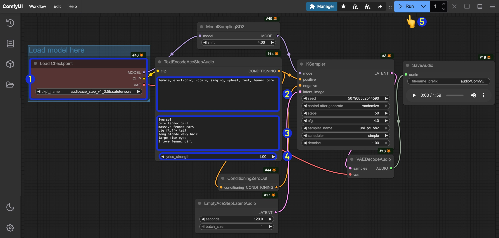
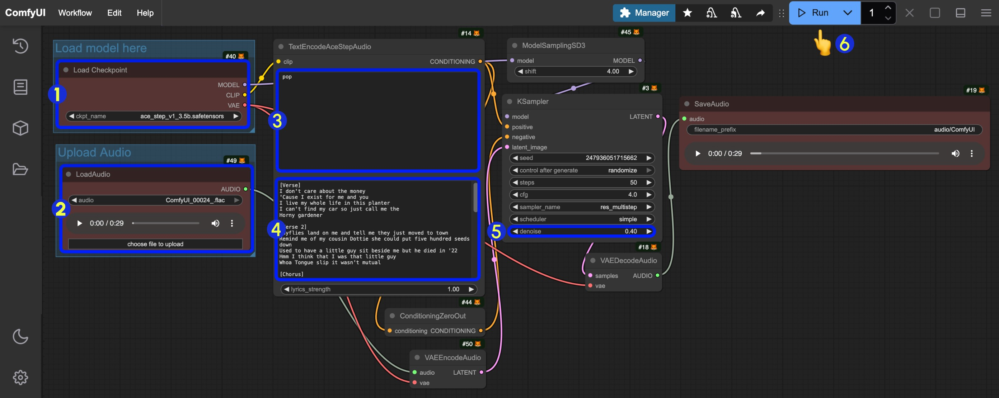

import UpdateReminder from "/snippets/de/tutorials/update-reminder.mdx";

ACE-Step ist ein quelloffenes Grundlagenmodell zur Musikgenerierung, das gemeinsam vom chinesischen Team StepFun und ACE Studio entwickelt wurde. Ziel ist es, Musikschaffenden effiziente, flexible und hochwertige Werkzeuge für die Musikgenerierung und -bearbeitung an die Hand zu geben.

Das Modell wird unter der [Apache-2.0](https://github.com/ace-step/ACE-Step?tab=readme-ov-file#-license)-Lizenz veröffentlicht und ist kostenlos für die kommerzielle Nutzung.

Als leistungsfähige Grundlage für die Musikgenerierung bietet ACE-Step umfangreiche Erweiterbarkeit. Mit Fine-Tuning-Techniken wie LoRA und ControlNet können Sie das Modell an Ihre tatsächlichen Anforderungen anpassen.
Ob Audiobearbeitung, Gesangssynthese, Begleitungsproduktion, Voice Cloning oder Style-Transfer-Anwendungen: ACE-Step bietet eine stabile und zuverlässige technische Grundlage.
Diese flexible Architektur vereinfacht den Entwicklungsprozess von Musik-KI-Anwendungen erheblich und ermöglicht es mehr Kreativen, KI-Technologie schnell in der Musikproduktion einzusetzen.

Derzeit hat ACE-Step den zugehörigen Trainingscode veröffentlicht, einschließlich des Trainings von LoRA-Modellen; der entsprechende ControlNet-Trainingscode wird künftig folgen.
Auf ihrer [GitHub](https://github.com/ace-step/ACE-Step?tab=readme-ov-file#-roadmap)-Seite erfahren Sie weitere Details.

<UpdateReminder/>

## ACE-Step: Beispiel-Workflow für Text zu Audio in ComfyUI

### 1. Workflow und zugehörige Modelle herunterladen

Klicken Sie auf die Schaltfläche unten, um die zugehörige Workflow-Datei herunterzuladen. Ziehen Sie sie in ComfyUI, um die Workflow-Informationen zu laden. Der Workflow enthält die Download-Informationen für die Modelle.

<a className="prose"  target='_blank' href="https://raw.githubusercontent.com/Comfy-Org/example_workflows/main/audio/ace-step/ace_step_1_t2m.json" style={{ display: 'inline-block', backgroundColor: '#0078D6', color: '#ffffff', padding: '10px 20px', borderRadius: '8px', borderColor: "transparent", textDecoration: 'none', fontWeight: 'bold'}}>
    <p className="prose" style={{ margin: 0, fontSize: "0.8rem" }}>Workflow-Datei im JSON-Format herunterladen</p>
</a>

Sie können [ace_step_v1_3.5b.safetensors](https://huggingface.co/Comfy-Org/ACE-Step_ComfyUI_repackaged/blob/main/all_in_one/ace_step_v1_3.5b.safetensors) auch manuell herunterladen und im Ordner `ComfyUI/models/checkpoints` speichern

### 2. Workflow Schritt für Schritt ausführen


1. Stellen Sie sicher, dass im Node `Load Checkpoints` das Modell `ace_step_v1_3.5b.safetensors` geladen ist
2. (Optional) Im Node `EmptyAceStepLatentAudio` legen Sie die Dauer der zu erzeugenden Musik fest
3. (Optional) Im Node `LatentOperationTonemapReinhard` regeln Sie mit `multiplier` die Lautstärke des Gesangs (höhere Werte machen den Gesang präsenter)
4. (Optional) Geben Sie die gewünschten Musikstile im Feld `tags` von `TextEncodeAceStepAudio` ein
5. (Optional) Geben Sie den passenden Liedtext im Feld `lyrics` von `TextEncodeAceStepAudio` ein
6. Klicken Sie auf die Schaltfläche `Run` oder verwenden Sie die Tastenkombination `Ctrl(cmd) + Enter`, um die Audiogenerierung zu starten
7. Nach Abschluss des Workflows können Sie das erzeugte Audio im Node `Save Audio` anhören. Per Klick starten Sie die Wiedergabe. Das Audio wird außerdem unter `ComfyUI/output/audio` gespeichert (der Unterordner ergibt sich aus dem Node `Save Audio`).

## ACE-Step ComfyUI Audio-zu-Audio-Workflow

Ähnlich wie bei Bild-zu-Bild-Workflows können Sie ein Musikstück als Eingabe verwenden und mit dem untenstehenden Workflow neu samplen und Musik generieren. Sie können außerdem die Differenz zum Original-Audio anpassen, indem Sie den Parameter `denoise` im `Ksampler` steuern.

### 1. Workflow-Datei herunterladen

Klicken Sie auf die Schaltfläche unten, um die entsprechende Workflow-Datei herunterzuladen. Ziehen Sie sie in ComfyUI, um die Workflow-Informationen zu laden.

<a className="prose"  target='_blank' href="https://raw.githubusercontent.com/Comfy-Org/example_workflows/main/audio/ace-step/ace_step_1_m2m_editing.json" style={{ display: 'inline-block', backgroundColor: '#0078D6', color: '#ffffff', padding: '10px 20px', borderRadius: '8px', borderColor: "transparent", textDecoration: 'none', fontWeight: 'bold'}}>
    <p className="prose" style={{ margin: 0, fontSize: "0.8rem" }}>Workflow-Datei im JSON-Format herunterladen</p>
</a>

Laden Sie die folgende Audiodatei als Eingabe-Audio herunter:

<a className="prose"   target='_blank' href="https://github.com/Comfy-Org/example_workflows/raw/refs/heads/main/audio/ace-step/input.mp3" style={{ display: 'inline-block', backgroundColor: '#0078D6', color: '#ffffff', padding: '10px 20px', borderRadius: '8px', borderColor: "transparent", textDecoration: 'none', fontWeight: 'bold'}}>
    <p className="prose" style={{ margin: 0, fontSize: "0.8rem" }}>Beispiel-Audiodatei für die Eingabe herunterladen</p>
</a>

### 2. Den Workflow Schritt für Schritt ausführen



1. Stellen Sie sicher, dass im Node `Load Checkpoints` das Modell `ace_step_v1_3.5b.safetensors` geladen ist
2. Laden Sie die bereitgestellte Audiodatei im Node `LoadAudio` hoch
3. (Optional) Geben Sie passende Musikstile und Liedtexte in den Feldern `tags` und `lyrics` von `TextEncodeAceStepAudio` ein. Die Angabe von Liedtexten ist für die Audiobearbeitung sehr wichtig
4. (Optional) Ändern Sie den Parameter `denoise` im Node `Ksampler`, um das beim Sampling hinzugefügte Rauschen anzupassen und damit die Ähnlichkeit zum Original-Audio zu steuern (kleinere Werte führen zu einer größeren Ähnlichkeit mit dem Original-Audio; ein Wert von `1.00` entspricht ungefähr einer Situation ohne Audio-Eingabe)
5. Klicken Sie auf die Schaltfläche `Run` oder verwenden Sie die Tastenkombination `Ctrl(cmd) + Enter`, um die Audio-Generierung auszuführen
6. Nach Abschluss des Workflows können Sie das generierte Audio im Node `Save Audio` in der Vorschau ansehen. Sie können es anklicken, um es abzuspielen und anzuhören; das Audio wird außerdem in `ComfyUI/output/audio` gespeichert (das Unterverzeichnis wird vom Node `Save Audio` bestimmt).

Sie können auch die Funktion zum Bearbeiten von Liedtexten von der Projektseite von ACE-Step übernehmen und die ursprünglichen Liedtexte ändern, um den Audioeffekt zu verändern.

### 3. Weitere Hinweise zum Workflow

1. Im Beispiel-Workflow können Sie die `tags` in `TextEncodeAceStepAudio` von `male voice` auf `female voice` ändern, um weibliche Vocals zu generieren.
2. Sie können auch die `lyrics` in `TextEncodeAceStepAudio` ändern, um den Liedtext und damit das generierte Audio zu verändern. Weitere Details finden Sie in den Beispielen auf der Projektseite von ACE-Step.

## ACE-Step Prompt-Leitfaden

ACE verwendet derzeit zwei Arten von Prompts: `tags` und `lyrics`.

- `tags`: Werden hauptsächlich verwendet, um Musikstile, Szenen usw. zu beschreiben. Ähnlich wie die Prompts, die wir für andere Generierungen verwenden, beschreiben sie in erster Linie den Gesamtstil und die Anforderungen an das Audio. Getrennt werden sie durch englische Kommas
- `lyrics`: Werden hauptsächlich verwendet, um Songtexte zu beschreiben, wobei Struktur-Tags für Songtexte wie [verse], [chorus] und [bridge] unterstützt werden, um die verschiedenen Teile des Songtexts zu unterscheiden. Für rein instrumentale Musik können Sie auch Instrumentennamen eingeben

Auf der [ACE-Step-Modellseite](https://ace-step.github.io/) finden Sie zahlreiche Beispiele für `tags` und `lyrics`. Sie können sich an diesen Beispielen orientieren, um die entsprechenden Prompts auszuprobieren. Die Prompt-Anleitung in diesem Dokument ist anhand des Projekts gegliedert, damit Sie schnell Kombinationen ausprobieren können, um den gewünschten Effekt zu erzielen.

### Tags (Prompt)

#### Gängige Musikstile

Verwenden Sie kurze Tag-Kombinationen, um bestimmte Musikstile zu erzeugen

- electronic
- rock
- pop
- funk
- soul
- cyberpunk
- Acid jazz
- electro
- em (electronic music)
- soft electric drums
- melodic

#### Szenentypen

Kombinieren Sie konkrete Nutzungsszenarien und Stimmungen, um Musik zu erzeugen, die zur jeweiligen Stimmung passt
- background music for parties
- radio broadcasts
- workout playlists

#### Instrumentale Elemente

- saxophone
- jazz
- piano, violin

#### Gesangsarten

- female voice
- male voice
- clean vocals

#### Fachbegriffe
Verwenden Sie gängige Fachbegriffe aus der Musik, um den Musikeffekt präzise zu steuern
- 110 bpm (beats per minute entspricht 110)
- fast tempo
- slow tempo

- loops
- fills
- acoustic guitar
- electric bass

{/* - Varianzsteuerung:
  - variance=0.3 (steuert den Grad der Differenz zwischen generierter Musik und Originalstil) */}

{/* - Songtext-Bearbeitung:
  - edit lyrics: 'When I was young' -> 'When you were kid' (Beispiel für die Bearbeitung von Songtexten) */}

### Songtexte

#### Struktur-Tags für Songtexte

- [outro]
- [verse]
- [chorus]
- [bridge]

#### Mehrsprachige Unterstützung

- ACE-Step V1 unterstützt mehrere Sprachen. Bei der Verwendung wandelt ACE-Step verschiedene Sprachen in englische Buchstaben um und erzeugt dann die Musik.
- In ComfyUI haben wir die Umwandlung aller Sprachen in englische Buchstaben noch nicht vollständig implementiert. Derzeit ist nur die [Umwandlung japanischer Hiragana- und Katakana-Zeichen](https://github.com/Comfy-Org/ComfyUI/commit/5d3cc85e13833aeb6ef9242cdae243083e30c6fc) implementiert.
Wenn Sie also mehrere Sprachen für die Musikgenerierung nutzen möchten, müssen Sie die entsprechende Sprache zunächst in englische Buchstaben umwandeln und dann die Abkürzung des Sprachcodes am Anfang der `lyrics` eingeben, zum Beispiel Chinesisch `[zh]`, Koreanisch `[ko]` usw.

Zum Beispiel:

```
[verse]

[zh]wo3zou3guo4shen1ye4de5jie1dao4
[zh]leng3feng1chui1luan4si1nian4de5piao4liang4wai4tao4
[zh]ni3de5wei1xiao4xiang4xing1guang1hen3xuan4yao4
[zh]zhao4liang4le5wo3gu1du2de5mei3fen1mei3miao3

[chorus]

[verse]​
[ko]hamkke si-kkeuleo-un sesang-ui sodong-eul pihae​
[ko]honja ogsang-eseo dalbich-ui eolyeompus-ileul balaboda​
[ko]niga salang-eun lideum-i ganghan eum-ag gatdago malhaess-eo​
[ko]han ta han tamada ma-eum-ui ondoga eolmana heojeonhanji ijge hae

[bridge]
[es]cantar mi anhelo por ti sin ocultar
[es]como poesía y pintura, lleno de anhelo indescifrable
[es]tu sombra es tan terca como el viento, inborrable
[es]persiguiéndote en vuelo, brilla como cruzar una mar de nubes

[chorus]
[fr]que tu sois le vent qui souffle sur ma main
[fr]un contact chaud comme la douce pluie printanière
[fr]que tu sois le vent qui s'entoure de mon corps
[fr]un amour profond qui ne s'éloignera jamais
```

Derzeit unterstützt ACE-Step 19 Sprachen, aber die folgenden zehn Sprachen werden besser unterstützt:
- Englisch
- Chinesisch: [zh]
- Russisch: [ru]
- Spanisch: [es]
- Japanisch: [ja]
- Deutsch: [de]
- Französisch: [fr]
- Portugiesisch: [pt]
- Italienisch: [it]
- Koreanisch: [ko]

<Note>
Die oben genannten Sprach-Tags waren zum Zeitpunkt der Erstellung dieser Dokumentation noch nicht vollständig getestet. Sollte ein Sprach-Tag falsch sein, [reichen Sie bitte ein Problem in unserem Dokumentations-Repository ein](https://github.com/Comfy-Org/docs/issues), und wir korrigieren es zeitnah.
</Note>

## ACE-Step: weiterführende Ressourcen

- [Projektseite](https://ace-step.github.io/)
- [Hugging Face](https://huggingface.co/ACE-Step/ACE-Step-v1-3.5B) 
- [GitHub](https://github.com/ace-step/ACE-Step)
- [Trainingsskripte](https://github.com/ace-step/ACE-Step?tab=readme-ov-file#-train)
