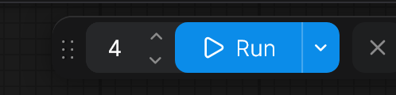
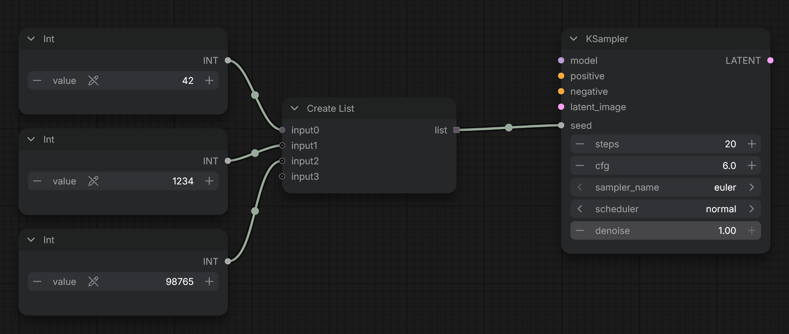
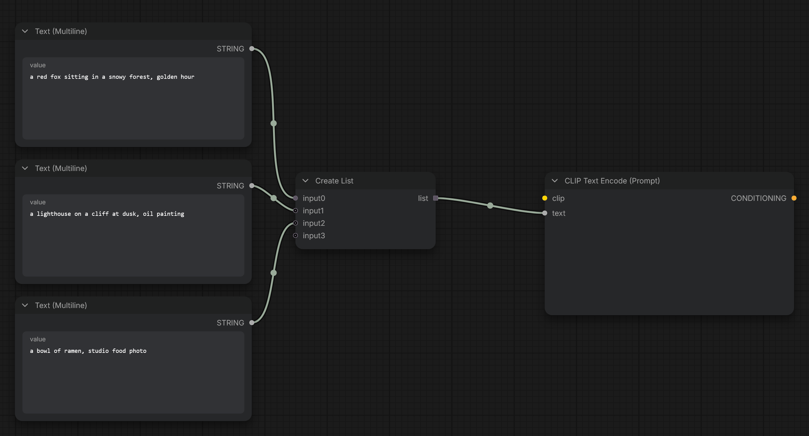
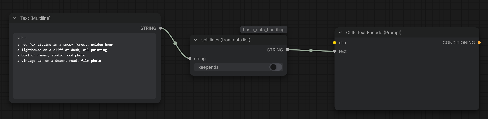
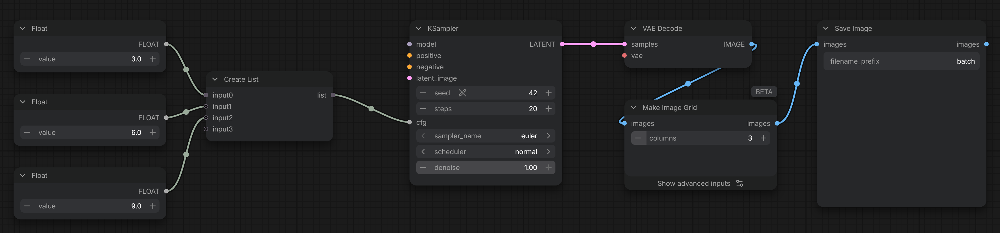
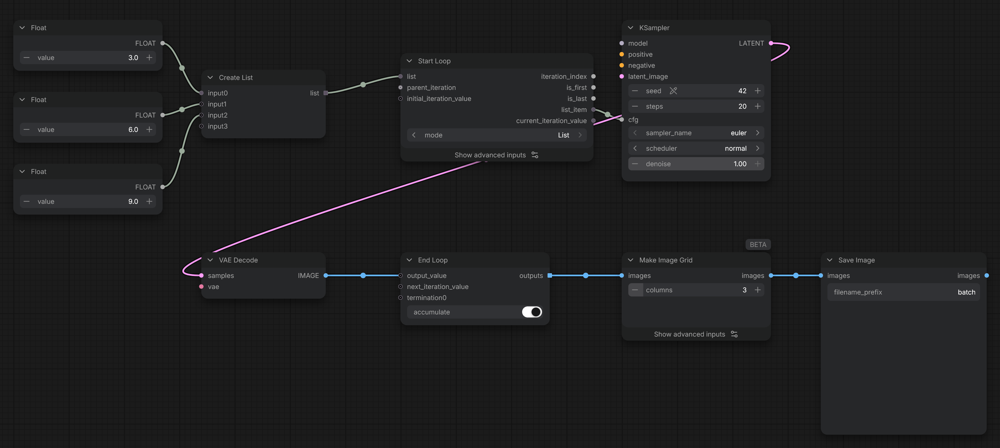
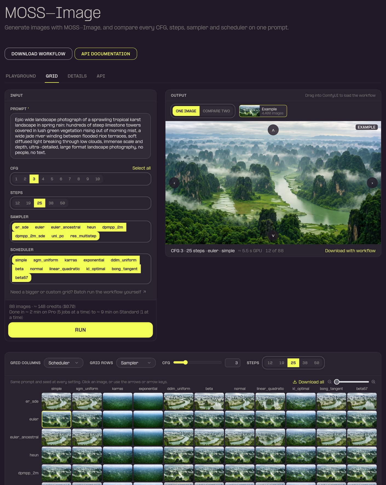
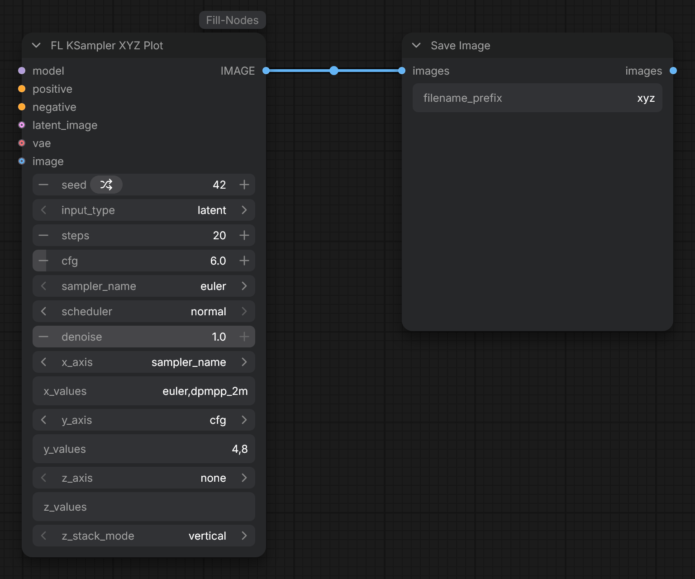
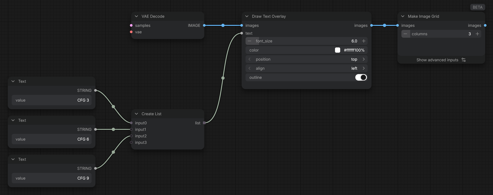

**Batch-Generierung** bedeutet, einen Workflow viele Male auszuführen und zwischen den Durchläufen etwas zu ändern: den Seed, den Prompt, die CFG, den Sampler, das Modell oder mehrere davon gleichzeitig. Ein **Einstellungen-Raster** ist eine Anwendung davon: derselbe Prompt und derselbe Seed, wobei pro Zelle eine oder zwei Einstellungen geändert werden, sodass Sie sehen, was jede Einstellung bewirkt.

Diese Anleitung beginnt mit dem einfachsten Fall und fügt Schritt für Schritt einen weiteren hinzu:

1. [Batch-Seeds](#batch-seeds): viele Variationen eines Prompts
2. [Batch-Prompts](#batch-prompts): ein Durchlauf pro Prompt
3. [Jede Einstellung batchen](#batch-any-setting): ein Durchlauf pro Wert von CFG, Steps oder einer anderen Eingabe
4. [Loops](#loops): Loop starten und Schleife beenden
5. [Einstellungen-Raster](#settings-grids): zwei oder mehr Einstellungen kreuzen und die Ergebnisse anordnen
6. [Skripting mit der Comfy API](#scripting-with-the-comfy-api): jede Kombination, in jeder Größe


| Methode | Was sich zwischen den Durchläufen ändert | Abschnitt |
|--------|---------------------------|---------|
| Batch-Anzahl | Der Seed oder jedes Widget, das auf `increment` oder `randomize` gesetzt ist | [Batch-Seeds](#batch-seeds) |
| `batch_size` | Das Rauschen jedes Bildes in einem Sampling-Durchlauf | [Batch-Seeds](#batch-seeds) |
| Listen | Jede Eingabe, die Sie aus einer Liste speisen: Seed, Prompt, CFG, Steps | [Batch-Prompts](#batch-prompts), [Jede Einstellung batchen](#batch-any-setting) |
| Loop starten / Schleife beenden | Jede Eingabe, jeweils eine Iteration | [Loops](#loops) |
| Ein XY-Plot-Node | Zwei oder drei Sampler-Einstellungen, gekreuzt | [Einstellungen-Raster](#settings-grids) |
| Ein Skript | Alles, in jeder Kombination | [Skripting](#scripting-with-the-comfy-api) |

<Tip>
Sie brauchen nur ein einfaches Einstellungen-Raster oder möchten erst sehen, was eines zeigt, bevor Sie Ihr eigenes bauen? Text-zu-Bild-Seiten für offene Modelle auf dem [Comfy Hub](https://comfy.org/hub/workflows) haben einen Tab **Grid** mit CFG, Steps, Sampler und Scheduler nebeneinander bei einem Seed, ohne jede Einrichtung. Probieren Sie den [Grid-Tab von MOSS-Image](https://comfy.org/hub/workflows/moss-image-text-to-image/) aus. Mehr dazu unter [Einstellungen-Raster](#settings-grids).
</Tip>

<Note>
Einige Schritte verwenden Custom Nodes. Jeder auf dieser Seite genannte Custom Node ist auf [Comfy Cloud](https://cloud.comfy.org) installiert, wo Custom Nodes geprüft werden, bevor sie hinzugefügt werden. In Ihrem eigenen ComfyUI [installieren Sie zuerst das Node-Paket](/de/installation/install_custom_node).
</Note>

## Seeds im Batch {#batch-seeds}

Der Seed bestimmt das Startrauschen, daher ergibt ein neuer Seed eine neue Komposition desselben Prompts. Den Seed zu ändern ist der einfachste Batch.

### Batch-Anzahl

Die **Batch-Anzahl** befindet sich in der Ausführungsleiste neben der Schaltfläche **Run**. Sie legt fest, wie oft der Workflow pro Klick in die Warteschlange gestellt wird. Wo Sie sie finden, steht unter [die Ausführungsleiste](/de/interface/overview).

1. Setzen Sie `control after generate` beim Seed des `KSampler` auf `randomize` oder `increment`.
2. Setzen Sie die **Batch-Anzahl** auf die gewünschte Anzahl an Bildern.
3. Klicken Sie auf **Run**. Jeder Lauf in der Warteschlange erhält den nächsten Seed.



`control after generate` funktioniert bei jedem Zahlen-Widget, das diese Option bietet, nicht nur beim Seed. Wenn jedes Widget auf `fixed` gesetzt ist, sind alle Läufe in der Warteschlange identisch und ergeben dasselbe Bild.

### batch_size am Latent

`batch_size` am Node `Empty Latent Image` erzeugt mehrere Latents auf einmal, und der `KSampler` entrauscht sie gemeinsam in einem Durchlauf. Jedes Bild im Batch erhält ein anderes Rauschen.

1. Setzen Sie bei `Empty Latent Image` den Wert `batch_size` auf die Anzahl der Bilder, zum Beispiel `4`.
2. Klicken Sie auf **Run**. `Save Image` speichert sie alle.

Ein größerer Batch benötigt mehr VRAM, da alle Bilder gleichzeitig gesampelt werden.

### Bestimmte Seeds

Um Seeds, die Ihnen bereits gefallen, erneut auszuführen, etwa um sie unter einer neuen Einstellung zu vergleichen, speisen Sie den Seed aus einer Liste:

1. Fügen Sie für jeden Seed einen [Int](/de/built-in-nodes/PrimitiveInt)-Node hinzu.
2. Fügen Sie einen [Create List](/de/built-in-nodes/CreateList)-Node hinzu und verbinden Sie jedes `Int` mit seinem nächsten freien Eingang. Neue Eingänge erscheinen, während Sie verbinden.
3. Verbinden Sie den Ausgang `list` von `Create List` mit dem Eingang `seed` des `KSampler`.
4. Klicken Sie auf **Run**. Der `KSampler` läuft einmal pro Seed.



Der nächste Abschnitt erklärt, wie Listen funktionieren.

## Batch-Prompts

Wenn ein Node eine **Liste** erhält, führt ComfyUI ihn einmal für jedes Element aus und reicht jedes Ergebnis an die nachfolgenden Nodes weiter. Eine Liste von Prompts, die mit `CLIP Text Encode` verbunden ist, ergibt ein Bild pro Prompt.

### Ein Text-Node pro Prompt

1. Fügen Sie für jeden Prompt einen [Text (Multiline)](/de/built-in-nodes/PrimitiveStringMultiline)-Node hinzu.
2. Verbinden Sie sie mit `Create List`.
3. Verbinden Sie den `list`-Ausgang mit dem `text`-Eingang des positiven `CLIP Text Encode`.
4. Klicken Sie auf **Run**. Jeder Prompt wird als eigener Lauf kodiert und gesampelt.



### Ein Prompt pro Zeile

Wenn Sie mehr als nur wenige Prompts haben, behalten Sie diese in einem Textfeld, einen Prompt pro Zeile, und teilen Sie es mit dem Node **splitlines (from data list)** aus dem Pack [Basic data handling](https://github.com/StableLlama/ComfyUI-basic_data_handling) in eine Liste auf.

1. Fügen Sie einen `Text (Multiline)`-Node hinzu und schreiben Sie einen Prompt pro Zeile.
2. Fügen Sie einen Node **splitlines (from data list)** hinzu (suchen Sie nach `splitlines`) und verbinden Sie den Text mit dessen `string`-Eingang. Lassen Sie `keepends` deaktiviert, damit die Zeilenumbrüche nicht Teil der Prompts sind.
3. Verbinden Sie dessen Ausgang mit dem `text`-Eingang des positiven `CLIP Text Encode`.
4. Klicken Sie auf **Run**. Jede Zeile wird zu einem eigenen Lauf.



Auf diese Weise können Sie eine ganze Prompt-Datei in das Textfeld einfügen. Leerzeilen werden zu leeren Prompts, entfernen Sie diese daher zuerst.

## Jede Einstellung als Batch {#batch-any-setting}

Eine Liste kann nahezu jede Eingabe speisen, nicht nur den Seed und den Prompt. Um eine Liste mit einem Widget wie `cfg` zu verbinden, ziehen Sie die Verbindung auf das Widget. So variieren Sie CFG:

1. Fügen Sie für jeden CFG-Wert einen [Float](/de/built-in-nodes/PrimitiveFloat)-Node hinzu, zum Beispiel `3`, `6` und `9`.
2. Führen Sie sie mit `Create List` zusammen und verbinden Sie die Liste mit der `cfg`-Eingabe des `KSampler`.
3. Halten Sie den Seed fest: Setzen Sie `control after generate` beim Seed auf `fixed`.
4. Verbinden Sie `VAE Decode` mit einem [Make Image Grid](/de/built-in-nodes/ImageGrid)-Node und dann mit `Save Image`.
5. Klicken Sie auf **Run**. `KSampler` und `VAE Decode` werden einmal pro CFG-Wert ausgeführt, und `Make Image Grid` erhält alle Bilder.



`steps`, `denoise`, die Bildgröße und die LoRA-Stärke funktionieren auf dieselbe Weise, mit `Int`- oder `Float`-Nodes.

<Warning>
Wenn ein Node **mehr als eine Liste** erhält, paart ComfyUI die Elemente nach Position: das erste mit dem ersten, das zweite mit dem zweiten, und das letzte Element der kürzeren Liste wird wiederholt. Es werden nicht alle Kombinationen erstellt. Drei Prompts und drei Seeds ergeben drei Bilder, nicht neun. Um zwei Einstellungen zu kombinieren, siehe [Einstellungsraster](#settings-grids) oder [Skripting](#scripting-with-the-comfy-api).
</Warning>

**Dropdowns.** `sampler_name`, `scheduler` und Modelldateien sind Dropdowns, die eine Liste aus Textwerten nicht direkt speisen kann. Um einige zu vergleichen, kopieren Sie die `KSampler`- und `VAE Decode`-Nodes einmal pro Wert, verbinden Sie sie mit demselben Modell, denselben Prompts und demselben Latent, stellen Sie jede Kopie anders ein und sammeln Sie die Bilder mit `Make Image Grid`. Für Sampler und Scheduler ist der XY-Plot-Node in [Einstellungsraster](#settings-grids) schneller.

## Schleifen {#loops}

Die Nodes [Start Loop](/de/built-in-nodes/StartLoop) und [End Loop](/de/built-in-nodes/EndLoop) führen die dazwischenliegenden Nodes einmal pro Iteration aus. `Start Loop` hat drei Modi:

| Modus | Iterationen |
|------|------------|
| `simple` | `num_iterations`-mal, wobei `iteration_index` bei 0 beginnt |
| `For` | Von `start_iteration_index` bis (ausschließlich) `max_iteration` in Schritten von `step` |
| `List` | Einmal pro Element der verbundenen `list`; das aktuelle Element wird über `list_item` ausgegeben |

Um eine Liste von Werten zu durchlaufen, zum Beispiel für CFG:

1. Erstellen Sie die Liste mit `Float`-Nodes und `Create List`, wie oben. Eine Liste von Prompts oder Seeds funktioniert genauso.
2. Fügen Sie einen `Start Loop`-Node hinzu, setzen Sie `mode` auf `List` und verbinden Sie die Liste mit seiner `list`-Eingabe.
3. Verbinden Sie `list_item` von `Start Loop` mit der Eingabe, die Sie ändern möchten, hier die `cfg`-Eingabe des `KSampler`.
4. Fügen Sie einen `End Loop`-Node hinzu. Verbinden Sie den `IMAGE`-Ausgang von `VAE Decode` mit `output_value` und aktivieren Sie `accumulate`, damit End Loop das Bild aus jeder Iteration zurückgibt, nicht nur das aus der letzten.
5. Verbinden Sie die `outputs` von `End Loop` mit `Make Image Grid` und dann mit `Save Image`.
6. Klicken Sie auf **Run**.



Für eine einzelne Liste liefern eine Schleife und eine einfache Liste dieselben Bilder. Eine Schleife ermöglicht außerdem, dass eine Iteration einen Wert an die nächste übergibt (`next_iteration_value` bei End Loop, `current_iteration_value` bei Start Loop), und eine Schleife kann in einer anderen verschachtelt werden, indem Sie den `iteration_index` der äußeren Schleife mit dem `parent_iteration` der inneren Schleife verbinden.

<Note>
Start Loop und End Loop sind neue Kern-Nodes. Wenn Sie sie nicht finden, [aktualisieren Sie ComfyUI](/de/installation/update_comfyui). Comfy Cloud wird nach jedem stabilen ComfyUI-Release aktualisiert.
</Note>

## Einstellungsraster {#settings-grids}

Ein Einstellungsraster hält Prompt, Modell und Seed konstant und ändert nur Sampler-Einstellungen, sodass jede Differenz zwischen zwei Zellen von der Einstellung stammt, die Sie geändert haben. Bei einem zufälligen Seed würde jede Zelle zusätzlich eine andere Komposition erhalten, und Sie könnten nicht mehr erkennen, ob eine Änderung von der Einstellung oder vom Rauschen stammt.

Die vier `KSampler`-Einstellungen, die ein Bild abgesehen von Prompt und Modell am stärksten verändern, sind:

| Einstellung | Was sie ändert |
|---------|-----------------|
| `cfg` | Wie streng das Modell dem Prompt folgt. Niedrige Werte wirken locker und weich; hohe Werte wirken gesättigt und überschärft. |
| `steps` | Wie viele Denoising-Schritte der Sampler ausführt. Mehr Schritte fügen bis zu einem Punkt Details hinzu und kosten danach nur noch Zeit. |
| `sampler_name` | Der Algorithmus, der bei jedem Schritt Rauschen entfernt (`euler`, `dpmpp_2m` und so weiter). |
| `scheduler` | Wie der Rauschpegel von Schritt zu Schritt sinkt (`normal`, `karras`, `simple` und so weiter). |

Ein vollständiger Sweep wächst schnell: 4 CFG-Werte × 3 Schrittanzahlen × 3 Sampler × 2 Scheduler ergeben 72 Bilder. Beginnen Sie mit einer oder zwei Einstellungen, finden Sie den Bereich, der gut aussieht, und grenzen Sie ihn dann ein.

### Der Grid-Tab im Comfy Hub

Wenn Sie nur ein einfaches Einstellungsraster benötigen, müssen Sie keines selbst erstellen. Text-zu-Bild-Seiten für offene Modelle auf dem [Comfy Hub](https://comfy.org/hub/workflows) haben einen **Grid**-Tab mit einem vorab gerenderten Sweep aus CFG × Schritte × Sampler × Scheduler bei einem Seed, zum Beispiel [MOSS-Image](https://comfy.org/hub/workflows/moss-image-text-to-image/).

- Wählen Sie aus, welche Einstellungen in den Spalten und Zeilen stehen, und klicken Sie auf eine beliebige Zelle, um sie in voller Größe anzuzeigen.
- Geben Sie Ihren eigenen Prompt ein, wählen Sie die zu vergleichenden Werte und klicken Sie auf **Run**, um sie auf Comfy Cloud im Batch auszuführen. Der Tab zeigt vor der Ausführung an, wie viele Bilder das sind und was es kostet.
- **Download with workflow** speichert ein Bild, das Sie in ComfyUI ziehen können, um seine genauen Einstellungen zu laden.



Für mehr Einstellungen, andere Modelle oder Ihren eigenen Workflow erstellen Sie das Raster selbst, wie unten beschrieben.

### Einstellungen mit einem XY-Plot-Node kombinieren

Der Node **FL KSampler XYZ Plot** aus dem Paket [Fill-Nodes](https://github.com/filliptm/ComfyUI_Fill-Nodes) ersetzt den `KSampler` und kombiniert bis zu drei Einstellungen für Sie. Er rendert jede Kombination und gibt ein Bild zurück, bei dem die Werte entlang der Achsen eingetragen sind.

1. Ersetzen Sie den `KSampler` durch **FL KSampler XYZ Plot**. Verbinden Sie `model`, `positive`, `negative`, `latent_image` und die `vae` aus Ihrem Checkpoint-Loader.
2. Legen Sie den Seed und die Basiswerte für die Einstellungen fest, die Sie nicht ändern.
3. Setzen Sie `x_axis` und `y_axis` auf zwei der Werte `steps`, `cfg`, `denoise`, `sampler_name` und `scheduler`.
4. Geben Sie die Werte für jede Achse in `x_values` und `y_values` ein, durch Kommas getrennt, zum Beispiel `euler,dpmpp_2m` und `4,8`.
5. Um eine dritte Einstellung zu kombinieren, legen Sie `z_axis` und `z_values` fest. `z_stack_mode` ordnet die zusätzlichen Raster untereinander oder nebeneinander an.
6. Verbinden Sie den Ausgang `IMAGE` mit `Save Image` und klicken Sie auf **Run**.




Um andere Eingänge zu kombinieren, etwa Prompts × Seeds oder LoRA-Stärke × CFG, verwenden Sie [verschachtelte Schleifen](#loops) oder ein [Skript](#scripting-with-the-comfy-api).

### Eigenes Raster anordnen

Wenn die Bilder aus einer Liste oder einer Schleife stammen, ordnet der Node [Make Image Grid](/de/built-in-nodes/ImageGrid) sie in Zeilen an, von links nach rechts und von oben nach unten.

| Eingabe | Was sie bewirkt |
|-------|--------------|
| `columns` | Bilder pro Zeile. Legen Sie den Wert auf die Anzahl der Werte Ihrer horizontalen Achse fest. |
| `cell_width`, `cell_height` | Die Größe, auf die jedes Bild skaliert wird. |
| `padding` | Pixel zwischen den Zellen. |

Um jede Zelle zu beschriften, setzen Sie einen Node [Draw Text Overlay](/de/built-in-nodes/TextOverlay) zwischen `VAE Decode` und `Make Image Grid`. Erstellen Sie mit `Text`-Nodes und `Create List` eine zweite Liste mit Beschriftungen wie `CFG 3`, `CFG 6` und `CFG 9` und verbinden Sie sie mit dem Eingang `text`. Da sowohl die Bilder als auch die Beschriftungen Listen sind, erhält jedes Bild die Beschriftung an derselben Position. Das Raster oben auf dieser Seite wurde auf diese Weise erstellt.



## Mit der Comfy API skripten {#scripting-with-the-comfy-api}

Bei mehr als zwei oder drei Einstellungen oder wenn Sie Prompts, Seeds und Modelle kombinieren möchten, ist ein Skript einfacher als ein Graph. Es erstellt jede Kombination, übermittelt jede als eigene Aufgabe und speichert die Ergebnisse zusammen mit einer Aufzeichnung dessen, was sich bei jedem Lauf geändert hat.

### 1. Workflow im API-Format exportieren

1. Erstellen und testen Sie den Workflow für einen Lauf in ComfyUI.
2. Öffnen Sie das Workflow-Menü und wählen Sie **Export (API)**. Dadurch wird der Graph im [API-Format](/development/api-development/workflow-api-format) gespeichert, wobei jeder Node mit seiner ID als Schlüssel versehen wird.
3. Öffnen Sie die JSON-Datei und notieren Sie die ID jedes Nodes, den Sie ändern möchten. Im Standard-Workflow für Text zu Bild ist der `KSampler` `"3"` und der positive `CLIP Text Encode` ist `"6"`.### 2. Einen Auftrag pro Kombination einreihen

Die [Comfy API v2](/de/api-reference/v2/overview) akzeptiert den Graphen im API-Format unter `POST /api/v2/jobs` und gibt einen Auftrag zurück, den Sie unter `GET /api/v2/jobs/{id}` abfragen können. Dieselbe API läuft auf Comfy Cloud und über [comfy-api-proxy](https://github.com/Comfy-Org/comfy-api-proxy) auch auf Ihrem eigenen ComfyUI, sodass das folgende Skript auf beiden funktioniert, wenn Sie `BASE_URL` ändern.

Comfy Cloud führt pro Plan eine festgelegte Anzahl von Aufträgen gleichzeitig aus und hält den Rest in einer Warteschlange:

| Plan | Gleichzeitig laufende Aufträge |
|------|------------------------|
| Standard | 1 |
| Creator | 3 |
| Pro | 5 |

Sie können bis zu 100 Aufträge in der Warteschlange haben. Um mehr als einen Auftrag gleichzeitig auszuführen, benötigen Sie die API und einen kostenpflichtigen Plan. Details finden Sie unter [Cloud-Parallelitätslimits](/development/deploy/cloud-usage#concurrency-limits).

In `AXES` ist jeder Schlüssel `<node ID>.<input name>` und jeder Wert die Liste der auszuprobierenden Werte. Das Skript führt jede Kombination aus. Es sorgt dafür, dass höchstens `MAX_IN_FLIGHT` Aufträge gleichzeitig abgesendet werden, sodass ein großer Batch niemals die Warteschlange füllt, und es wartet ab, wenn der Server mit `429` antwortet. Es benötigt Python 3.9 oder neuer und `pip install requests`. Legen Sie zuerst `COMFY_API_KEY` auf Ihren [API-Schlüssel](/development/api-development/getting-an-api-key) fest.

```python batch.py
import itertools, json, os, time
import requests

BASE_URL = "https://cloud.comfy.org"  # eigenes ComfyUI über comfy-api-proxy: "http://127.0.0.1:8189"
API_KEY = os.environ.get("COMFY_API_KEY", "")
HEADERS = {"Authorization": f"Bearer {API_KEY}"} if API_KEY else {}

WORKFLOW_FILE = "workflow_api.json"  # aus Export (API)
MAX_IN_FLIGHT = 5                    # an das Ausführungslimit Ihres Plans anpassen; nie über 100
OUT_DIR = "batch"

# "<node ID>.<input name>": Werte zum Ausprobieren. Jede Kombination wird ausgeführt.
AXES = {
    "3.seed": [42],
    "3.cfg": [3.0, 5.0, 7.0],
    "3.sampler_name": ["euler", "dpmpp_2m"],
    "6.text": ["a red fox in snow, photo", "a lighthouse at dusk, oil painting"],
}

def apply(graph, cell):
    for key, value in cell.items():
        node_id, name = key.split(".", 1)
        graph[node_id]["inputs"][name] = value

def submit(graph):
    while True:
        r = requests.post(f"{BASE_URL}/api/v2/jobs", headers=HEADERS, json={"workflow": graph})
        if r.status_code == 429:  # Warteschlange voll oder Rate-Limit erreicht: warten und erneut versuchen
            time.sleep(int(r.headers.get("Retry-After", "10")))
            continue
        r.raise_for_status()
        return r.json()["id"]

def save_outputs(job, name):
    files = []
    for i, output in enumerate(o for o in job["outputs"] if o["type"] == "image"):
        data = requests.get(output["url"], headers=HEADERS).content  # folgt der Weiterleitung zum Speicher
        ext = os.path.splitext(output["name"])[1] or ".png"
        path = os.path.join(OUT_DIR, f"{name}_{i}{ext}")
        with open(path, "wb") as f:
            f.write(data)
        files.append(path)
    return files

def main():
    os.makedirs(OUT_DIR, exist_ok=True)
    with open(WORKFLOW_FILE) as f:
        base = json.load(f)

    cells = [dict(zip(AXES, values)) for values in itertools.product(*AXES.values())]
    pending = [(f"{n:04d}", cell) for n, cell in enumerate(cells)]
    in_flight = {}  # Job-ID -> (name, cell)
    manifest = {}   # name -> was dieser Lauf geändert hat, und seine Dateien

    while pending or in_flight:
        while pending and len(in_flight) < MAX_IN_FLIGHT:
            name, cell = pending.pop(0)
            graph = json.loads(json.dumps(base))
            apply(graph, cell)
            in_flight[submit(graph)] = (name, cell)

        time.sleep(3)
        for job_id, (name, cell) in list(in_flight.items()):
            r = requests.get(f"{BASE_URL}/api/v2/jobs/{job_id}", headers=HEADERS)
            if r.status_code != 200:
                continue  # Rate-Limit erreicht oder ein vorübergehender Fehler: in der nächsten Runde erneut prüfen
            job = r.json()
            if job["status"] == "succeeded":
                manifest[name] = {"settings": cell, "files": save_outputs(job, name)}
                with open(os.path.join(OUT_DIR, "manifest.json"), "w", encoding="utf-8") as f:
                    json.dump(manifest, f, indent=2, ensure_ascii=False)
            elif job["status"] not in ("failed", "canceled", "expired"):
                continue  # noch in der Warteschlange oder in Ausführung
            else:
                print(f"{name} {cell}: {job['status']} {job.get('error')}")
            del in_flight[job_id]
            print(f"{len(cells) - len(pending) - len(in_flight)}/{len(cells)} done")

if __name__ == "__main__":
    main()
```

Die Dateien werden nummeriert (`0000_0.png`, `0001_0.png` und so weiter), und `batch/manifest.json` zeichnet die Einstellungen jeder einzelnen auf.

Einige gängige `AXES`-Einträge:

```python
"3.seed": list(range(1, 9)),             # acht Seeds
"3.seed": [42],                          # ein fester Seed, für ein Einstellungsraster
"3.scheduler": ["normal", "karras"],     # jedes Dropdown, nach seinem Optionsnamen
"6.text": [line.strip() for line in open("prompts.txt", encoding="utf-8") if line.strip()],  # ein Prompt pro Zeile
```

<Tip>
Die [Comfy SDKs](/development/api-development/sdks) für Python und TypeScript umfassen diese Endpunkte, einschließlich Uploads, Warten auf Aufträge und erneutes Versuchen, wenn die Warteschlange voll ist.
</Tip>

### 3. Ergebnisse anordnen

Um einen skriptgesteuerten Batch in ein Raster zu verwandeln, setzen Sie die gespeicherten Dateien mit ein paar Zeilen [Pillow](https://pillow.readthedocs.io/) (`pip install pillow`) zusammen. Dieses Beispiel ordnet eine Einstellung den Spalten und eine andere den Zeilen zu, hält die übrigen Einstellungen fest und schreibt die Werte entlang der Kanten:

```python make_grid.py
import json
from PIL import Image, ImageDraw

COLS = ("3.cfg", [3.0, 5.0, 7.0])
ROWS = ("3.sampler_name", ["euler", "dpmpp_2m"])
FIXED = {"3.seed": 42, "6.text": "a red fox in snow, photo"}
CELL, LABEL = 384, 100

with open("batch/manifest.json", encoding="utf-8") as f:
    runs = list(json.load(f).values())

def path(col, row):
    want = {COLS[0]: col, ROWS[0]: row, **FIXED}
    for run in runs:
        if all(run["settings"].get(k) == v for k, v in want.items()):
            return run["files"][0]
    raise KeyError(f"no run with {want}")

sheet = Image.new("RGB", (LABEL + CELL * len(COLS[1]), LABEL + CELL * len(ROWS[1])), "white")
draw = ImageDraw.Draw(sheet)
for x, col in enumerate(COLS[1]):
    draw.text((LABEL + x * CELL + 8, 12), f"{COLS[0]} {col}", fill="black")
for y, row in enumerate(ROWS[1]):
    draw.text((6, LABEL + y * CELL + 8), f"{row}", fill="black")
    for x, col in enumerate(COLS[1]):
        img = Image.open(path(col, row)).convert("RGB").resize((CELL, CELL))
        sheet.paste(img, (LABEL + x * CELL, LABEL + y * CELL))
sheet.save("grid.png")
```

Erstellen Sie ein Blatt pro Kombination der verbleibenden Einstellungen, zum Beispiel ein CFG-×-Sampler-Blatt für jeden Prompt.

## Selbst ausprobieren

1. Laden Sie das Rasterbild oben auf dieser Seite herunter und ziehen Sie es in ComfyUI. Dadurch wird der CFG-Sweep-Workflow geladen (er verwendet `sd_xl_base_1.0.safetensors`).
2. Ersetzen Sie die `Float`-Nodes durch `Int`-Nodes und verbinden Sie die Liste stattdessen mit `seed`, oder ersetzen Sie sie durch einen Node **splitlines (from data list)** und verbinden Sie diesen mit dem Prompt.
3. Wenn Sie jede Kombination mehrerer Einstellungen benötigen, exportieren Sie den Workflow mit **Export (API)** und führen Sie ihn mit dem Skript aus.
