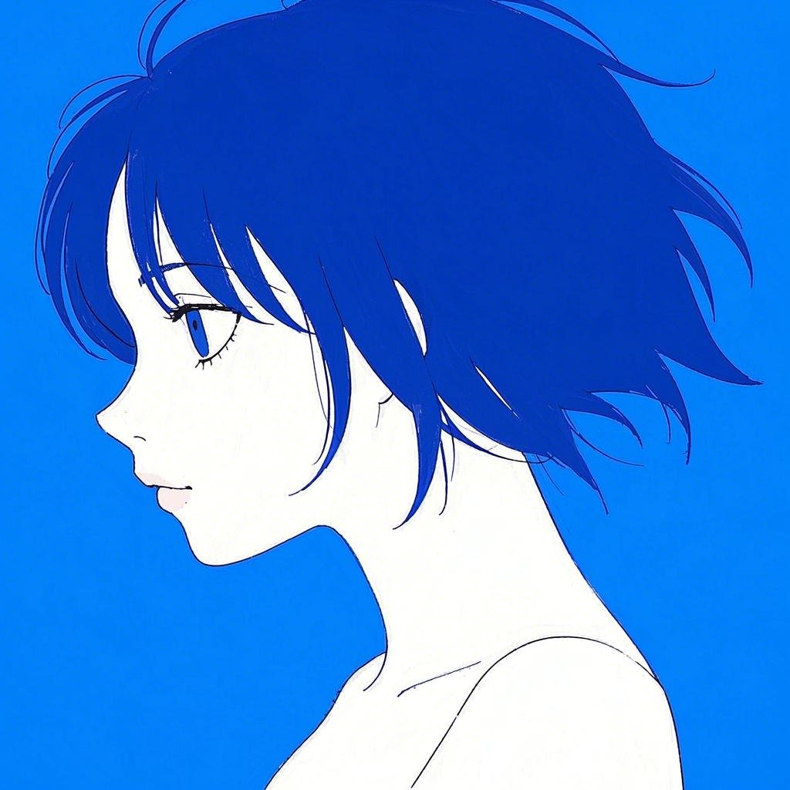
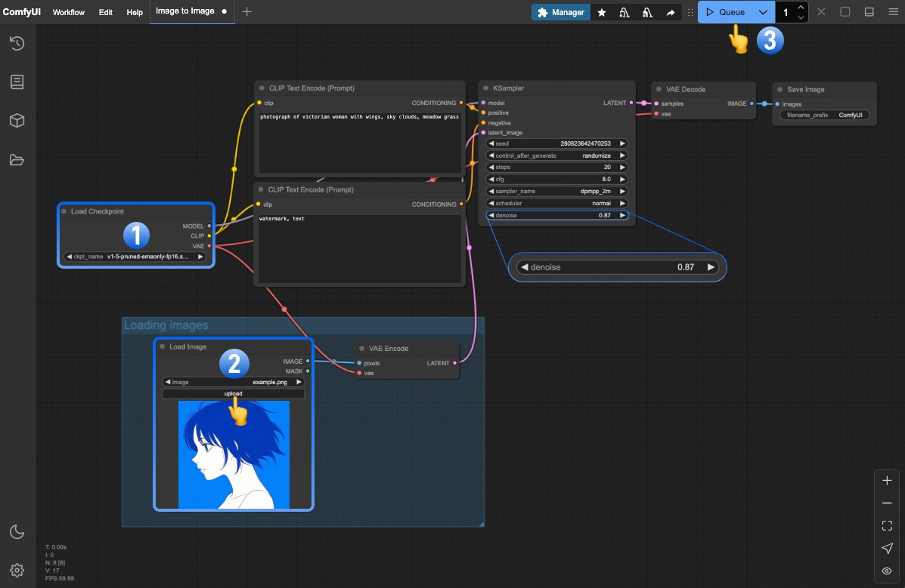

## Was ist Bild zu Bild in ComfyUI? {#what-is-image-to-image}

Bild zu Bild ist ein Workflow in ComfyUI, mit dem Sie ein Bild als Eingabe verwenden und daraus ein neues Bild generieren können.

Bild zu Bild eignet sich für Szenarien wie:
- Den Stil von Ausgangsbildern umwandeln, etwa realistische Fotos in künstlerische Stile
- Strichzeichnungen in realistische Bilder umwandeln
- Bilder restaurieren
- Alte Fotos kolorieren
- ... und weitere Szenarien

Ein Vergleich zur Veranschaulichung:
Es ist, als würden Sie einen Künstler bitten, ein bestimmtes Werk anhand Ihres Referenzbilds zu erstellen.

Wenn Sie dieses Tutorial aufmerksam mit dem Tutorial [Text zu Bild](/de/tutorials/basic/text-to-image) vergleichen,
werden Sie feststellen, dass der Prozess von Bild zu Bild dem von Text zu Bild sehr ähnlich ist,
nur mit einem zusätzlichen Referenzbild als Eingabe und Bedingung. Bei Text zu Bild lassen wir den Künstler (das Bildmodell) anhand unserer Prompts frei erstellen,
während wir bei Bild zu Bild den Künstler sowohl anhand unseres Referenzbilds als auch unserer Prompts erstellen lassen.

## Beispielanleitung für den ComfyUI Bild-zu-Bild-Workflow

### Modell installieren
Laden Sie die Datei [v1-5-pruned-emaonly-fp16.safetensors](https://huggingface.co/Comfy-Org/stable-diffusion-v1-5-archive/blob/main/v1-5-pruned-emaonly-fp16.safetensors) herunter und legen Sie sie in Ihrem Ordner `ComfyUI/models/checkpoints` ab.

### Bild-zu-Bild-Workflow und Eingabebild

Laden Sie das untenstehende Bild herunter und **ziehen Sie es in ComfyUI**, um den Workflow zu laden:

<Tip>
Bilder, die Workflow-JSON in ihren Metadaten enthalten, können direkt in ComfyUI gezogen oder über das Menü `Workflows` -> `Open (ctrl+o)` geladen werden.
</Tip>

Laden Sie das folgende Bild herunter; wir verwenden es als Eingabebild:

### Den Workflow Schritt für Schritt abschließen

Befolgen Sie die Schritte im untenstehenden Diagramm, damit der Workflow korrekt ausgeführt wird.

1. Stellen Sie sicher, dass `Load Checkpoint` **v1-5-pruned-emaonly-fp16.safetensors** lädt
2. Laden Sie das Eingabebild in den Node `Load Image` hoch
3. Klicken Sie auf `Queue` oder drücken Sie `Ctrl/Cmd + Enter`, um zu generieren

## Wichtige Punkte des Bild-zu-Bild-Workflows

Der Schlüssel des Bild-zu-Bild-Workflows liegt im Parameter `denoise` im Node `KSampler`. Dieser sollte **kleiner als 1** sein.

Wenn Sie den Parameter `denoise` angepasst und Bilder generiert haben, werden Sie feststellen:
- Je kleiner der Wert von `denoise`, desto kleiner ist die Differenz zwischen dem generierten Bild und dem Referenzbild.
- Je größer der Wert von `denoise`, desto größer ist die Differenz zwischen dem generierten Bild und dem Referenzbild.

Das liegt daran, dass `denoise` bestimmt, wie stark dem Bild im latenten Raum Rauschen hinzugefügt wird, nachdem das Referenzbild umgewandelt wurde. Wenn `denoise` 1 ist, wird das Bild im latenten Raum zu vollständig zufälligem Rauschen. Dadurch ist es identisch mit dem latenten Raum, den der Node `empty latent image` erzeugt, und verliert alle Eigenschaften des Referenzbilds.

<Note>
Ein niedriges `denoise` verringert nicht die Anzahl der Schritte, die ein Lauf ausführt; nur `denoise` 0 beendet das Sampling vollständig. ComfyUI erstellt einen Zeitplan für `steps / denoise` Schritte (abgerundet) und behält von diesem nur die letzten `steps + 1` Sigmas. Daher führt `steps` 20 mit `denoise` 0.5 20 Sampling-Schritte über die rauscharme Hälfte eines 40-Schritte-Zeitplans aus, und zwar mit der Schrittdichte dieses längeren Zeitplans. Um die Schrittdichte eines vollständigen Laufs beizubehalten und nur einen Teil des Bereichs zu samplen, setzen Sie `steps` auf die Schrittzahl dieses Laufs multipliziert mit `denoise`: Bei `denoise` 0.5 werden mit `steps` 10 exakt die Sigmas gesampelt, die ein 20-Schritte-Lauf für seine zweite Hälfte verwendet, mit der Hälfte der Modellauswertungen.
</Note>

Die zugrunde liegenden Prinzipien finden Sie in der entsprechenden Erklärung im Tutorial [Text zu Bild](/de/tutorials/basic/text-to-image).

## Selbst ausprobieren

1. Ändern Sie versuchsweise den Parameter `denoise` im **KSampler**-Node, indem Sie ihn schrittweise von 1 auf 0 verringern, und beobachten Sie die Veränderungen in den generierten Bildern.
2. Ersetzen Sie die Prompts und Referenzbilder durch Ihre eigenen, um Ihre eigenen Bildeffekte zu generieren.
