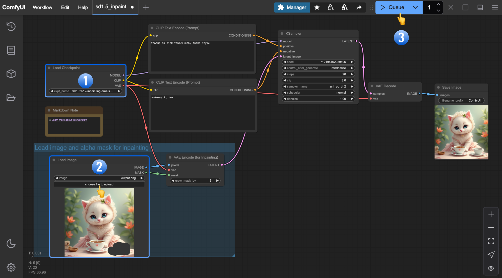
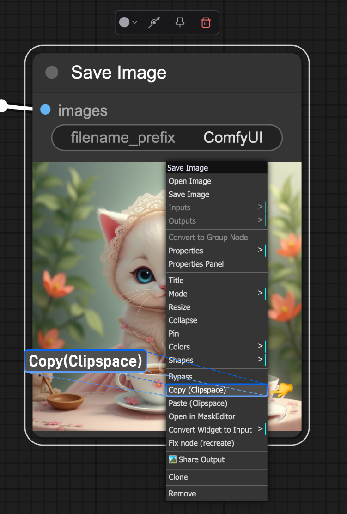
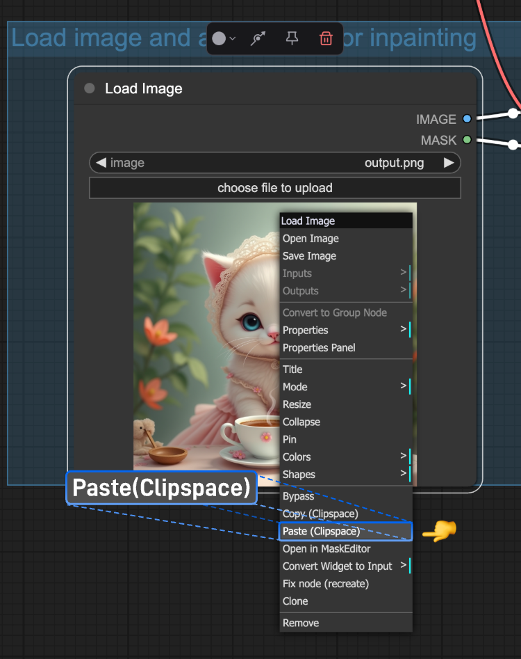
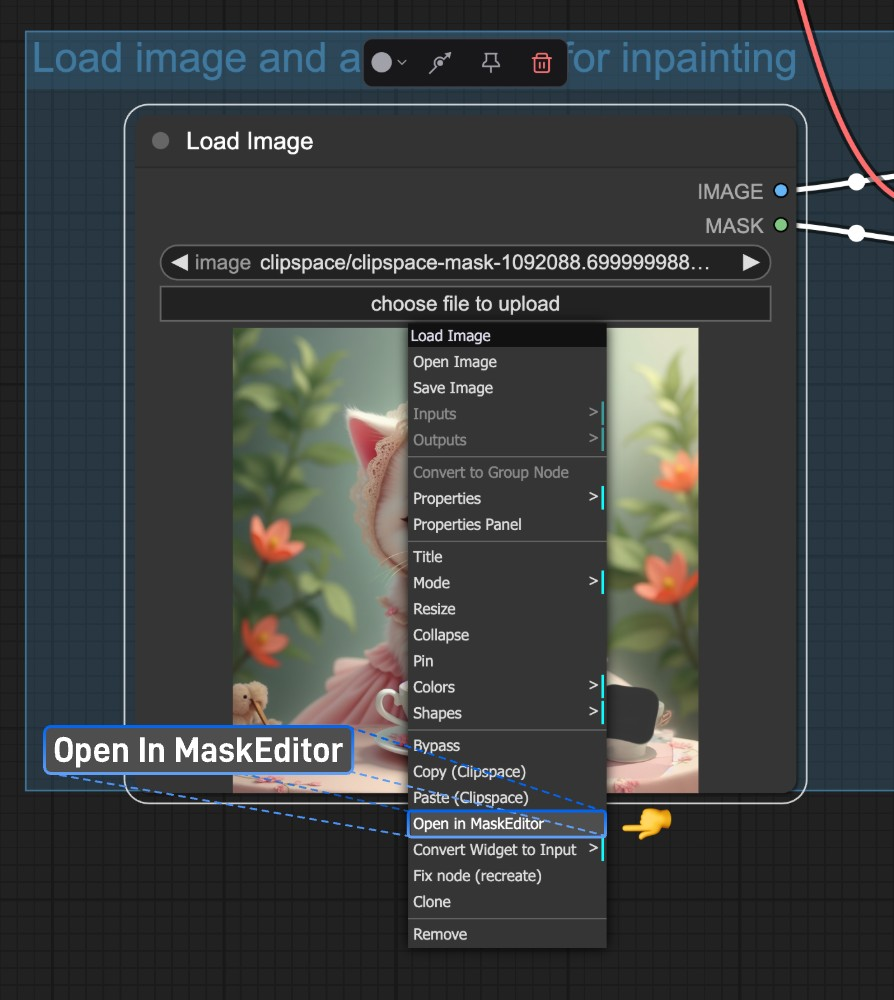
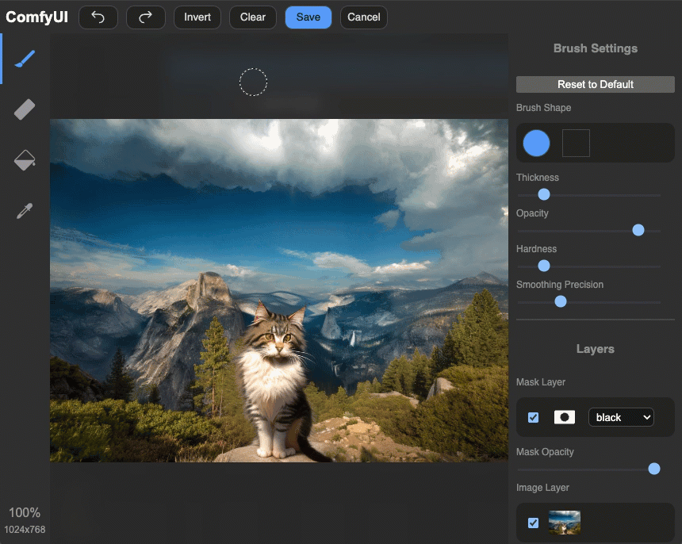
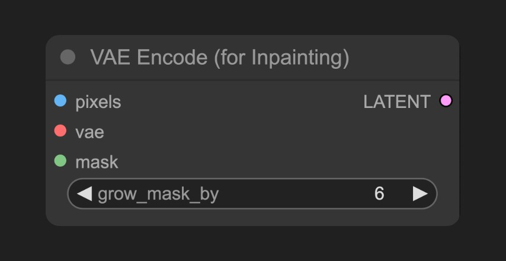

In diesem Artikel lernen Sie das Konzept des Inpaintings in der KI-Bildgenerierung kennen und erstellen Schritt für Schritt einen Inpainting-Workflow in ComfyUI. Wir behandeln:
- Inpainting-Workflows zum Bearbeiten von Bildern
- Maskierungen mit dem Maskeneditor von ComfyUI zeichnen
- Node `VAE Encoder (for Inpainting)`

## Über Inpainting

Bei der KI-Bildgenerierung kommt es häufig vor, dass wir mit dem Gesamtbild zufrieden sind, aber Elemente enthalten sind, die wir nicht wollen oder die Fehler aufweisen. Ein einfaches erneutes Generieren könnte ein völlig anderes Bild erzeugen, daher ist die Verwendung von Inpainting zur Korrektur bestimmter Bereiche sehr nützlich.

Es ist, als würde man einen **Künstler (KI-Modell)** ein Bild malen lassen, aber wir sind mit den konkreten Details noch nicht zufrieden. Wir müssen dem Künstler mitteilen, **welche Bereiche angepasst werden sollen (Maskierung)**, und ihn dann gemäß unseren Anforderungen **neu malen (Inpainting)** lassen.

Häufige Inpainting-Szenarien sind:
- **Fehlerbehebung:** Entfernen unerwünschter Objekte, Korrigieren fehlerhafter KI-generierter Körperteile usw.
- **Detailoptimierung:** Präzises Anpassen lokaler Elemente (z. B. Ändern von Kleidungstexturen, Anpassen des Gesichtsausdrucks)
- Und weitere Szenarien

## Beispiel für einen Inpainting-Workflow mit ComfyUI

### Modell- und Ressourcenvorbereitung

#### 1. Modell installieren

Laden Sie die Datei [512-inpainting-ema.safetensors](https://huggingface.co/Comfy-Org/stable_diffusion_2.1_repackaged/blob/main/512-inpainting-ema.safetensors) herunter und legen Sie sie in Ihrem Ordner `ComfyUI/models/checkpoints` ab:

#### 2. Inpainting-Asset

Bitte laden Sie das folgende Bild herunter, das wir als Eingabe verwenden:

<Note>
  Dieses Bild enthält bereits einen Alpha-Kanal (Transparenz-Maskierung), Sie müssen also keine Maskierung manuell zeichnen. Dieses Tutorial zeigt außerdem, wie Sie mit dem Maskeneditor Maskierungen zeichnen.
</Note>

#### 3. Inpainting-Workflow

Laden Sie das Bild unten herunter und **ziehen Sie es in ComfyUI**, um den Workflow zu laden:

<Tip>
Bilder, die Workflow-JSON in ihren Metadaten enthalten, können direkt in ComfyUI gezogen oder über das Menü `Workflows` -> `Open (ctrl+o)` geladen werden.
</Tip>

### Erklärung zum ComfyUI Inpainting-Workflow-Beispiel

Befolgen Sie die Schritte im folgenden Diagramm, damit der Workflow korrekt ausgeführt wird.

1. Stellen Sie sicher, dass `Load Checkpoint` `512-inpainting-ema.safetensors` lädt
2. Laden Sie das Eingabebild in den Node `Load Image` hoch
3. Klicken Sie auf `Queue` oder verwenden Sie `Ctrl + Enter`, um zu generieren

Zum Vergleich sehen Sie hier das Ergebnis mit dem Modell [v1-5-pruned-emaonly-fp16.safetensors](https://huggingface.co/Comfy-Org/stable-diffusion-v1-5-archive/blob/main/v1-5-pruned-emaonly-fp16.safetensors):

Sie werden feststellen, dass die mit dem Modell [512-inpainting-ema.safetensors](https://huggingface.co/Comfy-Org/stable_diffusion_2.1_repackaged/blob/main/512-inpainting-ema.safetensors) erzeugten Ergebnisse bessere Inpainting-Effekte und natürlichere Übergänge aufweisen.
Das liegt daran, dass dieses Modell speziell für Inpainting entwickelt wurde. Es hilft uns, den Generierungsbereich besser zu steuern, was zu besseren Inpainting-Ergebnissen führt.

Erinnern Sie sich an den Vergleich, den wir verwendet haben? Verschiedene Modelle sind wie Künstler mit unterschiedlichen Fähigkeiten, aber jeder Künstler hat seine eigenen Grenzen. Mit dem richtigen Modell erzielen Sie bessere Generierungsergebnisse.

Sie können diese Ansätze ausprobieren, um bessere Ergebnisse zu erzielen:

1. Ändern Sie die positiven und negativen Prompts mit genaueren Beschreibungen
2. Führen Sie mehrere Durchläufe mit unterschiedlichen Seeds im `KSampler` aus, um unterschiedliche Generierungsergebnisse zu erhalten
3. Nachdem Sie den Maskeneditor in diesem Tutorial kennengelernt haben, können Sie die generierten Ergebnisse erneut inpaintieren, um zufriedenstellende Resultate zu erzielen.

Als Nächstes lernen wir die Verwendung des **Maskeneditors** kennen. Unser Eingabebild enthält bereits einen transparenten `alpha`-Kanal (den Bereich, den wir bearbeiten möchten),
sodass ein manuelles Zeichnen der Maskierung nicht nötig ist. In der Praxis werden Sie den Maskeneditor jedoch häufig verwenden, um Maskierungen zu erstellen.

### Maskeneditor verwenden

Klicken Sie zunächst mit der rechten Maustaste auf den Node `Save Image` und wählen Sie `Copy(Clipspace)`:

Klicken Sie dann mit der rechten Maustaste auf den Node **Load Image** und wählen Sie `Paste(Clipspace)`:

Klicken Sie erneut mit der rechten Maustaste auf den Node **Load Image** und wählen Sie `Open in MaskEditor`:

1. Passen Sie die Pinselparameter im rechten Bereich an
2. Korrigieren Sie Fehler mit dem Radierer
3. Klicken Sie auf `Save`, wenn Sie fertig sind

Der gezeichnete Inhalt wird als Maskierungseingabe an den Node VAE Encoder (for Inpainting) zur Kodierung übergeben.

Passen Sie anschließend Ihre Prompts an und generieren Sie erneut, bis Sie zufriedenstellende Ergebnisse erzielen.

## VAE Encoder (for Inpainting) Node

Wenn Sie diesen Workflow mit [Text zu Bild](/de/tutorials/basic/text-to-image) und [Bild zu Bild](/de/tutorials/basic/image-to-image) vergleichen, erkennen Sie, dass die wichtigsten Unterschiede bei den bedingten Eingängen im VAE-Bereich liegen.
In diesem Workflow verwenden wir den Node **VAE Encoder (for Inpainting)**, der speziell für Inpainting entwickelt wurde, damit Sie den Generierungsbereich besser steuern und bessere Ergebnisse erzielen können.

**Eingabetypen**

| Parametername | Funktion                                                                                                                                              |
|----------------|-------------------------------------------------------------------------------------------------------------------------------------------------------|
| `pixels`       | Eingabebild, das in den Latent-Raum kodiert werden soll.                                                                                              |
| `vae`          | VAE-Modell, mit dem das Bild vom Pixelraum in den Latent-Raum kodiert wird.                                                                            |
| `mask`         | Bildmaskierung, die angibt, welche Bereiche geändert werden müssen.                                                                                    |
| `grow_mask_by` | Pixelwert, um den die ursprüngliche Maskierung nach außen erweitert wird, damit ein Übergangsbereich um die Maskierung entsteht und harte Kanten zwischen den per Inpainting geänderten und den ursprünglichen Bereichen vermieden werden. |

**Ausgabetypen**

| Parametername | Funktion                                                                |
|----------------|-------------------------------------------------------------------------|
| `latent`       | Vom VAE in den Latent-Raum kodiertes Bild.                              |
