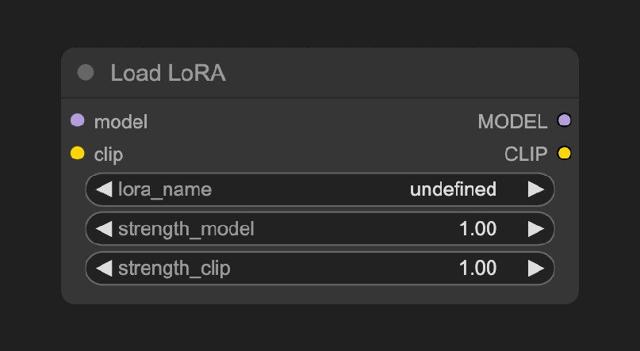
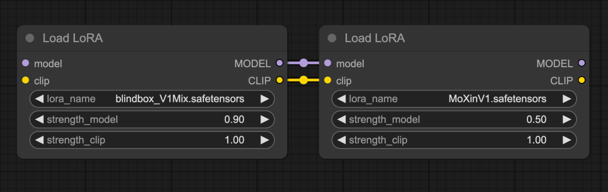

**LoRA (Low-Rank Adaptation)** ist eine effiziente Technik zum Fine-Tuning großer generativer Modelle wie Stable Diffusion.
Sie fügt dem vortrainierten Modell trainierbare Matrizen mit niedrigem Rang hinzu und passt nur einen Teil der Parameter an, statt das gesamte Modell neu zu trainieren.
So erreichen Sie die Optimierung für spezifische Aufgaben mit geringerem Rechenaufwand.
Im Vergleich zu Basismodellen wie SD1.5 sind LoRA-Modelle kleiner und einfacher zu trainieren.

Das obige Bild vergleicht die Generierung mit denselben Parametern einmal direkt mit [dreamshaper_8](https://civitai.com/models/4384?modelVersionId=128713) und einmal mit dem LoRA-Modell [blindbox_V1Mix](https://civitai.com/models/25995/blindbox).
Wie Sie sehen, können Sie mit einem LoRA-Modell Bilder in verschiedenen Stilen generieren, ohne das Basismodell anzupassen.

Wir zeigen Ihnen, wie Sie ein LoRA-Modell verwenden. Alle LoRA-Varianten: Lycoris, loha, lokr, locon usw. werden auf dieselbe Weise verwendet.

In diesem Beispiel lernen Sie, wie Sie ein LoRA-Modell in [ComfyUI](https://github.com/Comfy-Org/ComfyUI) laden und verwenden. Dabei werden die folgenden Themen behandelt:

1. Ein LoRA-Modell installieren
2. Bilder mit einem LoRA-Modell generieren
3. Eine kurze Einführung in den Node `Load LoRA`

## Erforderliche Modellinstallation

Laden Sie die Datei [dreamshaper_8.safetensors](https://civitai.com/api/download/models/128713?type=Model&format=SafeTensor&size=pruned&fp=fp16) herunter und legen Sie sie in Ihrem Ordner `ComfyUI/models/checkpoints` ab.

Laden Sie die Datei [blindbox_V1Mix.safetensors](https://civitai.com/api/download/models/32988?type=Model&format=SafeTensor&size=full&fp=fp16) herunter und legen Sie sie in Ihrem Ordner `ComfyUI/models/loras` ab.

## LoRA-Workflowdatei

Laden Sie das Bild unten herunter und **ziehen Sie es in ComfyUI**, um den Workflow zu laden.

<Tip>
Bilder, die Workflow-JSON in ihren Metadaten enthalten, können direkt in ComfyUI gezogen oder über das Menü `Workflows` -> `Open (ctrl+o)` geladen werden.
</Tip>

## Workflow Schritt für Schritt ausführen

Folgen Sie den Schritten im untenstehenden Diagramm, damit der Workflow korrekt ausgeführt wird.

1. Stellen Sie sicher, dass `Load Checkpoint` den `dreamshaper_8.safetensors` lädt
2. Stellen Sie sicher, dass `Load LoRA` den `blindbox_V1Mix.safetensors` lädt
3. Klicken Sie auf die Schaltfläche `Queue` oder verwenden Sie die Tastenkombination `Ctrl(cmd) + Enter`, um das Bild zu generieren

## Load LoRA Node: Einführung

Modelle im Ordner `ComfyUI\models\loras` werden von ComfyUI erkannt und können mit diesem Node geladen werden.

### Eingaben

| Parametername   | Funktion                                                                                               |
|------------------|--------------------------------------------------------------------------------------------------------|
| `model`          | Verbindet mit dem Basismodell                                                                          |
| `clip`           | Verbindet mit dem CLIP-Modell                                                                          |
| `lora_name`      | Wählt das zu ladende und zu verwendende LoRA-Modell aus                                                |
| `strength_model` | Beeinflusst, wie stark die LoRA die Modellgewichte prägt; höhere Werte machen den LoRA-Stil stärker    |
| `strength_clip`  | Beeinflusst, wie stark die LoRA die CLIP-Text-Embeddings prägt                                         |

### Ausgaben

| Parametername | Funktion                                             |
|----------------|------------------------------------------------------|
| `model`        | Gibt das Modell mit angewendeten LoRA-Anpassungen aus |
| `clip`         | Gibt das CLIP-Modell mit angewendeten LoRA-Anpassungen aus |

Dieser Node unterstützt Kettenverbindungen, sodass mehrere `Load LoRA` Nodes in Reihe geschaltet werden können, um mehrere LoRA-Modelle anzuwenden. Weitere Details finden Sie unter [Beispiel mit mehreren LoRAs in ComfyUI](/de/tutorials/basic/multiple-loras).

## Selbst ausprobieren

1. Versuchen Sie, den Prompt zu ändern oder verschiedene Parameter des Nodes `Load LoRA` anzupassen, etwa `strength_model`, um die Änderungen in den generierten Bildern zu beobachten und sich mit dem Node `Load LoRA` vertraut zu machen.
2. Besuchen Sie [CivitAI](https://civitai.com/models), um andere Arten von LoRA-Modellen herunterzuladen und auszuprobieren.
