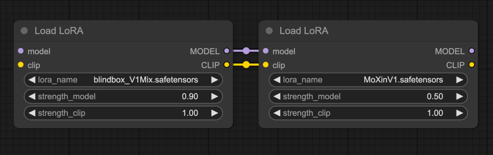
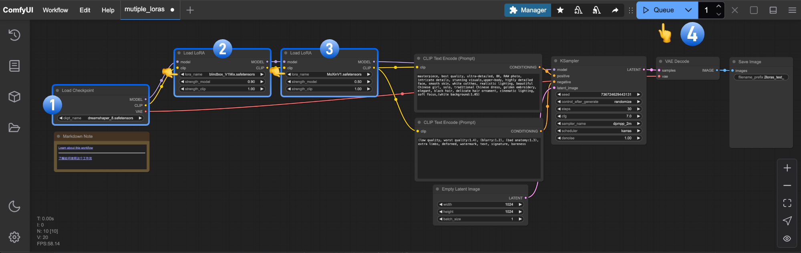

In unserem [ComfyUI LoRA-Beispiel](/de/tutorials/basic/lora) haben wir vorgestellt, wie Sie ein einzelnes LoRA-Modell laden und verwenden, und dabei die Verkettungsmöglichkeit des Nodes erwähnt.

Dieses Tutorial zeigt, wie Sie mehrere `Load LoRA`-Nodes verketten, um zwei LoRA-Modelle gleichzeitig anzuwenden: [blindbox_V1Mix](https://civitai.com/models/25995?modelVersionId=32988) und [MoXinV1](https://civitai.com/models/12597?modelVersionId=14856).

Der folgende Vergleich zeigt die einzelnen Effekte dieser LoRAs mit identischen Parametern:

Durch das Verketten mehrerer LoRA-Modelle erreichen wir einen gemischten Stil im Endergebnis:

## Modelle installieren

Laden Sie die Datei [dreamshaper_8.safetensors](https://civitai.com/api/download/models/128713?type=Model&format=SafeTensor&size=pruned&fp=fp16) herunter und legen Sie sie in Ihrem Ordner `ComfyUI/models/checkpoints` ab.

Laden Sie die Datei [blindbox_V1Mix.safetensors](https://civitai.com/api/download/models/32988?type=Model&format=SafeTensor&size=full&fp=fp16) herunter und legen Sie sie in Ihrem Ordner `ComfyUI/models/loras` ab.

Laden Sie die Datei [MoXinV1.safetensors](https://civitai.com/api/download/models/14856?type=Model&format=SafeTensor&size=full&fp=fp16) herunter und legen Sie sie in Ihrem Ordner `ComfyUI/models/loras` ab.

## Workflow mit mehreren LoRAs

Laden Sie das Bild unten herunter und **ziehen Sie es in ComfyUI**, um den Workflow zu laden:

<Tip>
Bilder, die Workflow-JSON in ihren Metadaten enthalten, können direkt in ComfyUI gezogen oder über das Menü `Workflows` -> `Open (ctrl+o)` geladen werden.
</Tip>

## Workflow Schritt für Schritt vervollständigen

Folgen Sie den Schritten im untenstehenden Diagramm, damit der Workflow korrekt ausgeführt wird.

1. Stellen Sie sicher, dass `Load Checkpoint` **dreamshaper_8.safetensors** lädt
2. Stellen Sie sicher, dass der erste `Load LoRA` **blindbox_V1Mix.safetensors** lädt
3. Stellen Sie sicher, dass der zweite `Load LoRA` **MoXinV1.safetensors** lädt
4. Klicken Sie auf `Queue` oder drücken Sie `Ctrl/Cmd + Enter`, um zu generieren

## Selbst ausprobieren

1. Passen Sie die Werte für `strength_model` in beiden `Load LoRA`-Nodes an, um den Einfluss jedes LoRA zu steuern
2. Entdecken Sie weitere LoRAs auf [CivitAI](https://civitai.com/models) und erstellen Sie eigene Kombinationen