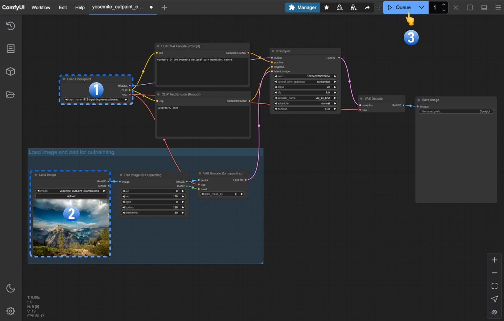
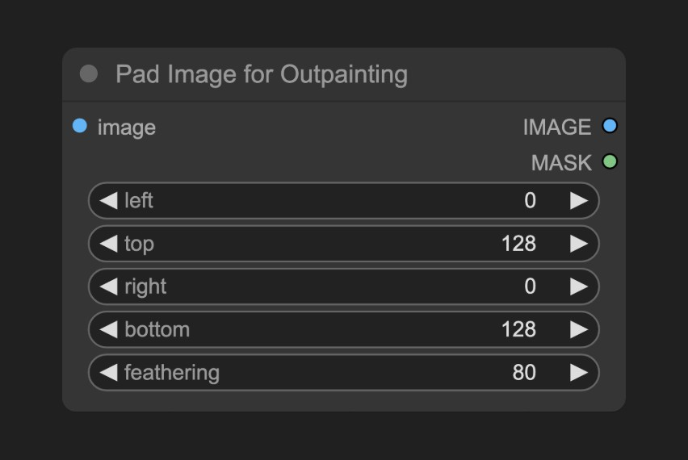
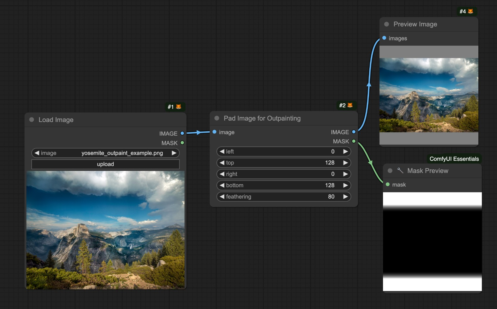

Diese Anleitung führt Sie in das Konzept des Outpaintings in der KI-Bildgenerierung ein und zeigt Ihnen, wie Sie einen Outpainting-Workflow in ComfyUI erstellen. Wir behandeln:
- Verwenden eines Outpainting-Workflows, um ein Bild zu erweitern
- Outpainting-bezogene Nodes in ComfyUI verstehen und verwenden
- Beherrschen des grundlegenden Outpainting-Prozesses

## Über Outpainting

In der KI-Bildgenerierung gibt es häufig Situationen, in denen ein vorhandenes Bild eine gute Komposition hat, aber die Canvas-Fläche zu klein ist, sodass der Canvas erweitert werden muss, um eine größere Szene zu erhalten. Genau hier kommt Outpainting ins Spiel.

Grundsätzlich werden ähnliche Inhalte wie bei [Inpainting](/de/tutorials/basic/inpaint) benötigt, aber wir verwenden andere Nodes, um die **Maskierung zu erstellen**.

Anwendungsfälle für Outpainting sind:
- **Szenenerweiterung:** Erweitern Sie den Szenenbereich des Originalbilds, um eine vollständigere Umgebung zu zeigen
- **Kompositionsanpassung:** Optimieren Sie die Gesamtkomposition durch Erweitern des Canvas
- **Inhaltsergänzung:** Fügen Sie dem Originalbild weitere zugehörige Szenenelemente hinzu

## Beispiel-Workflow für Outpainting in ComfyUI: Erklärung

### Vorbereitung

#### 1. Modell installieren

Laden Sie die folgende Modelldatei herunter und speichern Sie sie im Verzeichnis `ComfyUI/models/checkpoints`:
- [512-inpainting-ema.safetensors](https://huggingface.co/Comfy-Org/stable_diffusion_2.1_repackaged/blob/main/512-inpainting-ema.safetensors)

#### 2. Eingabebild

Bereiten Sie ein Bild vor, das Sie erweitern möchten. In diesem Beispiel verwenden wir das folgende Bild:

#### 3. Outpainting-Workflow

Laden Sie das untenstehende Bild herunter und **ziehen Sie es in ComfyUI**, um den Workflow zu laden:

<Tip>
Bilder, die Workflow-JSON in ihren Metadaten enthalten, können direkt in ComfyUI gezogen oder über das Menü `Workflows` -> `Open (ctrl+o)` geladen werden.
</Tip>

### Erklärung zur Nutzung des Outpainting-Workflows

Die wichtigsten Schritte des Outpainting-Workflows sind:

1. Laden Sie die lokal installierte Modelldatei im Node `Load Checkpoint`
2. Klicken Sie im Node `Load Image` auf die Schaltfläche `Upload`, um Ihr Bild hochzuladen
3. Klicken Sie auf die Schaltfläche `Queue` oder verwenden Sie die Tastenkombination `Ctrl + Enter`, um die Bilderzeugung auszuführen

In diesem Workflow verwenden wir hauptsächlich den Node `Pad Image for outpainting`, um Richtung und Reichweite der Bild-Erweiterung zu steuern. Dies ist eigentlich ein [Inpaint](/de/tutorials/basic/inpaint)-Workflow, aber wir verwenden andere Nodes, um die Maskierung zu erstellen.

### Node „Bild für Outpainting auffüllen“

Dieser Node nimmt ein Eingabebild entgegen und gibt ein erweitertes Bild mit einer entsprechenden Maskierung aus, wobei die Maskierung anhand der Node-Parameter erstellt wird.

#### Eingabeparameter

| Parametername | Funktion                                                                                                                              |
| -------------- | ------------------------------------------------------------------------------------------------------------------------------------- |
| `image`        | Eingabebild                                                                                                                           |
| `left`         | Auffüllmenge links                                                                                                                    |
| `top`          | Auffüllmenge oben                                                                                                                     |
| `right`        | Auffüllmenge rechts                                                                                                                   |
| `bottom`       | Auffüllmenge unten                                                                                                                    |
| `feathering`   | Steuert die Weichheit des Übergangs zwischen dem Originalbild und der hinzugefügten Auffüllung; höhere Werte erzeugen weichere Übergänge |

#### Ausgabeparameter

| Parametername | Funktion                                                                   |
| -------------- | -------------------------------------------------------------------------- |
| `image`        | Die Ausgabe `image` ist das aufgefüllte Bild                               |
| `mask`         | Die Ausgabe `mask` kennzeichnet den Bereich des Originalbilds und den hinzugefügten Auffüllbereich |

#### Inhalt der Node-Ausgaben

Nach der Verarbeitung durch den Node `Pad Image for outpainting` sehen die Vorschau des Ausgabebilds und der Maskierung wie folgt aus:

Sie können die entsprechenden Ausgaben sehen:
- Die Ausgabe `Image` ist das erweiterte Bild
- Die Ausgabe `Mask` ist die Maskierung, die die Erweiterungsbereiche markiert
