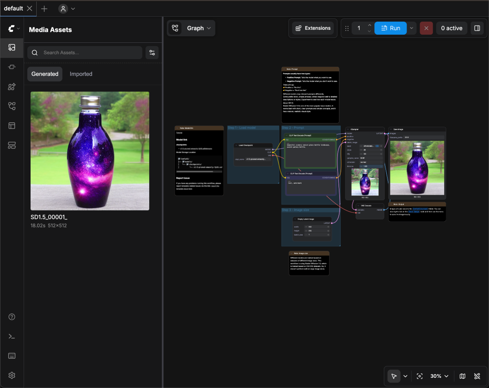
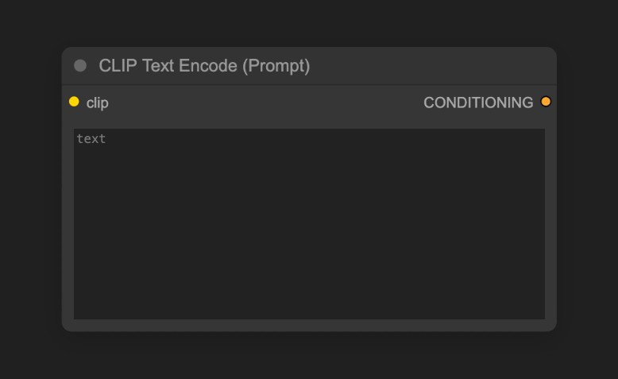
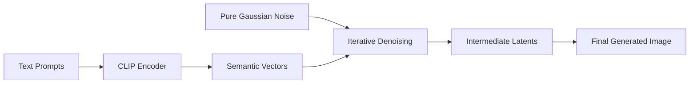
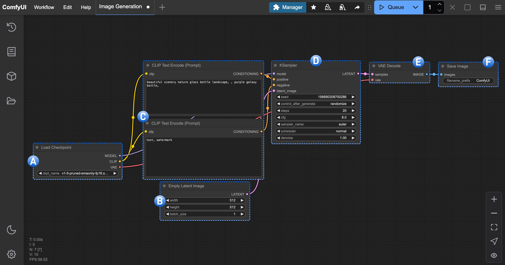
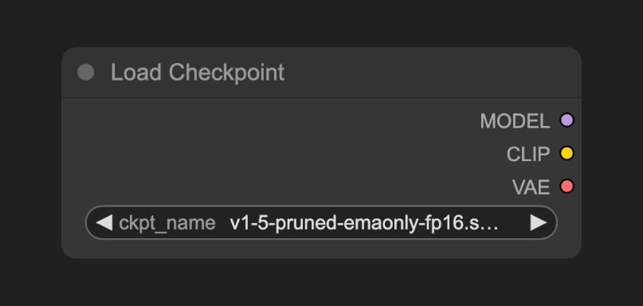
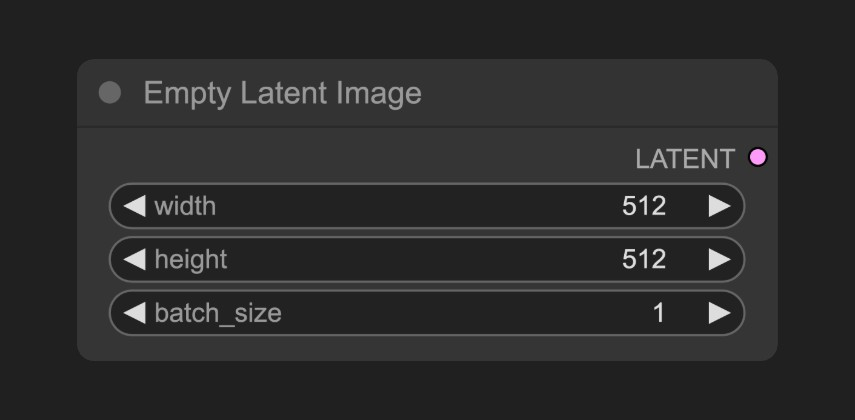
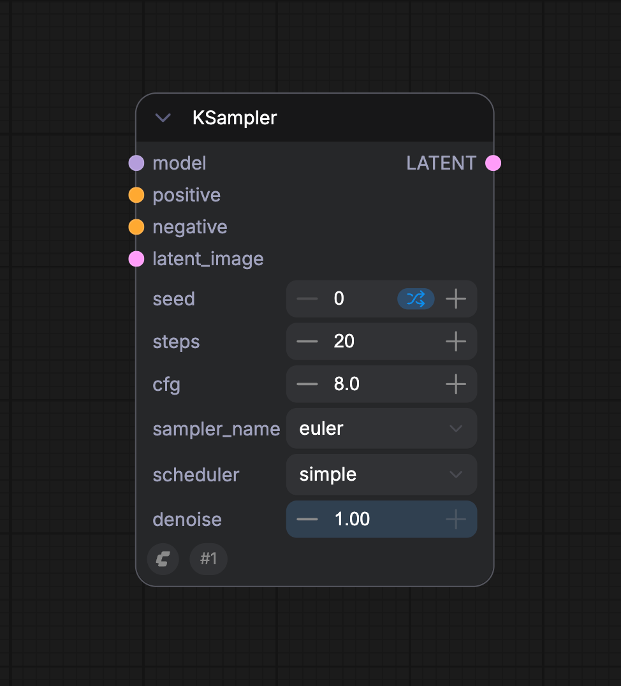
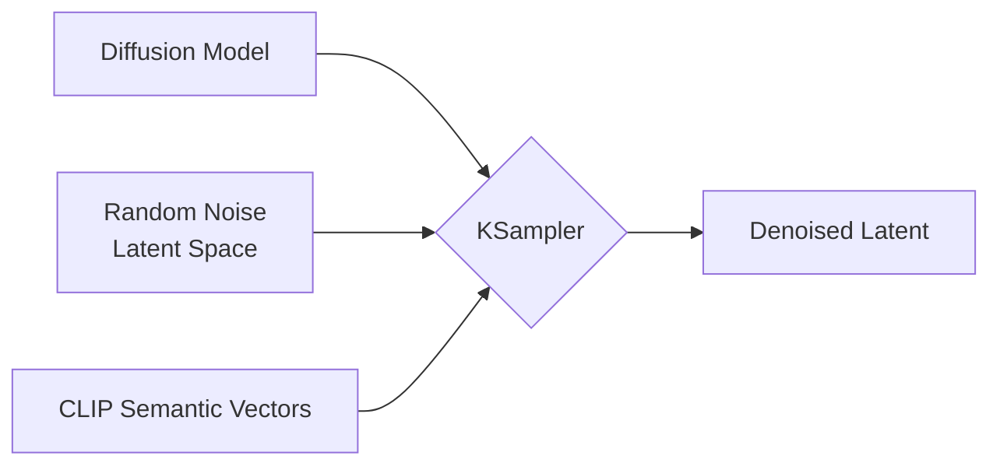
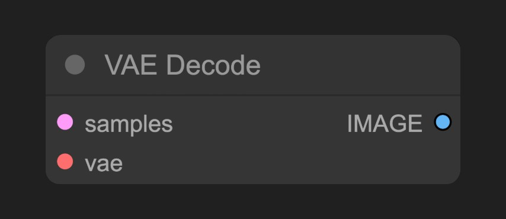
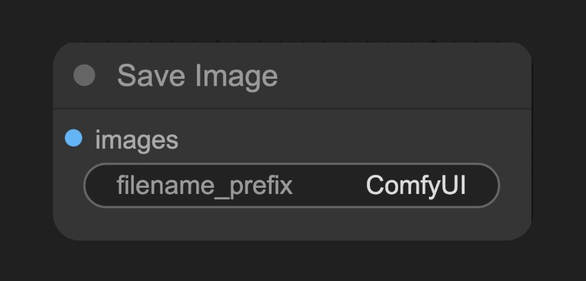

Dieser Leitfaden soll Sie in den Text-zu-Bild-Workflow von ComfyUI einführen und Ihnen helfen, die Funktionsweise und Nutzung verschiedener ComfyUI-Nodes zu verstehen.

In diesem Dokument werden wir:
- Einen Text-zu-Bild-Workflow abschließen
- Ein grundlegendes Verständnis der Prinzipien von Diffusionsmodellen gewinnen
- Die Funktionen und Rollen der Workflow-Nodes kennenlernen
- Einen ersten Einblick in das SD1.5-Modell erhalten

Wir beginnen mit der Ausführung eines Text-zu-Bild-Workflows, gefolgt von Erläuterungen zu den zugehörigen Konzepten. Bitte wählen Sie die relevanten Abschnitte entsprechend Ihren Anforderungen aus.

## Was ist Text zu Bild in ComfyUI? {#about-text-to-image}

**Text zu Bild** ist ein grundlegender Prozess in der KI-Kunstgenerierung, der Bilder aus Textbeschreibungen erzeugt, mit **Diffusion-Modellen** im Kern.

Der Text-zu-Bild-Prozess erfordert die folgenden Elemente:
- **Künstler:** Das Bildgenerierungsmodell
- **Canvas:** Der Latent-Raum
- **Bildanforderungen (Prompts):** Einschließlich positiver Prompts (Elemente, die Sie im Bild haben möchten) und negativer Prompts (Elemente, die Sie nicht möchten)

Dieser Text-zu-Bild-Generierungsprozess lässt sich einfach so verstehen, dass Sie Ihre Anforderungen (positive und negative Prompts) einem **Künstler (dem Bildmodell)** mitteilen, der dann auf Grundlage dieser Anforderungen das erstellt, was Sie möchten.

## Beispiel-Workflow für Text zu Bild in ComfyUI

### 1. Vorbereitung

Stellen Sie sicher, dass sich mindestens eine SD1.5-Modelldatei in Ihrem Ordner `ComfyUI/models/checkpoints` befindet, zum Beispiel [v1-5-pruned-emaonly-fp16.safetensors](https://huggingface.co/Comfy-Org/stable-diffusion-v1-5-archive/blob/main/v1-5-pruned-emaonly-fp16.safetensors)

Wenn Sie das Modell noch nicht installiert haben, folgen Sie [Modell herunterladen](/de/get_started/first_generation#modell-herunterladen).

### 2. Text-zu-Bild-Workflow laden

Laden Sie das folgende Bild herunter und **ziehen Sie es in ComfyUI**, um den Workflow zu laden:


<Tip>
Bilder, deren Metadaten den Workflow-JSON enthalten, können direkt in ComfyUI gezogen oder über das Menü `Workflows` -> `Open (ctrl+o)` geöffnet werden.
</Tip>

### 3. Modell laden und das erste Bild erzeugen

Nachdem Sie das Bildmodell installiert haben, folgen Sie den Schritten im untenstehenden Bild, um das Modell zu laden und Ihr erstes Bild zu erzeugen


Gehen Sie nach den Nummern im Bild vor:
1. Wählen Sie im Node **Load Checkpoint** über die Pfeile oder per Klick in das Textfeld die Datei **v1-5-pruned-emaonly-fp16.safetensors** aus. Die Pfeile links und rechts dürfen nicht den Text **null** anzeigen
2. Klicken Sie auf die Schaltfläche `Queue` oder verwenden Sie die Tastenkombination `Ctrl + Enter`, um die Bildgenerierung zu starten

Nach Abschluss des Vorgangs sehen Sie das Ergebnis im Node **Save Image**. Ein Rechtsklick auf das Bild speichert es lokal



<Tip>
  Wenn Sie mit dem Ergebnis nicht zufrieden sind, führen Sie die Generierung mehrmals aus. Bei jedem Lauf verwendet **KSampler** anhand des Parameters `seed` einen anderen Zufallswert, sodass jedes Ergebnis anders ausfällt
</Tip>

### 4. Mit dem Experimentieren beginnen

Ändern Sie den Text im Node **CLIP Text Encoder**



Die Verbindung `Positive` zum KSampler-Node steht für positive Prompts, die Verbindung `Negative` für negative Prompts

Für das SD1.5-Modell gelten einige grundlegende Regeln für Prompts:
- Verwenden Sie nach Möglichkeit Englisch
- Trennen Sie Prompts mit englischen Kommas `,`
- Verwenden Sie kurze Wendungen statt langer Sätze
- Beschreiben Sie so konkret wie möglich
- Erhöhen Sie mit Ausdrücken wie `(golden hour:1.2)` das Gewicht einzelner Schlüsselwörter, damit sie wahrscheinlicher im Bild erscheinen. `1.2` ist das Gewicht, `golden hour` das Schlüsselwort
- Verbessern Sie die Qualität mit Schlüsselwörtern wie `masterpiece, best quality, 4k`

Hier sind einige Beispiel-Prompts, die Sie ausprobieren können. Sie können aber auch eigene Prompts verwenden:

**1. Anime-Stil**

Positive Prompts:
```
anime style, 1girl with long pink hair, cherry blossom background, studio ghibli aesthetic, soft lighting, intricate details

masterpiece, best quality, 4k
```

Negative Prompts:
```
low quality, blurry, deformed hands, extra fingers
```

**2. Realistischer Stil**

Positive Prompts:
```
(ultra realistic portrait:1.3), (elegant woman in crimson silk dress:1.2), 
full body, soft cinematic lighting, (golden hour:1.2), 
(fujifilm XT4:1.1), shallow depth of field, 
(skin texture details:1.3), (film grain:1.1), 
gentle wind flow, warm color grading, (perfect facial symmetry:1.3)
```

Negative Prompts:
```
(deformed, cartoon, anime, doll, plastic skin, overexposed, blurry, extra fingers)
```

**3. Stil eines bestimmten Künstlers**

Positive Prompts:
```
fantasy elf, detailed character, glowing magic, vibrant colors, long flowing hair, elegant armor, ethereal beauty, mystical forest, magical aura, high detail, soft lighting, fantasy portrait, Artgerm style
```

Negative Prompts:
```
blurry, low detail, cartoonish, unrealistic anatomy, out of focus, cluttered, flat lighting
```

## Wie funktioniert Text zu Bild? {#text-to-image-working-principles}

Der gesamte Text-zu-Bild-Prozess lässt sich als **umgekehrter Diffusionsprozess** verstehen. Die Datei [v1-5-pruned-emaonly-fp16.safetensors](https://huggingface.co/Comfy-Org/stable-diffusion-v1-5-archive/blob/main/v1-5-pruned-emaonly-fp16.safetensors), die wir heruntergeladen haben, ist ein vortrainiertes Modell, das **aus reinem Gauß-Rauschen ein Zielbild erzeugen** kann. Wir geben nur unsere Prompts ein, und das Modell erzeugt durch Entrauschen zufälligen Rauschens das gewünschte Bild.



Dafür sind zwei Konzepte wichtig:
1. **Latent-Raum:** Der Latent-Raum ist eine abstrakte Form der Datendarstellung in Diffusionsmodellen. Bilder vom Pixelraum in den Latent-Raum zu überführen, reduziert den Speicherbedarf, erleichtert das Training von Diffusionsmodellen und senkt die Komplexität des Entrauschens. Es ist vergleichbar mit Architekten, die mit Bauplänen (Latent-Raum) arbeiten, statt direkt am Gebäude (Pixelraum) zu entwerfen: Die Struktur bleibt erhalten, und Änderungen sind deutlich günstiger
2. **Pixelraum:** Der Pixelraum ist der Speicherort der Bilder und zugleich das fertige Bild, das wir sehen. Hier werden die Pixelwerte gespeichert.

Wenn Sie mehr über Diffusionsmodelle erfahren möchten, lesen Sie diese Papers:
- [Denoising Diffusion Probabilistic Models (DDPM)](https://arxiv.org/pdf/2006.11239)
- [Denoising Diffusion Implicit Models (DDIM)](https://arxiv.org/pdf/2010.02502)
- [High-Resolution Image Synthesis with Latent Diffusion Models](https://arxiv.org/pdf/2112.10752)

## ComfyUI Text-zu-Bild-Workflow: Erläuterung der Nodes



### A. Node Load Checkpoint



Dieser Node wird in der Regel verwendet, um das Bildgenerierungsmodell zu laden. Ein `checkpoint` enthält normalerweise drei Komponenten: `MODEL (UNet)`, `CLIP` und `VAE`

- `MODEL (UNet)`: Das UNet-Modell, das während des Diffusionsprozesses für die Rauschvorhersage und die Bildgenerierung verantwortlich ist
- `CLIP`: Der Textencoder, der unsere Text-Prompts in Vektoren umwandelt, die das Modell verstehen kann, da das Modell Text-Prompts nicht direkt verstehen kann
- `VAE`: Der Variational AutoEncoder, der Bilder zwischen Pixelraum und latentem Raum umwandelt, da Diffusionsmodelle im latenten Raum arbeiten, während unsere Bilder im Pixelraum vorliegen

### B. Node Empty Latent Image



Definiert einen latenten Raum, der an den KSampler-Node ausgegeben wird. Der Node Empty Latent Image erstellt einen **latenten Raum aus reinem Rauschen**

Sie können sich seine Funktion als Festlegung der Canvas-Größe vorstellen, die die Abmessungen unseres final generierten Bildes bestimmt

### C. Node CLIP Text Encoder


Wird verwendet, um Prompts zu kodieren, also Ihre Anforderungen an das Bild
- Die mit dem KSampler-Node verbundene Eingabe `Positive` der Konditionierung steht für positive Prompts (Elemente, die Sie im Bild haben möchten)
- Die mit dem KSampler-Node verbundene Eingabe `Negative` der Konditionierung steht für negative Prompts (Elemente, die Sie nicht im Bild haben möchten)

Die Prompts werden von der `CLIP`-Komponente aus dem Node `Load Checkpoint` in semantische Vektoren kodiert und als Konditionierungen an den KSampler-Node ausgegeben

### D. Node KSampler



Der **KSampler** ist das Kernstück des gesamten Workflows: Hier findet der gesamte Rausch-Denoising-Prozess statt, der am Ende ein latentes Bild ausgibt



Hier eine Erläuterung der Parameter des KSampler-Nodes:

| Parametername             | Beschreibung                        | Funktion                                                                                                    |
|----------------------------|------------------------------------|-------------------------------------------------------------------------------------------------------------|
| **model**                  | Diffusionsmodell, das zum Denoising verwendet wird | Bestimmt Stil und Qualität der generierten Bilder                                                        |
| **positive**               | Kodierung der positiven Prompt-Konditionierung | Führt die Generierung dazu, die angegebenen Elemente einzubeziehen                                                             |
| **negative**               | Kodierung der negativen Prompt-Konditionierung | Unterdrückt unerwünschte Inhalte                                                                                 |
| **latent_image**           | Latentes Bild, das entrauscht werden soll  | Dient als Eingabeträger für die Rauschinitialisierung                                                        |
| **seed**                   | Zufallsseed für die Rauscherzeugung   | Steuert die Zufälligkeit der Generierung                                                                              |
| **control_after_generate** | Seed-Steuerungsmodus nach der Generierung | Bestimmt das Muster der Seed-Variation bei der Batch-Generierung                                                       |
| **steps**                  | Anzahl der Denoising-Iterationen     | Mehr Schritte bedeuten feinere Details, aber längere Verarbeitungszeit                                                    |
| **cfg**                    | Skalierung der Classifier-free Guidance     | Steuert die Stärke der Prompt-Bindung (zu hoch führt zu Overfitting)                                         |
| **sampler_name**           | Name des Sampling-Algorithmus            | Bestimmt die mathematische Methode für den Denoising-Pfad                                                       |
| **scheduler**              | Typ des Schedulers                     | Steuert die Abklingrate des Rauschens und die Verteilung der Schrittgröße                                                          |
| **denoise**                | Stärkekoeffizient des Denoisings     | Steuert die Rauschstärke, die dem latenten Raum hinzugefügt wird; 0.0 behält die ursprünglichen Eingabemerkmale bei, 1.0 ist vollständiges Rauschen |

Im KSampler-Node verwendet der latente Raum `seed` als Initialisierungsparameter, um zufälliges Rauschen zu erzeugen, und die semantischen Vektoren `Positive` und `Negative` werden als Konditionierungen in das Diffusionsmodell eingegeben

Anschließend wird basierend auf der durch den Parameter `steps` angegebenen Anzahl von Denoising-Schritten entrauscht. Jeder Denoising-Schritt verwendet den durch den Parameter `denoise` angegebenen Stärkekoeffizienten des Denoisings, um den latenten Raum zu entrauschen und ein neues latentes Bild zu erzeugen

### E. Node VAE Decode



Wandelt das vom **KSampler** ausgegebene latente Bild in ein Bild im Pixelraum um

### F. Node Save Image



Zeigt das dekodierte Bild aus dem latenten Raum in der Vorschau an und speichert es im lokalen Ordner `ComfyUI/output`

## Einführung in das SD1.5-Modell

**SD1.5 (Stable Diffusion 1.5)** ist ein KI-Bildgenerierungsmodell, das von [Stability AI](https://stability.ai/) entwickelt wurde. Es ist die grundlegende Version der Stable-Diffusion-Reihe, trainiert auf Bildern mit einer Auflösung von **512×512**, wodurch es besonders gut darin ist, Bilder in dieser Auflösung zu erzeugen. Mit einer Größe von etwa 4 GB läuft es flüssig auf **Consumer-GPUs (z. B. 6 GB VRAM)**. Derzeit verfügt SD1.5 über ein reichhaltiges Ökosystem und unterstützt verschiedene Plugins (wie ControlNet, LoRA) sowie Optimierungswerkzeuge.
Als Meilensteinmodell der KI-Kunstgenerierung bleibt SD1.5 dank seiner Open-Source-Natur, seiner leichtgewichtigen Architektur und seines reichen Ökosystems die beste Wahl für den Einstieg. Obwohl neuere Versionen wie SDXL/SD3 veröffentlicht wurden, bleibt sein Wert für Consumer-Hardware unerreicht.

### Grundlegende Informationen
- **Veröffentlichungsdatum**: Oktober 2022
- **Kernarchitektur**: Basierend auf dem Latent Diffusion Model (LDM)
- **Trainingsdaten**: LAION-Aesthetics v2.5-Datensatz (etwa 590 Mio. Trainingsschritte)
- **Open-Source-Merkmale**: Vollständig offenes Modell, offener Code und offene Trainingsdaten

### Vorteile und Grenzen
Vorteile des Modells:
- Leichtgewichtig: Kleine Größe, nur etwa 4 GB, läuft flüssig auf Consumer-GPUs
- Niedrige Einstiegshürde: Unterstützt eine breite Palette an Plugins und Optimierungswerkzeugen
- Ausgereiftes Ökosystem: Umfangreicher Support für Plugins und Werkzeuge
- Schnelle Generierung: Flüssiger Betrieb auf Consumer-GPUs

Grenzen des Modells:
- Detailverarbeitung: Hände und komplexe Beleuchtung neigen zu Verzerrungen
- Auflösungsgrenzen: Die Qualität nimmt bei direkter Generierung in 1024x1024 ab
- Prompt-Abhängigkeit: Erfordert präzise englische Beschreibungen zur Steuerung
