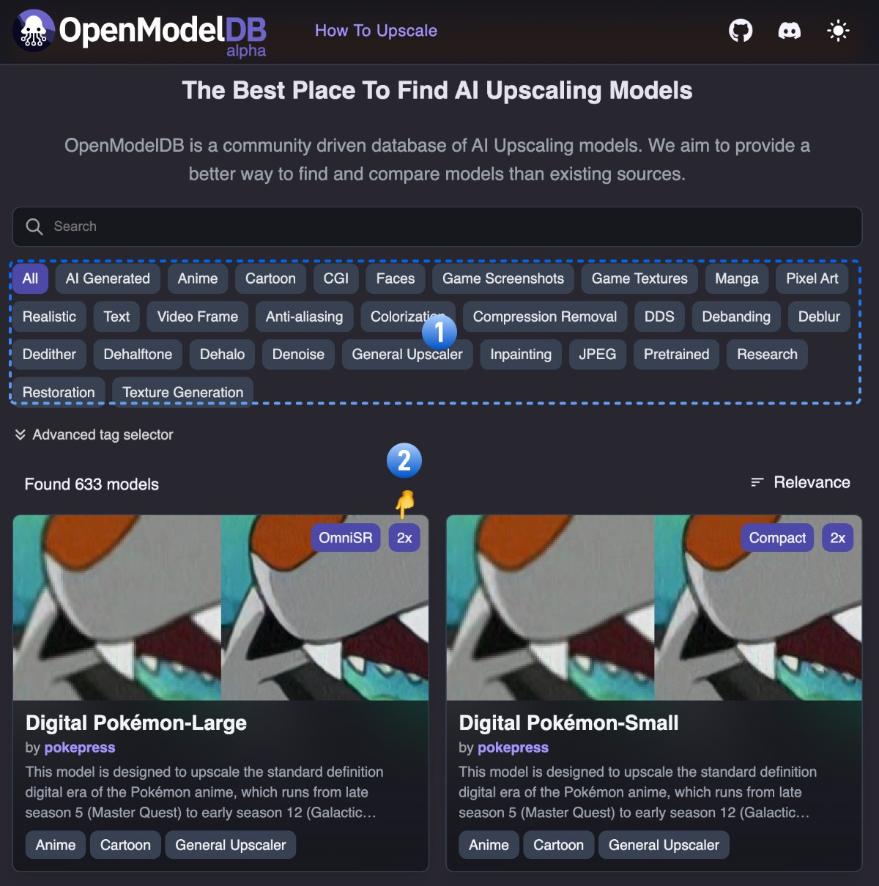
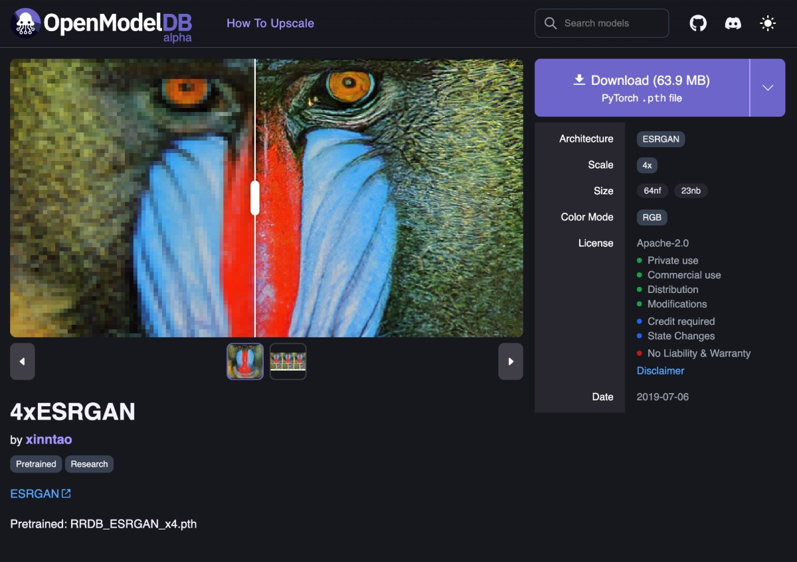
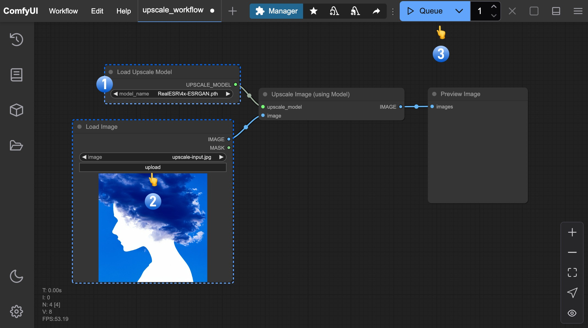
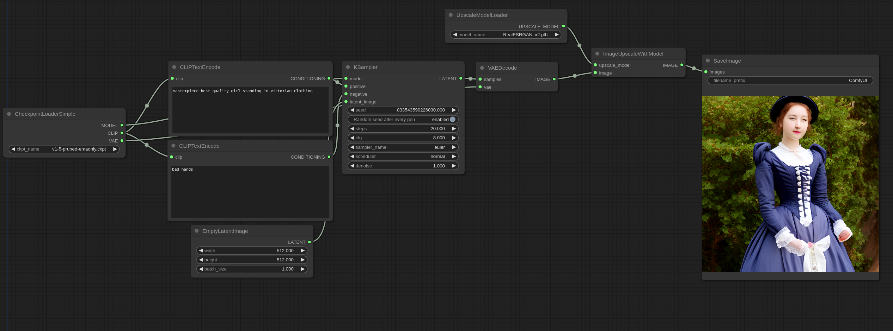

## Was ist Bild-Upscaling?

Bild-Upscaling ist der Prozess, bei dem niedrig aufgelöste Bilder mithilfe von Algorithmen in hochauflösende Bilder umgewandelt werden.
Anders als traditionelle Interpolationsmethoden können KI-Upscaling-Modelle (wie ESRGAN) Details intelligent rekonstruieren und dabei die Bildqualität erhalten.

Das Standardmodell SD1.5 hat beispielsweise oft Schwierigkeiten mit der Generierung großer Bilder.
Um hochauflösende Ergebnisse zu erzielen, generieren wir in der Regel zunächst kleinere Bilder und setzen dann Upscaling-Techniken ein.

Dieser Artikel behandelt eine von vielen Upscaling-Methoden in ComfyUI. In diesem Tutorial führen wir Sie durch:
1. Herunterladen und Installieren von Upscaling-Modellen
2. Durchführen eines einfachen Bild-Upscalings
3. Kombinieren von Text-zu-Bild-Workflows mit Upscaling

<Note>
Suchen Sie nach erweiterten Upscaling-Optionen? Sehen Sie sich unseren umfassenden [Bild-Upscaling-Leitfaden](/de/tutorials/utility/image-upscale) an, der verschiedene Modelle und Anwendungsfälle behandelt, darunter Porträtverbesserung, Produktfotografie und mehr.
</Note>

## Upscaling-Workflow

### Modellinstallation

Laden Sie die erforderlichen ESRGAN-Modelle herunter:
<Steps>
<Step title="OpenModelDB besuchen">
Besuchen Sie [OpenModelDB](https://openmodeldb.info/), um nach Upscaling-Modellen zu suchen und diese herunterzuladen (z. B. RealESRGAN).

Wie in der Abbildung zu sehen:
1. Filtern Sie Modelle nach Bildtyp mit der Kategorieauswahl.
2. Der Vergrößerungsfaktor des Modells wird oben rechts angezeigt (z. B. 2x im Screenshot).

Für dieses Tutorial verwenden wir das Modell [4x-ESRGAN](https://openmodeldb.info/models/4x-ESRGAN). Klicken Sie auf der Modell-Detailseite auf die Schaltfläche `Download`.

</Step>
<Step title="Modelldateien im Verzeichnis speichern">
Speichern Sie die Modelldatei (.pth) im Verzeichnis `ComfyUI/models/upscale_models`.
</Step>
</Steps>

### Workflow und Assets

Laden Sie das folgende Bild herunter und ziehen Sie es in ComfyUI, um den grundlegenden Upscaling-Workflow zu laden:

<Tip>
Bilder, deren Metadaten Workflow-JSON enthalten, können direkt in ComfyUI gezogen oder über das Menü `Workflows` -> `Open (ctrl+o)` geladen werden.
</Tip>

Verwenden Sie dieses Bild in kleinerer Größe als Eingabe:

### Workflow Schritt für Schritt abschließen

Befolgen Sie die Schritte im folgenden Diagramm, damit der Workflow korrekt ausgeführt wird.

1. Stellen Sie sicher, dass `Load Upscale Model` `4x-ESRGAN.pth` lädt.
2. Laden Sie das Eingabebild in den Node `Load Image` hoch.
3. Klicken Sie auf die Schaltfläche `Queue` oder verwenden Sie die Tastenkombination `Ctrl(cmd) + Enter`, um das Bild zu generieren.

Die Kernkomponenten sind die Nodes `Load Upscale Model` und `Upscale Image (Using Model)`. Sie empfangen eine Bildeingabe und skalieren diese mit dem ausgewählten Modell hoch.

## Kombinierter Text-zu-Bild-Workflow

Nachdem Sie das grundlegende Upscaling beherrschen, können Sie es mit dem [Text-zu-Bild](/de/tutorials/basic/text-to-image)-Workflow kombinieren. Die Grundlagen zu Text zu Bild finden Sie im [Text-zu-Bild-Tutorial](/de/tutorials/basic/text-to-image).

Laden Sie dieses Bild herunter und ziehen Sie es in ComfyUI, um den kombinierten Workflow zu laden:

Dieser Workflow verbindet das Ausgabebild des Text-zu-Bild-Workflows direkt mit den Upscaling-Nodes für die abschließende Verarbeitung.

## Zusätzliche Tipps

<Tip>
Modelleigenschaften:
- **RealESRGAN**: Allzweck-Upscaling
- **BSRGAN**: Stark bei Text und scharfen Kanten
- **SwinIR**: Bewahrt natürliche Texturen, ideal für Landschaften
</Tip>

1. **Verkettetes Upscaling**: Kombinieren Sie mehrere Upscale-Nodes (z. B. 2x → 4x) für eine besonders hohe Vergrößerung
2. **Hybrider Workflow**: Verbinden Sie Upscale-Nodes nach der Generierung zu „Generieren + Verbessern“-Pipelines
3. **Vergleichende Tests**: Unterschiedliche Modelle erzielen bei bestimmten Bildtypen bessere Ergebnisse. Testen Sie mehrere Optionen
