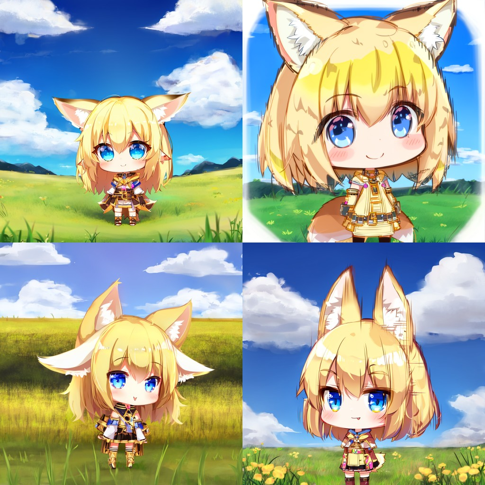
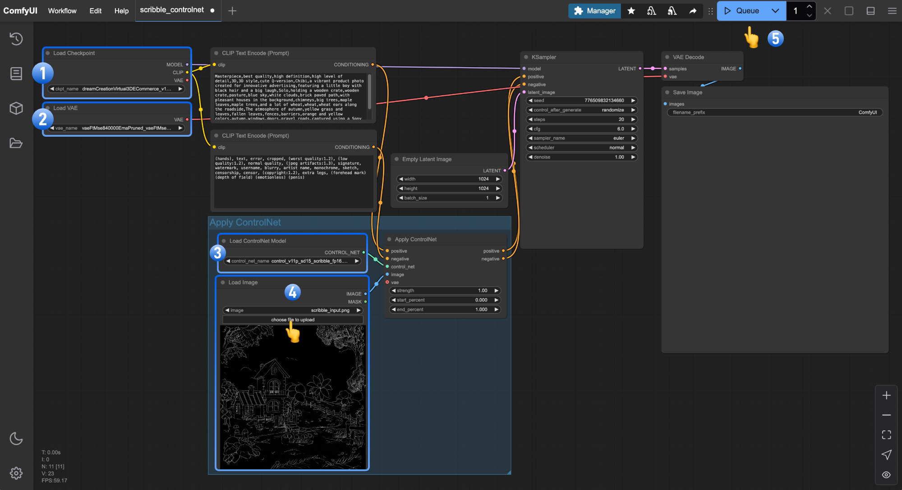
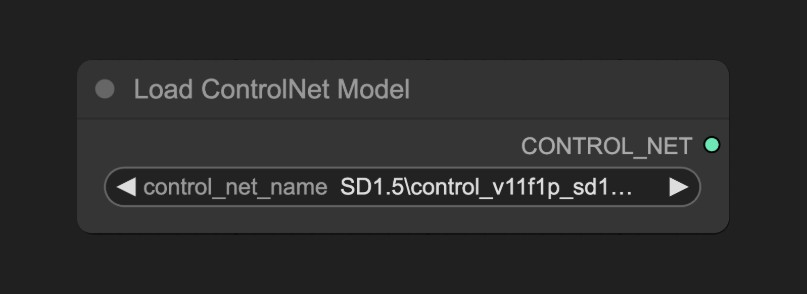
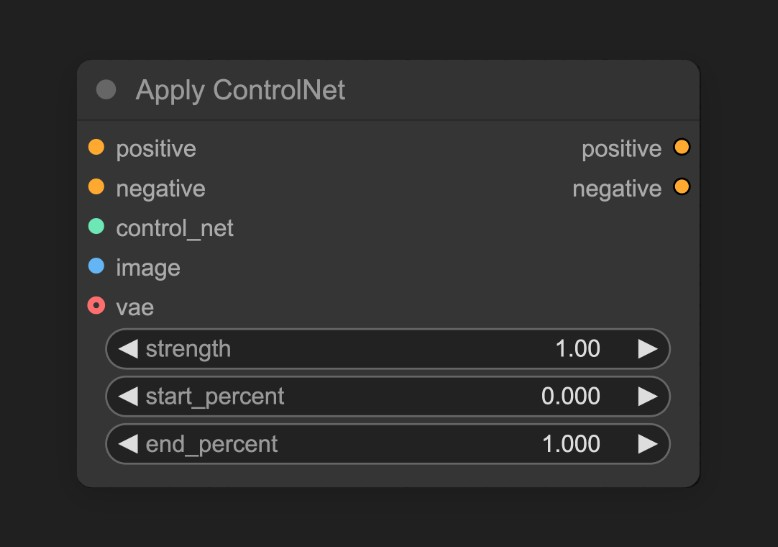
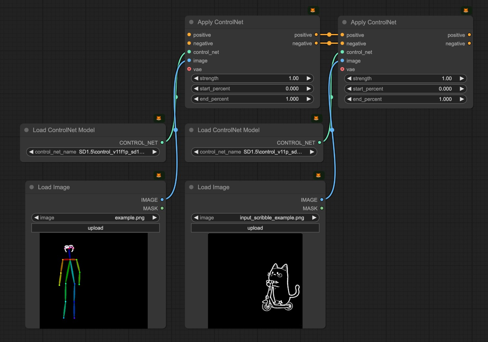
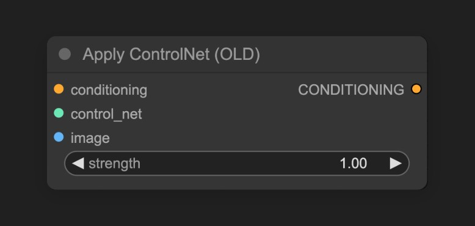

Präzise Kontrolle über die Bilderzeugung lässt sich in der KI-Bildgenerierung nicht mit einem einzigen Klick erreichen.
In der Regel sind zahlreiche Generierungsversuche nötig, um ein zufriedenstellendes Bild zu erhalten. Das Aufkommen von **ControlNet** hat diese Herausforderung jedoch wirkungsvoll gelöst.

ControlNet ist ein Modell zur bedingten Steuerungsgenerierung auf Basis von Diffusionsmodellen (wie Stable Diffusion),
das [Lvmin Zhang](https://github.com/lllyasviel) und Maneesh Agrawala et al. erstmals 2023 in dem Paper [Adding Conditional Control to Text-to-Image Diffusion Models](https://arxiv.org/abs/2302.05543) vorgestellt haben.

ControlNet-Modelle verbessern die Steuerbarkeit der Bildgenerierung und die Fähigkeit, Details zu reproduzieren, erheblich, indem sie multimodale Eingabebedingungen einführen,
etwa Kantenerkennungskarten, Tiefenkarten und Pose-Keypoints.

Diese Konditionierungsvorgaben machen die Bildgenerierung besser steuerbar, sodass während des Zeichnens mehrere ControlNet-Modelle gleichzeitig verwendet werden können, um bessere Ergebnisse zu erzielen.

Vor ControlNet konnten wir uns nur darauf verlassen, dass das Modell immer wieder Bilder generiert, bis wir mit den Ergebnissen zufrieden waren, was mit viel Zufall verbunden war.



Mit dem Aufkommen von ControlNet können wir die Bildgenerierung durch zusätzliche Bedingungen steuern.
Beispielsweise können wir eine einfache Skizze verwenden, um den Bildgenerierungsprozess zu lenken und Bilder zu erzeugen, die unserer Skizze weitgehend entsprechen.


In diesem Beispiel führen wir Sie durch die Installation und Verwendung von ControlNet-Modellen in [ComfyUI](https://github.com/Comfy-Org/ComfyUI) und schließen ein Beispiel zur skizzengesteuerten Bildgenerierung ab.


<Tip>
Die Workflows für andere Typen von ControlNet V1.1-Modellen ähneln diesem Beispiel. Sie müssen je nach Bedarf lediglich das passende Modell auswählen und das entsprechende Referenzbild hochladen.
</Tip>

## Informationen zur Bildvorverarbeitung für ControlNet

Verschiedene Arten von ControlNet-Modellen erfordern in der Regel unterschiedliche Arten von Referenzbildern:


> Bildquelle: [ComfyUI ControlNet aux](https://github.com/Fannovel16/comfyui_controlnet_aux)

Da die aktuellen **Comfy Core**-Nodes nicht alle Arten von **Vorverarbeitung** abdecken, stellen wir in den konkreten Beispielen dieser Dokumentation vorverarbeitete Bilder bereit.
In der Praxis müssen Sie jedoch möglicherweise Custom Nodes verwenden, um Bilder vorzuverarbeiten, damit sie den Anforderungen verschiedener ControlNet-Modelle entsprechen. Nachfolgend finden Sie einige relevante Custom Nodes:

- [ComfyUI-Advanced-ControlNet](https://github.com/Kosinkadink/ComfyUI-Advanced-ControlNet)
- [ComfyUI ControlNet aux](https://github.com/Fannovel16/comfyui_controlnet_aux)

## Erläuterung des ControlNet-Workflow-Beispiels für ComfyUI

### 1. Ressourcen für den ControlNet-Workflow

Bitte laden Sie das unten stehende Workflow-Bild herunter und ziehen Sie es in ComfyUI, um den Workflow zu laden:


<Tip>
Bilder mit Workflow-JSON in ihren Metadaten können direkt in ComfyUI gezogen oder über das Menü `Workflows` -> `Open (ctrl+o)` geladen werden.
Dieses Bild enthält bereits Download-Links für die entsprechenden Modelle. Beim Ziehen in ComfyUI werden die Downloads automatisch angeboten.
</Tip>

Bitte laden Sie das unten stehende Bild herunter, das wir als Eingabe verwenden:


### 2. Modelle manuell installieren

<Note>
Wenn Ihr Netzwerk den automatischen Download der entsprechenden Modelle nicht erfolgreich abschließen kann, versuchen Sie bitte, die unten stehenden Modelle manuell herunterzuladen und sie in den angegebenen Verzeichnissen abzulegen:
</Note>

- [dreamCreationVirtual3DECommerce_v10.safetensors](https://civitai.com/api/download/models/731340?type=Model&format=SafeTensor&size=full&fp=fp16)
- [vae-ft-mse-840000-ema-pruned.safetensors](https://huggingface.co/stabilityai/sd-vae-ft-mse-original/blob/main/vae-ft-mse-840000-ema-pruned.safetensors?download=true)
- [control_v11p_sd15_scribble_fp16.safetensors](https://huggingface.co/comfyanonymous/ControlNet-v1-1_fp16_safetensors/blob/main/control_v11p_sd15_scribble_fp16.safetensors?download=true)

```
ComfyUI/
├── models/
│   ├── checkpoints/
│   │   └── dreamCreationVirtual3DECommerce_v10.safetensors
│   ├── vae/
│   │   └── vae-ft-mse-840000-ema-pruned.safetensors
│   └── controlnet/
│       └── control_v11p_sd15_scribble_fp16.safetensors
```

<Note>
In diesem Beispiel könnten Sie auch das in dreamCreationVirtual3DECommerce_v10.safetensors eingebettete VAE-Modell verwenden, wir folgen jedoch der Empfehlung des Modellautors, ein separates VAE-Modell zu verwenden.
</Note>

### 3. Workflow Schritt für Schritt ausführen



1. Stellen Sie sicher, dass `Load Checkpoint` **dreamCreationVirtual3DECommerce_v10.safetensors** laden kann
2. Stellen Sie sicher, dass `Load VAE` **vae-ft-mse-840000-ema-pruned.safetensors** laden kann
3. Klicken Sie im Node `Load Image` auf `Upload`, um das zuvor bereitgestellte Eingabebild hochzuladen
4. Stellen Sie sicher, dass `Load ControlNet` **control_v11p_sd15_scribble_fp16.safetensors** laden kann
5. Klicken Sie auf die Schaltfläche `Queue` oder verwenden Sie die Tastenkombination `Ctrl(cmd) + Enter`, um die Bildgenerierung auszuführen

## Erläuterungen zugehöriger Nodes

### Erläuterung zu Load ControlNet



Modelle, die sich in `ComfyUI\models\controlnet` befinden, werden von ComfyUI erkannt und können über diesen Node geladen werden.

### Erläuterung zu Apply ControlNet



Dieser Node nimmt das von `load controlnet` geladene ControlNet-Modell entgegen und erzeugt auf Basis des Eingabebilds die entsprechenden Steuerungs-Konditionierungen.

**Eingabetypen**

| Parametername | Funktion |
|-----------------|--------------------------------------------------------------------------------------------------------------------------------------------|
| `positive`      | Positive Konditionierung |
| `negative`      | Negative Konditionierung |
| `control_net`   | Das anzuwendende ControlNet-Modell |
| `image`         | Vorverarbeitetes Bild, das als Referenz für die ControlNet-Anwendung dient |
| `vae`           | Eingabe des VAE-Modells |
| `strength`      | Stärke der ControlNet-Anwendung; höhere Werte erhöhen den Einfluss des ControlNet auf das generierte Bild |
| `start_percent` | Legt in Prozent fest, wann die Anwendung des ControlNet beginnt; z. B. bedeutet 0.2, dass die ControlNet-Guidance beginnt, wenn 20% der Diffusion abgeschlossen sind |
| `end_percent`   | Legt in Prozent fest, wann die Anwendung des ControlNet endet; z. B. bedeutet 0.8, dass die ControlNet-Guidance endet, wenn 80% der Diffusion abgeschlossen sind |

**Ausgabetypen**

| Parametername | Funktion |
|----------------|----------------------------------------------------|
| `positive`     | Von ControlNet verarbeitete positive Konditionierungsdaten |
| `negative`     | Von ControlNet verarbeitete negative Konditionierungsdaten |

Sie können mehrere ControlNet-Modelle über verkettete Verbindungen anwenden, wie im folgenden Bild gezeigt. Mehr zum Kombinieren mehrerer ControlNet-Modelle erfahren Sie im Leitfaden [ControlNet-Modelle mischen](/de/tutorials/controlnet/mixing-controlnets).


<Note>
In einigen frühen Workflows kann Ihnen der Node `Apply ControlNet(Old)` begegnen; er ist eine frühe Version des ControlNet-Nodes. Er ist inzwischen veraltet und wird standardmäßig nicht in der Suche und in den Node-Listen angezeigt.

Um ihn zu aktivieren, gehen Sie zu **Einstellungen** --> **comfy** --> **Node** und aktivieren Sie die Option `Show deprecated nodes in search`. Es wird jedoch empfohlen, den neuen Node zu verwenden.
</Note>

## ControlNet erkunden

1. Erstellen Sie ähnliche Skizzen oder zeichnen Sie sogar eigene und nutzen Sie ControlNet-Modelle, um Bilder zu generieren und die Vorteile von ControlNet kennenzulernen.
2. Passen Sie den Parameter `Control Strength` im Node Apply ControlNet an, um den Einfluss des ControlNet-Modells auf das generierte Bild zu steuern.
3. Besuchen Sie das Repository [ControlNet-v1-1_fp16_safetensors](https://huggingface.co/comfyanonymous/ControlNet-v1-1_fp16_safetensors/tree/main), um weitere ControlNet-Modelle herunterzuladen und damit Bilder zu generieren.
