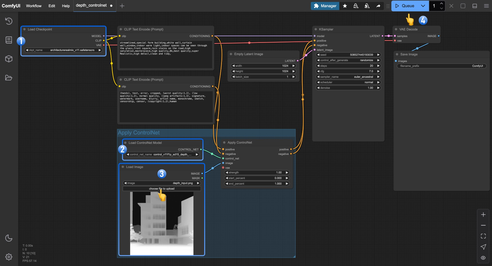

## Einführung in Tiefenkarten und Depth ControlNet

Eine Tiefenkarte ist eine besondere Art von Bild, bei der Graustufenwerte den Abstand zwischen Objekten in einer Szene und dem Beobachter oder der Kamera darstellen. In einer Tiefenkarte ist der Graustufenwert umgekehrt proportional zur Entfernung: Hellere Bereiche (näher an Weiß) zeigen Objekte an, die näher liegen, während dunklere Bereiche (näher an Schwarz) Objekte anzeigen, die weiter entfernt sind.


Depth ControlNet ist ein ControlNet-Modell, das speziell darauf trainiert wurde, Informationen aus Tiefenkarten zu verstehen und zu nutzen. Es hilft der KI, räumliche Beziehungen korrekt zu interpretieren, und stellt sicher, dass generierte Bilder der durch die Tiefenkarte vorgegebenen räumlichen Struktur entsprechen. Dadurch ist eine präzise Kontrolle über dreidimensionale räumliche Anordnungen möglich.

### Anwendungsszenarien für Tiefenkarten mit ControlNet

Tiefenkarten werden in zahlreichen Szenarien eingesetzt:

1. **Porträtszenen**: Die räumlichen Beziehungen zwischen Motiven und Hintergründen steuern, um Verzerrungen in kritischen Bereichen wie Gesichtern zu vermeiden
2. **Landschaftsszenen**: Die Hierarchie zwischen Vordergrund, Mittelgrund und Hintergrund steuern
3. **Architekturszenen**: Die räumliche Struktur und die perspektivischen Beziehungen von Gebäuden steuern
4. **Produktpräsentation**: Die Abgrenzung und räumliche Positionierung von Produkten gegenüber ihren Hintergründen steuern

In diesem Beispiel verwenden Sie eine Tiefenkarte, um eine architektonische Visualisierungsszene zu generieren.

## Beispiel-Workflow für ControlNet in ComfyUI

### 1. Dateien für den ControlNet-Workflow

Laden Sie das untenstehende Workflow-Bild herunter und ziehen Sie es in ComfyUI, um den Workflow zu laden:


<Tip>
Bilder mit Workflow-JSON in ihren Metadaten können direkt in ComfyUI gezogen oder über das Menü `Workflows` -> `Open (ctrl+o)` geladen werden.
Dieses Bild enthält bereits Download-Links für die zugehörigen Modelle. Wenn Sie es in ComfyUI ziehen, werden die Downloads automatisch angefragt.
</Tip>

Laden Sie das untenstehende Bild herunter, das wir als Eingabe verwenden:


### 2. Modelle installieren

<Note>
Falls Ihr Netzwerk den automatischen Download der entsprechenden Modelle nicht erfolgreich abschließen kann, versuchen Sie bitte, die untenstehenden Modelle manuell herunterzuladen und in die angegebenen Verzeichnisse zu legen:
</Note>

- [architecturerealmix_v11.safetensors](https://civitai.com/api/download/models/431755?type=Model&format=SafeTensor&size=full&fp=fp16)
- [control_v11f1p_sd15_depth_fp16.safetensors](https://huggingface.co/comfyanonymous/ControlNet-v1-1_fp16_safetensors/blob/main/control_v11f1p_sd15_depth_fp16.safetensors?download=true)

```
ComfyUI/
├── models/
│   ├── checkpoints/
│   │   └── architecturerealmix_v11.safetensors
│   └── controlnet/
│       └── control_v11f1p_sd15_depth_fp16.safetensors
```

### 3. Schrittweise Ausführung des Workflows



1. Stellen Sie sicher, dass `Load Checkpoint` **architecturerealmix_v11.safetensors** laden kann
2. Stellen Sie sicher, dass `Load ControlNet` **control_v11f1p_sd15_depth_fp16.safetensors** laden kann
3. Klicken Sie im Node `Load Image` auf `Upload`, um das zuvor bereitgestellte Tiefenbild hochzuladen
4. Klicken Sie auf die Schaltfläche `Queue` oder verwenden Sie die Tastenkombination `Ctrl(cmd) + Enter`, um die Bilderzeugung auszuführen

## Tiefensteuerung mit anderen Techniken kombinieren

Je nach kreativem Bedarf können Sie Depth ControlNet mit anderen Arten von ControlNet kombinieren, um bessere Ergebnisse zu erzielen:

1. **Depth + Lineart**: Räumliche Beziehungen beibehalten und gleichzeitig Konturen verstärken, geeignet für Architektur, Produkte und Charakterdesign
2. **Depth + Pose**: Die Körperhaltung einer Figur steuern und gleichzeitig korrekte räumliche Beziehungen beibehalten, geeignet für Charakterszenen

Weitere Informationen zur gemeinsamen Verwendung mehrerer ControlNet-Modelle finden Sie im Beispiel [Kombinieren von ControlNet-Modellen](/de/tutorials/controlnet/mixing-controlnets).
