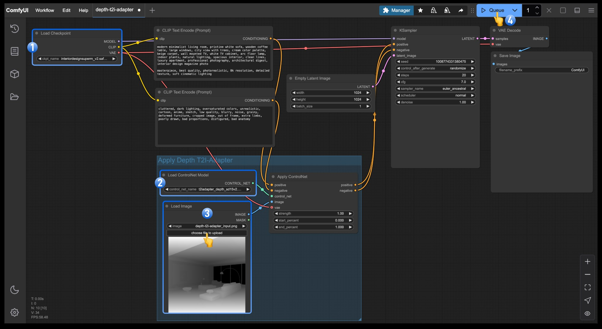

## Einführung in T2I Adapter

[T2I-Adapter](https://huggingface.co/TencentARC/T2I-Adapter) ist ein leichtgewichtiger Adapter, der von [Tencent ARC Lab](https://github.com/TencentARC) entwickelt wurde und die Möglichkeiten zur Steuerung von Struktur, Farbe und Stil bei Text-zu-Bild-Modellen (wie Stable Diffusion) erweitert.
Er funktioniert, indem externe Bedingungen (etwa Kantenerkennungskarten, Tiefenkarten, Skizzen oder Farbreferenzbilder) mit den internen Features des Modells abgeglichen werden, wodurch eine hochpräzise Steuerung ohne Änderung der ursprünglichen Modellstruktur erreicht wird. Mit nur etwa 77M Parametern (etwa 300MB groß) ist die Inferenzgeschwindigkeit rund dreimal so hoch wie bei [ControlNet](https://github.com/lllyasviel/ControlNet-v1-1-nightly), und er unterstützt die Kombination mehrerer Bedingungen (etwa Skizze + Farbraster). Zu den Anwendungsfällen gehören die Umwandlung von Line Art in Bilder, die Übertragung von Farbstilen, die Generierung von Szenen mit mehreren Elementen und vieles mehr.

### Vergleich zwischen T2I Adapter und ControlNet

Obwohl ihre Funktionen ähnlich sind, gibt es bemerkenswerte Unterschiede bei der Umsetzung und der Anwendung:

1. **Leichtgewichtiges Design**: T2I Adapter hat weniger Parameter und einen geringeren Speicherbedarf
2. **Inferenzgeschwindigkeit**: T2I Adapter ist in der Regel etwa dreimal so schnell wie ControlNet
3. **Steuerungspräzision**: ControlNet bietet in bestimmten Szenarien eine präzisere Steuerung, während T2I Adapter besser für eine leichtgewichtige Steuerung geeignet ist
4. **Kombination mehrerer Bedingungen**: T2I Adapter zeigt bei der Kombination mehrerer Bedingungen deutlich größere Ressourcenvorteile

### Wichtige Typen von T2I Adapter

T2I Adapter bietet verschiedene Typen zur Steuerung unterschiedlicher Aspekte:

- **Tiefe**: Steuert die räumliche Struktur und die Tiefenbeziehungen in Bildern
- **Line Art (Canny/Sketch)**: Steuert Bildkanten und Linien
- **Keypose**: Steuert Posen und Aktionen von Figuren
- **Segmentierung (Seg)**: Steuert das Szenenlayout durch semantische Segmentierung
- **Farbe**: Steuert das gesamte Farbschema von Bildern

In ComfyUI ist die Verwendung des T2I Adapter in Bezug auf Oberfläche und Workflow ähnlich wie bei [ControlNet](/de/tutorials/controlnet/controlnet). In diesem Beispiel zeigen wir Ihnen, wie Sie einen Tiefen-T2I-Adapter verwenden, um eine Innenraumszene zu steuern.


## Nutzen von Depth T2I Adapter-Anwendungen

Tiefenkarten haben mehrere wichtige Anwendungen in der Bilderzeugung:

1. **Räumliche Layoutsteuerung**: Beschreibt dreidimensionale Raumstrukturen präzise und eignet sich für Innenarchitektur und Architekturvisualisierung
2. **Objektpositionierung**: Steuert die relative Position und Größe von Objekten in einer Szene und eignet sich für Produktpräsentationen und den Szenenaufbau
3. **Perspektivische Beziehungen**: Hält eine plausible Perspektive und Proportionen aufrecht und eignet sich für die Generierung von Landschaften und urbanen Szenen
4. **Licht- und Schattenlayout**: Natürliche Licht- und Schattenverteilung auf Basis der Tiefeninformationen zur Steigerung des Realismus

Am Beispiel der Innenarchitektur zeigen wir, wie Sie den Depth T2I Adapter einsetzen. Diese Techniken lassen sich jedoch auch auf andere Szenarien übertragen.

## ComfyUI Depth T2I Adapter Workflow: Beispielerklärung

### 1. Ressourcen für den Depth T2I Adapter Workflow

Bitte laden Sie das untenstehende Workflow-Bild herunter und ziehen Sie es in ComfyUI, um den Workflow zu laden:


<Tip>
Bilder, deren Metadaten den Workflow-JSON enthalten, können direkt in ComfyUI gezogen oder über das Menü `Workflows` -> `Open (ctrl+o)` geladen werden.
Dieses Bild enthält bereits Download-Links für die zugehörigen Modelle. Wenn Sie es in ComfyUI ziehen, werden die Downloads automatisch angefragt.
</Tip>

Bitte laden Sie das untenstehende Bild herunter, das wir als Eingabe verwenden:


### 2. Modelle installieren

<Note>
Falls Ihr Netzwerk den automatischen Download der entsprechenden Modelle nicht erfolgreich abschließen kann, versuchen Sie bitte, die unten genannten Modelle manuell herunterzuladen und in die angegebenen Verzeichnisse zu legen:
</Note>

- [interiordesignsuperm_v2.safetensors](https://civitai.com/api/download/models/93152?type=Model&format=SafeTensor&size=full&fp=fp16)
- [t2iadapter_depth_sd15v2.pth](https://huggingface.co/TencentARC/T2I-Adapter/blob/main/models/t2iadapter_depth_sd15v2.pth?download=true)

```
ComfyUI/
├── models/
│   ├── checkpoints/
│   │   └── interiordesignsuperm_v2.safetensors
│   └── controlnet/
│       └── t2iadapter_depth_sd15v2.pth
```

### 3. Schrittweise Ausführung des Workflows



1. Stellen Sie sicher, dass `Load Checkpoint` **interiordesignsuperm_v2.safetensors** laden kann
2. Stellen Sie sicher, dass `Load ControlNet` **t2iadapter_depth_sd15v2.pth** laden kann
3. Klicken Sie im Node `Load Image` auf `Upload`, um das zuvor bereitgestellte Eingabebild hochzuladen
4. Klicken Sie auf die Schaltfläche `Queue` oder verwenden Sie die Tastenkombination `Ctrl(cmd) + Enter`, um die Bilderzeugung auszuführen

## Allgemeine Tipps zur Verwendung des T2I Adapter

### Optimierung der Qualität der Eingabebilder

Unabhängig vom Anwendungsfall sind hochwertige Eingabebilder entscheidend für die erfolgreiche Verwendung des T2I Adapter:

1. **Ausgewogener Kontrast**: Steuerungsbilder (etwa Tiefenkarten oder Line Art) sollten einen klaren Kontrast aufweisen, aber nicht übermäßig extrem sein
2. **Klare Grenzen**: Achten Sie darauf, dass wichtige Strukturen und Elementgrenzen im Steuerungsbild klar unterscheidbar sind
3. **Rauschkontrolle**: Vermeiden Sie möglichst starkes Rauschen in Steuerungsbildern, insbesondere bei Tiefenkarten und Line Art
4. **Sinnvolles Layout**: Steuerungsbilder sollten ein sinnvolles räumliches Layout und eine sinnvolle Verteilung der Elemente aufweisen

## Eigenschaften der Nutzung des T2I Adapter

Ein wesentlicher Vorteil des T2I Adapter ist die Möglichkeit, mehrere Bedingungen einfach zu kombinieren, um komplexe Steuerungseffekte zu erzielen:

1. **Tiefe + Kanten**: Räumliches Layout steuern und dabei klare strukturelle Kanten beibehalten, geeignet für Architektur und Innenarchitektur
2. **Line Art + Farbe**: Formen steuern und gleichzeitig Farbschemata festlegen, geeignet für Charakterdesign und Illustrationen
3. **Pose + Segmentierung**: Aktionen von Charakteren steuern und gleichzeitig Szenenbereiche definieren, geeignet für komplexe erzählerische Szenen

Das Mischen verschiedener T2I Adapter oder das Kombinieren mit anderen Steuerungsmethoden (etwa ControlNet, regionale Prompts usw.) kann die kreativen Möglichkeiten weiter erweitern. Um eine Mischung zu erreichen, verketten Sie einfach mehrere `Apply ControlNet`-Nodes auf die gleiche Weise, wie unter [ControlNet mischen](/de/tutorials/controlnet/mixing-controlnets) beschrieben.
