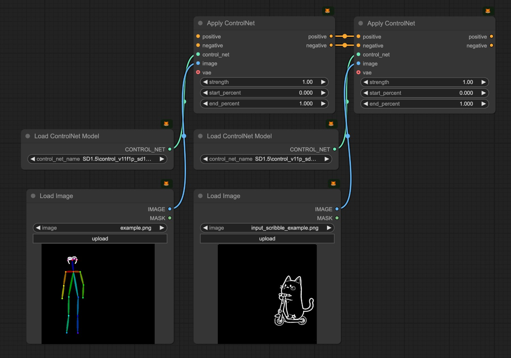
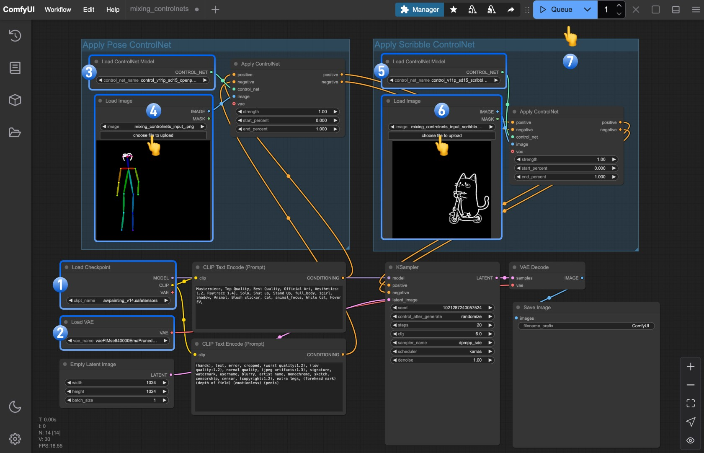

In der KI-Bildgenerierung reicht eine einzelne ControlNet-Bedingung oft nicht aus, um den Anforderungen komplexer Szenen gerecht zu werden. Durch das Mischen mehrerer ControlNets können Sie verschiedene Bereiche oder Aspekte eines Bildes gleichzeitig steuern und so eine präzisere Kontrolle über die Bildgenerierung erreichen.

In bestimmten Szenarien können Sie durch das Mischen von ControlNets die Eigenschaften verschiedener ControlNet-Bedingungen nutzen, um eine feinere bedingte Steuerung zu erreichen:
1. **Szenenkomplexität**: Komplexe Szenen erfordern das Zusammenspiel mehrerer ControlNet-Bedingungen.
2. **Feingranulare Steuerung**: Durch Anpassen des Stärke-Parameters jedes ControlNets können Sie den Einflussgrad für jeden Bereich präzise steuern.
3. **Komplementäre Effekte**: Verschiedene ControlNet-Typen können sich gegenseitig ergänzen und so die Einschränkungen einzelner Steuerungen ausgleichen.
4. **Kreativer Ausdruck**: Die Kombination verschiedener Steuerungen kann einzigartige kreative Effekte erzeugen.

### ControlNets mischen

Beim Mischen mehrerer ControlNets beeinflusst jedes ControlNet den Bildgenerierungsprozess entsprechend seinem angewendeten Bereich. ComfyUI ermöglicht es, mehrere ControlNet-Bedingungen über Kettenverbindungen im Node `Apply ControlNet` nacheinander schichtweise anzuwenden:



## ComfyUI ControlNet-Beispiel: Regionale Aufteilung und Mischung

In diesem Beispiel verwenden wir eine Kombination aus **Pose ControlNet** und **Scribble ControlNet**, um eine Szene mit mehreren Elementen zu generieren: links eine Figur, die vom Pose ControlNet gesteuert wird, und rechts eine Katze auf einem Roller, die vom Scribble ControlNet gesteuert wird.

### 1. Assets für den ControlNet-Mixing-Workflow

Bitte laden Sie das untenstehende Workflow-Bild herunter und ziehen Sie es in ComfyUI, um den Workflow zu laden:


<Tip>
Dieses Workflow-Bild enthält Metadaten und kann direkt in ComfyUI gezogen oder über das Menü `Workflows` -> `Open (ctrl+o)` geladen werden. Das System erkennt die erforderlichen Modelle automatisch und fordert Sie zum Herunterladen auf.
</Tip>

Eingabe-Pose-Bild (steuert die Pose der Figur links):


Eingabe-Scribble-Bild (steuert die Katze und den Roller rechts):


### 2. Modelle manuell installieren

<Note>
Wenn Ihr Netzwerk den automatischen Download der entsprechenden Modelle nicht erfolgreich abschließen kann, laden Sie die untenstehenden Modelle bitte manuell herunter und legen Sie sie in den angegebenen Verzeichnissen ab:
</Note>

- [awpainting_v14.safetensors](https://civitai.com/api/download/models/624939?type=Model&format=SafeTensor&size=full&fp=fp16)
- [control_v11p_sd15_scribble_fp16.safetensors](https://huggingface.co/comfyanonymous/ControlNet-v1-1_fp16_safetensors/blob/main/control_v11p_sd15_scribble_fp16.safetensors?download=true)
- [control_v11p_sd15_openpose_fp16.safetensors](https://huggingface.co/comfyanonymous/ControlNet-v1-1_fp16_safetensors/blob/main/control_v11p_sd15_openpose_fp16.safetensors?download=true)
- [vae-ft-mse-840000-ema-pruned.safetensors](https://huggingface.co/stabilityai/sd-vae-ft-mse-original/blob/main/vae-ft-mse-840000-ema-pruned.safetensors?download=true)

```
ComfyUI/
├── models/
│   ├── checkpoints/
│   │   └── awpainting_v14.safetensors
│   ├── controlnet/
│   │   └── control_v11p_sd15_scribble_fp16.safetensors
│   │   └── control_v11p_sd15_openpose_fp16.safetensors
│   ├── vae/
│   │   └── vae-ft-mse-840000-ema-pruned.safetensors
```

### 3. Workflow schrittweise ausführen



Folgen Sie den nummerierten Markierungen im Bild und führen Sie diese Schritte aus:

1. Stellen Sie sicher, dass `Load Checkpoint` **awpainting_v14.safetensors** laden kann
2. Stellen Sie sicher, dass `Load VAE` **vae-ft-mse-840000-ema-pruned.safetensors** laden kann

Erste ControlNet-Gruppe mit dem Openpose-Modell:
3. Stellen Sie sicher, dass `Load ControlNet Model` **control_v11p_sd15_openpose_fp16.safetensors** lädt
4. Klicken Sie im Node `Load Image` auf `Upload`, um das zuvor bereitgestellte Pose-Bild hochzuladen

Zweite ControlNet-Gruppe mit dem Scribble-Modell:
5. Stellen Sie sicher, dass `Load ControlNet Model` **control_v11p_sd15_scribble_fp16.safetensors** lädt
6. Klicken Sie im Node `Load Image` auf `Upload`, um das zuvor bereitgestellte Scribble-Bild hochzuladen
7. Klicken Sie auf die Schaltfläche `Queue` oder verwenden Sie die Tastenkombination `Ctrl(cmd) + Enter`, um die Bilderzeugung auszuführen

## Workflow-Erläuterung

#### Stärkeabgleich

Wenn Sie verschiedene Bereiche eines Bildes steuern, ist der Abgleich der Strength-Parameter besonders wichtig:
- Wenn die ControlNet-Stärke für einen Bereich deutlich höher ist als für einen anderen, kann die Steuerungswirkung dieses Bereichs die des anderen Bereichs überlagern und unterdrücken.
- Es wird empfohlen, für ControlNets, die verschiedene Bereiche steuern, ähnliche Strength-Werte festzulegen, zum Beispiel beide auf 1.0.

#### Prompt-Techniken

Für die Mischung mit regionaler Aufteilung muss der Prompt Beschreibungen beider Bereiche enthalten:

```
"A woman in red dress, a cat riding a scooter, detailed background, high quality"
```

Ein solcher Prompt deckt sowohl die Figur als auch die Katze auf dem Roller ab und stellt sicher, dass das Modell beide Steuerungsbereiche berücksichtigt.

## Mehrdimensionale Steuerungsanwendungen für ein einzelnes Motiv

Neben dem in diesem Beispiel gezeigten Mischen durch regionale Aufteilung ist ein weiterer gängiger Mischansatz, mehrdimensionale Steuerung auf dasselbe Motiv anzuwenden. Zum Beispiel:

- **Pose + Depth**: Körperhaltung und Raumgefühl der Figur steuern
- **Pose + Canny**: Körperhaltung und Kantendetails der Figur steuern
- **Pose + Reference**: Körperhaltung der Figur steuern und dabei einen bestimmten Stil als Referenz verwenden

Bei dieser Art von Anwendung sollten Referenzbilder für mehrere ControlNets auf dasselbe Motiv ausgerichtet werden, und ihre Stärken sollten angepasst werden, um eine angemessene Balance zu gewährleisten.

Durch die Kombination verschiedener Arten von ControlNets und die Angabe ihrer Steuerungsbereiche können Sie eine präzise Steuerung der Elemente in Ihrem Bild erreichen.
