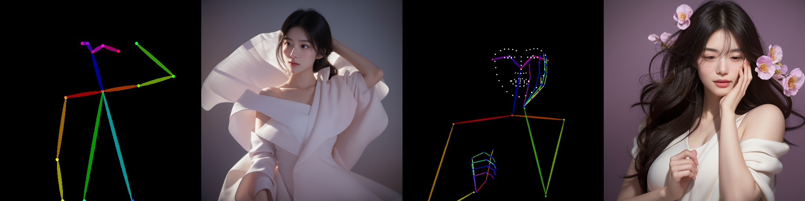
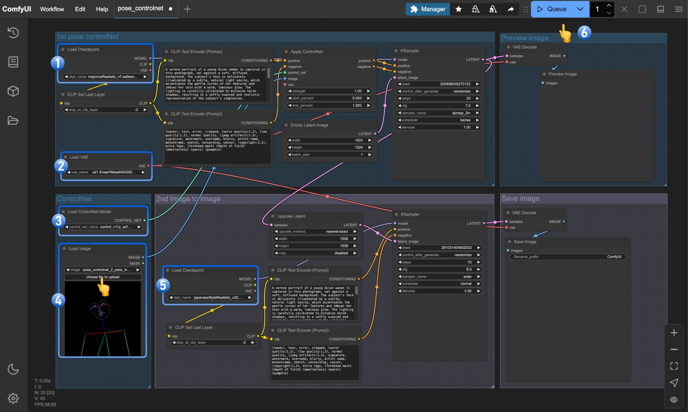

## Einführung in OpenPose

[OpenPose](https://github.com/CMU-Perceptual-Computing-Lab/openpose) ist ein von der Carnegie Mellon University (CMU) entwickeltes Open-Source-System zur Echtzeit-Posenschätzung mehrerer Personen und stellt einen bedeutenden Durchbruch im Bereich Computer Vision dar. Das System kann mehrere Personen in einem Bild gleichzeitig erkennen und dabei Folgendes erfassen:

- **Körperskelett**: 18 Keypoints, darunter Kopf, Schultern, Ellbogen, Handgelenke, Hüften, Knie und Knöchel
- **Gesichtsausdrücke**: 70 Keypoints im Gesicht zur Erfassung von Mikroausdrücken und Gesichtskonturen
- **Handdetails**: 21 Hand-Keypoints zur präzisen Darstellung von Fingerpositionen und Gesten
- **Fußhaltung**: 6 Fuß-Keypoints, die Standhaltungen und Bewegungsdetails festhalten



Bei der KI-Bildgenerierung dienen die von OpenPose erzeugten Skelettstruktur-Karten als konditionierende Eingänge für ControlNet und ermöglichen so eine präzise Steuerung von Haltung, Aktionen und Ausdrücken der generierten Figuren. Dadurch lassen sich realistische menschliche Figuren mit den erwarteten Posen und Aktionen generieren, was die Kontrollierbarkeit und den praktischen Nutzen KI-generierter Inhalte erheblich verbessert.
Insbesondere bei frühen Modellen der Stable Diffusion 1.5-Reihe können von OpenPose erzeugte Skelettkarten Probleme mit verzerrten Aktionen, Gliedmaßen und Gesichtsausdrücken von Figuren wirksam verhindern.

## ComfyUI-Nutzungsbeispiel: Pose-ControlNet mit zwei Durchgängen

### 1. Workflow-Dateien für Pose-ControlNet

Laden Sie das unten stehende Workflow-Bild herunter und ziehen Sie es in ComfyUI, um den Workflow zu laden:


<Tip>
Bilder, deren Metadaten den Workflow-JSON enthalten, können direkt in ComfyUI gezogen oder über das Menü `Workflows` -> `Open (ctrl+o)` geladen werden.
Dieses Bild enthält bereits Download-Links für die zugehörigen Modelle. Wenn Sie es in ComfyUI ziehen, werden die Downloads automatisch vorgeschlagen.
</Tip>

Laden Sie das unten stehende Bild herunter, das wir als Eingabe verwenden:


### 2. Modelle manuell installieren

<Note>
Falls Ihr Netzwerk den automatischen Download der entsprechenden Modelle nicht erfolgreich abschließen kann, laden Sie die unten stehenden Modelle manuell herunter und legen Sie sie in den angegebenen Verzeichnissen ab:
</Note>

- [control_v11p_sd15_openpose_fp16.safetensors](https://huggingface.co/comfyanonymous/ControlNet-v1-1_fp16_safetensors/blob/main/control_v11p_sd15_openpose_fp16.safetensors?download=true)
- [majicmixRealistic_v7.safetensors](https://civitai.com/api/download/models/176425?type=Model&format=SafeTensor&size=pruned&fp=fp16)
- [japaneseStyleRealistic_v20.safetensors](https://civitai.com/api/download/models/85426?type=Model&format=SafeTensor&size=pruned&fp=fp16)
- [vae-ft-mse-840000-ema-pruned.safetensors](https://huggingface.co/stabilityai/sd-vae-ft-mse-original/blob/main/vae-ft-mse-840000-ema-pruned.safetensors?download=true)

```
ComfyUI/
├── models/
│   ├── checkpoints/
│   │   └── majicmixRealistic_v7.safetensors
│   │   └── japaneseStyleRealistic_v20.safetensors
│   ├── vae/
│   │   └── vae-ft-mse-840000-ema-pruned.safetensors
│   └── controlnet/
│       └── control_v11p_sd15_openpose_fp16.safetensors
```

### 3. Workflow Schritt für Schritt ausführen



Folgen Sie den nummerierten Markierungen im Bild und führen Sie diese Schritte aus:

1. Stellen Sie sicher, dass `Load Checkpoint` **majicmixRealistic_v7.safetensors** laden kann
2. Stellen Sie sicher, dass `Load VAE` **vae-ft-mse-840000-ema-pruned.safetensors** laden kann
3. Stellen Sie sicher, dass `Load ControlNet Model` **control_v11p_sd15_openpose_fp16.safetensors** laden kann
4. Klicken Sie im Node `Load Image` auf den Auswahlbutton, um das zuvor bereitgestellte Pose-Eingabebild hochzuladen, oder verwenden Sie Ihre eigene OpenPose-Skelettkarte
5. Stellen Sie sicher, dass `Load Checkpoint` **japaneseStyleRealistic_v20.safetensors** laden kann
6. Klicken Sie auf die Schaltfläche `Queue` oder verwenden Sie die Tastenkombination `Ctrl(cmd) + Enter`, um die Bilderzeugung auszuführen

## Erklärung des zweistufigen Pose-ControlNet-Workflows

Dieser Workflow verwendet einen zweistufigen Ansatz zur Bildgenerierung und unterteilt den Bilderzeugungsprozess in zwei Phasen:

### Erste Phase: Grundlegende Generierung des Pose-Bildes

In der ersten Phase wird das Modell **majicmixRealistic_v7** mit Pose ControlNet kombiniert, um ein erstes Bild der Charakterpose zu generieren:

1. Zuerst laden Sie das Modell majicmixRealistic_v7 über den Node `Load Checkpoint`.
2. Laden Sie das Pose-Control-Modell über den Node `Load ControlNet Model`.
3. Das eingegebene Pose-Bild wird in den Node `Apply ControlNet` eingespeist und mit den Bedingungen für positive und negative Prompts kombiniert.
4. Der erste Node `KSampler` (typischerweise mit 20-30 Schritten) generiert ein grundlegendes Bild der Charakterpose.
5. Das Bild im Pixelraum für die erste Phase wird über `VAE Decode` gewonnen.

Diese Phase konzentriert sich hauptsächlich auf die korrekte Körperhaltung, die Pose und die Grundstruktur der Figur und stellt sicher, dass die generierte Figur der eingegebenen Skelettpose entspricht.

### Zweite Phase: Stiloptimierung und Detailverbesserung

In der zweiten Phase wird das Ausgabebild aus der ersten Phase als Referenz verwendet, wobei das Modell **japaneseStyleRealistic_v20** die Stilisierung und Detailverbesserung übernimmt:

1. Das in der ersten Phase generierte Bild erzeugt über den Node `Upscale latent` einen Latent-Raum mit größerer Auflösung.
2. Der zweite Node `Load Checkpoint` lädt das Modell japaneseStyleRealistic_v20, das auf Details und Stil ausgerichtet ist.
3. Der zweite Node `KSampler` verwendet eine niedrigere `denoise`-Stärke (typischerweise 0.4-0.6) zur Verfeinerung und bewahrt die Grundstruktur aus der ersten Phase.
4. Schließlich wird über den zweiten Node `VAE Decode` und den Node `Save Image` ein Bild mit höherer Qualität und größerer Auflösung ausgegeben.

Diese Phase konzentriert sich hauptsächlich auf Stilkonsistenz, Detailreichtum und die Verbesserung der gesamten Bildqualität.

## Vorteile der zweistufigen Bildgenerierung

Im Vergleich zur einstufigen Generierung bietet die zweistufige Bildgenerierungsmethode die folgenden Vorteile:

1. **Höhere Auflösung**: Die zweistufige Verarbeitung kann hochauflösende Bilder erzeugen, die über die Möglichkeiten der einstufigen Generierung hinausgehen.
2. **Stilmischung**: Kann die Vorteile verschiedener Modelle kombinieren, beispielsweise ein realistisches Modell in der ersten Phase und ein stilisiertes Modell in der zweiten Phase.
3. **Bessere Details**: Die zweite Phase kann sich auf die Optimierung der Details konzentrieren, ohne sich um die Gesamtstruktur kümmern zu müssen.
4. **Präzise Kontrolle**: Nachdem die Pose-Steuerung in der ersten Phase abgeschlossen ist, kann sich die zweite Phase auf die Verfeinerung von Stil und Details konzentrieren.
5. **Reduzierte GPU-Last**: Die Generierung in zwei Durchgängen ermöglicht hochwertige große Bilder mit begrenzten GPU-Ressourcen.

<Tip>
Mehr erfahren zur Technik des Mischens mehrerer ControlNets finden Sie im Tutorial [ControlNet-Modelle mischen](/de/tutorials/controlnet/mixing-controlnets).
</Tip>
