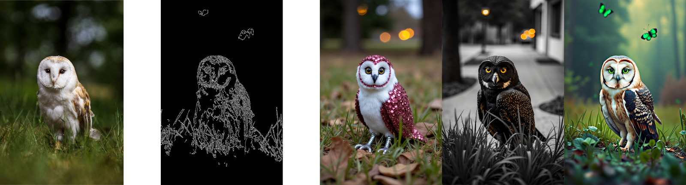
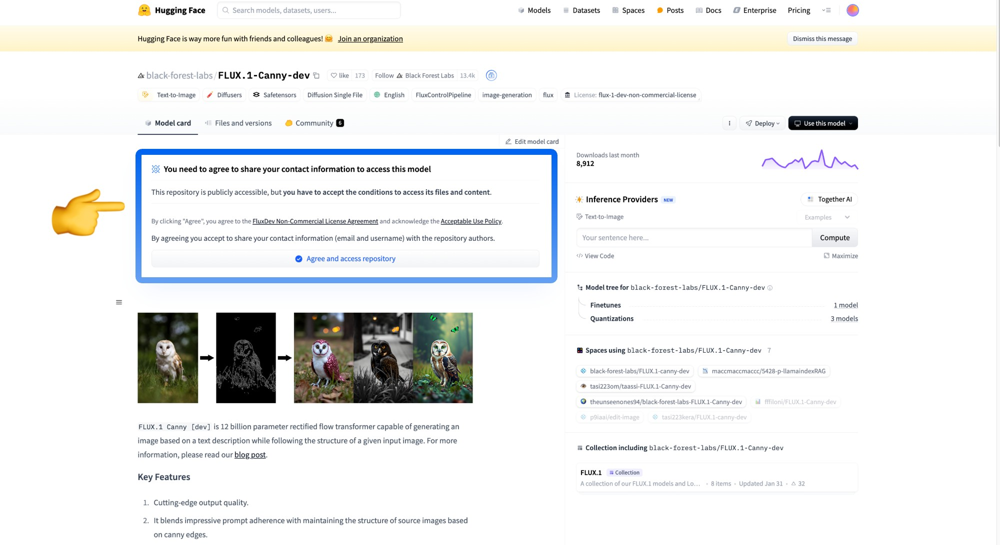
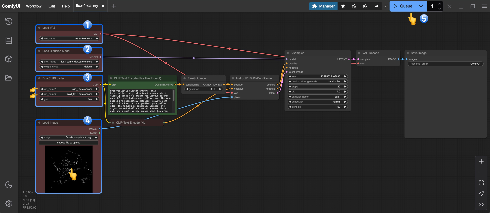
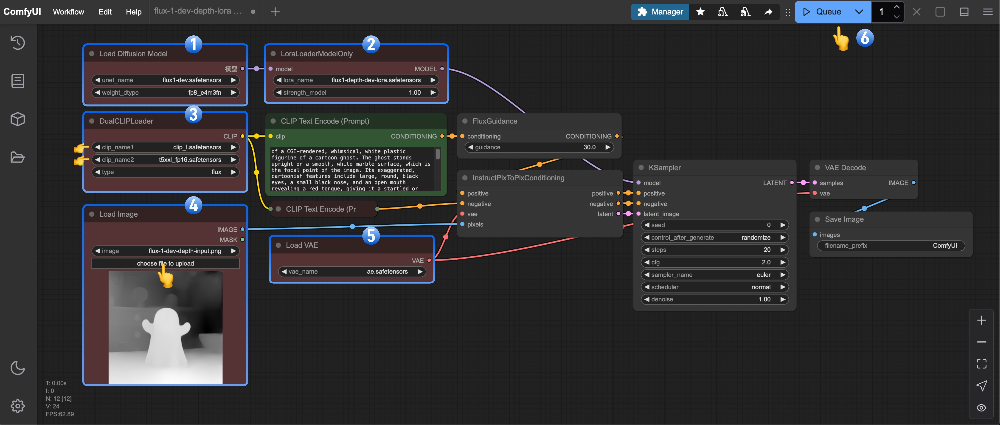

## Einführung in das FLUX.1 ControlNet-Modell

FLUX.1 Canny und Depth sind zwei leistungsstarke Modelle aus den [FLUX.1 Tools](https://blackforestlabs.ai/flux-1-tools/), die von [Black Forest Labs](https://blackforestlabs.ai/) vorgestellt wurden. Dieses Toolkit soll FLUX.1 um Steuerungs- und Guidance-Funktionen erweitern, sodass Sie reale oder generierte Bilder verändern und neu erstellen können.

**FLUX.1-Depth-dev** und **FLUX.1-Canny-dev** sind beides Rectified-Flow-Transformer-Modelle mit 12B Parametern, die anhand von Textbeschreibungen Bilder generieren und dabei die strukturellen Merkmale des Eingabebildes erhalten.
Die Depth-Version erhält die räumliche Struktur des Quellbildes durch Techniken zur Extraktion von Tiefenkarten, während die Canny-Version Kantenerkennungstechniken nutzt, um die strukturellen Merkmale des Quellbildes zu bewahren. So können Sie je nach Anforderung die passende Steuerungsmethode wählen.

Beide Modelle bieten die folgenden Eigenschaften:
- Erstklassige Ausgabequalität und Detailwiedergabe
- Hervorragende Prompt-Treue bei gleichzeitiger Konsistenz zum Originalbild
- Mit Guided-Distillation-Techniken trainiert für höhere Effizienz
- Offene Gewichte für die Forschungsgemeinschaft
- API-Schnittstellen (Pro-Version) und Open-Source-Gewichte (Dev-Version)

Darüber hinaus stellt Black Forest Labs auch die aus den vollständigen Modellen extrahierten Adapterversionen **FLUX.1-Depth-dev-lora** und **FLUX.1-Canny-dev-lora** bereit.
Diese lassen sich auf das Basismodell FLUX.1 [dev] anwenden und bieten bei kleinerer Dateigröße eine ähnliche Funktionalität. Sie eignen sich besonders für Umgebungen mit begrenzten Ressourcen.

Wir verwenden die Vollversion von **FLUX.1-Canny-dev** und **FLUX.1-Depth-dev-lora**, um die Workflow-Beispiele umzusetzen.

<Tip>
Die Metadaten aller Workflow-Bilder enthalten die entsprechenden Informationen zum Herunterladen der Modelle. Sie können die Workflows laden, indem Sie:
- sie direkt in ComfyUI ziehen
- oder das Menü `Workflows` -> `Open（ctrl+o）` verwenden

Wenn Sie nicht die Desktop-Version verwenden oder einige Modelle nicht automatisch heruntergeladen werden können, lesen Sie bitte die Abschnitte zur manuellen Installation, um die Modelldateien im entsprechenden Ordner zu speichern.

Für die Bildvorverarbeitung können Sie die folgenden Custom Nodes verwenden. In diesem Beispiel stellen wir verarbeitete Bilder als Eingabe bereit.
- [ComfyUI-Advanced-ControlNet](https://github.com/Kosinkadink/ComfyUI-Advanced-ControlNet)
- [ComfyUI ControlNet aux](https://github.com/Fannovel16/comfyui_controlnet_aux)
</Tip>

## Vollständiger Workflow für FLUX.1-Canny-dev

### Flux.1 Canny Modell {#flux_canny_model_example}

Generieren Sie mit Flux.1 Canny Bilder, die durch Kantenerkennung gesteuert werden.


<CardGroup cols={2}>
  <Card title="Auf Comfy Cloud ausführen" icon="cloud" href="https://cloud.comfy.org/?template=flux_canny_model_example&utm_source=docs&utm_medium=referral&utm_campaign=flux-1-controlnet">
    In Comfy Cloud öffnen
  </Card>
  <Card title="Workflow herunterladen" icon="download" href="https://github.com/Comfy-Org/workflow_templates/blob/main/templates/flux_canny_model_example.json">
    JSON herunterladen oder in der Vorlagenbibliothek nach &quot;Flux.1 Canny&quot; suchen
  </Card>
</CardGroup>

**Eingabedateien**

Laden Sie diese Datei in den passenden `LoadImage`-Node hoch:

<CardGroup cols={2}>
  <Card title="flux_canny_model_example_input_image.png" icon="image" href="https://raw.githubusercontent.com/Comfy-Org/workflow_templates/main/input/flux_canny_model_example_input_image.png">
    `LoadImage`-Node 17 · `flux_canny_model_example_input_image.png`
  </Card>
</CardGroup>

<div style={{display: 'grid', gridTemplateColumns: 'repeat(2, minmax(0, 1fr))', gap: '1rem', alignItems: 'start'}}>
  
</div>

### 1. Workflow und Asset

### 2. Manuelle Installation der Modelle

<Note>
Wenn Sie zuvor die [vollständige Version der Flux-bezogenen Workflows](/de/tutorials/flux/flux-1-text-to-image) verwendet haben, müssen Sie nur die Modelldatei **flux1-canny-dev.safetensors** herunterladen.
Da Sie zunächst den Nutzungsbedingungen von [black-forest-labs/FLUX.1-Canny-dev](https://huggingface.co/black-forest-labs/FLUX.1-Canny-dev) zustimmen müssen, besuchen Sie bitte die Seite [black-forest-labs/FLUX.1-Canny-dev](https://huggingface.co/black-forest-labs/FLUX.1-Canny-dev) und stellen Sie sicher, dass Sie den entsprechenden Nutzungsbedingungen wie im folgenden Bild zugestimmt haben.

</Note>

Vollständige Modellliste:
- [clip_l.safetensors](https://huggingface.co/comfyanonymous/flux_text_encoders/blob/main/clip_l.safetensors?download=true)
- [t5xxl_fp16.safetensors](https://huggingface.co/comfyanonymous/flux_text_encoders/blob/main/t5xxl_fp16.safetensors?download=true)
- [ae.safetensors](https://huggingface.co/black-forest-labs/FLUX.1-schnell/blob/main/ae.safetensors?download=true)
- [flux1-canny-dev.safetensors](https://huggingface.co/black-forest-labs/FLUX.1-Canny-dev/blob/main/flux1-canny-dev.safetensors?download=true) (Bitte stellen Sie sicher, dass Sie den Nutzungsbedingungen des entsprechenden Repos zugestimmt haben)

Speicherort der Dateien:
```
ComfyUI/
├── models/
│   ├── text_encoders/
│   │   ├── clip_l.safetensors
│   │   └── t5xxl_fp16.safetensors
│   ├── vae/
│   │   └── ae.safetensors
│   └── diffusion_models/
│       └── flux1-canny-dev.safetensors
```

### 3. Schritt-für-Schritt-Ausführung des Workflows



1. Stellen Sie sicher, dass `ae.safetensors` im `Load VAE`-Node geladen ist
2. Stellen Sie sicher, dass `flux1-canny-dev.safetensors` im `Load Diffusion Model`-Node geladen ist
3. Stellen Sie sicher, dass die folgenden Modelle im `DualCLIPLoader`-Node geladen sind:
   - clip_name1: t5xxl_fp16.safetensors
   - clip_name2: clip_l.safetensors
4. Laden Sie das bereitgestellte Eingabebild in den `Load Image`-Node hoch
5. Klicken Sie auf die Schaltfläche `Queue`, oder verwenden Sie die Tastenkombination `Ctrl(cmd) + Enter`, um den Workflow auszuführen

### 4. Mit Ihren Experimenten beginnen

Versuchen Sie, das Modell [FLUX.1-Depth-dev](https://huggingface.co/black-forest-labs/FLUX.1-Depth-dev) zu verwenden, um die Depth-Version des Workflows zu vervollständigen.

Sie können das folgende Bild als Eingabe verwenden


Oder verwenden Sie die folgenden Custom Nodes, um die Bildvorverarbeitung abzuschließen:
- [ComfyUI-Advanced-ControlNet](https://github.com/Kosinkadink/ComfyUI-Advanced-ControlNet)
- [ComfyUI ControlNet aux](https://github.com/Fannovel16/comfyui_controlnet_aux)

## FLUX.1-Depth-dev-lora Workflow

### Flux.1 Depth Lora {#flux_depth_lora_example}

Generieren Sie Bilder anhand von Tiefeninformationen mit dem Flux.1 LoRA.


<CardGroup cols={2}>
  <Card title="Auf Comfy Cloud ausführen" icon="cloud" href="https://cloud.comfy.org/?template=flux_depth_lora_example&utm_source=docs&utm_medium=referral&utm_campaign=flux-1-controlnet">
    In Comfy Cloud öffnen
  </Card>
  <Card title="Workflow herunterladen" icon="download" href="https://github.com/Comfy-Org/workflow_templates/blob/main/templates/flux_depth_lora_example.json">
    JSON herunterladen oder in der Vorlagenbibliothek nach „Flux.1 Depth LoRA“ suchen
  </Card>
</CardGroup>

**Eingabematerialien**

Laden Sie diese Datei in den passenden `LoadImage`-Node hoch:

<CardGroup cols={2}>
  <Card title="flux_depth_lora_example_input_image.png" icon="image" href="https://raw.githubusercontent.com/Comfy-Org/workflow_templates/main/input/flux_depth_lora_example_input_image.png">
    `LoadImage`-Node 17 · `flux_depth_lora_example_input_image.png`
  </Card>
</CardGroup>

<div style={{display: 'grid', gridTemplateColumns: 'repeat(2, minmax(0, 1fr))', gap: '1rem', alignItems: 'start'}}>
  
</div>

### 1. Workflow und Assets

### 2. Modelle manuell herunterladen

<Tip>
Wenn Sie bereits die [vollständige Version der Flux-Workflows](/de/tutorials/flux/flux-1-text-to-image) verwendet haben, müssen Sie nur noch die Modelldatei **flux1-depth-dev-lora.safetensors** herunterladen.
</Tip>

Vollständige Liste der Modelle:
- [clip_l.safetensors](https://huggingface.co/comfyanonymous/flux_text_encoders/blob/main/clip_l.safetensors?download=true)
- [t5xxl_fp16.safetensors](https://huggingface.co/comfyanonymous/flux_text_encoders/blob/main/t5xxl_fp16.safetensors?download=true)
- [ae.safetensors](https://huggingface.co/black-forest-labs/FLUX.1-schnell/blob/main/ae.safetensors?download=true)
- [flux1-dev.safetensors](https://huggingface.co/black-forest-labs/FLUX.1-dev/blob/main/flux1-dev.safetensors?download=true)
- [flux1-depth-dev-lora.safetensors](https://huggingface.co/black-forest-labs/FLUX.1-Depth-dev-lora/blob/main/flux1-depth-dev-lora.safetensors?download=true)

Speicherort der Dateien:
```
ComfyUI/
├── models/
│   ├── text_encoders/
│   │   ├── clip_l.safetensors
│   │   └── t5xxl_fp16.safetensors
│   ├── vae/
│   │   └── ae.safetensors
│   ├── diffusion_models/
│   │   └── flux1-dev.safetensors
│   └── loras/
│       └── flux1-depth-dev-lora.safetensors
```

### 3. Schrittweise Ausführung des Workflows



1. Stellen Sie sicher, dass `flux1-dev.safetensors` im Node `Load Diffusion Model` geladen ist
2. Stellen Sie sicher, dass `flux1-depth-dev-lora.safetensors` im Node `LoraLoaderModelOnly` geladen ist
3. Stellen Sie sicher, dass die folgenden Modelle im Node `DualCLIPLoader` geladen sind:
   - clip_name1: t5xxl_fp16.safetensors
   - clip_name2: clip_l.safetensors
4. Laden Sie das bereitgestellte Eingabebild im Node `Load Image` hoch
5. Stellen Sie sicher, dass `ae.safetensors` im Node `Load VAE` geladen ist
6. Klicken Sie auf die Schaltfläche `Queue` oder verwenden Sie die Tastenkombination `Ctrl(cmd) + Enter`, um den Workflow auszuführen

### 4. Eigene Experimente starten

Versuchen Sie, mit dem Modell [FLUX.1-Canny-dev-lora](https://huggingface.co/black-forest-labs/FLUX.1-Canny-dev-lora) die Canny-Version des Workflows zu erstellen

Verwenden Sie [ComfyUI-Advanced-ControlNet](https://github.com/Kosinkadink/ComfyUI-Advanced-ControlNet) oder [ComfyUI ControlNet aux](https://github.com/Fannovel16/comfyui_controlnet_aux), um die Bildvorverarbeitung durchzuführen

## Community-Versionen der Flux-ControlNets

XLab und InstantX + Shakker Labs haben ControlNets für Flux veröffentlicht.

**InstantX:**
- [FLUX.1-dev-Controlnet-Canny](https://huggingface.co/InstantX/FLUX.1-dev-Controlnet-Canny/blob/main/diffusion_pytorch_model.safetensors)
- [FLUX.1-dev-ControlNet-Depth](https://huggingface.co/Shakker-Labs/FLUX.1-dev-ControlNet-Depth/blob/main/diffusion_pytorch_model.safetensors)
- [FLUX.1-dev-ControlNet-Union-Pro](https://huggingface.co/Shakker-Labs/FLUX.1-dev-ControlNet-Union-Pro/blob/main/diffusion_pytorch_model.safetensors)

**XLab**: [flux-controlnet-collections](https://huggingface.co/XLabs-AI/flux-controlnet-collections) 

Legen Sie diese Dateien im Verzeichnis `ComfyUI/models/controlnet` ab.

Sie können [Flux-ControlNet-Beispiel](https://raw.githubusercontent.com/comfyanonymous/ComfyUI_examples/refs/heads/master/flux/flux_controlnet_example.png) besuchen, um das zugehörige Workflow-Bild zu erhalten, und das Bild von [hier](https://raw.githubusercontent.com/comfyanonymous/ComfyUI_examples/refs/heads/master/flux/girl_in_field.png) als Eingabebild verwenden.
