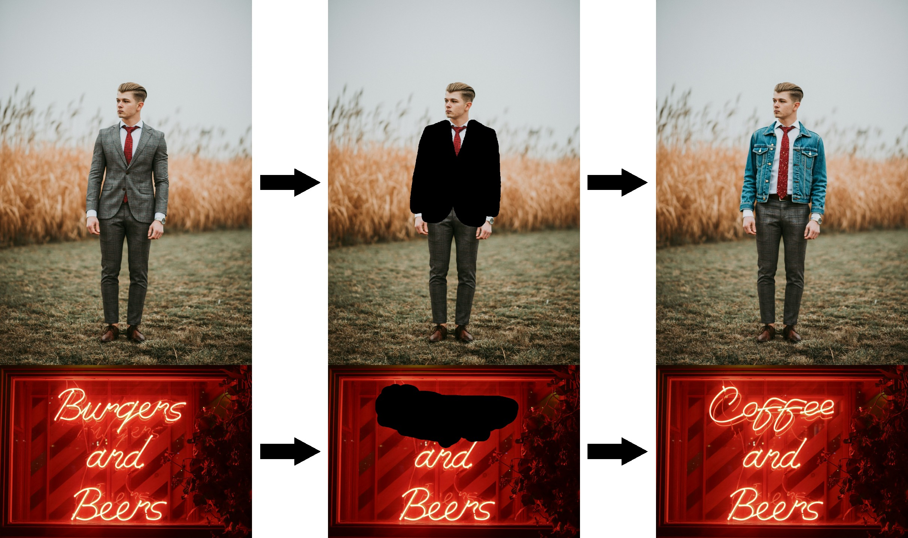
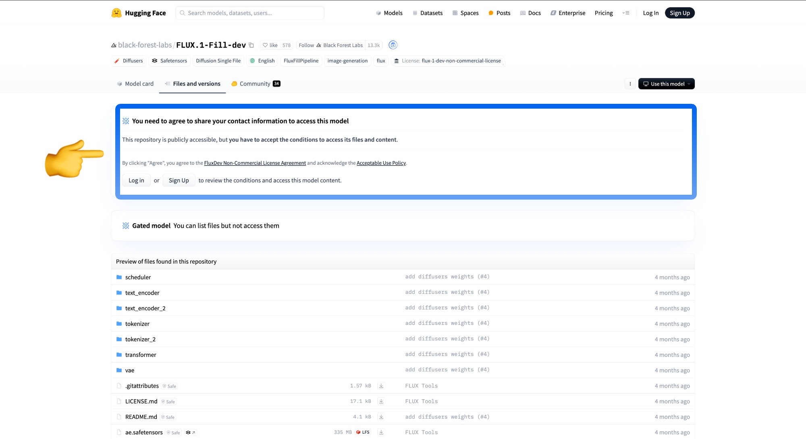
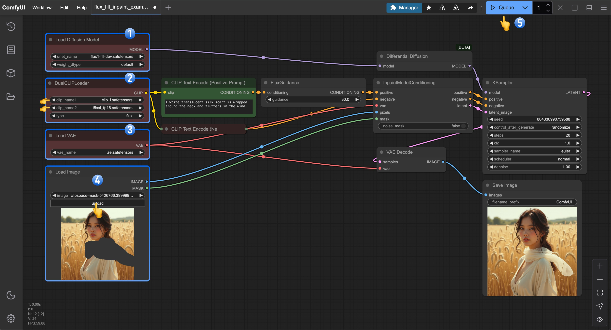
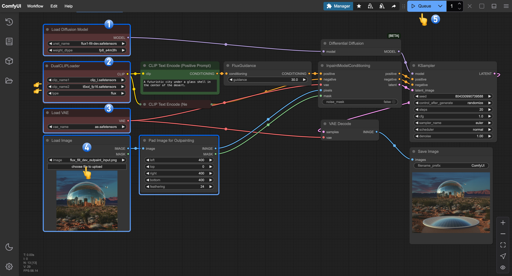

## Einführung in das Flux.1 fill dev-Modell

Flux.1 fill dev ist eines der zentralen Werkzeuge in der [FLUX.1 Tools Suite](https://blackforestlabs.ai/flux-1-tools/), die von [Black Forest Labs](https://blackforestlabs.ai/) eingeführt wurde, und wurde speziell für Inpainting und Outpainting von Bildern entwickelt.

Wichtigste Merkmale von Flux.1 fill dev:
- Leistungsstarke Inpainting- und Outpainting-Funktionen, deren Ergebnisse nur von der kommerziellen Version FLUX.1 Fill [pro] übertroffen werden.
- Hervorragendes Prompt-Verständnis und die Fähigkeit, Prompts präzise zu befolgen: Die Benutzerabsicht wird genau erfasst, während eine hohe Übereinstimmung mit dem Originalbild erhalten bleibt.
- Fortschrittliche Guided-Distillation-Trainingstechnologie, die das Modell effizienter macht und gleichzeitig eine hohe Ausgabequalität beibehält.
- Benutzerfreundliche Lizenzbedingungen: Generierte Ausgaben können für den persönlichen Gebrauch sowie für wissenschaftliche und kommerzielle Zwecke verwendet werden. Einzelheiten entnehmen Sie bitte der [FLUX.1 [dev] non-commercial license](https://huggingface.co/black-forest-labs/FLUX.1-dev/blob/main/LICENSE.md).

Open-Source-Repository: [FLUX.1 [dev]](https://huggingface.co/black-forest-labs/FLUX.1-dev)

Diese Anleitung zeigt Inpainting- und Outpainting-Workflows auf Basis des Flux.1 fill dev-Modells.
Wenn Sie mit Inpainting- und Outpainting-Workflows nicht vertraut sind, finden Sie in [ComfyUI-Beispiel für Layout-Inpainting](/de/tutorials/basic/inpaint) und [ComfyUI-Beispiel für Bild-Erweiterung](/de/tutorials/basic/outpaint) einige zugehörige Erläuterungen.

## Installation der Modelle für Flux.1 Fill dev

Bevor wir beginnen, schließen wir die Installation der Modelldateien für Flux.1 Fill dev ab. Die Inpainting- und Outpainting-Workflows verwenden genau dieselben Modelldateien.
Wenn Sie bereits die Vollversion des [Flux.1 Text-zu-Bild-Workflows](/de/tutorials/flux/flux-1-text-to-image) verwendet haben,
müssen Sie in diesem Abschnitt nur die Modelldatei **flux1-fill-dev.safetensors** herunterladen.

Da für den Download des Modells die Nutzungsvereinbarung akzeptiert werden muss, öffnen Sie die Seite [black-forest-labs/FLUX.1-Fill-dev](https://huggingface.co/black-forest-labs/FLUX.1-Fill-dev) und bestätigen Sie die Vereinbarung wie im folgenden Bild.


Complete model list:
|- [clip_l.safetensors](https://huggingface.co/comfyanonymous/flux_text_encoders/blob/main/clip_l.safetensors)
|- [t5xxl_fp16.safetensors](https://huggingface.co/comfyanonymous/flux_text_encoders/blob/main/t5xxl_fp16.safetensors)
|- [ae.safetensors](https://huggingface.co/black-forest-labs/FLUX.1-schnell/blob/main/ae.safetensors)
|- [flux1-fill-dev.safetensors](https://huggingface.co/black-forest-labs/FLUX.1-Fill-dev/blob/main/flux1-fill-dev.safetensors)

File storage location:
```
ComfyUI/
├── models/
│   ├── text_encoders/
│   │    ├── clip_l.safetensors
│   │    └── t5xxl_fp16.safetensors
│   ├── vae/
│   │    └── ae.safetensors
│   └── diffusion_models/
│        └── flux1-fill-dev.safetensors
```

## Inpainting-Workflow mit Flux.1 Fill dev

### Flux.1 Inpaint {#flux_fill_inpaint_example}

Füllen Sie fehlende Bildbereiche mit Flux.1 Fill Inpainting aus.


<CardGroup cols={2}>
  <Card title="Auf Comfy Cloud ausführen" icon="cloud" href="https://cloud.comfy.org/?template=flux_fill_inpaint_example&utm_source=docs&utm_medium=referral&utm_campaign=flux-1-fill-dev">
    In Comfy Cloud öffnen
  </Card>
  <Card title="Workflow herunterladen" icon="download" href="https://github.com/Comfy-Org/workflow_templates/blob/main/templates/flux_fill_inpaint_example.json">
    Laden Sie die JSON herunter oder suchen Sie in der Vorlagenbibliothek nach &quot;Flux.1 Inpaint&quot;
  </Card>
</CardGroup>

**Eingabematerialien**

Laden Sie diese Datei in den passenden `LoadImage`-Node hoch:

<CardGroup cols={2}>
  <Card title="flux_fill_inpaint_example_input_image.png" icon="image" href="https://raw.githubusercontent.com/Comfy-Org/workflow_templates/main/input/flux_fill_inpaint_example_input_image.png">
    `LoadImage`-Node 17 · `flux_fill_inpaint_example_input_image.png`
  </Card>
</CardGroup>

<div style={{display: 'grid', gridTemplateColumns: 'repeat(2, minmax(0, 1fr))', gap: '1rem', alignItems: 'start'}}>
  
</div>

**Beispielausgabe**

<div style={{display: 'grid', gridTemplateColumns: 'repeat(2, minmax(0, 1fr))', gap: '1rem', alignItems: 'start'}}>
  
  
</div>

### 1. Inpainting-Workflow und Bildmaterial

<Note>
Das zugehörige Bild enthält bereits einen Alpha-Kanal, Sie müssen also keine Maske separat zeichnen.
Wenn Sie eine eigene Maske zeichnen möchten, [klicken Sie hier](https://raw.githubusercontent.com/Comfy-Org/example_workflows/main/flux/inpaint/flux_fill_inpaint_input_original.png), um das Bild ohne Maske zu erhalten, und lesen Sie den Abschnitt zur Nutzung des Maskeneditors im [ComfyUI Layout Inpainting Example](/de/tutorials/basic/inpaint#maskeneditor-verwenden), um zu erfahren, wie Sie im `Load Image`-Node eine Maske zeichnen.
</Note>

### 2. Schritte zum Ausführen des Workflows



1. Stellen Sie sicher, dass im `Load Diffusion Model`-Node `flux1-fill-dev.safetensors` geladen ist.
2. Stellen Sie sicher, dass im `DualCLIPLoader`-Node die folgenden Modelle geladen sind:
   - clip_name1: `t5xxl_fp16.safetensors`
   - clip_name2: `clip_l.safetensors`
3. Stellen Sie sicher, dass im `Load VAE`-Node `ae.safetensors` geladen ist.
4. Laden Sie das im Dokument bereitgestellte Eingabebild in den `Load Image`-Node hoch; wenn Sie die Version ohne Maske verwenden, denken Sie daran, die Maske mit dem Maskeneditor zu zeichnen
5. Klicken Sie auf die Schaltfläche `Queue` oder verwenden Sie die Tastenkombination `Ctrl(cmd) + Enter`, um den Workflow auszuführen

## Flux.1 Fill dev Outpainting-Workflow

### Flux.1 Outpaint {#flux_fill_outpaint_example}

Erweitern Sie Bilder über ihre Grenzen hinaus mit Flux.1 Outpainting.


<CardGroup cols={2}>
  <Card title="Auf Comfy Cloud ausführen" icon="cloud" href="https://cloud.comfy.org/?template=flux_fill_outpaint_example&utm_source=docs&utm_medium=referral&utm_campaign=flux-1-fill-dev">
    In Comfy Cloud öffnen
  </Card>
  <Card title="Workflow herunterladen" icon="download" href="https://github.com/Comfy-Org/workflow_templates/blob/main/templates/flux_fill_outpaint_example.json">
    JSON herunterladen oder in der Vorlagenbibliothek nach „Flux.1 Outpaint“ suchen
  </Card>
</CardGroup>

**Eingabematerialien**

Laden Sie diese Datei in den passenden `LoadImage`-Node hoch:

<CardGroup cols={2}>
  <Card title="flux_fill_outpaint_example_input_image.png" icon="image" href="https://raw.githubusercontent.com/Comfy-Org/workflow_templates/main/input/flux_fill_outpaint_example_input_image.png">
    `LoadImage`-Node 17 · `flux_fill_outpaint_example_input_image.png`
  </Card>
</CardGroup>

<div style={{display: 'grid', gridTemplateColumns: 'repeat(2, minmax(0, 1fr))', gap: '1rem', alignItems: 'start'}}>
  
</div>

### 1. Outpainting-Workflow und Asset

### 2. Schritte zum Ausführen des Workflows



1. Stellen Sie sicher, dass im Node `Load Diffusion Model` `flux1-fill-dev.safetensors` geladen ist.
2. Stellen Sie sicher, dass im Node `DualCLIPLoader` die folgenden Modelle geladen sind:
   - clip_name1: `t5xxl_fp16.safetensors`
   - clip_name2: `clip_l.safetensors`
3. Stellen Sie sicher, dass im Node `Load VAE` `ae.safetensors` geladen ist.
4. Laden Sie das im Dokument bereitgestellte Eingabebild in den `Load Image`-Node hoch.
5. Klicken Sie auf die Schaltfläche `Queue` oder verwenden Sie die Tastenkombination `Ctrl(cmd) + Enter`, um den Workflow auszuführen.
