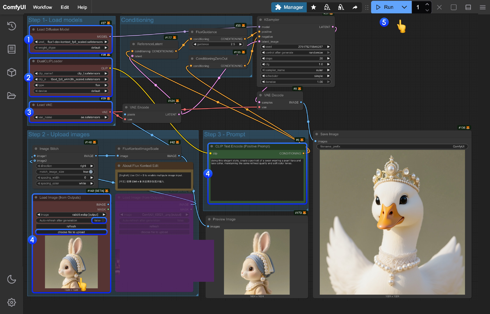

import PromptTechniques from "/snippets/de/tutorials/flux/prompt-techniques.mdx";
import UpdateReminder from "/snippets/de/tutorials/update-reminder.mdx"

<iframe
  className="w-full aspect-video rounded-xl"
  src="https://www.youtube.com/embed/Y7L_cbNJHj0?si=zuaRiU3qJYMNW2uv"
  title="ComfyUI Selection Toolbox New Features"
  allow="accelerometer; clipboard-write; encrypted-media; gyroscope; picture-in-picture"
  allowFullScreen
></iframe>

## Über FLUX.1 Kontext Dev

FLUX.1 Kontext ist ein bahnbrechendes multimodales Bildbearbeitungsmodell von Black Forest Labs, das gleichzeitige Text- und Bildeingaben unterstützt, den Bildkontext intelligent versteht und präzise Bearbeitungen durchführt. Seine Entwicklungsversion ist ein quelloffenes Diffusion-Transformer-Modell mit 12 Milliarden Parametern, das sich durch ein hervorragendes Kontextverständnis auszeichnet und die Charakterkonsistenz wahrt: Schlüsselelemente wie Charaktermerkmale und Bildkomposition bleiben auch nach mehreren iterativen Bearbeitungen stabil.

Es teilt die gleichen Kernfunktionen wie die FLUX.1 Kontext Suite:
- Charakterkonsistenz: Bewahrt einzigartige Elemente in Bildern über mehrere Szenen und Umgebungen hinweg, etwa Referenzcharaktere oder Objekte im Bild.
- Bearbeitung: Nimmt gezielte Änderungen an bestimmten Elementen im Bild vor, ohne andere Bereiche zu beeinflussen.
- Stilreferenz: Erzeugt neue Szenen und bewahrt dabei gemäß den Text-Prompts den einzigartigen Stil des Referenzbildes.
- Interaktive Geschwindigkeit: Minimale Latenz bei der Bilderzeugung und -bearbeitung.

Während die zuvor veröffentlichte API-Version die höchste Detailtreue und Geschwindigkeit bietet, läuft FLUX.1 Kontext [Dev] vollständig lokal und bietet damit unvergleichliche Flexibilität für Entwickler, Forscher und fortgeschrittene Nutzer, die experimentieren möchten.

### Versionsinformationen

- **[FLUX.1 Kontext [pro]** : Kommerzielle Version, ausgerichtet auf schnelle iterative Bearbeitung
- **FLUX.1 Kontext [max]** : Experimentelle Version mit stärkerer Prompt-Treue
- **FLUX.1 Kontext [dev]** : Open-Source-Version (in diesem Tutorial verwendet), 12B Parameter, hauptsächlich für die Forschung

Derzeit können Sie in ComfyUI alle diese Versionen verwenden: Die [Pro- und Max-Versionen](/de/tutorials/partner-nodes/black-forest-labs/flux-1-kontext) lassen sich über Partner-Nodes aufrufen; für die Open-Source-Version Dev beachten Sie bitte die Anweisungen in dieser Anleitung.

<UpdateReminder/>

## Modelldownload

Um die Workflows in dieser Anleitung auszuführen, laden Sie zunächst die folgenden Modelldateien herunter. Die Download-Links finden Sie auch direkt in den jeweiligen Workflows, die die Download-Informationen für die Modelldateien bereits enthalten.

**Diffusion Model**

- [flux1-dev-kontext_fp8_scaled.safetensors](https://huggingface.co/Comfy-Org/flux1-kontext-dev_ComfyUI/blob/main/split_files/diffusion_models/flux1-dev-kontext_fp8_scaled.safetensors)

<Tip>
Wenn Sie die Originalgewichte verwenden möchten, finden Sie sie im entsprechenden Repository von Black Forest Labs.
</Tip>

**VAE**
- [ae.safetensors](https://huggingface.co/Comfy-Org/Lumina_Image_2.0_Repackaged/blob/main/split_files/vae/ae.safetensors)

**Text Encoder**
- [clip_l.safetensors](https://huggingface.co/comfyanonymous/flux_text_encoders/blob/main/clip_l.safetensors)
- [t5xxl_fp16.safetensors](https://huggingface.co/comfyanonymous/flux_text_encoders/blob/main/t5xxl_fp16.safetensors) or [t5xxl_fp8_e4m3fn_scaled.safetensors](https://huggingface.co/comfyanonymous/flux_text_encoders/blob/main/t5xxl_fp8_e4m3fn_scaled.safetensors)

Model save location

```
📂 ComfyUI/
├── 📂 models/
│   ├── 📂 diffusion_models/
│   │   └── flux1-dev-kontext_fp8_scaled.safetensors
│   ├── 📂 vae/
│   │   └── ae.safetensor
│   └── 📂 text_encoders/
│       ├── clip_l.safetensors
│       └── t5xxl_fp16.safetensors or t5xxl_fp8_e4m3fn_scaled.safetensors
```

## FLUX.1 Kontext Dev Workflow

### FLUX Kontext Dev Bildbearbeitung {#flux_kontext_dev_basic}

Intelligente Bildbearbeitung, die Charaktere konsistent hält, gezielte Bereiche bearbeitet, ohne andere zu verändern, und den ursprünglichen Stil bewahrt.


<CardGroup cols={2}>
  <Card title="Auf Comfy Cloud ausführen" icon="cloud" href="https://cloud.comfy.org/?template=flux_kontext_dev_basic&utm_source=docs&utm_medium=referral&utm_campaign=flux-1-kontext-dev">
    In Comfy Cloud öffnen
  </Card>
  <Card title="Workflow herunterladen" icon="download" href="https://github.com/Comfy-Org/workflow_templates/blob/main/templates/flux_kontext_dev_basic.json">
    JSON herunterladen oder in der Vorlagenbibliothek nach &quot;FLUX Kontext Dev&quot; suchen
  </Card>
</CardGroup>

**Eingabematerialien**

Laden Sie diese Datei in den passenden `LoadImage`-Node hoch:

<CardGroup cols={2}>
  <Card title="flux_kontext_dev_basic_input_image.jpg" icon="image" href="https://raw.githubusercontent.com/Comfy-Org/workflow_templates/main/input/flux_kontext_dev_basic_input_image.jpg">
    `LoadImage` Node 190 · `flux_kontext_dev_basic_input_image.jpg`
  </Card>
</CardGroup>

<div style={{display: 'grid', gridTemplateColumns: 'repeat(2, minmax(0, 1fr))', gap: '1rem', alignItems: 'start'}}>
  
</div>

**Beispielausgabe**

<div style={{display: 'grid', gridTemplateColumns: 'repeat(2, minmax(0, 1fr))', gap: '1rem', alignItems: 'start'}}>
  
  
</div>

Dieser Workflow verwendet den Node `Load Image(from output)`, um das zu bearbeitende Bild zu laden. So können Sie das bearbeitete Bild bequem für mehrere Bearbeitungsrunden weiterverwenden.

### 1. Workflow und Eingabebild herunterladen

### 2. Den Workflow Schritt für Schritt ausführen


Anhand der Nummern im Bild können Sie den Workflow-Durchlauf abschließen:

1. Laden Sie im Node `Load Diffusion Model` das Modell `flux1-dev-kontext_fp8_scaled.safetensors`
2. Stellen Sie im Node `DualCLIP Load` sicher, dass `clip_l.safetensors` und `t5xxl_fp16.safetensors` oder `t5xxl_fp8_e4m3fn_scaled.safetensors` geladen sind
3. Stellen Sie im Node `Load VAE` sicher, dass das Modell `ae.safetensors` geladen ist
4. Laden Sie im Node `Load Image(from output)` das bereitgestellte Eingabebild
5. Ändern Sie im Node `CLIP Text Encode` die Prompts; unterstützt wird nur Englisch
6. Klicken Sie auf die Schaltfläche `Queue` oder verwenden Sie die Tastenkombination `Ctrl(cmd) + Enter`, um den Workflow auszuführen

<PromptTechniques/>
