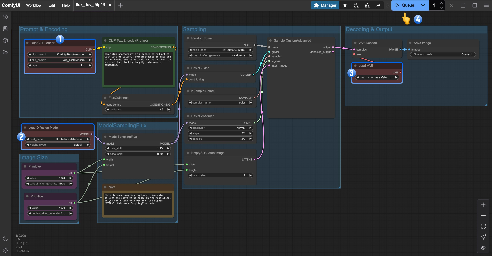
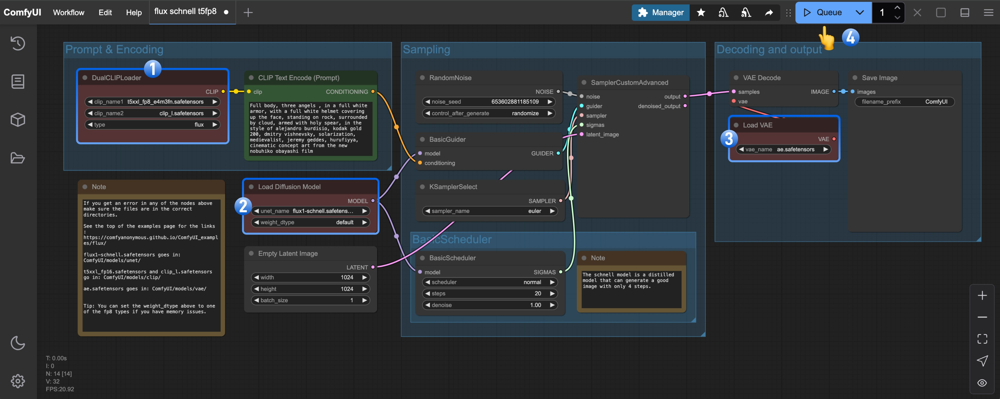

Flux ist eines der größten Open-Source-Modelle zur Text-zu-Bild-Generierung, mit 12B Parametern und einer ursprünglichen Dateigröße von etwa 23 GB. Es wurde von [Black Forest Labs](https://blackforestlabs.ai/) entwickelt, einem Team, das von ehemaligen Mitgliedern des Stable-Diffusion-Teams gegründet wurde.
Flux ist bekannt für seine hervorragende Bildqualität und Flexibilität und kann hochwertige, vielfältige Bilder generieren.

Derzeit gibt es mehrere Hauptversionen des Flux.1-Modells:
- **Flux.1 Pro:** Das leistungsstärkste Modell, Closed Source, nur über API-Aufrufe verfügbar.
- **[Flux.1 [dev]：](https://huggingface.co/black-forest-labs/FLUX.1-dev)** Open Source, aber auf nicht-kommerzielle Nutzung beschränkt, aus der Pro-Version destilliert, mit einer Leistung nahe der Pro-Version.
- **[Flux.1 [schnell]：](https://huggingface.co/black-forest-labs/FLUX.1-schnell)** Verwendet die Apache-2.0-Lizenz, benötigt nur 4 Schritte zum Generieren von Bildern und eignet sich für Hardware mit geringer Ausstattung.

**Merkmale des Flux.1-Modells**
- **Hybride Architektur:** Kombiniert die Vorteile von Transformer-Netzwerken und Diffusionsmodellen, integriert Text- und Bildinformationen effektiv, verbessert die Genauigkeit der Ausrichtung zwischen generierten Bildern und Prompts und zeichnet sich durch eine hervorragende Treue zu komplexen Prompts aus.
- **Parametergröße:** Flux hat 12B Parameter, erfasst komplexere Musterbeziehungen und generiert realistischere, vielfältigere Bilder.
- **Unterstützt mehrere Stile:** Unterstützt vielfältige Stile mit hervorragender Leistung für verschiedene Bildtypen.

In diesem Beispiel stellen wir Text-zu-Bild-Beispiele sowohl mit Flux.1 Dev als auch mit Flux.1 Schnell vor, einschließlich des vollständigen Modells und der vereinfachten FP8-Checkpoint-Version.

- **Flux Vollversion:** Beste Leistung, erfordert aber mehr VRAM-Ressourcen und die Installation mehrerer Modelldateien.
- **Flux FP8 Checkpoint:** Erfordert nur ein Modell in der fp8-Version, die Qualität ist jedoch etwas geringer als bei der Vollversion.

<Tip>
Die Metadaten aller Workflow-Bilder enthalten die entsprechenden Informationen zum Herunterladen der Modelle. Sie können die Workflows laden, indem Sie:
- sie direkt in ComfyUI ziehen
- oder das Menü `Workflows` -> `Open（ctrl+o）` verwenden

Wenn Sie nicht die Desktop-Version verwenden oder einige Modelle nicht automatisch heruntergeladen werden können, lesen Sie bitte die Abschnitte zur manuellen Installation, um die Modelldateien im entsprechenden Ordner zu speichern.
Stellen Sie sicher, dass Ihr ComfyUI vor dem Start auf die neueste Version aktualisiert ist.
</Tip>

## Flux.1 Vollversion: Beispiel für Text zu Bild

<Note>
Wenn Sie die Modelle nicht von [black-forest-labs/FLUX.1-dev](https://huggingface.co/black-forest-labs/FLUX.1-dev) herunterladen können, stellen Sie sicher, dass Sie bei Hugging Face angemeldet sind und der Lizenzvereinbarung des entsprechenden Repositorys zugestimmt haben.

</Note>

### Flux.1 Dev

### Flux.1 Dev fp8: Text zu Bild {#flux_dev_checkpoint_example}

Bilder mit der fp8-quantisierten Version von Flux.1 Dev generieren. Geeignet für Geräte mit begrenztem VRAM, es wird nur eine Modelldatei benötigt, die Bildqualität ist jedoch im Vergleich zur Vollversion leicht reduziert.


<CardGroup cols={2}>
  <Card title="Auf Comfy Cloud ausführen" icon="cloud" href="https://cloud.comfy.org/?template=flux_dev_checkpoint_example&utm_source=docs&utm_medium=referral&utm_campaign=flux-1-text-to-image">
    Diesen Workflow auf Comfy Cloud ausführen
  </Card>
  <Card title="Workflow herunterladen" icon="download" href="https://github.com/Comfy-Org/workflow_templates/blob/main/templates/flux_dev_checkpoint_example.json">
    JSON herunterladen oder in der Vorlagenbibliothek nach &quot;Flux.1 Dev fp8&quot; suchen
  </Card>
</CardGroup>

**Beispielausgabe**


#### 1. Workflow-Datei

#### 2. Manuelle Modellinstallation

<Note>
- Für die Datei `flux1-dev.safetensors` müssen Sie der Vereinbarung von [black-forest-labs/FLUX.1-dev](https://huggingface.co/black-forest-labs/FLUX.1-dev) zustimmen, bevor Sie sie über den Browser herunterladen.
- Wenn Ihr VRAM knapp ist, können Sie versuchen, `t5xxl_fp16.safetensors` durch [t5xxl_fp8_e4m3fn.safetensors](https://huggingface.co/comfyanonymous/flux_text_encoders/blob/main/t5xxl_fp8_e4m3fn.safetensors?download=true) zu ersetzen.
</Note>

Bitte laden Sie die folgenden Modelldateien herunter:
- [clip_l.safetensors](https://huggingface.co/comfyanonymous/flux_text_encoders/blob/main/clip_l.safetensors?download=true)
- [t5xxl_fp16.safetensors](https://huggingface.co/comfyanonymous/flux_text_encoders/blob/main/t5xxl_fp16.safetensors?download=true) Empfohlen, wenn Ihr VRAM größer als 32GB ist.
- [ae.safetensors](https://huggingface.co/black-forest-labs/FLUX.1-schnell/blob/main/ae.safetensors?download=true)
- [flux1-dev.safetensors](https://huggingface.co/black-forest-labs/FLUX.1-dev/blob/main/flux1-dev.safetensors) 

Speicherort:
```
ComfyUI/
├── models/
│   ├── text_encoders/
│   │   ├── clip_l.safetensors
│   │   └── t5xxl_fp16.safetensors
│   ├── vae/
│   │   └── ae.safetensors
│   └── diffusion_models/
│       └── flux1-dev.safetensors
```

#### 3. Schritte zum Ausführen des Workflows

Bitte prüfen Sie anhand der folgenden Abbildung, ob alle Modelldateien korrekt geladen sind



1. Stellen Sie sicher, dass im Node `DualCLIPLoader` die folgenden Modelle geladen sind:
   - clip_name1: t5xxl_fp16.safetensors
   - clip_name2: clip_l.safetensors
2. Stellen Sie sicher, dass im Node `Load Diffusion Model` `flux1-dev.safetensors` geladen ist
3. Stellen Sie sicher, dass im Node `Load VAE` `ae.safetensors` geladen ist
4. Klicken Sie auf die Schaltfläche `Queue` oder verwenden Sie die Tastenkombination `Ctrl(cmd) + Enter`, um den Workflow auszuführen

<Tip>
Dank der hervorragenden Fähigkeit von Flux, Prompts zu befolgen, benötigen wir keine negativen Prompts
</Tip>
### Flux.1 Schnell

### Flux.1 Schnell FP8 {#flux_schnell}

Bilder schnell mit der fp8-quantisierten Version von Flux.1 Schnell generieren. Ideal für schwächere Hardware, es sind nur 4 Schritte zum Generieren von Bildern nötig.


<CardGroup cols={2}>
  <Card title="Auf Comfy Cloud ausführen" icon="cloud" href="https://cloud.comfy.org/?template=flux_schnell&utm_source=docs&utm_medium=referral&utm_campaign=flux-1-text-to-image">
    Diesen Workflow auf Comfy Cloud ausführen
  </Card>
  <Card title="Workflow herunterladen" icon="download" href="https://github.com/Comfy-Org/workflow_templates/blob/main/templates/flux_schnell_full_text_to_image.json">
    JSON herunterladen oder in der Vorlagenbibliothek nach &quot;Flux.1 Schnell&quot; suchen
  </Card>
</CardGroup>

#### 1. Workflow-Datei

#### 2. Manuelle Modellinstallation

<Note>
In diesem Workflow unterscheiden sich nur zwei Modelldateien vom Workflow der Flux1 Dev Version. Für t5xxl können Sie weiterhin die fp16-Version verwenden, um bessere Ergebnisse zu erzielen.
- **t5xxl_fp16.safetensors** -> **t5xxl_fp8.safetensors**
- **flux1-dev.safetensors** -> **flux1-schnell.safetensors** 
</Note>

Vollständige Liste der Modelldateien:
- [clip_l.safetensors](https://huggingface.co/comfyanonymous/flux_text_encoders/blob/main/clip_l.safetensors?download=true)
- [t5xxl_fp8_e4m3fn.safetensors](https://huggingface.co/comfyanonymous/flux_text_encoders/blob/main/t5xxl_fp8_e4m3fn.safetensors?download=true)
- [ae.safetensors](https://huggingface.co/black-forest-labs/FLUX.1-schnell/blob/main/ae.safetensors?download=true)
- [flux1-schnell.safetensors](https://huggingface.co/black-forest-labs/FLUX.1-schnell/blob/main/flux1-schnell.safetensors) 

Speicherort der Dateien:
```
ComfyUI/
├── models/
│   ├── text_encoders/
│   │   ├── clip_l.safetensors
│   │   └── t5xxl_fp8_e4m3fn.safetensors
│   ├── vae/
│   │   └── ae.safetensors
│   └── diffusion_models/
│       └── flux1-schnell.safetensors
```

#### 3. Schritte zum Ausführen des Workflows



1. Stellen Sie sicher, dass im Node `DualCLIPLoader` die folgenden Modelle geladen sind:
   - clip_name1: t5xxl_fp8_e4m3fn.safetensors
   - clip_name2: clip_l.safetensors
2. Stellen Sie sicher, dass im Node `Load Diffusion Model` `flux1-schnell.safetensors` geladen ist
3. Stellen Sie sicher, dass im Node `Load VAE` `ae.safetensors` geladen ist
4. Klicken Sie auf die Schaltfläche `Queue` oder verwenden Sie die Tastenkombination `Ctrl(cmd) + Enter`, um den Workflow auszuführen

## Beispiel für Text zu Bild mit der Flux.1 FP8 Checkpoint-Version

Die fp8-Version ist eine quantisierte Version der ursprünglichen Flux.1 fp16-Version.
Die Qualität dieser Version ist in gewissem Maße geringer als die der fp16-Version,
sie benötigt aber auch weniger VRAM, und Sie müssen nur eine Modelldatei installieren, um sie auszuprobieren.

### Flux.1 Dev

### Flux.1 Dev: Text zu Bild {#flux_dev_full_text_to_image}

Generieren Sie hochwertige Bilder mit der vollständigen Version von Flux Dev. Sie benötigt mehr VRAM und mehrere Modelldateien, bietet aber die beste Prompt-Treue.


<CardGroup cols={2}>
  <Card title="Auf Comfy Cloud ausführen" icon="cloud" href="https://cloud.comfy.org/?template=flux_dev_full_text_to_image&utm_source=docs&utm_medium=referral&utm_campaign=flux-1-text-to-image">
    Diesen Workflow auf Comfy Cloud ausführen
  </Card>
  <Card title="Workflow herunterladen" icon="download" href="https://github.com/Comfy-Org/workflow_templates/blob/main/templates/flux_dev_full_text_to_image.json">
    JSON herunterladen oder in der Vorlagenbibliothek nach &quot;Flux.1 Dev FP8&quot; suchen
  </Card>
</CardGroup>

**Beispielausgabe**


Bitte laden Sie das Bild unten herunter und ziehen Sie es in ComfyUI, um den Workflow zu laden.

Bitte laden Sie [flux1-dev-fp8.safetensors](https://huggingface.co/Comfy-Org/flux1-dev/blob/main/flux1-dev-fp8.safetensors?download=true) herunter und speichern Sie die Datei im Verzeichnis `ComfyUI/models/checkpoints/`.

Stellen Sie sicher, dass der entsprechende Node `Load Checkpoint` `flux1-dev-fp8.safetensors` lädt, dann können Sie den Workflow ausprobieren.

### Flux.1 Schnell

### Flux.1 Schnell FP8 {#flux_schnell}

Generieren Sie schnell Bilder mit der quantisierten fp8-Version von Flux.1 Schnell. Ideal für schwächere Hardware, benötigt nur 4 Schritte zum Generieren von Bildern.


<CardGroup cols={2}>
  <Card title="Auf Comfy Cloud ausführen" icon="cloud" href="https://cloud.comfy.org/?template=flux_schnell&utm_source=docs&utm_medium=referral&utm_campaign=flux-1-text-to-image">
    Diesen Workflow auf Comfy Cloud ausführen
  </Card>
  <Card title="Workflow herunterladen" icon="download" href="https://github.com/Comfy-Org/workflow_templates/blob/main/templates/flux_schnell.json">
    JSON herunterladen oder in der Vorlagenbibliothek nach &quot;Flux.1 Schnell FP8&quot; suchen
  </Card>
</CardGroup>

Bitte laden Sie das Bild unten herunter und ziehen Sie es in ComfyUI, um den Workflow zu laden.

Bitte laden Sie [flux1-schnell-fp8.safetensors](https://huggingface.co/Comfy-Org/flux1-schnell/blob/main/flux1-schnell-fp8.safetensors?download=true) herunter und speichern Sie die Datei im Verzeichnis `ComfyUI/models/checkpoints/`.

Stellen Sie sicher, dass der entsprechende Node `Load Checkpoint` `flux1-schnell-fp8.safetensors` lädt, dann können Sie den Workflow ausprobieren.
