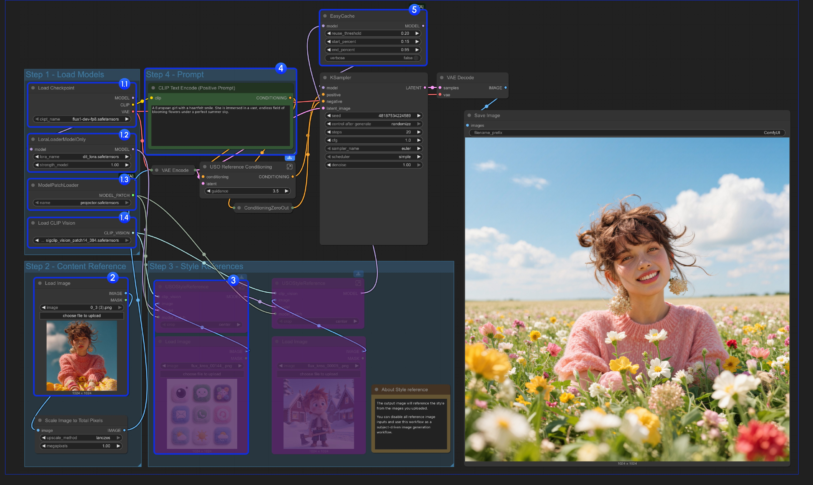
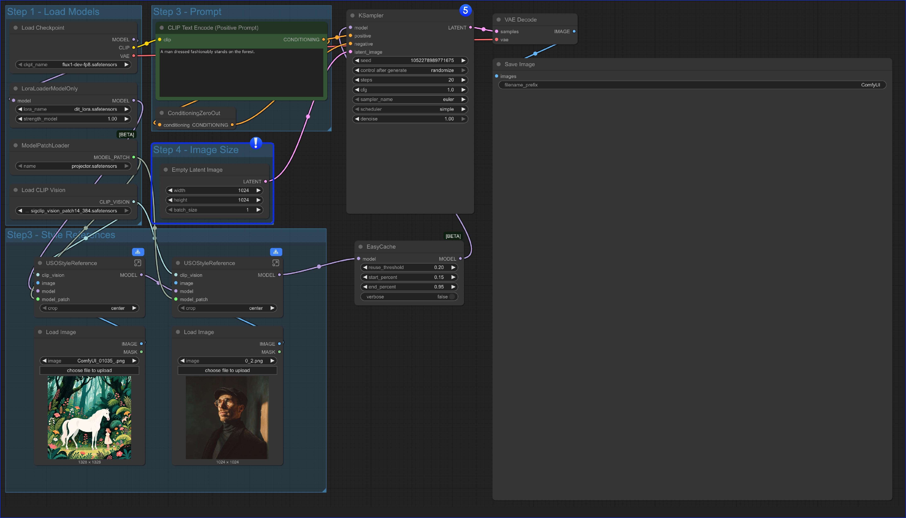

import UpdateReminder from "/snippets/de/tutorials/update-reminder.mdx"

**USO (Unified Style-Subject Optimized)** ist ein Modell, das vom UXO-Team bei ByteDance entwickelt wurde und stilgesteuerte sowie subjektgesteuerte Generierungsaufgaben vereint.
Aufgebaut auf der FLUX.1-dev-Architektur erreicht das Modell sowohl Stilähnlichkeit als auch Subjektkonsistenz durch disentangled Learning und Style Reward Learning (SRL).

USO unterstützt drei Hauptansätze:
- **Subjektgesteuert**: Subjekte in neue Szenen einfügen und dabei die Identität konsistent halten
- **Stilgesteuert**: Künstlerische Stile anhand von Referenzbildern auf neue Inhalte anwenden
- **Kombiniert**: Subjekt- und Stilreferenz gleichzeitig verwenden

**Weiterführende Links**
- [Projektseite](https://bytedance.github.io/USO/)
- [GitHub](https://github.com/bytedance/USO)
- [Modellgewichte](https://huggingface.co/bytedance-research/USO)

## Nativer ByteDance USO Workflow in ComfyUI

<UpdateReminder/>

### Referenzbild-Generierung mit FLUX.1 Dev USO {#flux1_dev_uso_reference_image_gen}

Steuern Sie mit Referenzbildern sowohl Stil als auch Subjekt. Behalten Sie das Gesicht Ihrer Figur bei und ändern Sie den künstlerischen Stil, oder wenden Sie künstlerische Stile auf neue Szenen an.


<CardGroup cols={2}>
  <Card title="Auf Comfy Cloud ausführen" icon="cloud" href="https://cloud.comfy.org/?template=flux1_dev_uso_reference_image_gen&utm_source=docs&utm_medium=referral&utm_campaign=flux-1-uso">
    Diesen Workflow auf Comfy Cloud ausführen
  </Card>
  <Card title="Workflow herunterladen" icon="download" href="https://github.com/Comfy-Org/workflow_templates/blob/main/templates/flux1_dev_uso_reference_image_gen.json">
    Laden Sie das Workflow-JSON herunter und ziehen Sie es in ComfyUI
  </Card>
</CardGroup>

**Eingabematerialien**

Laden Sie diese Datei in den passenden `LoadImage` Node hoch:

<CardGroup cols={2}>
  <Card title="flux1_dev_uso_reference_image_gen_input_image.png" icon="image" href="https://raw.githubusercontent.com/Comfy-Org/workflow_templates/main/input/flux1_dev_uso_reference_image_gen_input_image.png">
    `LoadImage` Node 47 · `flux1_dev_uso_reference_image_gen_input_image.png`
  </Card>
</CardGroup>

<div style={{display: 'grid', gridTemplateColumns: 'repeat(2, minmax(0, 1fr))', gap: '1rem', alignItems: 'start'}}>
  
</div>

**Beispielausgabe**

<div style={{display: 'grid', gridTemplateColumns: 'repeat(2, minmax(0, 1fr))', gap: '1rem', alignItems: 'start'}}>
  
  
</div>

### 1. Workflow und Eingaben

### 2. Links zu den Modellen

**Checkpoints**

- [flux1-dev-fp8.safetensors](https://huggingface.co/Comfy-Org/flux1-dev/blob/main/flux1-dev-fp8.safetensors)

**LoRAs**

- [uso-flux1-dit-lora-v1.safetensors](https://huggingface.co/Comfy-Org/USO_1.0_Repackaged/blob/main/split_files/loras/uso-flux1-dit-lora-v1.safetensors)

**model_patches**

- [uso-flux1-projector-v1.safetensors](https://huggingface.co/Comfy-Org/USO_1.0_Repackaged/blob/main/split_files/model_patches/uso-flux1-projector-v1.safetensors)

**clip_visions**
- [sigclip_vision_patch14_384.safetensors](https://huggingface.co/Comfy-Org/sigclip_vision_384/blob/main/sigclip_vision_patch14_384.safetensors)

Laden Sie alle Modelle herunter und legen Sie sie in den folgenden Verzeichnissen ab:

```
📂 ComfyUI/
├── 📂 models/
│   ├── 📂 checkpoints/
│   │   └── flux1-dev-fp8.safetensors
│   ├── 📂 loras/
│   │   └── uso-flux1-dit-lora-v1.safetensors
│   ├── 📂 model_patches/
│   │   └── uso-flux1-projector-v1.safetensors
│   ├── 📂 clip_visions/
│   │   └── sigclip_vision_patch14_384.safetensors
```

### 3. Anweisungen für den Workflow



1. Modelle laden:
    - 1.1 Stellen Sie sicher, dass im `Load Checkpoint` Node `flux1-dev-fp8.safetensors` geladen ist
    - 1.2 Stellen Sie sicher, dass im `LoraLoaderModelOnly` Node `dit_lora.safetensors` geladen ist
    - 1.3 Stellen Sie sicher, dass im `ModelPatchLoader` Node `projector.safetensors` geladen ist
    - 1.4 Stellen Sie sicher, dass im `Load CLIP Vision` Node `sigclip_vision_patch14_384.safetensors` geladen ist
2. Inhaltsreferenz:
    - 2.1 Klicken Sie auf `Upload`, um das von uns bereitgestellte Eingabebild hochzuladen
    - 2.2 Der `ImageScaleToMaxDimension` Node skaliert Ihr Eingabebild für die Inhaltsreferenz. 512px erhalten mehr Merkmale der Figur, aber wenn Sie nur den Kopf der Figur als Eingabe verwenden, nimmt die Figur im fertigen Ausgabebild oft zu viel Platz ein. Mit 1024px erzielen Sie deutlich bessere Ergebnisse.
3. Im Beispiel verwenden wir nur die Bildeingabe `content reference`. Wenn Sie die Bildeingabe `style reference` nutzen möchten, können Sie mit `Ctrl-B` die markierte Node-Gruppe umgehen.
4. Schreiben Sie Ihren Prompt oder behalten Sie den Standardwert bei
5. Legen Sie bei Bedarf die Bildgröße fest
6. Der EasyCache Node dient der Beschleunigung der Inferenz, kostet aber auch etwas Qualität und Details. Sie können ihn mit `Ctrl+B` umgehen, wenn Sie ihn nicht benötigen.
7. Klicken Sie auf die Schaltfläche `Run` oder verwenden Sie die Tastenkombination `Ctrl(Cmd) + Enter`, um den Workflow auszuführen

### 4. Zusätzliche Hinweise

1. Nur Stilreferenz:

Derselbe Workflow, den wir bereitstellen, enthält auch eine Variante, die nur die Stilreferenz verwendet.


Der einzige Unterschied ist, dass wir den `content reference` Node ersetzt haben und nur einen `Empty Latent Image` Node verwenden.

2. Sie können auch die gesamte Gruppe `Style Reference` umgehen und den Workflow als Text-zu-Bild-Workflow verwenden. Das heißt, dieser Workflow bietet 4 Varianten:
- Nur die Inhalts- (Subjekt-)Referenz verwenden
- Nur die Stilreferenz verwenden
- Inhalts- und Stilreferenz gemischt
- Als Text-zu-Bild-Workflow